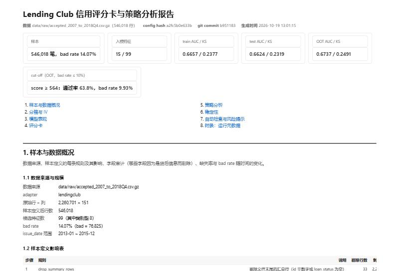

# credit-scorecard-pipeline（中文说明）

把"对一份数据做一次评分卡分析"变成"给任何一份带违约标签的贷款数据，自动跑完
样本定义 → 分箱 → 建模 → 评分卡 → 策略 → 监控 → 自动检查，并交出一份固定结构报告"的工具。
Python 包 + CLI + agent skill（`SKILL.md`）。



一行命令复现 Lending Club 报告（数据放 `data/raw/`，见 `data/README.md`）：

```bash
python -m scorecard run --config configs/lendingclub.yaml
```

```
原始数据 ──adapter──▶ 标准数据帧 ──engine──▶ 中间产物 ──report──▶ report.html / report.md
                      (target, issue_date,  │
                       特征, loan_amount,    ├─ profile.py   数据体检、bad rate 按季度
                       net_cash, event_date)├─ binning.py   toad / optbinning / tree → 单调 WOE、IV
                                            ├─ select.py    缺失率、IV、时间稳定性、相关性、系数符号、VIF
                                            ├─ model.py     WOE 逻辑回归 + HistGradientBoosting challenger
                                            ├─ scorecard.py PDO 换算、评分卡表
                                            ├─ strategy.py  约束下的 cut-off、利润曲线、swap set
                                            ├─ monitor.py   score PSI、特征 CSI、vintage
                                            └─ checks.py    自动检查（第 7 节）
SKILL.md ──▶ python -m scorecard run --config <yaml> [--dry-run]
```

引擎不认识任何数据集特定的列名，数据集知识只在 `scorecard/adapters/` 和 `configs/` 里；换数据集 = 一个 adapter + 一个 yaml。
自带三个 adapter：Lending Club（Kaggle 2007–2018Q4 accepted loans，226 万原始行、151 列）、UCI 信用卡违约数据（id 350，自动下载）和合成数据（测试与演示）。示例报告在 [`examples/`](examples/)。

## 快速开始

```bash
python -m venv .venv && .venv/Scripts/activate
pip install -e ".[dev,uci]" toad
pytest -q && ruff check .

python -m scorecard run --config configs/synthetic.yaml                  # 合成数据，约 10 秒
python -m scorecard run --config configs/uci.yaml                        # 自动下载 3 万行，约 20 秒
python -m scorecard run --config configs/lendingclub.yaml --dry-run      # 只打印样本定义影响表
python -m scorecard run --config configs/lendingclub.yaml                # 全量，解析已缓存时约 2 分钟
python -m scorecard run --config configs/lendingclub.yaml --sample-frac 0.1  # 随机 10% 试跑
```

输出在 `outputs/<dataset>/`：`report.html`（单文件自包含）、`report.md`、`figures/`，以及报告背后的全部表格（`scorecard.csv`、`scorecard_model.json`、`feature_selection.csv`、`model_metrics.csv`、`strategy_*.csv`、`monitor_*.csv`、`checks.csv`、`results.json`、`run_meta.json`）。

CLI 内置护栏（详见 `SKILL.md`）：不改原数据；建模前先打印样本定义影响表（`--dry-run` 到此为止）；样本 bad rate 不在 1–40% 时停下（退出码 2），除非显式传 `--allow-any-bad-rate`。

## Lending Club 结果

以下数字抄自 [`examples/lendingclub/report.md`](examples/lendingclub/report.md)；报告头部记录了产生这些数字的 config hash、数据文件、行数、git commit 和时间。评分卡按产品分卡（只用 2013-01 起放款的 36 期贷款），并跑"含 / 不含平台评级"两套。

| 项目 | 数值 |
|---|---|
| 原始贷款 → 最终样本 | 2,260,701 → 546,018（2013-01 … 2015-12 放款、已到期的 36 期贷款） |
| bad rate（Charged Off / Default vs Fully Paid） | 14.07% |
| 切分 | train 268,647 / test 115,135（2013-01 … 2015-06 分层随机 70/30）；OOT = 2015-07 … 2015-12 的 162,236 笔 |
| 候选特征 → 入模 | 99 → 15（缺失 > 50%：35 → IV < 0.02：40 → 时间稳定性 CSI > 0.25：0 → \|ρ\| > 0.7：8 → 系数符号：1） |
| LR 评分卡 AUC / KS — train | 0.6657 / 0.2377 |
| LR 评分卡 AUC / KS — test | 0.6624 / 0.2319 |
| LR 评分卡 AUC / KS — OOT | 0.6737 / 0.2491 |
| 5 折 CV AUC（每折重做分箱） | 0.6636 ± 0.0030 |
| GBDT challenger AUC — test / OOT | 0.6865 / 0.6968 |
| 含平台评级的第二套卡 AUC / KS — test / OOT | 0.6816 / 0.2614，0.6981 / 0.2884（sub_grade 以 IV 0.3378 入模） |
| 刻度 | PDO 20，600 分 ↔ 20:1 好坏比；分数范围 506–648 |
| 约束下的 cut-off（OOT，通过客群 bad rate ≤ 10%） | score ≥ 564 通过 63.8%，bad rate 9.93%（含平台评级：score ≥ 560，69.7%） |
| 通过率 70%（OOT） | score ≥ 561（实际 69.86%），通过客群 bad rate 10.58%（整体 14.71%） |
| 70% 通过率下与平台 grade 的 swap set（OOT） | swap-in 18.53% vs swap-out 19.25%：只用申请信息的卡比 grade 好 0.14 pp；含平台评级好 0.82 pp |
| score PSI train → test / train → OOT | 0.0002 / 0.0020；入模特征 CSI 全部 < 0.10（最高 percent_bc_gt_75 0.0250） |
| 自动检查 | 25 通过 / 0 警告 / 0 不通过 |
| 全量运行时间（两套模型，解析已缓存） | 2.1 min |

为什么从 2013 年开始：时间稳定性筛选（报告 2.3b）剔除 train 内最早与最晚 issue 年之间分箱分布差异大的特征。Lending Club 的主要征信字段（num_*、mo_sin_*、tot_*、bc_*）2012 年中才由征信局提供，从 2012-01 起建样时，筛选会把 15 个"刚开始有值"而非真正漂移的字段剔掉，只剩 6 个变量（test AUC 0.6473 / OOT 0.6508）；同一样本关掉筛选则是 15 个变量、0.6656 / 0.6743。把起点取在字段可得性稳定之后，筛选和变量都保住（15 个变量，test 0.6624 / OOT 0.6737，无一因时间不稳定被剔除，第 6 节也没有 CSI 报警）；取舍记在 `DECISIONS.md`（D26）。

### UCI 信用卡违约（第二个数据集）

抄自 [`examples/uci/report.md`](examples/uci/report.md)：30,000 名客户，bad rate 22.12%，32 个候选特征入模 17 个；LR AUC / KS train 0.7755 / 0.4176，test 0.7667 / 0.4212，hold-out 0.7641 / 0.4020（没有日期列，用分层 hold-out 代替 OOT）；bad rate ≤ 10% 时 test 上可通过 51.75%。自动检查 12 通过 / 1 警告 / 0 不通过——警告是 PAY_0 等 IV > 0.5 的人工核对项，adapter 已说明其合理性。

## 报告固定七节

1. 样本与数据概况 — 样本定义影响表、字段审计、缺失率 Top 20、bad rate 按季度、缺失率按年、切分
2. 分箱与 IV — IV 排名、筛选漏斗、因时间不稳定剔除的特征、单调性检查、Top 8 WOE 图、入模特征分箱表
3. 模型表现 — LR 系数（含 VIF）、train / test / OOT 的 AUC / KS / Gini、LR vs GBDT、5 折 CV、ROC / KS 图，两套模型并排
4. 评分卡 — PDO 换算、评分卡表、分数分布
5. 策略分析 — 等频分数段表、通过率–坏账率曲线、50–90% 通过率的候选 cut-off（含边际一档）、**约束下的最优 cut-off**（坏账率上限下通过率最高；目标通过率下的坏账率与净现金）作为主要结论、实际回款的利润曲线作参照、与平台 grade 的 swap set、两套模型同通过率对比
6. 稳定性 — score PSI（train → test / OOT）、每个入模特征的 CSI 及偏移最大的箱、按 issue 季度的 vintage 曲线
7. 自动检查与风险提示 — leakage IV、单箱占比、train–test KS 差、PSI / CSI、高缺失率入模、系数符号、VIF、swap set 合理性，以及 adapter 警告；每行写明检查了什么、阈值、结果、判定

某节的模块被关掉时会显示"（本阶段未实现）"占位而不是消失；七节现已全部实现。报告中文，术语英文（WOE、IV、KS、PSI、cut-off、swap set …）。

## 换一个数据集

1. 在 `scorecard/adapters/` 写一个 adapter：返回标准数据帧（`target` 0/1、特征列、可选的 `issue_date` / `event_date` / `loan_amount` / `net_cash`）和 `AdapterMeta`（样本定义日志、字段审计）。`generic.py` 已经覆盖任何带标签列的 CSV（`dataset.options.target_col`）；`uci.py` 是一个带下载、清洗和派生特征的 300 行示例。
2. 在 `configs/` 加一个 `extends: default.yaml` 的 yaml。
3. `python -m scorecard run --config configs/<name>.yaml --dry-run`，确认样本定义表后去掉 `--dry-run`。

## 仓库结构

```
scorecard/          包：cli.py、config.py、pipeline.py、adapters/（base、lendingclub、uci、generic、synthetic）、
                    binning.py、select.py、model.py、scorecard.py、strategy.py、monitor.py、checks.py、report.py、figures.py、templates/
configs/            default.yaml、lendingclub.yaml、uci.yaml、synthetic.yaml
examples/           已提交的报告与图（lendingclub、uci、synthetic）
tests/              只用合成数据（不读 data/raw）；CI 跑 ruff + pytest + 合成数据冒烟
SKILL.md            agent 入口：输入、步骤、输出、护栏
DECISIONS.md        决策记录（中文）        FAQ.md / FAQ_zh.md   面试问答（带实际数字）
```

## 进度

- Phase 1：流程跑通，报告 1–4 节，Lending Club adapter。
- Phase 2：策略层、监控层、第 7 节自动检查，含 / 不含平台评级两套模型。
- Phase 3（v1.0 / v1.0.1）：`SKILL.md` 与 CLI 护栏、UCI adapter、时间稳定性筛选、约束下的 cut-off、GitHub Actions CI；v1.0.1 把样本起点定为 2013-01。

License: MIT.
