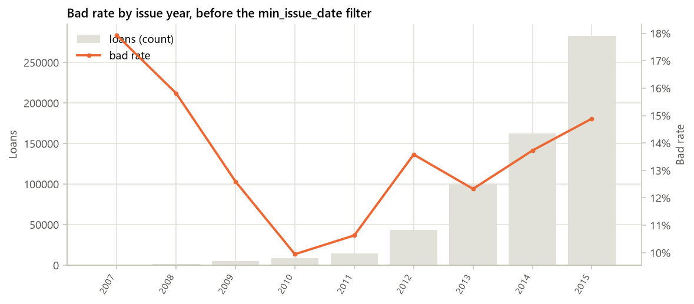
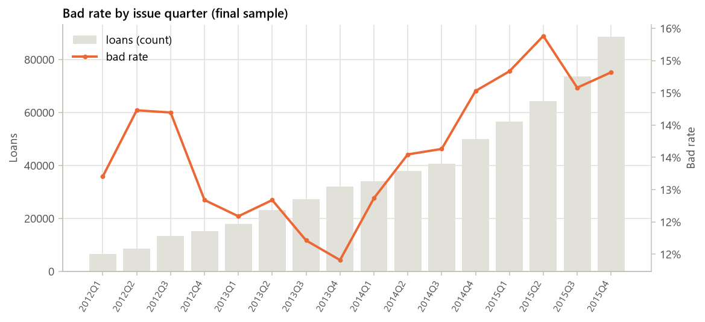
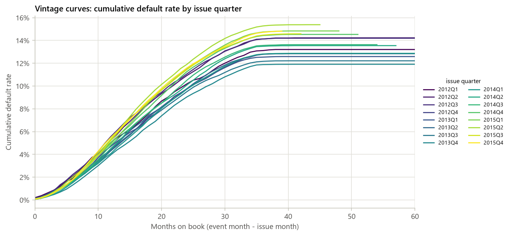

# Lending Club 信用评分卡与策略分析报告

- **数据**：data/raw/accepted_2007_to_2018Q4.csv.gz（589,488 行）
- **config hash**：5544daf1e437
- **git commit**：ab257db
- **生成时间**：2026-10-19 02:51:23

- **样本**：589,488 笔，bad rate 14.03%
- **入模特征**：6 / 99
- **train AUC / KS**：0.6429 / 0.2047
- **test AUC / KS**：0.6473 / 0.2134
- **OOT AUC / KS**：0.6508 / 0.2149
- **cut-off（OOT，bad rate ≤ 10%）**：score ≥ 567：通过率 56.2%，bad rate 9.95%

## 1. 样本与数据概况

_数据来源、样本定义的每条规则及其影响、字段审计（哪些字段因为是贷后信息而剔除）、缺失率与 bad rate 随时间的变化。_

### 1.1 数据来源与规模

- **数据来源**：data/raw/accepted_2007_to_2018Q4.csv.gz
- **adapter**：lendingclub
- **原始行 × 列**：2,260,701 × 151
- **样本定义后行数**：589,488
- **候选特征数**：99（其中类别型 8）
- **bad rate**：14.03%（bad = 82,728）
- **issue_date 范围**：2012-01 ~ 2015-12

### 1.2 样本定义影响表

| 步骤 | 规则 | 说明 | 剔除行数 | 剩余行数 | 剩余 bad rate |
|---|---|---|---|---|---|
| 1 | drop_summary_rows | 剔除文件末尾的汇总行（id 非数字或 loan_status 为空） | 33 | 2,260,668 | 19.96% |
| 2 | credit_policy | 剔除 loan_status 以 “Does not meet the credit policy” 开头的贷款（早期不同准入政策） | 2,749 | 2,257,919 | 19.96% |
| 3 | term_filter | 仅保留 36 期（按产品分卡：不同期限是不同产品，且长期限贷款在 OOT 窗口内无法到期；config terms_allowed） | 650,603 | 1,607,316 | 16.00% |
| 4 | maturity | 到期筛选：issue_d + term 个月 <= 数据截止月 2018-12（保证 performance window 完整） | 988,585 | 618,731 | 13.90% |
| 5 | terminal_status | 终态映射：Charged Off / Default → 1；Fully Paid → 0；Current / Late / In Grace Period 为 indeterminate，剔除 | 147 | 618,584 | 13.90% |
| 6 | min_issue_date | 只保留 issue_d >= 2012-01（2007–2011 量小且产品、客群与后期不同） | 29,096 | 589,488 | 14.03% |
| 7 | final_sample | 最终样本量与 bad rate | 0 | 589,488 | 14.03% |

_bad rate 按剩余行中已有终态（Charged Off / Default / Fully Paid）的贷款计算；终态映射之前的行里还包含 Current 等未终态贷款，不计入分母。_

### 1.3 min_issue_date 之前：bad rate 按 issue 年（到期 + 终态样本）

| issue 年 | 贷款数 | bad rate | 60 期占比 |
|---|---|---|---|
| 2007 | 251 | 17.93% | 0.00% |
| 2008 | 1,562 | 15.81% | 0.00% |
| 2009 | 4,716 | 12.60% | 0.00% |
| 2010 | 8,466 | 9.95% | 0.00% |
| 2011 | 14,101 | 10.63% | 0.00% |
| 2012 | 43,470 | 13.58% | 0.00% |
| 2013 | 100,422 | 12.33% | 0.00% |
| 2014 | 162,570 | 13.73% | 0.00% |
| 2015 | 283,026 | 14.89% | 0.00% |

_min_issue_date 规则只保留 issue_date >= 2012-01 的依据：早期年份样本少、产品结构（60 期占比）和 bad rate 与后期不同。_



_图 1.1 min_issue_date 过滤前的 bad rate 按 issue 年_

### 1.4 字段审计：按分组汇总

| 分组 | 字段数 | 处理 |
|---|---|---|
| A 目标来源 | 1 | 保留列（非特征） 1 |
| B 贷后回款 / 余额（泄漏，剔除） | 13 | 保留列（非特征） 7, 剔除 6 |
| C 贷后信用更新（泄漏，剔除） | 2 | 剔除 2 |
| D 困难 / 和解 / 还款计划（泄漏，剔除） | 23 | 剔除 23 |
| E 无信息 / 标识 / 自由文本（剔除） | 8 | 剔除 8 |
| F 投资人侧（剔除） | 1 | 剔除 1 |
| G 平台评级（use_platform_rating 开关） | 4 | 平台评级（开关） 4 |
| H 联合申请字段 | 16 | 入模候选 15, 派生后剔除原列 1 |
| I 申请时可得（候选特征） | 83 | 入模候选 78, 派生后剔除原列 4, 保留列（非特征） 1 |
| X adapter 派生变量 | 6 | 入模候选 6 |

### 字段审计清单（全部原始字段 + 派生变量）

| 字段 | 分组 | 处理 | 原因 |
|---|---|---|---|
| id | E 无信息 / 标识 / 自由文本（剔除） | 剔除 | 标识 / 自由文本 / 无信息 |
| member_id | E 无信息 / 标识 / 自由文本（剔除） | 剔除 | 标识 / 自由文本 / 无信息 |
| loan_amnt | I 申请时可得（候选特征） | 入模候选 | 申请时可得 |
| funded_amnt | I 申请时可得（候选特征） | 入模候选 | 申请时可得 |
| funded_amnt_inv | F 投资人侧（剔除） | 剔除 | 投资人侧 |
| term | I 申请时可得（候选特征） | 入模候选 | 申请时可得 |
| int_rate | G 平台评级（use_platform_rating 开关） | 平台评级（开关） | 平台评级，按 use_platform_rating 开关 |
| installment | G 平台评级（use_platform_rating 开关） | 平台评级（开关） | 平台评级，按 use_platform_rating 开关 |
| grade | G 平台评级（use_platform_rating 开关） | 平台评级（开关） | 平台评级，按 use_platform_rating 开关 |
| sub_grade | G 平台评级（use_platform_rating 开关） | 平台评级（开关） | 平台评级，按 use_platform_rating 开关 |
| emp_title | E 无信息 / 标识 / 自由文本（剔除） | 剔除 | 标识 / 自由文本 / 无信息 |
| emp_length | I 申请时可得（候选特征） | 派生后剔除原列 | → emp_length_years（'10+ years' → 10，'< 1 year' → 0，n/a → NaN） |
| home_ownership | I 申请时可得（候选特征） | 入模候选 | 申请时可得 |
| annual_inc | I 申请时可得（候选特征） | 入模候选 | 申请时可得 |
| verification_status | I 申请时可得（候选特征） | 入模候选 | 申请时可得 |
| issue_d | I 申请时可得（候选特征） | 保留列（非特征） | issue_date：时间切分 / OOT / vintage，不作为特征 |
| loan_status | A 目标来源 | 保留列（非特征） | → target（终态映射） |
| pymnt_plan | D 困难 / 和解 / 还款计划（泄漏，剔除） | 剔除 | 困难 / 和解 / 还款计划，贷后信息 |
| url | E 无信息 / 标识 / 自由文本（剔除） | 剔除 | 标识 / 自由文本 / 无信息 |
| desc | E 无信息 / 标识 / 自由文本（剔除） | 剔除 | 标识 / 自由文本 / 无信息 |
| purpose | I 申请时可得（候选特征） | 入模候选 | 申请时可得 |
| title | E 无信息 / 标识 / 自由文本（剔除） | 剔除 | 标识 / 自由文本 / 无信息 |
| zip_code | E 无信息 / 标识 / 自由文本（剔除） | 剔除 | 标识 / 自由文本 / 无信息 |
| addr_state | I 申请时可得（候选特征） | 入模候选 | 申请时可得 |
| dti | I 申请时可得（候选特征） | 入模候选 | 申请时可得 |
| delinq_2yrs | I 申请时可得（候选特征） | 入模候选 | 申请时可得 |
| earliest_cr_line | I 申请时可得（候选特征） | 派生后剔除原列 | → credit_hist_months = months(issue_d − earliest_cr_line) |
| fico_range_low | I 申请时可得（候选特征） | 派生后剔除原列 | → fico_mid = (fico_range_low + fico_range_high) / 2 |
| fico_range_high | I 申请时可得（候选特征） | 派生后剔除原列 | → fico_mid |
| inq_last_6mths | I 申请时可得（候选特征） | 入模候选 | 申请时可得 |
| mths_since_last_delinq | I 申请时可得（候选特征） | 入模候选 | 申请时可得 |
| mths_since_last_record | I 申请时可得（候选特征） | 入模候选 | 申请时可得 |
| open_acc | I 申请时可得（候选特征） | 入模候选 | 申请时可得 |
| pub_rec | I 申请时可得（候选特征） | 入模候选 | 申请时可得 |
| revol_bal | I 申请时可得（候选特征） | 入模候选 | 申请时可得 |
| revol_util | I 申请时可得（候选特征） | 入模候选 | 申请时可得 |
| total_acc | I 申请时可得（候选特征） | 入模候选 | 申请时可得 |
| initial_list_status | I 申请时可得（候选特征） | 入模候选 | 申请时可得 |
| out_prncp | B 贷后回款 / 余额（泄漏，剔除） | 剔除 | 贷后回款 / 余额，泄漏 |
| out_prncp_inv | B 贷后回款 / 余额（泄漏，剔除） | 剔除 | 贷后回款 / 余额，泄漏 |
| total_pymnt | B 贷后回款 / 余额（泄漏，剔除） | 保留列（非特征） | net_cash input (strategy layer only) |
| total_pymnt_inv | B 贷后回款 / 余额（泄漏，剔除） | 剔除 | 贷后回款 / 余额，泄漏 |
| total_rec_prncp | B 贷后回款 / 余额（泄漏，剔除） | 保留列（非特征） | net_cash consistency check only |
| total_rec_int | B 贷后回款 / 余额（泄漏，剔除） | 保留列（非特征） | net_cash consistency check only |
| total_rec_late_fee | B 贷后回款 / 余额（泄漏，剔除） | 保留列（非特征） | net_cash consistency check only |
| recoveries | B 贷后回款 / 余额（泄漏，剔除） | 保留列（非特征） | net_cash consistency check only |
| collection_recovery_fee | B 贷后回款 / 余额（泄漏，剔除） | 保留列（非特征） | net_cash input (strategy layer only) |
| last_pymnt_d | B 贷后回款 / 余额（泄漏，剔除） | 保留列（非特征） | event_date for vintage curves (monitor layer only) |
| last_pymnt_amnt | B 贷后回款 / 余额（泄漏，剔除） | 剔除 | 贷后回款 / 余额，泄漏 |
| next_pymnt_d | B 贷后回款 / 余额（泄漏，剔除） | 剔除 | 贷后回款 / 余额，泄漏 |
| last_credit_pull_d | B 贷后回款 / 余额（泄漏，剔除） | 剔除 | 贷后回款 / 余额，泄漏 |
| last_fico_range_high | C 贷后信用更新（泄漏，剔除） | 剔除 | 贷后信用更新，泄漏 |
| last_fico_range_low | C 贷后信用更新（泄漏，剔除） | 剔除 | 贷后信用更新，泄漏 |
| collections_12_mths_ex_med | I 申请时可得（候选特征） | 入模候选 | 申请时可得 |
| mths_since_last_major_derog | I 申请时可得（候选特征） | 入模候选 | 申请时可得 |
| policy_code | E 无信息 / 标识 / 自由文本（剔除） | 剔除 | 标识 / 自由文本 / 无信息 |
| application_type | I 申请时可得（候选特征） | 入模候选 | 申请时可得 |
| annual_inc_joint | H 联合申请字段 | 入模候选 | 联合申请字段，缺失 = 非联合申请 |
| dti_joint | H 联合申请字段 | 入模候选 | 联合申请字段，缺失 = 非联合申请 |
| verification_status_joint | H 联合申请字段 | 入模候选 | 联合申请字段，缺失 = 非联合申请 |
| acc_now_delinq | I 申请时可得（候选特征） | 入模候选 | 申请时可得 |
| tot_coll_amt | I 申请时可得（候选特征） | 入模候选 | 申请时可得 |
| tot_cur_bal | I 申请时可得（候选特征） | 入模候选 | 申请时可得 |
| open_acc_6m | I 申请时可得（候选特征） | 入模候选 | 申请时可得 |
| open_act_il | I 申请时可得（候选特征） | 入模候选 | 申请时可得 |
| open_il_12m | I 申请时可得（候选特征） | 入模候选 | 申请时可得 |
| open_il_24m | I 申请时可得（候选特征） | 入模候选 | 申请时可得 |
| mths_since_rcnt_il | I 申请时可得（候选特征） | 入模候选 | 申请时可得 |
| total_bal_il | I 申请时可得（候选特征） | 入模候选 | 申请时可得 |
| il_util | I 申请时可得（候选特征） | 入模候选 | 申请时可得 |
| open_rv_12m | I 申请时可得（候选特征） | 入模候选 | 申请时可得 |
| open_rv_24m | I 申请时可得（候选特征） | 入模候选 | 申请时可得 |
| max_bal_bc | I 申请时可得（候选特征） | 入模候选 | 申请时可得 |
| all_util | I 申请时可得（候选特征） | 入模候选 | 申请时可得 |
| total_rev_hi_lim | I 申请时可得（候选特征） | 入模候选 | 申请时可得 |
| inq_fi | I 申请时可得（候选特征） | 入模候选 | 申请时可得 |
| total_cu_tl | I 申请时可得（候选特征） | 入模候选 | 申请时可得 |
| inq_last_12m | I 申请时可得（候选特征） | 入模候选 | 申请时可得 |
| acc_open_past_24mths | I 申请时可得（候选特征） | 入模候选 | 申请时可得 |
| avg_cur_bal | I 申请时可得（候选特征） | 入模候选 | 申请时可得 |
| bc_open_to_buy | I 申请时可得（候选特征） | 入模候选 | 申请时可得 |
| bc_util | I 申请时可得（候选特征） | 入模候选 | 申请时可得 |
| chargeoff_within_12_mths | I 申请时可得（候选特征） | 入模候选 | 申请时可得 |
| delinq_amnt | I 申请时可得（候选特征） | 入模候选 | 申请时可得 |
| mo_sin_old_il_acct | I 申请时可得（候选特征） | 入模候选 | 申请时可得 |
| mo_sin_old_rev_tl_op | I 申请时可得（候选特征） | 入模候选 | 申请时可得 |
| mo_sin_rcnt_rev_tl_op | I 申请时可得（候选特征） | 入模候选 | 申请时可得 |
| mo_sin_rcnt_tl | I 申请时可得（候选特征） | 入模候选 | 申请时可得 |
| mort_acc | I 申请时可得（候选特征） | 入模候选 | 申请时可得 |
| mths_since_recent_bc | I 申请时可得（候选特征） | 入模候选 | 申请时可得 |
| mths_since_recent_bc_dlq | I 申请时可得（候选特征） | 入模候选 | 申请时可得 |
| mths_since_recent_inq | I 申请时可得（候选特征） | 入模候选 | 申请时可得 |
| mths_since_recent_revol_delinq | I 申请时可得（候选特征） | 入模候选 | 申请时可得 |
| num_accts_ever_120_pd | I 申请时可得（候选特征） | 入模候选 | 申请时可得 |
| num_actv_bc_tl | I 申请时可得（候选特征） | 入模候选 | 申请时可得 |
| num_actv_rev_tl | I 申请时可得（候选特征） | 入模候选 | 申请时可得 |
| num_bc_sats | I 申请时可得（候选特征） | 入模候选 | 申请时可得 |
| num_bc_tl | I 申请时可得（候选特征） | 入模候选 | 申请时可得 |
| num_il_tl | I 申请时可得（候选特征） | 入模候选 | 申请时可得 |
| num_op_rev_tl | I 申请时可得（候选特征） | 入模候选 | 申请时可得 |
| num_rev_accts | I 申请时可得（候选特征） | 入模候选 | 申请时可得 |
| num_rev_tl_bal_gt_0 | I 申请时可得（候选特征） | 入模候选 | 申请时可得 |
| num_sats | I 申请时可得（候选特征） | 入模候选 | 申请时可得 |
| num_tl_120dpd_2m | I 申请时可得（候选特征） | 入模候选 | 申请时可得 |
| num_tl_30dpd | I 申请时可得（候选特征） | 入模候选 | 申请时可得 |
| num_tl_90g_dpd_24m | I 申请时可得（候选特征） | 入模候选 | 申请时可得 |
| num_tl_op_past_12m | I 申请时可得（候选特征） | 入模候选 | 申请时可得 |
| pct_tl_nvr_dlq | I 申请时可得（候选特征） | 入模候选 | 申请时可得 |
| percent_bc_gt_75 | I 申请时可得（候选特征） | 入模候选 | 申请时可得 |
| pub_rec_bankruptcies | I 申请时可得（候选特征） | 入模候选 | 申请时可得 |
| tax_liens | I 申请时可得（候选特征） | 入模候选 | 申请时可得 |
| tot_hi_cred_lim | I 申请时可得（候选特征） | 入模候选 | 申请时可得 |
| total_bal_ex_mort | I 申请时可得（候选特征） | 入模候选 | 申请时可得 |
| total_bc_limit | I 申请时可得（候选特征） | 入模候选 | 申请时可得 |
| total_il_high_credit_limit | I 申请时可得（候选特征） | 入模候选 | 申请时可得 |
| revol_bal_joint | H 联合申请字段 | 入模候选 | 联合申请字段，缺失 = 非联合申请 |
| sec_app_fico_range_low | H 联合申请字段 | 入模候选 | 联合申请字段，缺失 = 非联合申请 |
| sec_app_fico_range_high | H 联合申请字段 | 入模候选 | 联合申请字段，缺失 = 非联合申请 |
| sec_app_earliest_cr_line | H 联合申请字段 | 派生后剔除原列 | → sec_app_credit_hist_months |
| sec_app_inq_last_6mths | H 联合申请字段 | 入模候选 | 联合申请字段，缺失 = 非联合申请 |
| sec_app_mort_acc | H 联合申请字段 | 入模候选 | 联合申请字段，缺失 = 非联合申请 |
| sec_app_open_acc | H 联合申请字段 | 入模候选 | 联合申请字段，缺失 = 非联合申请 |
| sec_app_revol_util | H 联合申请字段 | 入模候选 | 联合申请字段，缺失 = 非联合申请 |
| sec_app_open_act_il | H 联合申请字段 | 入模候选 | 联合申请字段，缺失 = 非联合申请 |
| sec_app_num_rev_accts | H 联合申请字段 | 入模候选 | 联合申请字段，缺失 = 非联合申请 |
| sec_app_chargeoff_within_12_mths | H 联合申请字段 | 入模候选 | 联合申请字段，缺失 = 非联合申请 |
| sec_app_collections_12_mths_ex_med | H 联合申请字段 | 入模候选 | 联合申请字段，缺失 = 非联合申请 |
| sec_app_mths_since_last_major_derog | H 联合申请字段 | 入模候选 | 联合申请字段，缺失 = 非联合申请 |
| hardship_flag | D 困难 / 和解 / 还款计划（泄漏，剔除） | 剔除 | 困难 / 和解 / 还款计划，贷后信息 |
| hardship_type | D 困难 / 和解 / 还款计划（泄漏，剔除） | 剔除 | 困难 / 和解 / 还款计划，贷后信息 |
| hardship_reason | D 困难 / 和解 / 还款计划（泄漏，剔除） | 剔除 | 困难 / 和解 / 还款计划，贷后信息 |
| hardship_status | D 困难 / 和解 / 还款计划（泄漏，剔除） | 剔除 | 困难 / 和解 / 还款计划，贷后信息 |
| deferral_term | D 困难 / 和解 / 还款计划（泄漏，剔除） | 剔除 | 困难 / 和解 / 还款计划，贷后信息 |
| hardship_amount | D 困难 / 和解 / 还款计划（泄漏，剔除） | 剔除 | 困难 / 和解 / 还款计划，贷后信息 |
| hardship_start_date | D 困难 / 和解 / 还款计划（泄漏，剔除） | 剔除 | 困难 / 和解 / 还款计划，贷后信息 |
| hardship_end_date | D 困难 / 和解 / 还款计划（泄漏，剔除） | 剔除 | 困难 / 和解 / 还款计划，贷后信息 |
| payment_plan_start_date | D 困难 / 和解 / 还款计划（泄漏，剔除） | 剔除 | 困难 / 和解 / 还款计划，贷后信息 |
| hardship_length | D 困难 / 和解 / 还款计划（泄漏，剔除） | 剔除 | 困难 / 和解 / 还款计划，贷后信息 |
| hardship_dpd | D 困难 / 和解 / 还款计划（泄漏，剔除） | 剔除 | 困难 / 和解 / 还款计划，贷后信息 |
| hardship_loan_status | D 困难 / 和解 / 还款计划（泄漏，剔除） | 剔除 | 困难 / 和解 / 还款计划，贷后信息 |
| orig_projected_additional_accrued_interest | D 困难 / 和解 / 还款计划（泄漏，剔除） | 剔除 | 困难 / 和解 / 还款计划，贷后信息 |
| hardship_payoff_balance_amount | D 困难 / 和解 / 还款计划（泄漏，剔除） | 剔除 | 困难 / 和解 / 还款计划，贷后信息 |
| hardship_last_payment_amount | D 困难 / 和解 / 还款计划（泄漏，剔除） | 剔除 | 困难 / 和解 / 还款计划，贷后信息 |
| disbursement_method | I 申请时可得（候选特征） | 入模候选 | 申请时可得 |
| debt_settlement_flag | D 困难 / 和解 / 还款计划（泄漏，剔除） | 剔除 | 困难 / 和解 / 还款计划，贷后信息 |
| debt_settlement_flag_date | D 困难 / 和解 / 还款计划（泄漏，剔除） | 剔除 | 困难 / 和解 / 还款计划，贷后信息 |
| settlement_status | D 困难 / 和解 / 还款计划（泄漏，剔除） | 剔除 | 困难 / 和解 / 还款计划，贷后信息 |
| settlement_date | D 困难 / 和解 / 还款计划（泄漏，剔除） | 剔除 | 困难 / 和解 / 还款计划，贷后信息 |
| settlement_amount | D 困难 / 和解 / 还款计划（泄漏，剔除） | 剔除 | 困难 / 和解 / 还款计划，贷后信息 |
| settlement_percentage | D 困难 / 和解 / 还款计划（泄漏，剔除） | 剔除 | 困难 / 和解 / 还款计划，贷后信息 |
| settlement_term | D 困难 / 和解 / 还款计划（泄漏，剔除） | 剔除 | 困难 / 和解 / 还款计划，贷后信息 |
| fico_mid | X adapter 派生变量 | 入模候选 | (fico_range_low + fico_range_high) / 2 |
| credit_hist_months | X adapter 派生变量 | 入模候选 | months(issue_d − earliest_cr_line) |
| emp_length_years | X adapter 派生变量 | 入模候选 | emp_length 解析为年数 |
| log_annual_inc | X adapter 派生变量 | 入模候选 | log1p(annual_inc) |
| loan_to_inc | X adapter 派生变量 | 入模候选 | loan_amnt / annual_inc（annual_inc = 0 → NaN） |
| sec_app_credit_hist_months | X adapter 派生变量 | 入模候选 | months(issue_d − sec_app_earliest_cr_line) |

### 1.5 缺失率 Top 20（候选特征，全样本）

| 特征 | 类型 | 缺失率 | 取值数 |
|---|---|---|---|
| sec_app_open_acc | numeric | 100.00% | 0 |
| sec_app_credit_hist_months | numeric | 100.00% | 0 |
| sec_app_mths_since_last_major_derog | numeric | 100.00% | 0 |
| sec_app_collections_12_mths_ex_med | numeric | 100.00% | 0 |
| sec_app_chargeoff_within_12_mths | numeric | 100.00% | 0 |
| sec_app_num_rev_accts | numeric | 100.00% | 0 |
| sec_app_fico_range_high | numeric | 100.00% | 0 |
| sec_app_revol_util | numeric | 100.00% | 0 |
| revol_bal_joint | numeric | 100.00% | 0 |
| sec_app_fico_range_low | numeric | 100.00% | 0 |
| sec_app_open_act_il | numeric | 100.00% | 0 |
| sec_app_mort_acc | numeric | 100.00% | 0 |
| sec_app_inq_last_6mths | numeric | 100.00% | 0 |
| dti_joint | numeric | 99.96% | 225 |
| annual_inc_joint | numeric | 99.96% | 183 |
| verification_status_joint | categorical | 99.96% | 1 |
| il_util | numeric | 97.83% | 155 |
| mths_since_rcnt_il | numeric | 97.55% | 193 |
| open_acc_6m | numeric | 97.48% | 13 |
| open_rv_24m | numeric | 97.48% | 28 |



_图 1.2 bad rate 按 issue 季度（最终样本）_

### 1.6 bad rate 按 issue 季度

| 季度 | 贷款数 | bad 数 | bad rate |
|---|---|---|---|
| 2012Q1 | 6,498 | 858 | 13.20% |
| 2012Q2 | 8,469 | 1,205 | 14.23% |
| 2012Q3 | 13,322 | 1,891 | 14.19% |
| 2012Q4 | 15,181 | 1,949 | 12.84% |
| 2013Q1 | 17,988 | 2,264 | 12.59% |
| 2013Q2 | 23,136 | 2,970 | 12.84% |
| 2013Q3 | 27,318 | 3,336 | 12.21% |
| 2013Q4 | 31,980 | 3,808 | 11.91% |
| 2014Q1 | 34,074 | 4,384 | 12.87% |
| 2014Q2 | 37,881 | 5,131 | 13.55% |
| 2014Q3 | 40,595 | 5,533 | 13.63% |
| 2014Q4 | 50,020 | 7,267 | 14.53% |
| 2015Q1 | 56,568 | 8,391 | 14.83% |
| 2015Q2 | 64,222 | 9,878 | 15.38% |
| 2015Q3 | 73,567 | 10,725 | 14.58% |
| 2015Q4 | 88,669 | 13,138 | 14.82% |

### 1.7 缺失率按 issue 年（总缺失率 > 5% 的特征）

| 特征 | 总缺失率 | 2012 | 2013 | 2014 | 2015 |
|---|---|---|---|---|---|
| sec_app_mths_since_last_major_derog | 100.0% | 100.0% | 100.0% | 100.0% | 100.0% |
| sec_app_num_rev_accts | 100.0% | 100.0% | 100.0% | 100.0% | 100.0% |
| sec_app_chargeoff_within_12_mths | 100.0% | 100.0% | 100.0% | 100.0% | 100.0% |
| sec_app_credit_hist_months | 100.0% | 100.0% | 100.0% | 100.0% | 100.0% |
| sec_app_open_acc | 100.0% | 100.0% | 100.0% | 100.0% | 100.0% |
| sec_app_open_act_il | 100.0% | 100.0% | 100.0% | 100.0% | 100.0% |
| sec_app_revol_util | 100.0% | 100.0% | 100.0% | 100.0% | 100.0% |
| sec_app_fico_range_high | 100.0% | 100.0% | 100.0% | 100.0% | 100.0% |
| sec_app_inq_last_6mths | 100.0% | 100.0% | 100.0% | 100.0% | 100.0% |
| revol_bal_joint | 100.0% | 100.0% | 100.0% | 100.0% | 100.0% |
| sec_app_mort_acc | 100.0% | 100.0% | 100.0% | 100.0% | 100.0% |
| sec_app_fico_range_low | 100.0% | 100.0% | 100.0% | 100.0% | 100.0% |
| sec_app_collections_12_mths_ex_med | 100.0% | 100.0% | 100.0% | 100.0% | 100.0% |
| dti_joint | 100.0% | 100.0% | 100.0% | 100.0% | 99.9% |
| annual_inc_joint | 100.0% | 100.0% | 100.0% | 100.0% | 99.9% |
| verification_status_joint | 100.0% | 100.0% | 100.0% | 100.0% | 99.9% |
| il_util | 97.8% | 100.0% | 100.0% | 100.0% | 95.5% |
| mths_since_rcnt_il | 97.6% | 100.0% | 100.0% | 100.0% | 94.9% |
| open_acc_6m | 97.5% | 100.0% | 100.0% | 100.0% | 94.7% |
| open_rv_24m | 97.5% | 100.0% | 100.0% | 100.0% | 94.7% |
| open_rv_12m | 97.5% | 100.0% | 100.0% | 100.0% | 94.7% |
| total_bal_il | 97.5% | 100.0% | 100.0% | 100.0% | 94.7% |
| open_il_12m | 97.5% | 100.0% | 100.0% | 100.0% | 94.7% |
| open_act_il | 97.5% | 100.0% | 100.0% | 100.0% | 94.7% |
| open_il_24m | 97.5% | 100.0% | 100.0% | 100.0% | 94.7% |
| all_util | 97.5% | 100.0% | 100.0% | 100.0% | 94.7% |
| inq_last_12m | 97.5% | 100.0% | 100.0% | 100.0% | 94.7% |
| total_cu_tl | 97.5% | 100.0% | 100.0% | 100.0% | 94.7% |
| inq_fi | 97.5% | 100.0% | 100.0% | 100.0% | 94.7% |
| max_bal_bc | 97.5% | 100.0% | 100.0% | 100.0% | 94.7% |
| mths_since_last_record | 83.5% | 97.3% | 87.4% | 81.1% | 81.3% |
| mths_since_recent_bc_dlq | 75.3% | 87.4% | 77.6% | 73.1% | 73.8% |
| mths_since_last_major_derog | 73.2% | 89.8% | 79.5% | 70.7% | 69.8% |
| mths_since_recent_revol_delinq | 65.3% | 73.8% | 69.8% | 63.5% | 63.5% |
| mths_since_last_delinq | 50.5% | 59.1% | 56.5% | 48.9% | 48.0% |
| mths_since_recent_inq | 11.7% | 25.1% | 11.2% | 9.5% | 11.0% |
| mo_sin_old_il_acct | 7.4% | 54.3% | 4.3% | 3.6% | 3.5% |
| num_tl_120dpd_2m | 7.4% | 51.9% | 0.2% | 4.0% | 5.0% |
| emp_length_years | 6.0% | 4.0% | 5.0% | 5.9% | 6.7% |

_征信类字段（num_* / mo_sin_* / il / rv 等）在早期年份缺失率极高；select 步骤按 max_missing 阈值处理。_

### 1.8 样本切分

| 样本 | 行数 | 占比 | bad rate | issue 起 | issue 止 |
|---|---|---|---|---|---|
| train | 299,076 | 50.73% | 13.78% | 2012-01 | 2015-06 |
| test | 128,176 | 21.74% | 13.78% | 2012-01 | 2015-06 |
| oot | 162,236 | 27.52% | 14.71% | 2015-07 | 2015-12 |

_按 issue_date 切 OOT（最后 6 个月：2015-07 ~ 2015-12），其余按 target 分层随机切 train / test；train_ratio = 0.7，random_state = 42。分箱、WOE、特征选择与模型只在 train 上拟合。_

### 1.9 adapter 说明

- net_cash 一致性检验（Charged Off 样本 82,728 笔）：total_pymnt 与 total_rec_prncp + total_rec_int + total_rec_late_fee + recoveries 相差 < 1 的占 100.00%（最大绝对差 0.01）；不含 recoveries 时占 23.85%（最大绝对差 34,294）→ total_pymnt 已包含 recoveries。
- net_cash = total_pymnt - collection_recovery_fee - funded_amnt（实际回款减放款本金；仅策略层使用）
- 占比 < 1% 的类别并入 OTHER_RARE（按全样本频率计算，不使用标签）：purpose: moving, vacation, house, wedding, renewable_energy, educational；home_ownership: OTHER, NONE, ANY；addr_state: KY, OK, KS, AR, UT, NM, HI, NH, WV, RI, MS, MT, DC, DE, AK, WY, SD, VT, NE, ME, ND, ID, IA
- 终态映射时剔除的 indeterminate 状态：Current 72，Late (31-120 days) 61，In Grace Period 9，Late (16-30 days) 5

## 2. 分箱与 IV

_在 train 上做单调 WOE 分箱并计算 IV；按缺失率、IV、相关性和系数符号筛选入模特征。_

### [不含平台评级] 2.1 分箱设置

- **分箱后端**：toad（4 个特征库未给出切点，退到 tree：collections_12_mths_ex_med, chargeoff_within_12_mths, delinq_amnt, tax_liens）
- **method / min_samples / max_bins**：chi / 0.05 / 6
- **单调性约束**：是（不单调则合并相邻箱直至单调或退到 2 箱）
- **切点搜索样本量**：200,000（WOE / IV 在全部 train 上计算；筛选阈值也在 train 上评估）
- **WOE 定义**：WOE = ln(good 占比 / bad 占比)，越大越安全；缺失单独一箱
- **候选特征 → 入模特征**：99 → 6

![[不含平台评级] 图 2.1 IV 排名（前 30；绿色 = 入模）](figures/03_iv_ranking_no_platform_rating.png)

_[不含平台评级] 图 2.1 IV 排名（前 30；绿色 = 入模）_

### [不含平台评级] 2.2 IV 排名表（全部候选特征，按 IV 降序）

| 特征 | 类型 | IV | 缺失率（train） | 箱数 | 入模 | 剔除步骤 | 原因 |
|---|---|---|---|---|---|---|---|
| fico_mid | numeric | 0.1307 | 0.00% | 6 | 是 |  | selected |
| log_annual_inc | numeric | 0.0739 | 0.00% | 6 | 是 |  | selected |
| annual_inc | numeric | 0.0739 | 0.00% | 6 | 否 | 3_corr | \|corr\| = 1.00 with log_annual_inc (IV 0.074) |
| total_bc_limit | numeric | 0.0697 | 1.41% | 7 | 否 | 2b_time_csi | time CSI 1.030 > 0.25 (2012 vs 2015, bin Missing: 13.8% -> 0.0%) |
| tot_hi_cred_lim | numeric | 0.0692 | 5.25% | 7 | 否 | 2b_time_csi | time CSI 4.800 > 0.25 (2012 vs 2015, bin Missing: 51.6% -> 0.0%) |
| acc_open_past_24mths | numeric | 0.0676 | 1.41% | 7 | 否 | 2b_time_csi | time CSI 1.076 > 0.25 (2012 vs 2015, bin Missing: 13.8% -> 0.0%) |
| avg_cur_bal | numeric | 0.0666 | 5.25% | 7 | 否 | 2b_time_csi | time CSI 4.796 > 0.25 (2012 vs 2015, bin Missing: 51.6% -> 0.0%) |
| bc_open_to_buy | numeric | 0.0657 | 2.41% | 4 | 否 | 2b_time_csi | time CSI 0.400 > 0.25 (2012 vs 2015, bin Missing: 14.9% -> 1.0%) |
| tot_cur_bal | numeric | 0.0581 | 5.25% | 7 | 否 | 2b_time_csi | time CSI 4.796 > 0.25 (2012 vs 2015, bin Missing: 51.6% -> 0.0%) |
| num_tl_op_past_12m | numeric | 0.0540 | 5.25% | 6 | 否 | 2b_time_csi | time CSI 4.824 > 0.25 (2012 vs 2015, bin Missing: 51.6% -> 0.0%) |
| total_rev_hi_lim | numeric | 0.0518 | 5.25% | 7 | 否 | 2b_time_csi | time CSI 4.804 > 0.25 (2012 vs 2015, bin Missing: 51.6% -> 0.0%) |
| dti | numeric | 0.0481 | 0.00% | 4 | 是 |  | selected |
| mort_acc | numeric | 0.0432 | 1.41% | 5 | 否 | 2b_time_csi | time CSI 1.035 > 0.25 (2012 vs 2015, bin Missing: 13.8% -> 0.0%) |
| home_ownership | categorical | 0.0410 | 0.00% | 3 | 是 |  | selected |
| mo_sin_rcnt_tl | numeric | 0.0396 | 5.25% | 7 | 否 | 2b_time_csi | time CSI 4.805 > 0.25 (2012 vs 2015, bin Missing: 51.6% -> 0.0%) |
| loan_to_inc | numeric | 0.0378 | 0.00% | 4 | 是 |  | selected |
| mo_sin_rcnt_rev_tl_op | numeric | 0.0369 | 5.25% | 7 | 否 | 2b_time_csi | time CSI 4.799 > 0.25 (2012 vs 2015, bin Missing: 51.6% -> 0.0%) |
| mths_since_recent_inq | numeric | 0.0352 | 11.80% | 7 | 是 |  | selected |
| mths_since_recent_bc | numeric | 0.0332 | 2.32% | 7 | 否 | 2b_time_csi | time CSI 0.400 > 0.25 (2012 vs 2015, bin Missing: 14.7% -> 1.0%) |
| percent_bc_gt_75 | numeric | 0.0322 | 2.45% | 6 | 否 | 2b_time_csi | time CSI 0.414 > 0.25 (2012 vs 2015, bin Missing: 14.9% -> 1.1%) |
| inq_last_6mths | numeric | 0.0319 | 0.00% | 4 | 否 | 3_corr | \|corr\| = 0.72 with mths_since_recent_inq (IV 0.035) |
| mo_sin_old_rev_tl_op | numeric | 0.0292 | 5.25% | 5 | 否 | 2b_time_csi | time CSI 4.811 > 0.25 (2012 vs 2015, bin Missing: 51.6% -> 0.0%) |
| bc_util | numeric | 0.0269 | 2.48% | 5 | 否 | 2b_time_csi | time CSI 0.405 > 0.25 (2012 vs 2015, bin Missing: 14.9% -> 1.1%) |
| purpose | categorical | 0.0194 | 0.00% | 3 | 否 | 2_iv | IV 0.0194 < 0.02 |
| num_actv_rev_tl | numeric | 0.0186 | 5.25% | 5 | 否 | 2_iv | IV 0.0186 < 0.02 |
| revol_bal | numeric | 0.0185 | 0.00% | 6 | 否 | 2_iv | IV 0.0185 < 0.02 |
| num_rev_tl_bal_gt_0 | numeric | 0.0184 | 5.25% | 5 | 否 | 2_iv | IV 0.0184 < 0.02 |
| credit_hist_months | numeric | 0.0181 | 0.00% | 5 | 否 | 2_iv | IV 0.0181 < 0.02 |
| emp_length_years | numeric | 0.0173 | 5.61% | 4 | 否 | 2_iv | IV 0.0173 < 0.02 |
| revol_util | numeric | 0.0172 | 0.05% | 5 | 否 | 2_iv | IV 0.0172 < 0.02 |
| mo_sin_old_il_acct | numeric | 0.0152 | 8.95% | 4 | 否 | 2_iv | IV 0.0152 < 0.02 |
| verification_status | categorical | 0.0138 | 0.00% | 3 | 否 | 2_iv | IV 0.0138 < 0.02 |
| addr_state | categorical | 0.0111 | 0.00% | 4 | 否 | 2_iv | IV 0.0111 < 0.02 |
| total_acc | numeric | 0.0067 | 0.00% | 6 | 否 | 2_iv | IV 0.0067 < 0.02 |
| total_bal_ex_mort | numeric | 0.0067 | 1.41% | 5 | 否 | 2_iv | IV 0.0067 < 0.02 |
| loan_amnt | numeric | 0.0053 | 0.00% | 2 | 否 | 2_iv | IV 0.0053 < 0.02 |
| funded_amnt | numeric | 0.0053 | 0.00% | 2 | 否 | 2_iv | IV 0.0053 < 0.02 |
| mths_since_last_record | numeric | 0.0050 | 84.25% | 3 | 否 | 1_missing | missing rate 84.3% > 50% |
| num_bc_tl | numeric | 0.0049 | 5.25% | 6 | 否 | 2_iv | IV 0.0049 < 0.02 |
| total_il_high_credit_limit | numeric | 0.0043 | 5.25% | 4 | 否 | 2_iv | IV 0.0043 < 0.02 |
| initial_list_status | categorical | 0.0043 | 0.00% | 2 | 否 | 2_iv | IV 0.0043 < 0.02 |
| num_op_rev_tl | numeric | 0.0043 | 5.25% | 7 | 否 | 2_iv | IV 0.0043 < 0.02 |
| pub_rec | numeric | 0.0042 | 0.00% | 2 | 否 | 2_iv | IV 0.0042 < 0.02 |
| num_actv_bc_tl | numeric | 0.0041 | 5.25% | 5 | 否 | 2_iv | IV 0.0041 < 0.02 |
| mths_since_last_major_derog | numeric | 0.0040 | 74.57% | 3 | 否 | 1_missing | missing rate 74.6% > 50% |
| pub_rec_bankruptcies | numeric | 0.0033 | 0.00% | 2 | 否 | 2_iv | IV 0.0033 < 0.02 |
| num_il_tl | numeric | 0.0027 | 5.25% | 3 | 否 | 2_iv | IV 0.0027 < 0.02 |
| num_accts_ever_120_pd | numeric | 0.0027 | 5.25% | 3 | 否 | 2_iv | IV 0.0027 < 0.02 |
| tot_coll_amt | numeric | 0.0025 | 5.25% | 3 | 否 | 2_iv | IV 0.0025 < 0.02 |
| delinq_2yrs | numeric | 0.0019 | 0.00% | 3 | 否 | 2_iv | IV 0.0019 < 0.02 |
| mths_since_last_delinq | numeric | 0.0016 | 51.46% | 3 | 否 | 1_missing | missing rate 51.5% > 50% |
| pct_tl_nvr_dlq | numeric | 0.0013 | 5.28% | 3 | 否 | 2_iv | IV 0.0013 < 0.02 |
| num_rev_accts | numeric | 0.0012 | 5.25% | 3 | 否 | 2_iv | IV 0.0012 < 0.02 |
| num_tl_120dpd_2m | numeric | 0.0012 | 7.81% | 2 | 否 | 2_iv | IV 0.0012 < 0.02 |
| num_tl_90g_dpd_24m | numeric | 0.0010 | 5.25% | 3 | 否 | 2_iv | IV 0.0010 < 0.02 |
| mths_since_recent_revol_delinq | numeric | 0.0009 | 65.92% | 3 | 否 | 1_missing | missing rate 65.9% > 50% |
| mths_since_recent_bc_dlq | numeric | 0.0008 | 75.69% | 3 | 否 | 1_missing | missing rate 75.7% > 50% |
| num_bc_sats | numeric | 0.0008 | 3.03% | 3 | 否 | 2_iv | IV 0.0008 < 0.02 |
| num_sats | numeric | 0.0007 | 3.03% | 3 | 否 | 2_iv | IV 0.0007 < 0.02 |
| open_acc | numeric | 0.0006 | 0.00% | 2 | 否 | 2_iv | IV 0.0006 < 0.02 |
| num_tl_30dpd | numeric | 0.0001 | 5.25% | 2 | 否 | 2_iv | IV 0.0001 < 0.02 |
| collections_12_mths_ex_med | numeric | 0.0000 | 0.00% | 1 | 否 | 2_iv | IV 0.0000 < 0.02 |
| verification_status_joint | categorical | 0.0000 | 100.00% | 1 | 否 | 1_missing | missing rate 100.0% > 50% |
| application_type | categorical | 0.0000 | 0.00% | 1 | 否 | 2_iv | IV 0.0000 < 0.02 |
| term | numeric | 0.0000 | 0.00% | 1 | 否 | 2_iv | IV 0.0000 < 0.02 |
| dti_joint | numeric | 0.0000 | 100.00% | 2 | 否 | 1_missing | missing rate 100.0% > 50% |
| annual_inc_joint | numeric | 0.0000 | 100.00% | 2 | 否 | 1_missing | missing rate 100.0% > 50% |
| il_util | numeric | 0.0000 | 100.00% | 2 | 否 | 1_missing | missing rate 100.0% > 50% |
| total_bal_il | numeric | 0.0000 | 100.00% | 2 | 否 | 1_missing | missing rate 100.0% > 50% |
| mths_since_rcnt_il | numeric | 0.0000 | 100.00% | 2 | 否 | 1_missing | missing rate 100.0% > 50% |
| open_il_24m | numeric | 0.0000 | 100.00% | 2 | 否 | 1_missing | missing rate 100.0% > 50% |
| open_il_12m | numeric | 0.0000 | 100.00% | 2 | 否 | 1_missing | missing rate 100.0% > 50% |
| open_act_il | numeric | 0.0000 | 100.00% | 2 | 否 | 1_missing | missing rate 100.0% > 50% |
| open_acc_6m | numeric | 0.0000 | 100.00% | 2 | 否 | 1_missing | missing rate 100.0% > 50% |
| acc_now_delinq | numeric | 0.0000 | 0.00% | 1 | 否 | 2_iv | IV 0.0000 < 0.02 |
| chargeoff_within_12_mths | numeric | 0.0000 | 0.00% | 1 | 否 | 2_iv | IV 0.0000 < 0.02 |
| total_cu_tl | numeric | 0.0000 | 100.00% | 2 | 否 | 1_missing | missing rate 100.0% > 50% |
| inq_fi | numeric | 0.0000 | 100.00% | 2 | 否 | 1_missing | missing rate 100.0% > 50% |
| all_util | numeric | 0.0000 | 100.00% | 2 | 否 | 1_missing | missing rate 100.0% > 50% |
| open_rv_24m | numeric | 0.0000 | 100.00% | 2 | 否 | 1_missing | missing rate 100.0% > 50% |
| max_bal_bc | numeric | 0.0000 | 100.00% | 2 | 否 | 1_missing | missing rate 100.0% > 50% |
| delinq_amnt | numeric | 0.0000 | 0.00% | 1 | 否 | 2_iv | IV 0.0000 < 0.02 |
| open_rv_12m | numeric | 0.0000 | 100.00% | 2 | 否 | 1_missing | missing rate 100.0% > 50% |
| inq_last_12m | numeric | 0.0000 | 100.00% | 2 | 否 | 1_missing | missing rate 100.0% > 50% |
| sec_app_fico_range_low | numeric | 0.0000 | 100.00% | 2 | 否 | 1_missing | missing rate 100.0% > 50% |
| revol_bal_joint | numeric | 0.0000 | 100.00% | 2 | 否 | 1_missing | missing rate 100.0% > 50% |
| tax_liens | numeric | 0.0000 | 0.00% | 1 | 否 | 2_iv | IV 0.0000 < 0.02 |
| sec_app_fico_range_high | numeric | 0.0000 | 100.00% | 2 | 否 | 1_missing | missing rate 100.0% > 50% |
| sec_app_inq_last_6mths | numeric | 0.0000 | 100.00% | 2 | 否 | 1_missing | missing rate 100.0% > 50% |
| sec_app_open_acc | numeric | 0.0000 | 100.00% | 2 | 否 | 1_missing | missing rate 100.0% > 50% |
| sec_app_mort_acc | numeric | 0.0000 | 100.00% | 2 | 否 | 1_missing | missing rate 100.0% > 50% |
| sec_app_collections_12_mths_ex_med | numeric | 0.0000 | 100.00% | 2 | 否 | 1_missing | missing rate 100.0% > 50% |
| sec_app_chargeoff_within_12_mths | numeric | 0.0000 | 100.00% | 2 | 否 | 1_missing | missing rate 100.0% > 50% |
| sec_app_num_rev_accts | numeric | 0.0000 | 100.00% | 2 | 否 | 1_missing | missing rate 100.0% > 50% |
| sec_app_open_act_il | numeric | 0.0000 | 100.00% | 2 | 否 | 1_missing | missing rate 100.0% > 50% |
| sec_app_revol_util | numeric | 0.0000 | 100.00% | 2 | 否 | 1_missing | missing rate 100.0% > 50% |
| disbursement_method | categorical | 0.0000 | 0.00% | 1 | 否 | 2_iv | IV 0.0000 < 0.02 |
| sec_app_mths_since_last_major_derog | numeric | 0.0000 | 100.00% | 2 | 否 | 1_missing | missing rate 100.0% > 50% |
| sec_app_credit_hist_months | numeric | 0.0000 | 100.00% | 2 | 否 | 1_missing | missing rate 100.0% > 50% |

### [不含平台评级] 2.3 特征筛选漏斗

| 步骤 | 剔除 | 剩余 |
|---|---|---|
| 候选特征 |  | 99 |
| 缺失率 > 50% | 35 | 64 |
| IV < 0.02 | 41 | 23 |
| 时间稳定性 CSI > 0.25（train 内 2012 vs 2015） | 15 | 8 |
| \|corr\| > 0.7（保留 IV 高者） | 2 | 6 |
| LR 系数为正（WOE 方向反转） | 0 | 6 |

### [不含平台评级] 2.3b 因时间不稳定剔除的特征（train 内 2012 vs 2015，CSI > 0.25）

| 特征 | IV | time CSI | 偏移最大的箱 | 2012 占比 | 2015 占比 |
|---|---|---|---|---|---|
| num_tl_op_past_12m | 0.0540 | 4.8236 | Missing | 51.65% | 0.00% |
| mo_sin_old_rev_tl_op | 0.0292 | 4.8115 | Missing | 51.65% | 0.00% |
| mo_sin_rcnt_tl | 0.0396 | 4.8047 | Missing | 51.65% | 0.00% |
| total_rev_hi_lim | 0.0518 | 4.8045 | Missing | 51.65% | 0.00% |
| tot_hi_cred_lim | 0.0692 | 4.8002 | Missing | 51.65% | 0.00% |
| mo_sin_rcnt_rev_tl_op | 0.0369 | 4.7987 | Missing | 51.65% | 0.00% |
| avg_cur_bal | 0.0666 | 4.7959 | Missing | 51.65% | 0.00% |
| tot_cur_bal | 0.0581 | 4.7959 | Missing | 51.65% | 0.00% |
| acc_open_past_24mths | 0.0676 | 1.0765 | Missing | 13.83% | 0.00% |
| mort_acc | 0.0432 | 1.0351 | Missing | 13.83% | 0.00% |
| total_bc_limit | 0.0697 | 1.0299 | Missing | 13.83% | 0.00% |
| percent_bc_gt_75 | 0.0322 | 0.4137 | Missing | 14.88% | 1.07% |
| bc_util | 0.0269 | 0.4050 | Missing | 14.94% | 1.10% |
| bc_open_to_buy | 0.0657 | 0.4005 | Missing | 14.88% | 1.03% |
| mths_since_recent_bc | 0.0332 | 0.4003 | Missing | 14.74% | 0.98% |

_在 train 内部就已随时间漂移的特征（多数是某年起才有值的字段）不进评分卡，这样第 6 节的 CSI 只反映 OOT 上的真实漂移。_

### [不含平台评级] 时间稳定性 CSI（通过缺失率与 IV 筛选的全部候选特征）

| 特征 | IV | time CSI | 偏移最大的箱 | 2012 占比 | 2015 占比 |
|---|---|---|---|---|---|
| num_tl_op_past_12m | 0.0540 | 4.8236 | Missing | 51.65% | 0.00% |
| mo_sin_old_rev_tl_op | 0.0292 | 4.8115 | Missing | 51.65% | 0.00% |
| mo_sin_rcnt_tl | 0.0396 | 4.8047 | Missing | 51.65% | 0.00% |
| total_rev_hi_lim | 0.0518 | 4.8045 | Missing | 51.65% | 0.00% |
| tot_hi_cred_lim | 0.0692 | 4.8002 | Missing | 51.65% | 0.00% |
| mo_sin_rcnt_rev_tl_op | 0.0369 | 4.7987 | Missing | 51.65% | 0.00% |
| avg_cur_bal | 0.0666 | 4.7959 | Missing | 51.65% | 0.00% |
| tot_cur_bal | 0.0581 | 4.7959 | Missing | 51.65% | 0.00% |
| acc_open_past_24mths | 0.0676 | 1.0765 | Missing | 13.83% | 0.00% |
| mort_acc | 0.0432 | 1.0351 | Missing | 13.83% | 0.00% |
| total_bc_limit | 0.0697 | 1.0299 | Missing | 13.83% | 0.00% |
| percent_bc_gt_75 | 0.0322 | 0.4137 | Missing | 14.88% | 1.07% |
| bc_util | 0.0269 | 0.4050 | Missing | 14.94% | 1.10% |
| bc_open_to_buy | 0.0657 | 0.4005 | Missing | 14.88% | 1.03% |
| mths_since_recent_bc | 0.0332 | 0.4003 | Missing | 14.74% | 0.98% |
| mths_since_recent_inq | 0.0352 | 0.1574 | Missing | 25.25% | 10.57% |
| fico_mid | 0.1307 | 0.1065 | <= 672 | 18.31% | 30.48% |
| dti | 0.0481 | 0.0651 | > 25.12 | 13.66% | 23.25% |
| inq_last_6mths | 0.0319 | 0.0608 | <= 0 | 50.56% | 59.95% |
| log_annual_inc | 0.0739 | 0.0139 | > 11.4 | 19.72% | 24.10% |
| annual_inc | 0.0739 | 0.0139 | > 89,500 | 19.72% | 24.10% |
| home_ownership | 0.0410 | 0.0106 | {RENT} | 47.85% | 44.31% |
| loan_to_inc | 0.0378 | 0.0003 | <= 0.1636 | 43.24% | 42.68% |

### [不含平台评级] 2.4 单调性检查（入模特征）

| 特征 | 类型 | 切点来源 | 初始箱数 | 初始单调 | 最终箱数（含缺失箱） | 最终单调 | 最大箱占比 |
|---|---|---|---|---|---|---|---|
| fico_mid | numeric | toad | 6 | 是 | 6 | 是 | 27.73% |
| log_annual_inc | numeric | toad | 6 | 是 | 6 | 是 | 23.52% |
| dti | numeric | toad | 4 | 是 | 4 | 是 | 38.04% |
| home_ownership | categorical | unique_values | 3 | 是 | 3 | 是 | 46.72% |
| loan_to_inc | numeric | toad | 4 | 是 | 4 | 是 | 42.54% |
| mths_since_recent_inq | numeric | toad | 6 | 是 | 7 | 是 | 21.19% |

_类别型特征按 train bad rate 排序后再分箱，因此天然单调。数值型不单调时合并相邻箱，直到 bad rate 单调或只剩 2 箱。切点来源 unique_values = 取值数不超过 max_bins、逐值成箱。_

![[不含平台评级] 图 2.2 fico_mid 的 WOE（IV 第 1 名）](figures/04_woe_no_platform_rating_01_fico_mid.png)

_[不含平台评级] 图 2.2 fico_mid 的 WOE（IV 第 1 名）_

![[不含平台评级] 图 2.3 log_annual_inc 的 WOE（IV 第 2 名）](figures/04_woe_no_platform_rating_02_log_annual_inc.png)

_[不含平台评级] 图 2.3 log_annual_inc 的 WOE（IV 第 2 名）_

![[不含平台评级] 图 2.4 dti 的 WOE（IV 第 3 名）](figures/04_woe_no_platform_rating_03_dti.png)

_[不含平台评级] 图 2.4 dti 的 WOE（IV 第 3 名）_

![[不含平台评级] 图 2.5 home_ownership 的 WOE（IV 第 4 名）](figures/04_woe_no_platform_rating_04_home_ownership.png)

_[不含平台评级] 图 2.5 home_ownership 的 WOE（IV 第 4 名）_

![[不含平台评级] 图 2.6 loan_to_inc 的 WOE（IV 第 5 名）](figures/04_woe_no_platform_rating_05_loan_to_inc.png)

_[不含平台评级] 图 2.6 loan_to_inc 的 WOE（IV 第 5 名）_

![[不含平台评级] 图 2.7 mths_since_recent_inq 的 WOE（IV 第 6 名）](figures/04_woe_no_platform_rating_06_mths_since_recent_inq.png)

_[不含平台评级] 图 2.7 mths_since_recent_inq 的 WOE（IV 第 6 名）_

### [不含平台评级] 分箱表：fico_mid（IV = 0.1307）

| 分箱 | 人数 | 占比 | bad 数 | bad rate | WOE |
|---|---|---|---|---|---|
| <= 672 | 82,929 | 27.73% | 15,166 | 18.29% | -0.3369 |
| (672, 687] | 70,010 | 23.41% | 11,002 | 15.71% | -0.1543 |
| (687, 702] | 54,744 | 18.30% | 7,217 | 13.18% | 0.0510 |
| (702, 717] | 37,599 | 12.57% | 3,969 | 10.56% | 0.3030 |
| (717, 737] | 27,069 | 9.05% | 2,287 | 8.45% | 0.5490 |
| > 737 | 26,725 | 8.94% | 1,564 | 5.85% | 0.9441 |

### [不含平台评级] 分箱表：log_annual_inc（IV = 0.0739）

| 分箱 | 人数 | 占比 | bad 数 | bad rate | WOE |
|---|---|---|---|---|---|
| <= 10.46 | 44,746 | 14.96% | 8,702 | 19.45% | -0.4127 |
| (10.46, 10.71] | 43,577 | 14.57% | 7,142 | 16.39% | -0.2044 |
| (10.71, 11.03] | 68,735 | 22.98% | 9,862 | 14.35% | -0.0472 |
| (11.03, 11.23] | 43,194 | 14.44% | 5,424 | 12.56% | 0.1068 |
| (11.23, 11.4] | 28,496 | 9.53% | 3,223 | 11.31% | 0.2255 |
| > 11.4 | 70,328 | 23.52% | 6,852 | 9.74% | 0.3922 |

### [不含平台评级] 分箱表：dti（IV = 0.0481）

| 分箱 | 人数 | 占比 | bad 数 | bad rate | WOE |
|---|---|---|---|---|---|
| <= 11.85 | 80,504 | 26.92% | 8,717 | 10.83% | 0.2745 |
| (11.85, 20.5] | 113,769 | 38.04% | 14,649 | 12.88% | 0.0781 |
| (20.5, 25.12] | 47,939 | 16.03% | 7,453 | 15.55% | -0.1416 |
| > 25.12 | 56,864 | 19.01% | 10,386 | 18.26% | -0.3354 |

### [不含平台评级] 分箱表：home_ownership（IV = 0.0410）

| 分箱 | 人数 | 占比 | bad 数 | bad rate | WOE |
|---|---|---|---|---|---|
| {MORTGAGE} | 139,728 | 46.72% | 15,744 | 11.27% | 0.2298 |
| {OTHER_RARE, OWN} | 29,500 | 9.86% | 4,343 | 14.72% | -0.0773 |
| {RENT} | 129,848 | 43.42% | 21,118 | 16.26% | -0.1952 |

### [不含平台评级] 分箱表：loan_to_inc（IV = 0.0378）

| 分箱 | 人数 | 占比 | bad 数 | bad rate | WOE |
|---|---|---|---|---|---|
| <= 0.1636 | 127,214 | 42.54% | 14,887 | 11.70% | 0.1870 |
| (0.1636, 0.2333] | 70,735 | 23.65% | 9,419 | 13.32% | 0.0394 |
| (0.2333, 0.3163] | 55,026 | 18.40% | 8,412 | 15.29% | -0.1217 |
| > 0.3163 | 46,101 | 15.41% | 8,487 | 18.41% | -0.3451 |

### [不含平台评级] 分箱表：mths_since_recent_inq（IV = 0.0352）

| 分箱 | 人数 | 占比 | bad 数 | bad rate | WOE |
|---|---|---|---|---|---|
| <= 1 | 52,057 | 17.41% | 8,999 | 17.29% | -0.2685 |
| (1, 4] | 63,366 | 21.19% | 9,627 | 15.19% | -0.1143 |
| (4, 6] | 32,881 | 10.99% | 4,638 | 14.11% | -0.0273 |
| (6, 10] | 50,099 | 16.75% | 6,569 | 13.11% | 0.0572 |
| (10, 18] | 49,581 | 16.58% | 5,982 | 12.07% | 0.1524 |
| > 18 | 15,807 | 5.29% | 1,736 | 10.98% | 0.2586 |
| Missing | 35,285 | 11.80% | 3,654 | 10.36% | 0.3244 |

### [含平台评级] 2.1 分箱设置

- **分箱后端**：toad（4 个特征库未给出切点，退到 tree：collections_12_mths_ex_med, chargeoff_within_12_mths, delinq_amnt, tax_liens）
- **method / min_samples / max_bins**：chi / 0.05 / 6
- **单调性约束**：是（不单调则合并相邻箱直至单调或退到 2 箱）
- **切点搜索样本量**：200,000（WOE / IV 在全部 train 上计算；筛选阈值也在 train 上评估）
- **WOE 定义**：WOE = ln(good 占比 / bad 占比)，越大越安全；缺失单独一箱
- **候选特征 → 入模特征**：103 → 7

![[含平台评级] 图 2.1 IV 排名（前 30；绿色 = 入模）](figures/03_iv_ranking_with_platform_rating.png)

_[含平台评级] 图 2.1 IV 排名（前 30；绿色 = 入模）_

### [含平台评级] 2.2 IV 排名表（全部候选特征，按 IV 降序）

| 特征 | 类型 | IV | 缺失率（train） | 箱数 | 入模 | 剔除步骤 | 原因 |
|---|---|---|---|---|---|---|---|
| sub_grade | categorical | 0.3154 | 0.00% | 6 | 是 |  | selected |
| int_rate | numeric | 0.2988 | 0.00% | 6 | 否 | 3_corr | \|corr\| = 0.96 with sub_grade (IV 0.315) |
| grade | categorical | 0.2925 | 0.00% | 4 | 否 | 3_corr | \|corr\| = 0.93 with sub_grade (IV 0.315) |
| fico_mid | numeric | 0.1307 | 0.00% | 6 | 是 |  | selected |
| log_annual_inc | numeric | 0.0739 | 0.00% | 6 | 否 | 3_corr | \|corr\| = 1.00 with annual_inc (IV 0.074) |
| annual_inc | numeric | 0.0739 | 0.00% | 6 | 是 |  | selected |
| total_bc_limit | numeric | 0.0697 | 1.41% | 7 | 否 | 2b_time_csi | time CSI 1.030 > 0.25 (2012 vs 2015, bin Missing: 13.8% -> 0.0%) |
| tot_hi_cred_lim | numeric | 0.0692 | 5.25% | 7 | 否 | 2b_time_csi | time CSI 4.800 > 0.25 (2012 vs 2015, bin Missing: 51.6% -> 0.0%) |
| acc_open_past_24mths | numeric | 0.0676 | 1.41% | 7 | 否 | 2b_time_csi | time CSI 1.076 > 0.25 (2012 vs 2015, bin Missing: 13.8% -> 0.0%) |
| avg_cur_bal | numeric | 0.0666 | 5.25% | 7 | 否 | 2b_time_csi | time CSI 4.796 > 0.25 (2012 vs 2015, bin Missing: 51.6% -> 0.0%) |
| bc_open_to_buy | numeric | 0.0657 | 2.41% | 4 | 否 | 2b_time_csi | time CSI 0.400 > 0.25 (2012 vs 2015, bin Missing: 14.9% -> 1.0%) |
| tot_cur_bal | numeric | 0.0581 | 5.25% | 7 | 否 | 2b_time_csi | time CSI 4.796 > 0.25 (2012 vs 2015, bin Missing: 51.6% -> 0.0%) |
| num_tl_op_past_12m | numeric | 0.0540 | 5.25% | 6 | 否 | 2b_time_csi | time CSI 4.824 > 0.25 (2012 vs 2015, bin Missing: 51.6% -> 0.0%) |
| total_rev_hi_lim | numeric | 0.0518 | 5.25% | 7 | 否 | 2b_time_csi | time CSI 4.804 > 0.25 (2012 vs 2015, bin Missing: 51.6% -> 0.0%) |
| dti | numeric | 0.0481 | 0.00% | 4 | 是 |  | selected |
| mort_acc | numeric | 0.0432 | 1.41% | 5 | 否 | 2b_time_csi | time CSI 1.035 > 0.25 (2012 vs 2015, bin Missing: 13.8% -> 0.0%) |
| home_ownership | categorical | 0.0410 | 0.00% | 3 | 是 |  | selected |
| mo_sin_rcnt_tl | numeric | 0.0396 | 5.25% | 7 | 否 | 2b_time_csi | time CSI 4.805 > 0.25 (2012 vs 2015, bin Missing: 51.6% -> 0.0%) |
| loan_to_inc | numeric | 0.0378 | 0.00% | 4 | 是 |  | selected |
| mo_sin_rcnt_rev_tl_op | numeric | 0.0369 | 5.25% | 7 | 否 | 2b_time_csi | time CSI 4.799 > 0.25 (2012 vs 2015, bin Missing: 51.6% -> 0.0%) |
| mths_since_recent_inq | numeric | 0.0352 | 11.80% | 7 | 是 |  | selected |
| mths_since_recent_bc | numeric | 0.0332 | 2.32% | 7 | 否 | 2b_time_csi | time CSI 0.400 > 0.25 (2012 vs 2015, bin Missing: 14.7% -> 1.0%) |
| percent_bc_gt_75 | numeric | 0.0322 | 2.45% | 6 | 否 | 2b_time_csi | time CSI 0.414 > 0.25 (2012 vs 2015, bin Missing: 14.9% -> 1.1%) |
| inq_last_6mths | numeric | 0.0319 | 0.00% | 4 | 否 | 3_corr | \|corr\| = 0.72 with mths_since_recent_inq (IV 0.035) |
| mo_sin_old_rev_tl_op | numeric | 0.0292 | 5.25% | 5 | 否 | 2b_time_csi | time CSI 4.811 > 0.25 (2012 vs 2015, bin Missing: 51.6% -> 0.0%) |
| bc_util | numeric | 0.0269 | 2.48% | 5 | 否 | 2b_time_csi | time CSI 0.405 > 0.25 (2012 vs 2015, bin Missing: 14.9% -> 1.1%) |
| purpose | categorical | 0.0194 | 0.00% | 3 | 否 | 2_iv | IV 0.0194 < 0.02 |
| num_actv_rev_tl | numeric | 0.0186 | 5.25% | 5 | 否 | 2_iv | IV 0.0186 < 0.02 |
| revol_bal | numeric | 0.0185 | 0.00% | 6 | 否 | 2_iv | IV 0.0185 < 0.02 |
| num_rev_tl_bal_gt_0 | numeric | 0.0184 | 5.25% | 5 | 否 | 2_iv | IV 0.0184 < 0.02 |
| credit_hist_months | numeric | 0.0181 | 0.00% | 5 | 否 | 2_iv | IV 0.0181 < 0.02 |
| emp_length_years | numeric | 0.0173 | 5.61% | 4 | 否 | 2_iv | IV 0.0173 < 0.02 |
| revol_util | numeric | 0.0172 | 0.05% | 5 | 否 | 2_iv | IV 0.0172 < 0.02 |
| mo_sin_old_il_acct | numeric | 0.0152 | 8.95% | 4 | 否 | 2_iv | IV 0.0152 < 0.02 |
| verification_status | categorical | 0.0138 | 0.00% | 3 | 否 | 2_iv | IV 0.0138 < 0.02 |
| addr_state | categorical | 0.0111 | 0.00% | 4 | 否 | 2_iv | IV 0.0111 < 0.02 |
| total_acc | numeric | 0.0067 | 0.00% | 6 | 否 | 2_iv | IV 0.0067 < 0.02 |
| total_bal_ex_mort | numeric | 0.0067 | 1.41% | 5 | 否 | 2_iv | IV 0.0067 < 0.02 |
| loan_amnt | numeric | 0.0053 | 0.00% | 2 | 否 | 2_iv | IV 0.0053 < 0.02 |
| funded_amnt | numeric | 0.0053 | 0.00% | 2 | 否 | 2_iv | IV 0.0053 < 0.02 |
| mths_since_last_record | numeric | 0.0050 | 84.25% | 3 | 否 | 1_missing | missing rate 84.3% > 50% |
| num_bc_tl | numeric | 0.0049 | 5.25% | 6 | 否 | 2_iv | IV 0.0049 < 0.02 |
| total_il_high_credit_limit | numeric | 0.0043 | 5.25% | 4 | 否 | 2_iv | IV 0.0043 < 0.02 |
| initial_list_status | categorical | 0.0043 | 0.00% | 2 | 否 | 2_iv | IV 0.0043 < 0.02 |
| num_op_rev_tl | numeric | 0.0043 | 5.25% | 7 | 否 | 2_iv | IV 0.0043 < 0.02 |
| pub_rec | numeric | 0.0042 | 0.00% | 2 | 否 | 2_iv | IV 0.0042 < 0.02 |
| num_actv_bc_tl | numeric | 0.0041 | 5.25% | 5 | 否 | 2_iv | IV 0.0041 < 0.02 |
| mths_since_last_major_derog | numeric | 0.0040 | 74.57% | 3 | 否 | 1_missing | missing rate 74.6% > 50% |
| pub_rec_bankruptcies | numeric | 0.0033 | 0.00% | 2 | 否 | 2_iv | IV 0.0033 < 0.02 |
| num_il_tl | numeric | 0.0027 | 5.25% | 3 | 否 | 2_iv | IV 0.0027 < 0.02 |
| num_accts_ever_120_pd | numeric | 0.0027 | 5.25% | 3 | 否 | 2_iv | IV 0.0027 < 0.02 |
| tot_coll_amt | numeric | 0.0025 | 5.25% | 3 | 否 | 2_iv | IV 0.0025 < 0.02 |
| delinq_2yrs | numeric | 0.0019 | 0.00% | 3 | 否 | 2_iv | IV 0.0019 < 0.02 |
| mths_since_last_delinq | numeric | 0.0016 | 51.46% | 3 | 否 | 1_missing | missing rate 51.5% > 50% |
| pct_tl_nvr_dlq | numeric | 0.0013 | 5.28% | 3 | 否 | 2_iv | IV 0.0013 < 0.02 |
| installment | numeric | 0.0013 | 0.00% | 2 | 否 | 2_iv | IV 0.0013 < 0.02 |
| num_rev_accts | numeric | 0.0012 | 5.25% | 3 | 否 | 2_iv | IV 0.0012 < 0.02 |
| num_tl_120dpd_2m | numeric | 0.0012 | 7.81% | 2 | 否 | 2_iv | IV 0.0012 < 0.02 |
| num_tl_90g_dpd_24m | numeric | 0.0010 | 5.25% | 3 | 否 | 2_iv | IV 0.0010 < 0.02 |
| mths_since_recent_revol_delinq | numeric | 0.0009 | 65.92% | 3 | 否 | 1_missing | missing rate 65.9% > 50% |
| mths_since_recent_bc_dlq | numeric | 0.0008 | 75.69% | 3 | 否 | 1_missing | missing rate 75.7% > 50% |
| num_bc_sats | numeric | 0.0008 | 3.03% | 3 | 否 | 2_iv | IV 0.0008 < 0.02 |
| num_sats | numeric | 0.0007 | 3.03% | 3 | 否 | 2_iv | IV 0.0007 < 0.02 |
| open_acc | numeric | 0.0006 | 0.00% | 2 | 否 | 2_iv | IV 0.0006 < 0.02 |
| num_tl_30dpd | numeric | 0.0001 | 5.25% | 2 | 否 | 2_iv | IV 0.0001 < 0.02 |
| collections_12_mths_ex_med | numeric | 0.0000 | 0.00% | 1 | 否 | 2_iv | IV 0.0000 < 0.02 |
| term | numeric | 0.0000 | 0.00% | 1 | 否 | 2_iv | IV 0.0000 < 0.02 |
| dti_joint | numeric | 0.0000 | 100.00% | 2 | 否 | 1_missing | missing rate 100.0% > 50% |
| verification_status_joint | categorical | 0.0000 | 100.00% | 1 | 否 | 1_missing | missing rate 100.0% > 50% |
| application_type | categorical | 0.0000 | 0.00% | 1 | 否 | 2_iv | IV 0.0000 < 0.02 |
| annual_inc_joint | numeric | 0.0000 | 100.00% | 2 | 否 | 1_missing | missing rate 100.0% > 50% |
| all_util | numeric | 0.0000 | 100.00% | 2 | 否 | 1_missing | missing rate 100.0% > 50% |
| max_bal_bc | numeric | 0.0000 | 100.00% | 2 | 否 | 1_missing | missing rate 100.0% > 50% |
| open_rv_24m | numeric | 0.0000 | 100.00% | 2 | 否 | 1_missing | missing rate 100.0% > 50% |
| open_rv_12m | numeric | 0.0000 | 100.00% | 2 | 否 | 1_missing | missing rate 100.0% > 50% |
| il_util | numeric | 0.0000 | 100.00% | 2 | 否 | 1_missing | missing rate 100.0% > 50% |
| total_bal_il | numeric | 0.0000 | 100.00% | 2 | 否 | 1_missing | missing rate 100.0% > 50% |
| mths_since_rcnt_il | numeric | 0.0000 | 100.00% | 2 | 否 | 1_missing | missing rate 100.0% > 50% |
| open_il_24m | numeric | 0.0000 | 100.00% | 2 | 否 | 1_missing | missing rate 100.0% > 50% |
| open_il_12m | numeric | 0.0000 | 100.00% | 2 | 否 | 1_missing | missing rate 100.0% > 50% |
| open_act_il | numeric | 0.0000 | 100.00% | 2 | 否 | 1_missing | missing rate 100.0% > 50% |
| open_acc_6m | numeric | 0.0000 | 100.00% | 2 | 否 | 1_missing | missing rate 100.0% > 50% |
| acc_now_delinq | numeric | 0.0000 | 0.00% | 1 | 否 | 2_iv | IV 0.0000 < 0.02 |
| delinq_amnt | numeric | 0.0000 | 0.00% | 1 | 否 | 2_iv | IV 0.0000 < 0.02 |
| inq_fi | numeric | 0.0000 | 100.00% | 2 | 否 | 1_missing | missing rate 100.0% > 50% |
| chargeoff_within_12_mths | numeric | 0.0000 | 0.00% | 1 | 否 | 2_iv | IV 0.0000 < 0.02 |
| inq_last_12m | numeric | 0.0000 | 100.00% | 2 | 否 | 1_missing | missing rate 100.0% > 50% |
| total_cu_tl | numeric | 0.0000 | 100.00% | 2 | 否 | 1_missing | missing rate 100.0% > 50% |
| sec_app_open_acc | numeric | 0.0000 | 100.00% | 2 | 否 | 1_missing | missing rate 100.0% > 50% |
| sec_app_mort_acc | numeric | 0.0000 | 100.00% | 2 | 否 | 1_missing | missing rate 100.0% > 50% |
| sec_app_inq_last_6mths | numeric | 0.0000 | 100.00% | 2 | 否 | 1_missing | missing rate 100.0% > 50% |
| sec_app_fico_range_high | numeric | 0.0000 | 100.00% | 2 | 否 | 1_missing | missing rate 100.0% > 50% |
| sec_app_fico_range_low | numeric | 0.0000 | 100.00% | 2 | 否 | 1_missing | missing rate 100.0% > 50% |
| revol_bal_joint | numeric | 0.0000 | 100.00% | 2 | 否 | 1_missing | missing rate 100.0% > 50% |
| tax_liens | numeric | 0.0000 | 0.00% | 1 | 否 | 2_iv | IV 0.0000 < 0.02 |
| sec_app_revol_util | numeric | 0.0000 | 100.00% | 2 | 否 | 1_missing | missing rate 100.0% > 50% |
| disbursement_method | categorical | 0.0000 | 0.00% | 1 | 否 | 2_iv | IV 0.0000 < 0.02 |
| sec_app_mths_since_last_major_derog | numeric | 0.0000 | 100.00% | 2 | 否 | 1_missing | missing rate 100.0% > 50% |
| sec_app_collections_12_mths_ex_med | numeric | 0.0000 | 100.00% | 2 | 否 | 1_missing | missing rate 100.0% > 50% |
| sec_app_num_rev_accts | numeric | 0.0000 | 100.00% | 2 | 否 | 1_missing | missing rate 100.0% > 50% |
| sec_app_open_act_il | numeric | 0.0000 | 100.00% | 2 | 否 | 1_missing | missing rate 100.0% > 50% |
| sec_app_chargeoff_within_12_mths | numeric | 0.0000 | 100.00% | 2 | 否 | 1_missing | missing rate 100.0% > 50% |
| sec_app_credit_hist_months | numeric | 0.0000 | 100.00% | 2 | 否 | 1_missing | missing rate 100.0% > 50% |

### [含平台评级] 2.3 特征筛选漏斗

| 步骤 | 剔除 | 剩余 |
|---|---|---|
| 候选特征 |  | 103 |
| 缺失率 > 50% | 35 | 68 |
| IV < 0.02 | 42 | 26 |
| 时间稳定性 CSI > 0.25（train 内 2012 vs 2015） | 15 | 11 |
| \|corr\| > 0.7（保留 IV 高者） | 4 | 7 |
| LR 系数为正（WOE 方向反转） | 0 | 7 |

### [含平台评级] 2.3b 因时间不稳定剔除的特征（train 内 2012 vs 2015，CSI > 0.25）

| 特征 | IV | time CSI | 偏移最大的箱 | 2012 占比 | 2015 占比 |
|---|---|---|---|---|---|
| num_tl_op_past_12m | 0.0540 | 4.8236 | Missing | 51.65% | 0.00% |
| mo_sin_old_rev_tl_op | 0.0292 | 4.8115 | Missing | 51.65% | 0.00% |
| mo_sin_rcnt_tl | 0.0396 | 4.8047 | Missing | 51.65% | 0.00% |
| total_rev_hi_lim | 0.0518 | 4.8045 | Missing | 51.65% | 0.00% |
| tot_hi_cred_lim | 0.0692 | 4.8002 | Missing | 51.65% | 0.00% |
| mo_sin_rcnt_rev_tl_op | 0.0369 | 4.7987 | Missing | 51.65% | 0.00% |
| avg_cur_bal | 0.0666 | 4.7959 | Missing | 51.65% | 0.00% |
| tot_cur_bal | 0.0581 | 4.7959 | Missing | 51.65% | 0.00% |
| acc_open_past_24mths | 0.0676 | 1.0765 | Missing | 13.83% | 0.00% |
| mort_acc | 0.0432 | 1.0351 | Missing | 13.83% | 0.00% |
| total_bc_limit | 0.0697 | 1.0299 | Missing | 13.83% | 0.00% |
| percent_bc_gt_75 | 0.0322 | 0.4137 | Missing | 14.88% | 1.07% |
| bc_util | 0.0269 | 0.4050 | Missing | 14.94% | 1.10% |
| bc_open_to_buy | 0.0657 | 0.4005 | Missing | 14.88% | 1.03% |
| mths_since_recent_bc | 0.0332 | 0.4003 | Missing | 14.74% | 0.98% |

_在 train 内部就已随时间漂移的特征（多数是某年起才有值的字段）不进评分卡，这样第 6 节的 CSI 只反映 OOT 上的真实漂移。_

### [含平台评级] 时间稳定性 CSI（通过缺失率与 IV 筛选的全部候选特征）

| 特征 | IV | time CSI | 偏移最大的箱 | 2012 占比 | 2015 占比 |
|---|---|---|---|---|---|
| num_tl_op_past_12m | 0.0540 | 4.8236 | Missing | 51.65% | 0.00% |
| mo_sin_old_rev_tl_op | 0.0292 | 4.8115 | Missing | 51.65% | 0.00% |
| mo_sin_rcnt_tl | 0.0396 | 4.8047 | Missing | 51.65% | 0.00% |
| total_rev_hi_lim | 0.0518 | 4.8045 | Missing | 51.65% | 0.00% |
| tot_hi_cred_lim | 0.0692 | 4.8002 | Missing | 51.65% | 0.00% |
| mo_sin_rcnt_rev_tl_op | 0.0369 | 4.7987 | Missing | 51.65% | 0.00% |
| avg_cur_bal | 0.0666 | 4.7959 | Missing | 51.65% | 0.00% |
| tot_cur_bal | 0.0581 | 4.7959 | Missing | 51.65% | 0.00% |
| acc_open_past_24mths | 0.0676 | 1.0765 | Missing | 13.83% | 0.00% |
| mort_acc | 0.0432 | 1.0351 | Missing | 13.83% | 0.00% |
| total_bc_limit | 0.0697 | 1.0299 | Missing | 13.83% | 0.00% |
| percent_bc_gt_75 | 0.0322 | 0.4137 | Missing | 14.88% | 1.07% |
| bc_util | 0.0269 | 0.4050 | Missing | 14.94% | 1.10% |
| bc_open_to_buy | 0.0657 | 0.4005 | Missing | 14.88% | 1.03% |
| mths_since_recent_bc | 0.0332 | 0.4003 | Missing | 14.74% | 0.98% |
| mths_since_recent_inq | 0.0352 | 0.1574 | Missing | 25.25% | 10.57% |
| fico_mid | 0.1307 | 0.1065 | <= 672 | 18.31% | 30.48% |
| int_rate | 0.2988 | 0.0823 | (7.69, 9.71] | 13.15% | 18.89% |
| dti | 0.0481 | 0.0651 | > 25.12 | 13.66% | 23.25% |
| sub_grade | 0.3154 | 0.0626 | {B3, B4} | 19.14% | 11.80% |
| inq_last_6mths | 0.0319 | 0.0608 | <= 0 | 50.56% | 59.95% |
| grade | 0.2925 | 0.0432 | {B} | 38.60% | 29.56% |
| annual_inc | 0.0739 | 0.0139 | > 89,500 | 19.72% | 24.10% |
| log_annual_inc | 0.0739 | 0.0139 | > 11.4 | 19.72% | 24.10% |
| home_ownership | 0.0410 | 0.0106 | {RENT} | 47.85% | 44.31% |
| loan_to_inc | 0.0378 | 0.0003 | <= 0.1636 | 43.24% | 42.68% |

### [含平台评级] 2.4 单调性检查（入模特征）

| 特征 | 类型 | 切点来源 | 初始箱数 | 初始单调 | 最终箱数（含缺失箱） | 最终单调 | 最大箱占比 |
|---|---|---|---|---|---|---|---|
| sub_grade | categorical | toad | 6 | 是 | 6 | 是 | 24.14% |
| fico_mid | numeric | toad | 6 | 是 | 6 | 是 | 27.73% |
| annual_inc | numeric | toad | 6 | 是 | 6 | 是 | 23.52% |
| dti | numeric | toad | 4 | 是 | 4 | 是 | 38.04% |
| home_ownership | categorical | unique_values | 3 | 是 | 3 | 是 | 46.72% |
| loan_to_inc | numeric | toad | 4 | 是 | 4 | 是 | 42.54% |
| mths_since_recent_inq | numeric | toad | 6 | 是 | 7 | 是 | 21.19% |

_类别型特征按 train bad rate 排序后再分箱，因此天然单调。数值型不单调时合并相邻箱，直到 bad rate 单调或只剩 2 箱。切点来源 unique_values = 取值数不超过 max_bins、逐值成箱。_

![[含平台评级] 图 2.2 sub_grade 的 WOE（IV 第 1 名）](figures/04_woe_with_platform_rating_01_sub_grade.png)

_[含平台评级] 图 2.2 sub_grade 的 WOE（IV 第 1 名）_

![[含平台评级] 图 2.3 fico_mid 的 WOE（IV 第 2 名）](figures/04_woe_with_platform_rating_02_fico_mid.png)

_[含平台评级] 图 2.3 fico_mid 的 WOE（IV 第 2 名）_

![[含平台评级] 图 2.4 annual_inc 的 WOE（IV 第 3 名）](figures/04_woe_with_platform_rating_03_annual_inc.png)

_[含平台评级] 图 2.4 annual_inc 的 WOE（IV 第 3 名）_

![[含平台评级] 图 2.5 dti 的 WOE（IV 第 4 名）](figures/04_woe_with_platform_rating_04_dti.png)

_[含平台评级] 图 2.5 dti 的 WOE（IV 第 4 名）_

![[含平台评级] 图 2.6 home_ownership 的 WOE（IV 第 5 名）](figures/04_woe_with_platform_rating_05_home_ownership.png)

_[含平台评级] 图 2.6 home_ownership 的 WOE（IV 第 5 名）_

![[含平台评级] 图 2.7 loan_to_inc 的 WOE（IV 第 6 名）](figures/04_woe_with_platform_rating_06_loan_to_inc.png)

_[含平台评级] 图 2.7 loan_to_inc 的 WOE（IV 第 6 名）_

![[含平台评级] 图 2.8 mths_since_recent_inq 的 WOE（IV 第 7 名）](figures/04_woe_with_platform_rating_07_mths_since_recent_inq.png)

_[含平台评级] 图 2.8 mths_since_recent_inq 的 WOE（IV 第 7 名）_

### [含平台评级] 分箱表：sub_grade（IV = 0.3154）

| 分箱 | 人数 | 占比 | bad 数 | bad rate | WOE |
|---|---|---|---|---|---|
| {A1, A2, A3, A4} | 46,633 | 15.59% | 2,207 | 4.73% | 1.1683 |
| {A5, B1, B2} | 57,473 | 19.22% | 4,989 | 8.68% | 0.5194 |
| {B3, B4} | 44,484 | 14.87% | 5,109 | 11.49% | 0.2082 |
| {B5, C1, C2, C3} | 72,183 | 24.14% | 11,252 | 15.59% | -0.1447 |
| {C4, C5, D1, D3, D2} | 53,389 | 17.85% | 11,104 | 20.80% | -0.4968 |
| {D4, D5, G5, E2, E1, G4, F1, E4, E3, F3, E5, F2, G2, G1, F4, G3, F5} | 24,914 | 8.33% | 6,544 | 26.27% | -0.8017 |

### [含平台评级] 分箱表：fico_mid（IV = 0.1307）

| 分箱 | 人数 | 占比 | bad 数 | bad rate | WOE |
|---|---|---|---|---|---|
| <= 672 | 82,929 | 27.73% | 15,166 | 18.29% | -0.3369 |
| (672, 687] | 70,010 | 23.41% | 11,002 | 15.71% | -0.1543 |
| (687, 702] | 54,744 | 18.30% | 7,217 | 13.18% | 0.0510 |
| (702, 717] | 37,599 | 12.57% | 3,969 | 10.56% | 0.3030 |
| (717, 737] | 27,069 | 9.05% | 2,287 | 8.45% | 0.5490 |
| > 737 | 26,725 | 8.94% | 1,564 | 5.85% | 0.9441 |

### [含平台评级] 分箱表：annual_inc（IV = 0.0739）

| 分箱 | 人数 | 占比 | bad 数 | bad rate | WOE |
|---|---|---|---|---|---|
| <= 35,000 | 44,746 | 14.96% | 8,702 | 19.45% | -0.4127 |
| (35,000, 45,000] | 43,577 | 14.57% | 7,142 | 16.39% | -0.2044 |
| (45,000, 62,000] | 68,735 | 22.98% | 9,862 | 14.35% | -0.0472 |
| (62,000, 75,000] | 43,194 | 14.44% | 5,424 | 12.56% | 0.1068 |
| (75,000, 89,500] | 28,496 | 9.53% | 3,223 | 11.31% | 0.2255 |
| > 89,500 | 70,328 | 23.52% | 6,852 | 9.74% | 0.3922 |

### [含平台评级] 分箱表：dti（IV = 0.0481）

| 分箱 | 人数 | 占比 | bad 数 | bad rate | WOE |
|---|---|---|---|---|---|
| <= 11.85 | 80,504 | 26.92% | 8,717 | 10.83% | 0.2745 |
| (11.85, 20.5] | 113,769 | 38.04% | 14,649 | 12.88% | 0.0781 |
| (20.5, 25.12] | 47,939 | 16.03% | 7,453 | 15.55% | -0.1416 |
| > 25.12 | 56,864 | 19.01% | 10,386 | 18.26% | -0.3354 |

### [含平台评级] 分箱表：home_ownership（IV = 0.0410）

| 分箱 | 人数 | 占比 | bad 数 | bad rate | WOE |
|---|---|---|---|---|---|
| {MORTGAGE} | 139,728 | 46.72% | 15,744 | 11.27% | 0.2298 |
| {OTHER_RARE, OWN} | 29,500 | 9.86% | 4,343 | 14.72% | -0.0773 |
| {RENT} | 129,848 | 43.42% | 21,118 | 16.26% | -0.1952 |

### [含平台评级] 分箱表：loan_to_inc（IV = 0.0378）

| 分箱 | 人数 | 占比 | bad 数 | bad rate | WOE |
|---|---|---|---|---|---|
| <= 0.1636 | 127,214 | 42.54% | 14,887 | 11.70% | 0.1870 |
| (0.1636, 0.2333] | 70,735 | 23.65% | 9,419 | 13.32% | 0.0394 |
| (0.2333, 0.3163] | 55,026 | 18.40% | 8,412 | 15.29% | -0.1217 |
| > 0.3163 | 46,101 | 15.41% | 8,487 | 18.41% | -0.3451 |

### [含平台评级] 分箱表：mths_since_recent_inq（IV = 0.0352）

| 分箱 | 人数 | 占比 | bad 数 | bad rate | WOE |
|---|---|---|---|---|---|
| <= 1 | 52,057 | 17.41% | 8,999 | 17.29% | -0.2685 |
| (1, 4] | 63,366 | 21.19% | 9,627 | 15.19% | -0.1143 |
| (4, 6] | 32,881 | 10.99% | 4,638 | 14.11% | -0.0273 |
| (6, 10] | 50,099 | 16.75% | 6,569 | 13.11% | 0.0572 |
| (10, 18] | 49,581 | 16.58% | 5,982 | 12.07% | 0.1524 |
| > 18 | 15,807 | 5.29% | 1,736 | 10.98% | 0.2586 |
| Missing | 35,285 | 11.80% | 3,654 | 10.36% | 0.3244 |

## 3. 模型表现

_WOE 逻辑回归评分卡与 GBDT challenger 在 train / test / OOT 上的 AUC、KS、Gini，以及 train 内交叉验证（每折重做分箱与 WOE；入模变量清单固定自全 train）。_

### [不含平台评级] 3.1 LR 系数表（WOE 输入；WOE 越大越安全，系数应为负）

| 特征 | 系数 | IV | VIF |
|---|---|---|---|
| (intercept) | -1.8348 |  |  |
| fico_mid | -0.8651 | 0.1307 | 1.0504 |
| log_annual_inc | -0.4978 | 0.0739 | 1.2633 |
| dti | -0.6786 | 0.0481 | 1.0794 |
| home_ownership | -0.6468 | 0.0410 | 1.1013 |
| loan_to_inc | -0.6964 | 0.0378 | 1.1597 |
| mths_since_recent_inq | -1.0166 | 0.0352 | 1.0326 |

_LogisticRegression(penalty=l2, C=1.0)；VIF > 5.0 标警。_

### [不含平台评级] 3.2 train / test / OOT 表现

| 模型 | 样本 | 行数 | bad rate | AUC | KS | Gini |
|---|---|---|---|---|---|---|
| LR scorecard | train | 299,076 | 13.78% | 0.6429 | 0.2047 | 0.2858 |
| GBDT challenger | train | 299,076 | 13.78% | 0.6986 | 0.2863 | 0.3971 |
| LR scorecard | test | 128,176 | 13.78% | 0.6473 | 0.2134 | 0.2947 |
| GBDT challenger | test | 128,176 | 13.78% | 0.6890 | 0.2743 | 0.3780 |
| LR scorecard | OOT | 162,236 | 14.71% | 0.6508 | 0.2149 | 0.3015 |
| GBDT challenger | OOT | 162,236 | 14.71% | 0.6968 | 0.2866 | 0.3935 |

### [不含平台评级] 3.3 5 折 CV（train 内；每折重做分箱与 WOE）

| 模型 | AUC 均值 ± std | KS 均值 ± std | 折数 |
|---|---|---|---|
| LR scorecard | 0.6416 ± 0.0025 | 0.2050 ± 0.0038 | 5 |
| GBDT challenger | 0.6845 ± 0.0019 | 0.2705 ± 0.0035 | 5 |

### [不含平台评级] 3.4 LR vs GBDT challenger

| 指标 | LR scorecard | GBDT | GBDT − LR |
|---|---|---|---|
| test AUC | 0.6473 | 0.6890 | +0.0417 |
| test KS | 0.2134 | 0.2743 | +0.0608 |
| OOT AUC | 0.6508 | 0.6968 | +0.0460 |
| OOT KS | 0.2149 | 0.2866 | +0.0717 |

_challenger 直接使用未 WOE 的原始候选特征（含缺失），只作为性能上限参照，不上线。_

![[不含平台评级] 图 3.1 ROC 曲线](figures/05_roc_no_platform_rating.png)

_[不含平台评级] 图 3.1 ROC 曲线_

![[不含平台评级] 图 3.2 KS 曲线（LR，test）](figures/06_ks_no_platform_rating.png)

_[不含平台评级] 图 3.2 KS 曲线（LR，test）_

### [不含平台评级] KS 分段表（test，按 LR 预测概率从高风险到低风险 10 等分）

| 分段 | 人数 | bad 数 | bad rate | 累计 bad 占比 | 累计 good 占比 | KS |
|---|---|---|---|---|---|---|
| 1 | 12,818 | 3,292 | 25.68% | 18.64% | 8.62% | 0.1002 |
| 2 | 12,818 | 2,601 | 20.29% | 33.37% | 17.86% | 0.1550 |
| 3 | 12,817 | 2,318 | 18.09% | 46.49% | 27.36% | 0.1913 |
| 4 | 12,818 | 2,091 | 16.31% | 58.34% | 37.07% | 0.2126 |
| 5 | 12,817 | 1,723 | 13.44% | 68.09% | 47.11% | 0.2098 |
| 6 | 12,818 | 1,590 | 12.40% | 77.10% | 57.27% | 0.1983 |
| 7 | 12,817 | 1,418 | 11.06% | 85.12% | 67.58% | 0.1754 |
| 8 | 12,818 | 1,161 | 9.06% | 91.70% | 78.13% | 0.1357 |
| 9 | 12,817 | 888 | 6.93% | 96.73% | 88.92% | 0.0780 |
| 10 | 12,818 | 578 | 4.51% | 100.00% | 100.00% | 0.0000 |

### [含平台评级] 3.1 LR 系数表（WOE 输入；WOE 越大越安全，系数应为负）

| 特征 | 系数 | IV | VIF |
|---|---|---|---|
| (intercept) | -1.8365 |  |  |
| sub_grade | -0.7614 | 0.3154 | 1.5698 |
| fico_mid | -0.3179 | 0.1307 | 1.4367 |
| annual_inc | -0.3284 | 0.0739 | 1.2852 |
| dti | -0.5352 | 0.0481 | 1.0881 |
| home_ownership | -0.5411 | 0.0410 | 1.1066 |
| loan_to_inc | -0.5729 | 0.0378 | 1.1652 |
| mths_since_recent_inq | -0.5786 | 0.0352 | 1.0875 |

_LogisticRegression(penalty=l2, C=1.0)；VIF > 5.0 标警。_

### [含平台评级] 3.2 train / test / OOT 表现

| 模型 | 样本 | 行数 | bad rate | AUC | KS | Gini |
|---|---|---|---|---|---|---|
| LR scorecard | train | 299,076 | 13.78% | 0.6715 | 0.2478 | 0.3431 |
| GBDT challenger | train | 299,076 | 13.78% | 0.7046 | 0.2975 | 0.4092 |
| LR scorecard | test | 128,176 | 13.78% | 0.6753 | 0.2566 | 0.3507 |
| GBDT challenger | test | 128,176 | 13.78% | 0.6944 | 0.2818 | 0.3888 |
| LR scorecard | OOT | 162,236 | 14.71% | 0.6897 | 0.2793 | 0.3794 |
| GBDT challenger | OOT | 162,236 | 14.71% | 0.7107 | 0.3087 | 0.4215 |

### [含平台评级] 3.3 5 折 CV（train 内；每折重做分箱与 WOE）

| 模型 | AUC 均值 ± std | KS 均值 ± std | 折数 |
|---|---|---|---|
| LR scorecard | 0.6704 ± 0.0027 | 0.2494 ± 0.0062 | 5 |
| GBDT challenger | 0.6907 ± 0.0024 | 0.2797 ± 0.0050 | 5 |

### [含平台评级] 3.4 LR vs GBDT challenger

| 指标 | LR scorecard | GBDT | GBDT − LR |
|---|---|---|---|
| test AUC | 0.6753 | 0.6944 | +0.0191 |
| test KS | 0.2566 | 0.2818 | +0.0252 |
| OOT AUC | 0.6897 | 0.7107 | +0.0210 |
| OOT KS | 0.2793 | 0.3087 | +0.0294 |

_challenger 直接使用未 WOE 的原始候选特征（含缺失），只作为性能上限参照，不上线。_

![[含平台评级] 图 3.1 ROC 曲线](figures/05_roc_with_platform_rating.png)

_[含平台评级] 图 3.1 ROC 曲线_

![[含平台评级] 图 3.2 KS 曲线（LR，test）](figures/06_ks_with_platform_rating.png)

_[含平台评级] 图 3.2 KS 曲线（LR，test）_

### [含平台评级] KS 分段表（test，按 LR 预测概率从高风险到低风险 10 等分）

| 分段 | 人数 | bad 数 | bad rate | 累计 bad 占比 | 累计 good 占比 | KS |
|---|---|---|---|---|---|---|
| 1 | 12,818 | 3,669 | 28.62% | 20.78% | 8.28% | 0.1250 |
| 2 | 12,818 | 2,750 | 21.45% | 36.35% | 17.39% | 0.1896 |
| 3 | 12,817 | 2,431 | 18.97% | 50.11% | 26.79% | 0.2333 |
| 4 | 12,818 | 2,051 | 16.00% | 61.73% | 36.53% | 0.2520 |
| 5 | 12,817 | 1,780 | 13.89% | 71.81% | 46.52% | 0.2529 |
| 6 | 12,818 | 1,507 | 11.76% | 80.34% | 56.75% | 0.2359 |
| 7 | 12,817 | 1,253 | 9.78% | 87.43% | 67.21% | 0.2022 |
| 8 | 12,818 | 1,007 | 7.86% | 93.14% | 77.90% | 0.1524 |
| 9 | 12,817 | 749 | 5.84% | 97.38% | 88.82% | 0.0856 |
| 10 | 12,818 | 463 | 3.61% | 100.00% | 100.00% | 0.0000 |

## 4. 评分卡

_把 WOE 逻辑回归换算为评分卡：PDO、base score、base odds，每个变量每个分箱的分数，以及分数分布。_

### [不含平台评级] 4.1 PDO 换算

- **PDO / base score / base odds**：20 / 600 / 20:1
- **Factor = PDO / ln2**：28.8539
- **Offset = base − Factor × ln(odds)**：600 − 28.8539 × ln(20) = 513.5614
- **LR 截距 b0**：-1.8348
- **基础分 = Offset − Factor × b0**：566.50 → 取整 567
- **分箱分数**：points = −Factor × 系数 × WOE，取整
- **可能的分数范围**：527 ~ 620
- **整数分数的 AUC（test / OOT）**：test 0.6472 / OOT 0.6504

### [不含平台评级] 4.2 评分卡表

| 变量 | 分箱 | train 人数 | 占比 | bad rate | WOE | 系数 | 分数 | 整数分 |
|---|---|---|---|---|---|---|---|---|
| BASE | (every applicant) |  |  |  |  |  | 566.50 | 567 |
| fico_mid | <= 672 | 82,929 | 27.73% | 18.29% | -0.3369 | -0.8651 | -8.41 | -8 |
| fico_mid | (672, 687] | 70,010 | 23.41% | 15.71% | -0.1543 | -0.8651 | -3.85 | -4 |
| fico_mid | (687, 702] | 54,744 | 18.30% | 13.18% | 0.0510 | -0.8651 | 1.27 | 1 |
| fico_mid | (702, 717] | 37,599 | 12.57% | 10.56% | 0.3030 | -0.8651 | 7.56 | 8 |
| fico_mid | (717, 737] | 27,069 | 9.05% | 8.45% | 0.5490 | -0.8651 | 13.70 | 14 |
| fico_mid | > 737 | 26,725 | 8.94% | 5.85% | 0.9441 | -0.8651 | 23.57 | 24 |
| log_annual_inc | <= 10.46 | 44,746 | 14.96% | 19.45% | -0.4127 | -0.4978 | -5.93 | -6 |
| log_annual_inc | (10.46, 10.71] | 43,577 | 14.57% | 16.39% | -0.2044 | -0.4978 | -2.94 | -3 |
| log_annual_inc | (10.71, 11.03] | 68,735 | 22.98% | 14.35% | -0.0472 | -0.4978 | -0.68 | -1 |
| log_annual_inc | (11.03, 11.23] | 43,194 | 14.44% | 12.56% | 0.1068 | -0.4978 | 1.53 | 2 |
| log_annual_inc | (11.23, 11.4] | 28,496 | 9.53% | 11.31% | 0.2255 | -0.4978 | 3.24 | 3 |
| log_annual_inc | > 11.4 | 70,328 | 23.52% | 9.74% | 0.3922 | -0.4978 | 5.63 | 6 |
| dti | <= 11.85 | 80,504 | 26.92% | 10.83% | 0.2745 | -0.6786 | 5.38 | 5 |
| dti | (11.85, 20.5] | 113,769 | 38.04% | 12.88% | 0.0781 | -0.6786 | 1.53 | 2 |
| dti | (20.5, 25.12] | 47,939 | 16.03% | 15.55% | -0.1416 | -0.6786 | -2.77 | -3 |
| dti | > 25.12 | 56,864 | 19.01% | 18.26% | -0.3354 | -0.6786 | -6.57 | -7 |
| home_ownership | {MORTGAGE} | 139,728 | 46.72% | 11.27% | 0.2298 | -0.6468 | 4.29 | 4 |
| home_ownership | {OTHER_RARE, OWN} | 29,500 | 9.86% | 14.72% | -0.0773 | -0.6468 | -1.44 | -1 |
| home_ownership | {RENT} | 129,848 | 43.42% | 16.26% | -0.1952 | -0.6468 | -3.64 | -4 |
| loan_to_inc | <= 0.1636 | 127,214 | 42.54% | 11.70% | 0.1870 | -0.6964 | 3.76 | 4 |
| loan_to_inc | (0.1636, 0.2333] | 70,735 | 23.65% | 13.32% | 0.0394 | -0.6964 | 0.79 | 1 |
| loan_to_inc | (0.2333, 0.3163] | 55,026 | 18.40% | 15.29% | -0.1217 | -0.6964 | -2.44 | -2 |
| loan_to_inc | > 0.3163 | 46,101 | 15.41% | 18.41% | -0.3451 | -0.6964 | -6.93 | -7 |
| mths_since_recent_inq | <= 1 | 52,057 | 17.41% | 17.29% | -0.2685 | -1.0166 | -7.87 | -8 |
| mths_since_recent_inq | (1, 4] | 63,366 | 21.19% | 15.19% | -0.1143 | -1.0166 | -3.35 | -3 |
| mths_since_recent_inq | (4, 6] | 32,881 | 10.99% | 14.11% | -0.0273 | -1.0166 | -0.80 | -1 |
| mths_since_recent_inq | (6, 10] | 50,099 | 16.75% | 13.11% | 0.0572 | -1.0166 | 1.68 | 2 |
| mths_since_recent_inq | (10, 18] | 49,581 | 16.58% | 12.07% | 0.1524 | -1.0166 | 4.47 | 4 |
| mths_since_recent_inq | > 18 | 15,807 | 5.29% | 10.98% | 0.2586 | -1.0166 | 7.59 | 8 |
| mths_since_recent_inq | Missing | 35,285 | 11.80% | 10.36% | 0.3244 | -1.0166 | 9.52 | 10 |

![[不含平台评级] 图 4.1 分数分布（test，good / bad 分开）](figures/07_score_dist_no_platform_rating_test.png)

_[不含平台评级] 图 4.1 分数分布（test，good / bad 分开）_

![[不含平台评级] 图 4.2 分数分布（OOT，good / bad 分开）](figures/07_score_dist_no_platform_rating_oot.png)

_[不含平台评级] 图 4.2 分数分布（OOT，good / bad 分开）_

### [含平台评级] 4.1 PDO 换算

- **PDO / base score / base odds**：20 / 600 / 20:1
- **Factor = PDO / ln2**：28.8539
- **Offset = base − Factor × ln(odds)**：600 − 28.8539 × ln(20) = 513.5614
- **LR 截距 b0**：-1.8365
- **基础分 = Offset − Factor × b0**：566.55 → 取整 567
- **分箱分数**：points = −Factor × 系数 × WOE，取整
- **可能的分数范围**：524 ~ 622
- **整数分数的 AUC（test / OOT）**：test 0.6752 / OOT 0.6893

### [含平台评级] 4.2 评分卡表

| 变量 | 分箱 | train 人数 | 占比 | bad rate | WOE | 系数 | 分数 | 整数分 |
|---|---|---|---|---|---|---|---|---|
| BASE | (every applicant) |  |  |  |  |  | 566.55 | 567 |
| sub_grade | {A1, A2, A3, A4} | 46,633 | 15.59% | 4.73% | 1.1683 | -0.7614 | 25.67 | 26 |
| sub_grade | {A5, B1, B2} | 57,473 | 19.22% | 8.68% | 0.5194 | -0.7614 | 11.41 | 11 |
| sub_grade | {B3, B4} | 44,484 | 14.87% | 11.49% | 0.2082 | -0.7614 | 4.57 | 5 |
| sub_grade | {B5, C1, C2, C3} | 72,183 | 24.14% | 15.59% | -0.1447 | -0.7614 | -3.18 | -3 |
| sub_grade | {C4, C5, D1, D3, D2} | 53,389 | 17.85% | 20.80% | -0.4968 | -0.7614 | -10.91 | -11 |
| sub_grade | {D4, D5, G5, E2, E1, G4, F1, E4, E3, F3, E5, F2, G2, G1, F4, G3, F5} | 24,914 | 8.33% | 26.27% | -0.8017 | -0.7614 | -17.61 | -18 |
| fico_mid | <= 672 | 82,929 | 27.73% | 18.29% | -0.3369 | -0.3179 | -3.09 | -3 |
| fico_mid | (672, 687] | 70,010 | 23.41% | 15.71% | -0.1543 | -0.3179 | -1.42 | -1 |
| fico_mid | (687, 702] | 54,744 | 18.30% | 13.18% | 0.0510 | -0.3179 | 0.47 | 0 |
| fico_mid | (702, 717] | 37,599 | 12.57% | 10.56% | 0.3030 | -0.3179 | 2.78 | 3 |
| fico_mid | (717, 737] | 27,069 | 9.05% | 8.45% | 0.5490 | -0.3179 | 5.04 | 5 |
| fico_mid | > 737 | 26,725 | 8.94% | 5.85% | 0.9441 | -0.3179 | 8.66 | 9 |
| annual_inc | <= 35,000 | 44,746 | 14.96% | 19.45% | -0.4127 | -0.3284 | -3.91 | -4 |
| annual_inc | (35,000, 45,000] | 43,577 | 14.57% | 16.39% | -0.2044 | -0.3284 | -1.94 | -2 |
| annual_inc | (45,000, 62,000] | 68,735 | 22.98% | 14.35% | -0.0472 | -0.3284 | -0.45 | 0 |
| annual_inc | (62,000, 75,000] | 43,194 | 14.44% | 12.56% | 0.1068 | -0.3284 | 1.01 | 1 |
| annual_inc | (75,000, 89,500] | 28,496 | 9.53% | 11.31% | 0.2255 | -0.3284 | 2.14 | 2 |
| annual_inc | > 89,500 | 70,328 | 23.52% | 9.74% | 0.3922 | -0.3284 | 3.72 | 4 |
| dti | <= 11.85 | 80,504 | 26.92% | 10.83% | 0.2745 | -0.5352 | 4.24 | 4 |
| dti | (11.85, 20.5] | 113,769 | 38.04% | 12.88% | 0.0781 | -0.5352 | 1.21 | 1 |
| dti | (20.5, 25.12] | 47,939 | 16.03% | 15.55% | -0.1416 | -0.5352 | -2.19 | -2 |
| dti | > 25.12 | 56,864 | 19.01% | 18.26% | -0.3354 | -0.5352 | -5.18 | -5 |
| home_ownership | {MORTGAGE} | 139,728 | 46.72% | 11.27% | 0.2298 | -0.5411 | 3.59 | 4 |
| home_ownership | {OTHER_RARE, OWN} | 29,500 | 9.86% | 14.72% | -0.0773 | -0.5411 | -1.21 | -1 |
| home_ownership | {RENT} | 129,848 | 43.42% | 16.26% | -0.1952 | -0.5411 | -3.05 | -3 |
| loan_to_inc | <= 0.1636 | 127,214 | 42.54% | 11.70% | 0.1870 | -0.5729 | 3.09 | 3 |
| loan_to_inc | (0.1636, 0.2333] | 70,735 | 23.65% | 13.32% | 0.0394 | -0.5729 | 0.65 | 1 |
| loan_to_inc | (0.2333, 0.3163] | 55,026 | 18.40% | 15.29% | -0.1217 | -0.5729 | -2.01 | -2 |
| loan_to_inc | > 0.3163 | 46,101 | 15.41% | 18.41% | -0.3451 | -0.5729 | -5.70 | -6 |
| mths_since_recent_inq | <= 1 | 52,057 | 17.41% | 17.29% | -0.2685 | -0.5786 | -4.48 | -4 |
| mths_since_recent_inq | (1, 4] | 63,366 | 21.19% | 15.19% | -0.1143 | -0.5786 | -1.91 | -2 |
| mths_since_recent_inq | (4, 6] | 32,881 | 10.99% | 14.11% | -0.0273 | -0.5786 | -0.46 | 0 |
| mths_since_recent_inq | (6, 10] | 50,099 | 16.75% | 13.11% | 0.0572 | -0.5786 | 0.95 | 1 |
| mths_since_recent_inq | (10, 18] | 49,581 | 16.58% | 12.07% | 0.1524 | -0.5786 | 2.54 | 3 |
| mths_since_recent_inq | > 18 | 15,807 | 5.29% | 10.98% | 0.2586 | -0.5786 | 4.32 | 4 |
| mths_since_recent_inq | Missing | 35,285 | 11.80% | 10.36% | 0.3244 | -0.5786 | 5.42 | 5 |

![[含平台评级] 图 4.1 分数分布（test，good / bad 分开）](figures/07_score_dist_with_platform_rating_test.png)

_[含平台评级] 图 4.1 分数分布（test，good / bad 分开）_

![[含平台评级] 图 4.2 分数分布（OOT，good / bad 分开）](figures/07_score_dist_with_platform_rating_oot.png)

_[含平台评级] 图 4.2 分数分布（OOT，good / bad 分开）_

## 5. 策略分析

_在 test 与 OOT 上评估评分卡的业务用法：分数段表、通过率–坏账率曲线、候选 cut-off、用实际回款算的利润曲线，以及与平台基准的 swap set。_

### 5.0 口径

- **评分方向与通过规则**：分数越高越安全；cut-off 规则为 score ≥ cut-off 通过。分数为整数，所以每个候选通过率取实际通过率最接近的 cut-off，并同时报告实际通过率
- **评估样本**：test / OOT（train 不参与策略评估）
- **候选通过率**：50% / 60% / 70% / 80% / 90%
- **利润口径**：net_cash = total_pymnt - collection_recovery_fee - funded_amnt（实际回款减放款本金；仅策略层使用）。这是用贷后实际结果做的策略评估，不是预测；净现金为名义金额，未折现、未扣资金成本与运营成本
- **swap set 基准**：平台评级 grade 从最好一档往下批，批到与模型 cut-off 相同的通过人数（边际一档内按固定种子随机排序）
- **约束条件**：坏账率上限 10%（5.3 的主要结论）；目标通过率 70%（5.3 的第二行，swap set 也按这一档展示）

### [不含平台评级] 5.1 分数段表（test，等频 10 段，分数从高到低）

| 分段 | 分数区间 | 人数 | 占比 | bad 数 | bad rate | 累计通过率 | 累计 bad rate | 净现金/笔 |
|---|---|---|---|---|---|---|---|---|
| 1 | 593–620 | 12,393 | 9.67% | 553 | 4.46% | 9.67% | 4.46% | 1,299 |
| 2 | 584–592 | 12,983 | 10.13% | 887 | 6.83% | 19.80% | 5.67% | 1,387 |
| 3 | 579–583 | 10,858 | 8.47% | 987 | 9.09% | 28.27% | 6.70% | 1,333 |
| 4 | 574–578 | 13,774 | 10.75% | 1,454 | 10.56% | 39.02% | 7.76% | 1,317 |
| 5 | 570–573 | 12,209 | 9.53% | 1,497 | 12.26% | 48.54% | 8.64% | 1,220 |
| 6 | 566–569 | 13,234 | 10.32% | 1,792 | 13.54% | 58.87% | 9.50% | 1,174 |
| 7 | 562–565 | 13,008 | 10.15% | 2,080 | 15.99% | 69.01% | 10.46% | 1,028 |
| 8 | 558–561 | 11,477 | 8.95% | 2,043 | 17.80% | 77.97% | 11.30% | 973 |
| 9 | 551–557 | 15,312 | 11.95% | 3,054 | 19.95% | 89.91% | 12.45% | 874 |
| 10 | 527–550 | 12,928 | 10.09% | 3,313 | 25.63% | 100.00% | 13.78% | 589 |

_累计通过率 / 累计 bad rate = 以该段下边界为 cut-off 时的通过率与通过客群 bad rate。按分数分位数切段，整数分数有并列，各段人数近似相等。_

### [不含平台评级] 5.1 分数段表（OOT，等频 10 段，分数从高到低）

| 分段 | 分数区间 | 人数 | 占比 | bad 数 | bad rate | 累计通过率 | 累计 bad rate | 净现金/笔 |
|---|---|---|---|---|---|---|---|---|
| 1 | 594–620 | 15,054 | 9.28% | 597 | 3.97% | 9.28% | 3.97% | 1,113 |
| 2 | 585–593 | 15,169 | 9.35% | 1,105 | 7.28% | 18.63% | 5.63% | 1,100 |
| 3 | 579–584 | 15,762 | 9.72% | 1,494 | 9.48% | 28.34% | 6.95% | 1,031 |
| 4 | 574–578 | 17,082 | 10.53% | 2,013 | 11.78% | 38.87% | 8.26% | 918 |
| 5 | 570–573 | 15,434 | 9.51% | 2,016 | 13.06% | 48.39% | 9.20% | 900 |
| 6 | 566–569 | 16,684 | 10.28% | 2,478 | 14.85% | 58.67% | 10.19% | 807 |
| 7 | 562–565 | 16,259 | 10.02% | 2,620 | 16.11% | 68.69% | 11.06% | 759 |
| 8 | 557–561 | 17,727 | 10.93% | 3,411 | 19.24% | 79.62% | 12.18% | 631 |
| 9 | 551–556 | 16,184 | 9.98% | 3,550 | 21.94% | 89.59% | 13.27% | 447 |
| 10 | 527–550 | 16,881 | 10.41% | 4,579 | 27.13% | 100.00% | 14.71% | 279 |

![[不含平台评级] 图 5.1 通过率–坏账率曲线（点 = 候选 cut-off）](figures/08_approval_curve_no_platform_rating.png)

_[不含平台评级] 图 5.1 通过率–坏账率曲线（点 = 候选 cut-off）_

### [不含平台评级] 5.2 候选 cut-off（test；样本 bad rate 13.78%）

| 目标通过率 | cut-off | 实际通过率 | 通过人数 | 通过客群 bad rate | 拒绝客群 bad rate | 边际新增人数 | 边际 bad rate | 总净现金 | 净现金/笔 | 边际净现金/笔 |
|---|---|---|---|---|---|---|---|---|---|---|
| 50.00% | 569 | 51.05% | 65,440 | 8.90% | 18.86% | 65,440 | 8.90% | 85,216,414 | 1,302 | 1,302 |
| 60.00% | 566 | 58.87% | 75,451 | 9.50% | 19.90% | 10,011 | 13.44% | 97,157,439 | 1,288 | 1,193 |
| 70.00% | 562 | 69.01% | 88,459 | 10.46% | 21.17% | 13,008 | 15.99% | 110,531,960 | 1,250 | 1,028 |
| 80.00% | 557 | 80.08% | 102,638 | 11.50% | 22.94% | 14,179 | 17.99% | 124,131,893 | 1,209 | 959 |
| 90.00% | 551 | 89.91% | 115,248 | 12.45% | 25.63% | 12,610 | 20.19% | 135,081,292 | 1,172 | 868 |

_边际 = 比上一档宽松的 cut-off 多放进来的那一批客户；边际 bad rate 和边际净现金/笔决定了再放松一档是否划算。_

### [不含平台评级] 5.2 候选 cut-off（OOT；样本 bad rate 14.71%）

| 目标通过率 | cut-off | 实际通过率 | 通过人数 | 通过客群 bad rate | 拒绝客群 bad rate | 边际新增人数 | 边际 bad rate | 总净现金 | 净现金/笔 | 边际净现金/笔 |
|---|---|---|---|---|---|---|---|---|---|---|
| 50.00% | 569 | 50.79% | 82,405 | 9.47% | 20.11% | 82,405 | 9.47% | 82,490,176 | 1,001 | 1,001 |
| 60.00% | 565 | 61.09% | 99,107 | 10.38% | 21.50% | 16,702 | 14.86% | 96,135,183 | 970 | 817 |
| 70.00% | 561 | 70.85% | 114,951 | 11.27% | 23.07% | 15,844 | 16.83% | 107,829,071 | 938 | 738 |
| 80.00% | 557 | 79.62% | 129,171 | 12.18% | 24.58% | 14,220 | 19.54% | 116,253,283 | 900 | 592 |
| 90.00% | 551 | 89.59% | 145,355 | 13.27% | 27.13% | 16,184 | 21.94% | 123,483,367 | 850 | 447 |

### [不含平台评级] 5.3 约束下的最优 cut-off（主要结论）

| 样本 | 准则 | cut-off | 实际通过率 | 通过人数 | 通过客群 bad rate | 总净现金 | 净现金/笔 |
|---|---|---|---|---|---|---|---|
| test | 坏账率上限 10% 下通过率最高 | 564 | 63.91% | 81,921 | 9.97% | 103,995,891 | 1,269 |
| test | 目标通过率 70% 下的坏账率与净现金 | 562 | 69.01% | 88,459 | 10.46% | 110,531,960 | 1,250 |
| OOT | 坏账率上限 10% 下通过率最高 | 567 | 56.20% | 91,173 | 9.95% | 89,506,519 | 982 |
| OOT | 目标通过率 70% 下的坏账率与净现金 | 561 | 70.85% | 114,951 | 11.27% | 107,829,071 | 938 |

_第一行：通过客群 bad rate ≤ 10% 的前提下通过率最高的 cut-off（空白 = 没有任何 cut-off 能满足）；第二行：通过率 70% 时的坏账率与净现金。_

OOT 上无约束的总净现金在通过率 99.7%（cut-off 533，接近全部通过）处最大：各分数段的每笔净现金接近持平，说明平台已对风险定价（risk-based pricing），低分客户的高利率覆盖了更高的损失。因此评分卡在这里的价值不是靠拒绝提高利润，而是风险约束下的准入（坏账率上限）与分层定价；本报告以 5.3 的约束下 cut-off 为主要结论，下面的利润曲线只作参照。

![[不含平台评级] 图 5.2 利润曲线（左：总净现金；右：每笔净现金）](figures/09_profit_curve_no_platform_rating.png)

_[不含平台评级] 图 5.2 利润曲线（左：总净现金；右：每笔净现金）_

### [不含平台评级] 5.4 利润最大化 cut-off（无约束参照：总净现金 vs 每笔净现金）

| 样本 | 准则 | cut-off | 实际通过率 | 通过人数 | 通过客群 bad rate | 总净现金 | 净现金/笔 |
|---|---|---|---|---|---|---|---|
| test | 总净现金最大 | 527 | 100.00% | 128,176 | 13.78% | 142,700,259 | 1,113 |
| test | 每笔净现金最大 | 578 | 30.21% | 38,721 | 6.89% | 52,265,925 | 1,350 |
| test | 全部通过（参照） | 527 | 100.00% | 128,176 | 13.78% | 142,700,259 | 1,113 |
| OOT | 总净现金最大 | 533 | 99.68% | 161,716 | 14.64% | 128,211,720 | 793 |
| OOT | 每笔净现金最大 | 593 | 10.08% | 16,347 | 4.13% | 18,423,048 | 1,127 |
| OOT | 全部通过（参照） | 527 | 100.00% | 162,236 | 14.71% | 128,191,612 | 790 |

_净现金来自实际回款（见 5.0 口径）。每笔净现金最大的 cut-off 只在通过率 ≥ 10% 的范围内搜索，避免只剩几十个高分客户时的噪声。总净现金最大的 cut-off 通常比坏账率最低的 cut-off 宽松得多：多放进来的一档客户只要利息收入高于损失，总额就继续上升（风险定价越充分，越接近全部通过）。_

### [不含平台评级] 5.5 swap set（test；cut-off 562，通过率 69.0%，目标 70%）

| 模型 \ 基准 | 基准批 | 基准拒 | 合计 |
|---|---|---|---|
| 模型批（score ≥ cut-off） | 69,065 笔 · bad rate 8.56% · 净现金/笔 1,232 | 19,394 笔 · bad rate 17.23% · 净现金/笔 1,314  ← swap-in | 88,459 笔 · bad rate 10.46% · 净现金/笔 1,250 |
| 模型拒 | 19,394 笔 · bad rate 16.79% · 净现金/笔 866  ← swap-out | 20,323 笔 · bad rate 25.36% · 净现金/笔 757 | 39,717 笔 · bad rate 21.17% · 净现金/笔 810 |
| 合计 | 88,459 笔 · bad rate 10.36% · 净现金/笔 1,151 | 39,717 笔 · bad rate 21.39% · 净现金/笔 1,029 | 128,176 笔 · bad rate 13.78% · 净现金/笔 1,113 |

_swap-in（模型批、基准拒）19,394 笔，bad rate 17.23%；swap-out（模型拒、基准批）19,394 笔，bad rate 16.79%。两格人数相同，模型换进的客户反而更差；同通过率下模型通过客群 bad rate 10.46%，基准（平台评级） 10.36%（+0.09 pp）。 通过客群净现金：模型 110,531,960，基准 101,848,229。_

### [不含平台评级] 5.5 swap set（OOT；cut-off 561，通过率 70.9%，目标 70%）

| 模型 \ 基准 | 基准批 | 基准拒 | 合计 |
|---|---|---|---|
| 模型批（score ≥ cut-off） | 91,046 笔 · bad rate 9.02% · 净现金/笔 975 | 23,905 笔 · bad rate 19.84% · 净现金/笔 797  ← swap-in | 114,951 笔 · bad rate 11.27% · 净现金/笔 938 |
| 模型拒 | 23,905 笔 · bad rate 17.82% · 净现金/笔 586  ← swap-out | 23,380 笔 · bad rate 28.43% · 净现金/笔 271 | 47,285 笔 · bad rate 23.07% · 净现金/笔 431 |
| 合计 | 114,951 笔 · bad rate 10.85% · 净现金/笔 894 | 47,285 笔 · bad rate 24.09% · 净现金/笔 537 | 162,236 笔 · bad rate 14.71% · 净现金/笔 790 |

_swap-in（模型批、基准拒）23,905 笔，bad rate 19.84%；swap-out（模型拒、基准批）23,905 笔，bad rate 17.82%。两格人数相同，模型换进的客户反而更差；同通过率下模型通过客群 bad rate 11.27%，基准（平台评级） 10.85%（+0.42 pp）。 通过客群净现金：模型 107,829,071，基准 102,798,640。_

### [不含平台评级] 各候选通过率下的 swap set 汇总

| 样本 | 目标通过率 | cut-off | 实际通过率 | 模型通过客群 bad rate | 基准通过客群 bad rate | swap-in 人数 | swap-in bad rate | swap-out 人数 | swap-out bad rate | 模型通过客群净现金 | 基准通过客群净现金 |
|---|---|---|---|---|---|---|---|---|---|---|---|
| test | 50.00% | 569 | 51.05% | 8.90% | 8.57% | 20,458 | 13.90% | 20,458 | 12.83% | 85,216,414 | 75,200,127 |
| test | 60.00% | 566 | 58.87% | 9.50% | 9.14% | 20,058 | 15.77% | 20,058 | 14.41% | 97,157,439 | 87,274,287 |
| test | 70.00% | 562 | 69.01% | 10.46% | 10.36% | 19,394 | 17.23% | 19,394 | 16.79% | 110,531,960 | 101,848,229 |
| test | 80.00% | 557 | 80.08% | 11.50% | 11.35% | 15,520 | 20.11% | 15,520 | 19.13% | 124,131,893 | 117,425,967 |
| test | 90.00% | 551 | 89.91% | 12.45% | 12.48% | 9,741 | 22.95% | 9,741 | 23.31% | 135,081,292 | 130,306,800 |
| OOT | 50.00% | 569 | 50.79% | 9.47% | 8.53% | 26,270 | 15.55% | 26,270 | 12.58% | 82,490,176 | 77,923,327 |
| OOT | 60.00% | 565 | 61.09% | 10.38% | 9.44% | 25,373 | 18.35% | 25,373 | 14.66% | 96,135,183 | 91,471,776 |
| OOT | 70.00% | 561 | 70.85% | 11.27% | 10.85% | 23,905 | 19.84% | 23,905 | 17.82% | 107,829,071 | 102,798,640 |
| OOT | 80.00% | 557 | 79.62% | 12.18% | 11.83% | 19,927 | 22.50% | 19,927 | 20.24% | 116,253,283 | 112,958,627 |
| OOT | 90.00% | 551 | 89.59% | 13.27% | 13.02% | 12,318 | 26.86% | 12,318 | 23.95% | 123,483,367 | 122,605,445 |

### [含平台评级] 5.1 分数段表（test，等频 10 段，分数从高到低）

| 分段 | 分数区间 | 人数 | 占比 | bad 数 | bad rate | 累计通过率 | 累计 bad rate | 净现金/笔 |
|---|---|---|---|---|---|---|---|---|
| 1 | 602–622 | 12,358 | 9.64% | 441 | 3.57% | 9.64% | 3.57% | 1,081 |
| 2 | 590–601 | 12,485 | 9.74% | 726 | 5.81% | 19.38% | 4.70% | 1,194 |
| 3 | 582–589 | 13,439 | 10.48% | 1,033 | 7.69% | 29.87% | 5.75% | 1,291 |
| 4 | 576–581 | 12,811 | 9.99% | 1,237 | 9.66% | 39.86% | 6.73% | 1,258 |
| 5 | 571–575 | 11,865 | 9.26% | 1,396 | 11.77% | 49.12% | 7.68% | 1,231 |
| 6 | 566–570 | 12,716 | 9.92% | 1,739 | 13.68% | 59.04% | 8.68% | 1,200 |
| 7 | 561–565 | 12,805 | 9.99% | 2,015 | 15.74% | 69.03% | 9.71% | 1,164 |
| 8 | 556–560 | 12,104 | 9.44% | 2,231 | 18.43% | 78.47% | 10.76% | 1,066 |
| 9 | 549–555 | 13,577 | 10.59% | 2,893 | 21.31% | 89.07% | 12.01% | 1,015 |
| 10 | 524–548 | 14,016 | 10.93% | 3,949 | 28.17% | 100.00% | 13.78% | 678 |

_累计通过率 / 累计 bad rate = 以该段下边界为 cut-off 时的通过率与通过客群 bad rate。按分数分位数切段，整数分数有并列，各段人数近似相等。_

### [含平台评级] 5.1 分数段表（OOT，等频 10 段，分数从高到低）

| 分段 | 分数区间 | 人数 | 占比 | bad 数 | bad rate | 累计通过率 | 累计 bad rate | 净现金/笔 |
|---|---|---|---|---|---|---|---|---|
| 1 | 603–622 | 16,161 | 9.96% | 502 | 3.11% | 9.96% | 3.11% | 1,021 |
| 2 | 591–602 | 15,820 | 9.75% | 889 | 5.62% | 19.71% | 4.35% | 1,026 |
| 3 | 583–590 | 16,676 | 10.28% | 1,327 | 7.96% | 29.99% | 5.59% | 1,009 |
| 4 | 578–582 | 13,498 | 8.32% | 1,329 | 9.85% | 38.31% | 6.51% | 947 |
| 5 | 572–577 | 18,064 | 11.13% | 2,159 | 11.95% | 49.45% | 7.74% | 926 |
| 6 | 567–571 | 15,550 | 9.58% | 2,317 | 14.90% | 59.03% | 8.90% | 818 |
| 7 | 562–566 | 15,982 | 9.85% | 2,751 | 17.21% | 68.88% | 10.09% | 777 |
| 8 | 556–561 | 17,997 | 11.09% | 3,572 | 19.85% | 79.97% | 11.44% | 711 |
| 9 | 549–555 | 16,213 | 9.99% | 3,906 | 24.09% | 89.97% | 12.85% | 505 |
| 10 | 524–548 | 16,275 | 10.03% | 5,111 | 31.40% | 100.00% | 14.71% | 184 |

![[含平台评级] 图 5.1 通过率–坏账率曲线（点 = 候选 cut-off）](figures/08_approval_curve_with_platform_rating.png)

_[含平台评级] 图 5.1 通过率–坏账率曲线（点 = 候选 cut-off）_

### [含平台评级] 5.2 候选 cut-off（test；样本 bad rate 13.78%）

| 目标通过率 | cut-off | 实际通过率 | 通过人数 | 通过客群 bad rate | 拒绝客群 bad rate | 边际新增人数 | 边际 bad rate | 总净现金 | 净现金/笔 | 边际净现金/笔 |
|---|---|---|---|---|---|---|---|---|---|---|
| 50.00% | 571 | 49.12% | 62,958 | 7.68% | 19.67% | 62,958 | 7.68% | 76,336,610 | 1,213 | 1,213 |
| 60.00% | 566 | 59.04% | 75,674 | 8.68% | 21.12% | 12,716 | 13.68% | 91,594,048 | 1,210 | 1,200 |
| 70.00% | 560 | 70.92% | 90,903 | 9.94% | 23.14% | 15,229 | 16.17% | 108,998,929 | 1,199 | 1,143 |
| 80.00% | 555 | 80.28% | 102,895 | 10.99% | 25.12% | 11,992 | 18.98% | 121,648,705 | 1,182 | 1,055 |
| 90.00% | 548 | 90.30% | 115,741 | 12.17% | 28.73% | 12,846 | 21.62% | 134,648,090 | 1,163 | 1,012 |

_边际 = 比上一档宽松的 cut-off 多放进来的那一批客户；边际 bad rate 和边际净现金/笔决定了再放松一档是否划算。_

### [含平台评级] 5.2 候选 cut-off（OOT；样本 bad rate 14.71%）

| 目标通过率 | cut-off | 实际通过率 | 通过人数 | 通过客群 bad rate | 拒绝客群 bad rate | 边际新增人数 | 边际 bad rate | 总净现金 | 净现金/笔 | 边际净现金/笔 |
|---|---|---|---|---|---|---|---|---|---|---|
| 50.00% | 572 | 49.45% | 80,219 | 7.74% | 21.53% | 80,219 | 7.74% | 79,059,511 | 986 | 986 |
| 60.00% | 567 | 59.03% | 95,769 | 8.90% | 23.08% | 15,550 | 14.90% | 91,785,806 | 958 | 818 |
| 70.00% | 561 | 70.88% | 114,996 | 10.34% | 25.35% | 19,227 | 17.51% | 106,963,868 | 930 | 789 |
| 80.00% | 556 | 79.97% | 129,748 | 11.44% | 27.75% | 14,752 | 20.04% | 117,003,679 | 902 | 681 |
| 90.00% | 549 | 89.97% | 145,961 | 12.85% | 31.40% | 16,213 | 24.09% | 125,189,594 | 858 | 505 |

### [含平台评级] 5.3 约束下的最优 cut-off（主要结论）

| 样本 | 准则 | cut-off | 实际通过率 | 通过人数 | 通过客群 bad rate | 总净现金 | 净现金/笔 |
|---|---|---|---|---|---|---|---|
| test | 坏账率上限 10% 下通过率最高 | 560 | 70.92% | 90,903 | 9.94% | 108,998,929 | 1,199 |
| test | 目标通过率 70% 下的坏账率与净现金 | 560 | 70.92% | 90,903 | 9.94% | 108,998,929 | 1,199 |
| OOT | 坏账率上限 10% 下通过率最高 | 563 | 66.95% | 108,609 | 9.86% | 101,743,480 | 937 |
| OOT | 目标通过率 70% 下的坏账率与净现金 | 561 | 70.88% | 114,996 | 10.34% | 106,963,868 | 930 |

_第一行：通过客群 bad rate ≤ 10% 的前提下通过率最高的 cut-off（空白 = 没有任何 cut-off 能满足）；第二行：通过率 70% 时的坏账率与净现金。_

OOT 上无约束的总净现金在通过率 98.5%（cut-off 537，接近全部通过）处最大：各分数段的每笔净现金接近持平，说明平台已对风险定价（risk-based pricing），低分客户的高利率覆盖了更高的损失。因此评分卡在这里的价值不是靠拒绝提高利润，而是风险约束下的准入（坏账率上限）与分层定价；本报告以 5.3 的约束下 cut-off 为主要结论，下面的利润曲线只作参照。

![[含平台评级] 图 5.2 利润曲线（左：总净现金；右：每笔净现金）](figures/09_profit_curve_with_platform_rating.png)

_[含平台评级] 图 5.2 利润曲线（左：总净现金；右：每笔净现金）_

### [含平台评级] 5.4 利润最大化 cut-off（无约束参照：总净现金 vs 每笔净现金）

| 样本 | 准则 | cut-off | 实际通过率 | 通过人数 | 通过客群 bad rate | 总净现金 | 净现金/笔 |
|---|---|---|---|---|---|---|---|
| test | 总净现金最大 | 527 | 99.93% | 128,089 | 13.76% | 142,750,512 | 1,114 |
| test | 每笔净现金最大 | 568 | 54.93% | 70,411 | 8.26% | 85,526,067 | 1,215 |
| test | 全部通过（参照） | 524 | 100.00% | 128,176 | 13.78% | 142,700,259 | 1,113 |
| OOT | 总净现金最大 | 537 | 98.46% | 159,733 | 14.33% | 128,710,071 | 806 |
| OOT | 每笔净现金最大 | 591 | 19.71% | 31,981 | 4.35% | 32,726,784 | 1,023 |
| OOT | 全部通过（参照） | 524 | 100.00% | 162,236 | 14.71% | 128,191,612 | 790 |

_净现金来自实际回款（见 5.0 口径）。每笔净现金最大的 cut-off 只在通过率 ≥ 10% 的范围内搜索，避免只剩几十个高分客户时的噪声。总净现金最大的 cut-off 通常比坏账率最低的 cut-off 宽松得多：多放进来的一档客户只要利息收入高于损失，总额就继续上升（风险定价越充分，越接近全部通过）。_

### [含平台评级] 5.5 swap set（test；cut-off 560，通过率 70.9%，目标 70%）

| 模型 \ 基准 | 基准批 | 基准拒 | 合计 |
|---|---|---|---|
| 模型批（score ≥ cut-off） | 79,689 笔 · bad rate 9.21% · 净现金/笔 1,177 | 11,214 笔 · bad rate 15.09% · 净现金/笔 1,359  ← swap-in | 90,903 笔 · bad rate 9.94% · 净现金/笔 1,199 |
| 模型拒 | 11,214 笔 · bad rate 19.95% · 净现金/笔 950  ← swap-out | 26,059 笔 · bad rate 24.52% · 净现金/笔 884 | 37,273 笔 · bad rate 23.14% · 净现金/笔 904 |
| 合计 | 90,903 笔 · bad rate 10.54% · 净现金/笔 1,149 | 37,273 笔 · bad rate 21.68% · 净现金/笔 1,027 | 128,176 笔 · bad rate 13.78% · 净现金/笔 1,113 |

_swap-in（模型批、基准拒）11,214 笔，bad rate 15.09%；swap-out（模型拒、基准批）11,214 笔，bad rate 19.95%。两格人数相同，模型换进了更好的客户；同通过率下模型通过客群 bad rate 9.94%，基准（平台评级） 10.54%（-0.60 pp）。 通过客群净现金：模型 108,998,929，基准 104,418,475。_

### [含平台评级] 5.5 swap set（OOT；cut-off 561，通过率 70.9%，目标 70%）

| 模型 \ 基准 | 基准批 | 基准拒 | 合计 |
|---|---|---|---|
| 模型批（score ≥ cut-off） | 100,666 笔 · bad rate 9.36% · 净现金/笔 938 | 14,330 笔 · bad rate 17.22% · 净现金/笔 877  ← swap-in | 114,996 笔 · bad rate 10.34% · 净现金/笔 930 |
| 模型拒 | 14,330 笔 · bad rate 21.34% · 净现金/笔 589  ← swap-out | 32,910 笔 · bad rate 27.09% · 净现金/笔 389 | 47,240 笔 · bad rate 25.35% · 净现金/笔 449 |
| 合计 | 114,996 笔 · bad rate 10.85% · 净现金/笔 894 | 47,240 笔 · bad rate 24.09% · 净现金/笔 537 | 162,236 笔 · bad rate 14.71% · 净现金/笔 790 |

_swap-in（模型批、基准拒）14,330 笔，bad rate 17.22%；swap-out（模型拒、基准批）14,330 笔，bad rate 21.34%。两格人数相同，模型换进了更好的客户；同通过率下模型通过客群 bad rate 10.34%，基准（平台评级） 10.85%（-0.51 pp）。 通过客群净现金：模型 106,963,868，基准 102,838,241。_

### [含平台评级] 各候选通过率下的 swap set 汇总

| 样本 | 目标通过率 | cut-off | 实际通过率 | 模型通过客群 bad rate | 基准通过客群 bad rate | swap-in 人数 | swap-in bad rate | swap-out 人数 | swap-out bad rate | 模型通过客群净现金 | 基准通过客群净现金 |
|---|---|---|---|---|---|---|---|---|---|---|---|
| test | 50.00% | 571 | 49.12% | 7.68% | 8.47% | 11,294 | 10.53% | 11,294 | 14.96% | 76,336,610 | 72,292,800 |
| test | 60.00% | 566 | 59.04% | 8.68% | 9.16% | 9,968 | 13.41% | 9,968 | 16.99% | 91,594,048 | 87,578,477 |
| test | 70.00% | 560 | 70.92% | 9.94% | 10.54% | 11,214 | 15.09% | 11,214 | 19.95% | 108,998,929 | 104,418,475 |
| test | 80.00% | 555 | 80.28% | 10.99% | 11.38% | 8,971 | 17.69% | 8,971 | 22.14% | 121,648,705 | 117,557,828 |
| test | 90.00% | 548 | 90.30% | 12.17% | 12.51% | 6,551 | 20.73% | 6,551 | 26.65% | 134,648,090 | 130,868,756 |
| OOT | 50.00% | 572 | 49.45% | 7.74% | 8.47% | 14,907 | 11.07% | 14,907 | 15.00% | 79,059,511 | 75,848,505 |
| OOT | 60.00% | 567 | 59.03% | 8.90% | 9.06% | 11,640 | 14.94% | 11,640 | 16.22% | 91,785,806 | 89,072,885 |
| OOT | 70.00% | 561 | 70.88% | 10.34% | 10.85% | 14,330 | 17.22% | 14,330 | 21.34% | 106,963,868 | 102,838,241 |
| OOT | 80.00% | 556 | 79.97% | 11.44% | 11.86% | 12,132 | 19.45% | 12,132 | 23.97% | 117,003,679 | 113,364,305 |
| OOT | 90.00% | 549 | 89.97% | 12.85% | 13.07% | 7,754 | 24.49% | 7,754 | 28.71% | 125,189,594 | 122,886,966 |

### 5.6 两套模型对比：同通过率下的通过客群 bad rate（不含平台评级 vs 含平台评级）

| 样本 | 目标通过率 | cut-off（不含平台评级） | bad rate（不含平台评级） | cut-off（含平台评级） | bad rate（含平台评级） | 差（pp） |
|---|---|---|---|---|---|---|
| test | 50.00% | 569 | 8.90% | 571 | 7.68% | -1.22 |
| test | 60.00% | 566 | 9.50% | 566 | 8.68% | -0.82 |
| test | 70.00% | 562 | 10.46% | 560 | 9.94% | -0.52 |
| test | 80.00% | 557 | 11.50% | 555 | 10.99% | -0.51 |
| test | 90.00% | 551 | 12.45% | 548 | 12.17% | -0.28 |
| OOT | 50.00% | 569 | 9.47% | 572 | 7.74% | -1.74 |
| OOT | 60.00% | 565 | 10.38% | 567 | 8.90% | -1.48 |
| OOT | 70.00% | 561 | 11.27% | 561 | 10.34% | -0.93 |
| OOT | 80.00% | 557 | 12.18% | 556 | 11.44% | -0.74 |
| OOT | 90.00% | 551 | 13.27% | 549 | 12.85% | -0.42 |

_两套模型的 cut-off 不可比（分数刻度相同但变量不同），应比较同通过率下的 bad rate。_

## 6. 稳定性

_分数与入模特征在 train → test / OOT 上的分布稳定性（PSI / CSI），以及按 issue 季度的 vintage 曲线。_

### 6.0 口径

- **PSI 公式**：PSI = Σ (actual% − expected%) × ln(actual% / expected%)，expected = train；占比为 0 的段按 0.01% 处理
- **score PSI 分段**：train 分数的 10 等频段（右闭区间），同一套边界套到 test / OOT
- **CSI**：每个入模特征按评分卡的分箱（含缺失箱）算分布的 PSI，train → test 与 train → OOT
- **阈值**：🟢 稳定 < 0.10 ≤ 🟡 关注 < 0.25 ≤ 🔴 警戒（行业惯例：< 0.10 不动，0.10–0.25 观察，> 0.25 需处理）

### [不含平台评级] 6.1 score PSI

| 对比 | train 行数 | 对比样本行数 | PSI | 判定 |
|---|---|---|---|---|
| train → test | 299,076 | 128,176 | 0.0002 | 🟢 稳定 |
| train → OOT | 299,076 | 162,236 | 0.0003 | 🟢 稳定 |

![[不含平台评级] 图 6.1 分数分布按 train 等频段（train vs test vs OOT）](figures/10_score_psi_no_platform_rating.png)

_[不含平台评级] 图 6.1 分数分布按 train 等频段（train vs test vs OOT）_

### [不含平台评级] score PSI 分段明细

| 段 | 分数区间 | train 占比 | test 占比 | OOT 占比 | PSI 贡献（test） | PSI 贡献（OOT） |
|---|---|---|---|---|---|---|
| 1 | <= 550 | 10.15% | 10.09% | 10.41% | 0.0000 | 0.0001 |
| 2 | (550, 556] | 9.96% | 9.84% | 9.98% | 0.0000 | 0.0000 |
| 3 | (556, 561] | 10.89% | 11.06% | 10.93% | 0.0000 | 0.0000 |
| 4 | (561, 565] | 9.96% | 10.15% | 10.02% | 0.0000 | 0.0000 |
| 5 | (565, 569] | 10.43% | 10.32% | 10.28% | 0.0000 | 0.0000 |
| 6 | (569, 573] | 9.76% | 9.53% | 9.51% | 0.0001 | 0.0001 |
| 7 | (573, 578] | 10.74% | 10.75% | 10.53% | 0.0000 | 0.0000 |
| 8 | (578, 583] | 8.36% | 8.47% | 8.28% | 0.0000 | 0.0000 |
| 9 | (583, 592] | 9.97% | 10.13% | 9.99% | 0.0000 | 0.0000 |
| 10 | > 592 | 9.77% | 9.67% | 10.08% | 0.0000 | 0.0001 |

### [不含平台评级] 6.2 入模特征 CSI（判定按 train → OOT）

| 特征 | CSI train→test | CSI train→OOT | 判定 | 偏移最大的箱 | train 占比 | OOT 占比 |
|---|---|---|---|---|---|---|
| dti | 0.0000 | 0.0116 | 🟢 稳定 | > 25.12 | 19.01% | 23.25% |
| log_annual_inc | 0.0001 | 0.0048 | 🟢 稳定 | > 11.4 | 23.52% | 26.24% |
| home_ownership | 0.0000 | 0.0029 | 🟢 稳定 | {OTHER_RARE, OWN} | 9.86% | 11.48% |
| fico_mid | 0.0000 | 0.0025 | 🟢 稳定 | (687, 702] | 18.30% | 17.25% |
| mths_since_recent_inq | 0.0000 | 0.0024 | 🟢 稳定 | (1, 4] | 21.19% | 22.42% |
| loan_to_inc | 0.0000 | 0.0024 | 🟢 稳定 | <= 0.1636 | 42.54% | 44.83% |

_CSI 高说明该特征的客群分布变了，不一定意味着模型失效：先看 score PSI 是否稳定，再看该特征的分箱是否仍合理、含义是否变化（例如某个征信字段从某年开始才有值）。_

![[不含平台评级] 图 6.2 入模特征 CSI（虚线 = 0.10 / 0.25）](figures/11_csi_no_platform_rating.png)

_[不含平台评级] 图 6.2 入模特征 CSI（虚线 = 0.10 / 0.25）_

### [不含平台评级] CSI 分箱明细（train → OOT）

| 特征 | 分箱 | train 占比 | 对比样本占比 | PSI 贡献 |
|---|---|---|---|---|
| fico_mid | <= 672 | 27.73% | 28.63% | 0.0003 |
| fico_mid | (672, 687] | 23.41% | 22.36% | 0.0005 |
| fico_mid | (687, 702] | 18.30% | 17.25% | 0.0006 |
| fico_mid | (702, 717] | 12.57% | 12.60% | 0.0000 |
| fico_mid | (717, 737] | 9.05% | 9.20% | 0.0000 |
| fico_mid | > 737 | 8.94% | 9.95% | 0.0011 |
| log_annual_inc | <= 10.46 | 14.96% | 14.24% | 0.0004 |
| log_annual_inc | (10.46, 10.71] | 14.57% | 13.34% | 0.0011 |
| log_annual_inc | (10.71, 11.03] | 22.98% | 22.10% | 0.0003 |
| log_annual_inc | (11.03, 11.23] | 14.44% | 14.62% | 0.0000 |
| log_annual_inc | (11.23, 11.4] | 9.53% | 9.47% | 0.0000 |
| log_annual_inc | > 11.4 | 23.52% | 26.24% | 0.0030 |
| dti | <= 11.85 | 26.92% | 24.61% | 0.0021 |
| dti | (11.85, 20.5] | 38.04% | 36.09% | 0.0010 |
| dti | (20.5, 25.12] | 16.03% | 16.05% | 0.0000 |
| dti | > 25.12 | 19.01% | 23.25% | 0.0085 |
| dti | Missing | 0.00% | 0.00% | 0.0000 |
| home_ownership | {MORTGAGE} | 46.72% | 46.54% | 0.0000 |
| home_ownership | {OTHER_RARE, OWN} | 9.86% | 11.48% | 0.0024 |
| home_ownership | {RENT} | 43.42% | 41.99% | 0.0005 |
| loan_to_inc | <= 0.1636 | 42.54% | 44.83% | 0.0012 |
| loan_to_inc | (0.1636, 0.2333] | 23.65% | 23.08% | 0.0001 |
| loan_to_inc | (0.2333, 0.3163] | 18.40% | 17.19% | 0.0008 |
| loan_to_inc | > 0.3163 | 15.41% | 14.90% | 0.0002 |
| loan_to_inc | Missing | 0.00% | 0.00% | 0.0000 |
| mths_since_recent_inq | <= 1 | 17.41% | 18.35% | 0.0005 |
| mths_since_recent_inq | (1, 4] | 21.19% | 22.42% | 0.0007 |
| mths_since_recent_inq | (4, 6] | 10.99% | 10.79% | 0.0000 |
| mths_since_recent_inq | (6, 10] | 16.75% | 15.55% | 0.0009 |
| mths_since_recent_inq | (10, 18] | 16.58% | 16.33% | 0.0000 |
| mths_since_recent_inq | > 18 | 5.29% | 5.23% | 0.0000 |
| mths_since_recent_inq | Missing | 11.80% | 11.33% | 0.0002 |

### [含平台评级] 6.1 score PSI

| 对比 | train 行数 | 对比样本行数 | PSI | 判定 |
|---|---|---|---|---|
| train → test | 299,076 | 128,176 | 0.0002 | 🟢 稳定 |
| train → OOT | 299,076 | 162,236 | 0.0033 | 🟢 稳定 |

![[含平台评级] 图 6.1 分数分布按 train 等频段（train vs test vs OOT）](figures/10_score_psi_with_platform_rating.png)

_[含平台评级] 图 6.1 分数分布按 train 等频段（train vs test vs OOT）_

### [含平台评级] score PSI 分段明细

| 段 | 分数区间 | train 占比 | test 占比 | OOT 占比 | PSI 贡献（test） | PSI 贡献（OOT） |
|---|---|---|---|---|---|---|
| 1 | <= 548 | 10.94% | 10.93% | 10.03% | 0.0000 | 0.0008 |
| 2 | (548, 554] | 9.07% | 8.79% | 8.36% | 0.0001 | 0.0006 |
| 3 | (554, 560] | 11.08% | 11.25% | 10.73% | 0.0000 | 0.0001 |
| 4 | (560, 565] | 10.07% | 9.99% | 9.82% | 0.0000 | 0.0001 |
| 5 | (565, 570] | 9.76% | 9.92% | 9.65% | 0.0000 | 0.0000 |
| 6 | (570, 575] | 9.28% | 9.26% | 9.45% | 0.0000 | 0.0000 |
| 7 | (575, 581] | 9.96% | 9.99% | 10.37% | 0.0000 | 0.0002 |
| 8 | (581, 589] | 10.50% | 10.48% | 10.85% | 0.0000 | 0.0001 |
| 9 | (589, 601] | 9.73% | 9.74% | 9.96% | 0.0000 | 0.0000 |
| 10 | > 601 | 9.61% | 9.64% | 10.79% | 0.0000 | 0.0014 |

### [含平台评级] 6.2 入模特征 CSI（判定按 train → OOT）

| 特征 | CSI train→test | CSI train→OOT | 判定 | 偏移最大的箱 | train 占比 | OOT 占比 |
|---|---|---|---|---|---|---|
| dti | 0.0000 | 0.0116 | 🟢 稳定 | > 25.12 | 19.01% | 23.25% |
| sub_grade | 0.0001 | 0.0107 | 🟢 稳定 | {A1, A2, A3, A4} | 15.59% | 17.61% |
| annual_inc | 0.0001 | 0.0048 | 🟢 稳定 | > 89,500 | 23.52% | 26.24% |
| home_ownership | 0.0000 | 0.0029 | 🟢 稳定 | {OTHER_RARE, OWN} | 9.86% | 11.48% |
| fico_mid | 0.0000 | 0.0025 | 🟢 稳定 | (687, 702] | 18.30% | 17.25% |
| mths_since_recent_inq | 0.0000 | 0.0024 | 🟢 稳定 | (1, 4] | 21.19% | 22.42% |
| loan_to_inc | 0.0000 | 0.0024 | 🟢 稳定 | <= 0.1636 | 42.54% | 44.83% |

_CSI 高说明该特征的客群分布变了，不一定意味着模型失效：先看 score PSI 是否稳定，再看该特征的分箱是否仍合理、含义是否变化（例如某个征信字段从某年开始才有值）。_

![[含平台评级] 图 6.2 入模特征 CSI（虚线 = 0.10 / 0.25）](figures/11_csi_with_platform_rating.png)

_[含平台评级] 图 6.2 入模特征 CSI（虚线 = 0.10 / 0.25）_

### [含平台评级] CSI 分箱明细（train → OOT）

| 特征 | 分箱 | train 占比 | 对比样本占比 | PSI 贡献 |
|---|---|---|---|---|
| sub_grade | {A1, A2, A3, A4} | 15.59% | 17.61% | 0.0025 |
| sub_grade | {A5, B1, B2} | 19.22% | 20.71% | 0.0011 |
| sub_grade | {B3, B4} | 14.87% | 13.73% | 0.0009 |
| sub_grade | {B5, C1, C2, C3} | 24.14% | 24.99% | 0.0003 |
| sub_grade | {C4, C5, D1, D3, D2} | 17.85% | 16.52% | 0.0010 |
| sub_grade | {D4, D5, G5, E2, E1, G4, F1, E4, E3, F3, E5, F2, G2, G1, F4, G3, F5} | 8.33% | 6.44% | 0.0049 |
| fico_mid | <= 672 | 27.73% | 28.63% | 0.0003 |
| fico_mid | (672, 687] | 23.41% | 22.36% | 0.0005 |
| fico_mid | (687, 702] | 18.30% | 17.25% | 0.0006 |
| fico_mid | (702, 717] | 12.57% | 12.60% | 0.0000 |
| fico_mid | (717, 737] | 9.05% | 9.20% | 0.0000 |
| fico_mid | > 737 | 8.94% | 9.95% | 0.0011 |
| annual_inc | <= 35,000 | 14.96% | 14.24% | 0.0004 |
| annual_inc | (35,000, 45,000] | 14.57% | 13.34% | 0.0011 |
| annual_inc | (45,000, 62,000] | 22.98% | 22.10% | 0.0003 |
| annual_inc | (62,000, 75,000] | 14.44% | 14.62% | 0.0000 |
| annual_inc | (75,000, 89,500] | 9.53% | 9.47% | 0.0000 |
| annual_inc | > 89,500 | 23.52% | 26.24% | 0.0030 |
| dti | <= 11.85 | 26.92% | 24.61% | 0.0021 |
| dti | (11.85, 20.5] | 38.04% | 36.09% | 0.0010 |
| dti | (20.5, 25.12] | 16.03% | 16.05% | 0.0000 |
| dti | > 25.12 | 19.01% | 23.25% | 0.0085 |
| dti | Missing | 0.00% | 0.00% | 0.0000 |
| home_ownership | {MORTGAGE} | 46.72% | 46.54% | 0.0000 |
| home_ownership | {OTHER_RARE, OWN} | 9.86% | 11.48% | 0.0024 |
| home_ownership | {RENT} | 43.42% | 41.99% | 0.0005 |
| loan_to_inc | <= 0.1636 | 42.54% | 44.83% | 0.0012 |
| loan_to_inc | (0.1636, 0.2333] | 23.65% | 23.08% | 0.0001 |
| loan_to_inc | (0.2333, 0.3163] | 18.40% | 17.19% | 0.0008 |
| loan_to_inc | > 0.3163 | 15.41% | 14.90% | 0.0002 |
| loan_to_inc | Missing | 0.00% | 0.00% | 0.0000 |
| mths_since_recent_inq | <= 1 | 17.41% | 18.35% | 0.0005 |
| mths_since_recent_inq | (1, 4] | 21.19% | 22.42% | 0.0007 |
| mths_since_recent_inq | (4, 6] | 10.99% | 10.79% | 0.0000 |
| mths_since_recent_inq | (6, 10] | 16.75% | 15.55% | 0.0009 |
| mths_since_recent_inq | (10, 18] | 16.58% | 16.33% | 0.0000 |
| mths_since_recent_inq | > 18 | 5.29% | 5.23% | 0.0000 |
| mths_since_recent_inq | Missing | 11.80% | 11.33% | 0.0002 |



_图 6.3 vintage 曲线（按 issue 季度的累计违约率 vs 账龄）_

### 6.3 vintage 表：累计违约率按 issue 季度 × 账龄（月）

| issue 季度 | 贷款数 | MOB 3 | MOB 6 | MOB 9 | MOB 12 | MOB 18 | MOB 24 | MOB 30 | MOB 36 | MOB 48 | MOB 60 |
|---|---|---|---|---|---|---|---|---|---|---|---|
| 2012Q1 | 6,498 | 0.86% | 1.89% | 3.72% | 5.03% | 7.59% | 10.19% | 12.00% | 13.11% | 13.20% | 13.20% |
| 2012Q2 | 8,469 | 0.80% | 2.10% | 3.59% | 5.24% | 8.47% | 10.92% | 13.08% | 14.13% | 14.23% | 14.23% |
| 2012Q3 | 13,322 | 0.85% | 2.24% | 3.64% | 5.57% | 8.58% | 11.06% | 13.05% | 14.13% | 14.19% | 14.19% |
| 2012Q4 | 15,181 | 0.63% | 1.69% | 3.10% | 4.71% | 7.23% | 9.75% | 11.64% | 12.79% | 12.84% | 12.84% |
| 2013Q1 | 17,988 | 0.63% | 1.71% | 3.04% | 4.32% | 7.33% | 9.77% | 11.62% | 12.54% | 12.59% | 12.59% |
| 2013Q2 | 23,136 | 0.72% | 1.75% | 3.13% | 4.39% | 7.44% | 9.76% | 11.84% | 12.79% | 12.84% | 12.84% |
| 2013Q3 | 27,318 | 0.78% | 1.61% | 2.84% | 4.33% | 7.04% | 9.51% | 11.19% | 12.17% | 12.21% | 12.21% |
| 2013Q4 | 31,980 | 0.47% | 1.32% | 2.58% | 3.96% | 6.52% | 9.04% | 10.80% | 11.88% | 11.91% | 11.91% |
| 2014Q1 | 34,074 | 0.49% | 1.53% | 2.82% | 4.08% | 7.07% | 9.72% | 11.74% | 12.81% | 12.87% | 12.87% |
| 2014Q2 | 37,881 | 0.61% | 1.71% | 2.91% | 4.52% | 7.68% | 10.09% | 12.39% | 13.48% | 13.55% |  |
| 2014Q3 | 40,595 | 0.64% | 1.66% | 3.03% | 4.79% | 7.65% | 10.51% | 12.54% | 13.56% | 13.63% |  |
| 2014Q4 | 50,020 | 0.60% | 1.81% | 3.29% | 5.05% | 8.10% | 11.27% | 13.31% | 14.43% | 14.53% |  |
| 2015Q1 | 56,568 | 0.63% | 1.83% | 3.41% | 4.94% | 8.57% | 11.52% | 13.60% | 14.74% | 14.83% |  |
| 2015Q2 | 64,222 | 0.71% | 2.04% | 3.49% | 5.31% | 9.12% | 11.90% | 14.17% | 15.27% |  |  |
| 2015Q3 | 73,567 | 0.66% | 1.78% | 3.33% | 5.23% | 8.65% | 11.44% | 13.38% | 14.47% |  |  |
| 2015Q4 | 88,669 | 0.63% | 1.81% | 3.66% | 5.48% | 8.79% | 11.59% | 13.49% | 14.71% |  |  |

_空白 = 该季度到数据截止时账龄还没到。_

### vintage 口径

- Lending Club 没有逐月表现数据，vintage 的账龄用 last_pymnt_d − issue_d（月）近似违约发生月：最后一次还款之后约 120 天以上才被 Charged Off，所以曲线比真实违约时点早约 4–5 个月；Fully Paid 贷款的 last_pymnt_d 是结清月，不参与分子。
- 数据截止月 2019-03；账龄超过 60 个月的违约（0 笔）计入最后一个月。
- 424 笔违约没有 event_date（从未还款），记为账龄 0。

## 7. 自动检查与风险提示

_对 leakage、单箱占比、train–test KS 差、PSI / CSI、高缺失率入模、系数符号与 VIF 的自动检查，并汇总 adapter 与建模警告。_

### 7.0 汇总

- **通过 / 警告 / 不通过 / 提示**：24 / 1 / 0 / 0
- **结论**：有警告项，需要人工判断

### 7.1 检查清单

| 检查项 | 范围 | 阈值 | 结果 | 判定 | 说明 |
|---|---|---|---|---|---|
| 样本 bad rate 在合理区间 | 数据 | 1%–40% | 14.03% | 🟢 通过 |  |
| IV 过高（疑似 leakage） | 不含平台评级 | IV > 0.5 | 最高 IV 0.1307（fico_mid） | 🟢 通过 |  |
| 入模特征单一分箱占比过高 | 不含平台评级 | 最大箱占比 > 90% | 最大 46.7%（home_ownership） | 🟢 通过 |  |
| train–test KS 差（LR scorecard） | 不含平台评级 | KS(train) − KS(test) > 0.05 | 0.2047 − 0.2134 = -0.0087 | 🟢 通过 |  |
| train–test KS 差（GBDT challenger） | 不含平台评级 | KS(train) − KS(test) > 0.05 | 0.2863 − 0.2743 = +0.0120 | 🟢 通过 |  |
| test KS 高得不合理 | 不含平台评级 | KS > 0.9 | 0.2134 | 🟢 通过 |  |
| score PSI train → test | 不含平台评级 | PSI > 0.25 | 0.0002 | 🟢 通过 |  |
| score PSI train → OOT | 不含平台评级 | PSI > 0.25 | 0.0003 | 🟢 通过 |  |
| 入模特征 CSI（train → OOT） | 不含平台评级 | CSI > 0.25 | 0 / 6 个特征 | 🟢 通过 |  |
| 入模特征缺失率过高 | 不含平台评级 | train 缺失率 > 50% | 最高 11.8%（mths_since_recent_inq） | 🟢 通过 |  |
| LR 系数符号（WOE 越大越安全，系数应为负） | 不含平台评级 | 系数 > 0 | 0 / 6 个为正 | 🟢 通过 |  |
| 入模特征 VIF | 不含平台评级 | VIF > 5.0 | 最高 1.26（log_annual_inc） | 🟢 通过 |  |
| swap set：swap-in bad rate 低于 swap-out（OOT，基准 = 平台评级） | 不含平台评级 | swap-in > swap-out | 19.84% vs 17.82% | 🟡 警告 | 在模型与基准意见不同的客户上，模型反而更差：检查 leakage、客群变化或基准定义 |
| IV 过高（疑似 leakage） | 含平台评级 | IV > 0.5 | 最高 IV 0.3154（sub_grade） | 🟢 通过 |  |
| 入模特征单一分箱占比过高 | 含平台评级 | 最大箱占比 > 90% | 最大 46.7%（home_ownership） | 🟢 通过 |  |
| train–test KS 差（LR scorecard） | 含平台评级 | KS(train) − KS(test) > 0.05 | 0.2478 − 0.2566 = -0.0088 | 🟢 通过 |  |
| train–test KS 差（GBDT challenger） | 含平台评级 | KS(train) − KS(test) > 0.05 | 0.2975 − 0.2818 = +0.0157 | 🟢 通过 |  |
| test KS 高得不合理 | 含平台评级 | KS > 0.9 | 0.2566 | 🟢 通过 |  |
| score PSI train → test | 含平台评级 | PSI > 0.25 | 0.0002 | 🟢 通过 |  |
| score PSI train → OOT | 含平台评级 | PSI > 0.25 | 0.0033 | 🟢 通过 |  |
| 入模特征 CSI（train → OOT） | 含平台评级 | CSI > 0.25 | 0 / 7 个特征 | 🟢 通过 |  |
| 入模特征缺失率过高 | 含平台评级 | train 缺失率 > 50% | 最高 11.8%（mths_since_recent_inq） | 🟢 通过 |  |
| LR 系数符号（WOE 越大越安全，系数应为负） | 含平台评级 | 系数 > 0 | 0 / 7 个为正 | 🟢 通过 |  |
| 入模特征 VIF | 含平台评级 | VIF > 5.0 | 最高 1.57（sub_grade） | 🟢 通过 |  |
| swap set：swap-in bad rate 低于 swap-out（OOT，基准 = 平台评级） | 含平台评级 | swap-in > swap-out | 17.22% vs 21.34% | 🟢 通过 |  |

阈值来自 config `checks`；IV / 单箱占比 / 缺失率在 train 上计算，PSI / CSI 见第 6 节，KS 见第 3 节，swap set 见第 5 节。这些检查只提示风险，不会自动改模型。

## 附录：运行元数据

### 运行元数据

- **config**：configs\lendingclub.yaml（hash 5544daf1e437）
- **数据文件**：data/raw/accepted_2007_to_2018Q4.csv.gz；原始 2,260,701 行 → 样本 589,488 行
- **git commit**：ab257db
- **运行时间**：2026-10-19 02:51:23
- **总耗时**：112.5 s
- **版本**：python 3.13.2, credit-scorecard-pipeline 0.1.0, pandas 3.0.6, numpy 2.5.4, sklearn 1.9.1, toad 0.1.7, matplotlib 3.11.2
- **缓存**：data\cache\lendingclub_2767e594d504e290.pkl

### 各步骤耗时

| 步骤 | 秒 |
|---|---|
| load | 12.8 |
| split | 0.2 |
| profile | 2.0 |
| variants | 95.4 |
| strategy | 0.5 |
| monitor | 1.6 |
| checks | 0.0 |
| artifacts | 0.1 |
| variant.no_platform_rating.binning | 4.7 |
| variant.no_platform_rating.select_and_lr | 0.9 |
| variant.no_platform_rating.gbdt | 5.8 |
| variant.no_platform_rating.scoring | 6.3 |
| variant.no_platform_rating.cv_lr | 4.8 |
| variant.no_platform_rating.cv_gbdt | 24.7 |
| variant.with_platform_rating.binning | 5.3 |
| variant.with_platform_rating.select_and_lr | 1.4 |
| variant.with_platform_rating.gbdt | 5.7 |
| variant.with_platform_rating.scoring | 6.2 |
| variant.with_platform_rating.cv_lr | 5.7 |
| variant.with_platform_rating.cv_gbdt | 23.6 |

<details><summary>完整 config</summary>

```yaml
dataset:
  adapter: lendingclub
  path: data/raw/accepted_2007_to_2018Q4.csv.gz
  nrows: null
  cache: true
  cache_dir: data/cache
  options:
    date_format: '%b-%Y'
    sample_frac: null
    sample_random_state: 42
    data_cutoff_month: 2018-12
    terms_allowed:
    - 36
    net_cash_subtract_collection_fee: true
    rare_category_min_share: 0.01
    rare_category_cols:
    - purpose
    - home_ownership
    - addr_state
    rare_category_label: OTHER_RARE
    field_groups:
      A:
      - loan_status
      B:
      - total_pymnt
      - total_pymnt_inv
      - total_rec_prncp
      - total_rec_int
      - total_rec_late_fee
      - recoveries
      - collection_recovery_fee
      - out_prncp
      - out_prncp_inv
      - last_pymnt_d
      - last_pymnt_amnt
      - next_pymnt_d
      - last_credit_pull_d
      C:
      - last_fico_range_high
      - last_fico_range_low
      D:
      - hardship_*
      - settlement_*
      - debt_settlement_flag*
      - deferral_term
      - payment_plan_start_date
      - orig_projected_additional_accrued_interest
      - pymnt_plan
      E:
      - id
      - member_id
      - url
      - desc
      - title
      - policy_code
      - emp_title
      - zip_code
      F:
      - funded_amnt_inv
      G:
      - grade
      - sub_grade
      - int_rate
      - installment
      H:
      - annual_inc_joint
      - dti_joint
      - verification_status_joint
      - revol_bal_joint
      - sec_app_*
sample:
  min_issue_date: 2012-01
  max_issue_date: null
split:
  oot_months: 6
  oot_fraction: 0.15
  train_ratio: 0.7
  random_state: 42
features:
  use_platform_rating:
  - false
  - true
  exclude: []
binning:
  backend: auto
  method: chi
  min_samples: 0.05
  max_bins: 6
  monotonic: true
  sample_size: 200000
  prebins: 200
select:
  max_missing: 0.5
  min_iv: 0.02
  leakage_iv: 0.5
  max_corr: 0.7
  max_vif: 5.0
  drop_positive_coef: true
  max_features: null
  max_time_csi: 0.25
model:
  lr_C: 1.0
  lr_max_iter: 1000
  cv_folds: 5
  cv_challenger: true
  gbdt:
    learning_rate: 0.05
    max_iter: 300
    max_leaf_nodes: 8
    min_samples_leaf: 200
    l2_regularization: 1.0
    early_stopping: false
scorecard:
  pdo: 20
  base_score: 600
  base_odds: 20
strategy:
  approval_rates:
  - 0.5
  - 0.6
  - 0.7
  - 0.8
  - 0.9
  score_bands: 10
  target_approval_rate: 0.7
  max_bad_rate: 0.1
  profit_min_approval_rate: 0.1
monitor:
  psi_bins: 10
  psi_warn: 0.1
  psi_alert: 0.25
  vintage_max_mob: 60
checks:
  leakage_iv: 0.5
  single_bin_share: 0.9
  ks_gap: 0.05
  psi_alert: 0.25
  missing_in_model: 0.5
report:
  title: Lending Club 信用评分卡与策略分析报告
  top_missing: 20
  top_woe_plots: 8
  embed_figures: true
output:
  dir: outputs/lendingclub
```

</details>

