# Lending Club 信用评分卡与策略分析报告

- **数据**：data/raw/accepted_2007_to_2018Q4.csv.gz（633,767 行）
- **config hash**：ca81f62454d0
- **git commit**：24db62f
- **生成时间**：2026-10-19 00:42:15

- **样本**：633,767 笔，bad rate 14.85%
- **入模特征**：20 / 99
- **train AUC / KS**：0.6733 / 0.2467
- **test AUC / KS**：0.6744 / 0.2513
- **OOT AUC / KS**：0.6750 / 0.2526

> **运行警告**
> - 到期规则使不同期限的完整放款窗口不同（36 期贷款 issue_d <= 2015-12，60 期贷款 issue_d <= 2013-12）：最后几个月只有短期限贷款，train 与 OOT 的 term 构成不同（DECISIONS.md D5；可用 terms_allowed 只建单一期限的卡）

## 1. 样本与数据概况

_数据来源、样本定义的每条规则及其影响、字段审计（哪些字段因为是贷后信息而剔除）、缺失率与 bad rate 随时间的变化。_

### 1.1 数据来源与规模

- **数据来源**：data/raw/accepted_2007_to_2018Q4.csv.gz
- **adapter**：lendingclub
- **原始行 × 列**：2,260,701 × 151
- **样本定义后行数**：633,767
- **候选特征数**：99（其中类别型 8）
- **bad rate**：14.85%（bad = 94,115）
- **issue_date 范围**：2012-01 ~ 2015-12

### 1.2 样本定义影响表

| 步骤 | 规则 | 说明 | 剔除行数 | 剩余行数 | 剩余 bad rate |
|---|---|---|---|---|---|
| 1 | drop_summary_rows | 剔除文件末尾的汇总行（id 非数字或 loan_status 为空） | 33 | 2,260,668 | 19.96% |
| 2 | credit_policy | 剔除 loan_status 以 “Does not meet the credit policy” 开头的贷款（早期不同准入政策） | 2,749 | 2,257,919 | 19.96% |
| 3 | maturity | 到期筛选：issue_d + term 个月 <= 数据截止月 2018-12（保证 performance window 完整） | 1,584,209 | 673,710 | 14.81% |
| 4 | terminal_status | 终态映射：Charged Off / Default → 1；Fully Paid → 0；Current / Late / In Grace Period 为 indeterminate，剔除 | 157 | 673,553 | 14.81% |
| 5 | min_issue_date | 只保留 issue_d >= 2012-01（2007–2011 量小且产品、客群与后期不同） | 39,786 | 633,767 | 14.85% |
| 6 | final_sample | 最终样本量与 bad rate | 0 | 633,767 | 14.85% |

_bad rate 按剩余行中已有终态（Charged Off / Default / Fully Paid）的贷款计算；终态映射之前的行里还包含 Current 等未终态贷款，不计入分母。_

### 1.3 min_issue_date 之前：bad rate 按 issue 年（到期 + 终态样本）

| issue 年 | 贷款数 | bad rate | 60 期占比 |
|---|---|---|---|
| 2007 | 251 | 17.93% | 0.00% |
| 2008 | 1,562 | 15.81% | 0.00% |
| 2009 | 4,716 | 12.60% | 0.00% |
| 2010 | 11,536 | 12.89% | 26.61% |
| 2011 | 21,721 | 15.18% | 35.08% |
| 2012 | 53,367 | 16.20% | 18.55% |
| 2013 | 134,804 | 15.60% | 25.51% |
| 2014 | 162,570 | 13.73% | 0.00% |
| 2015 | 283,026 | 14.89% | 0.00% |

_min_issue_date 规则只保留 issue_date >= 2012-01 的依据：早期年份样本少、产品结构（60 期占比）和 bad rate 与后期不同。_


_图 1.1 min_issue_date 过滤前的 bad rate 按 issue 年_

### 1.4 字段审计：按分组汇总

| 分组 | 字段数 | 处理 |
|---|---|---|
| A 目标来源 | 1 | 保留列（非特征） 1 |
| B 贷后回款 / 余额（泄漏，剔除） | 13 | 保留列（非特征） 7, 剔除 6 |
| C 贷后信用更新（泄漏，剔除） | 2 | 剔除 2 |
| D 困难 / 和解 / 还款计划（泄漏，剔除） | 23 | 剔除 23 |
| E 无信息 / 标识 / 自由文本（剔除） | 8 | 剔除 8 |
| F 投资人侧（剔除） | 1 | 剔除 1 |
| G 平台评级（use_platform_rating 开关） | 4 | 平台评级（开关） 4 |
| H 联合申请字段 | 16 | 入模候选 15, 派生后剔除原列 1 |
| I 申请时可得（候选特征） | 83 | 入模候选 78, 派生后剔除原列 4, 保留列（非特征） 1 |
| X adapter 派生变量 | 6 | 入模候选 6 |

### 字段审计清单（全部原始字段 + 派生变量）

| 字段 | 分组 | 处理 | 原因 |
|---|---|---|---|
| id | E 无信息 / 标识 / 自由文本（剔除） | 剔除 | 标识 / 自由文本 / 无信息 |
| member_id | E 无信息 / 标识 / 自由文本（剔除） | 剔除 | 标识 / 自由文本 / 无信息 |
| loan_amnt | I 申请时可得（候选特征） | 入模候选 | 申请时可得 |
| funded_amnt | I 申请时可得（候选特征） | 入模候选 | 申请时可得 |
| funded_amnt_inv | F 投资人侧（剔除） | 剔除 | 投资人侧 |
| term | I 申请时可得（候选特征） | 入模候选 | 申请时可得 |
| int_rate | G 平台评级（use_platform_rating 开关） | 平台评级（开关） | 平台评级，按 use_platform_rating 开关 |
| installment | G 平台评级（use_platform_rating 开关） | 平台评级（开关） | 平台评级，按 use_platform_rating 开关 |
| grade | G 平台评级（use_platform_rating 开关） | 平台评级（开关） | 平台评级，按 use_platform_rating 开关 |
| sub_grade | G 平台评级（use_platform_rating 开关） | 平台评级（开关） | 平台评级，按 use_platform_rating 开关 |
| emp_title | E 无信息 / 标识 / 自由文本（剔除） | 剔除 | 标识 / 自由文本 / 无信息 |
| emp_length | I 申请时可得（候选特征） | 派生后剔除原列 | → emp_length_years（'10+ years' → 10，'< 1 year' → 0，n/a → NaN） |
| home_ownership | I 申请时可得（候选特征） | 入模候选 | 申请时可得 |
| annual_inc | I 申请时可得（候选特征） | 入模候选 | 申请时可得 |
| verification_status | I 申请时可得（候选特征） | 入模候选 | 申请时可得 |
| issue_d | I 申请时可得（候选特征） | 保留列（非特征） | issue_date：时间切分 / OOT / vintage，不作为特征 |
| loan_status | A 目标来源 | 保留列（非特征） | → target（终态映射） |
| pymnt_plan | D 困难 / 和解 / 还款计划（泄漏，剔除） | 剔除 | 困难 / 和解 / 还款计划，贷后信息 |
| url | E 无信息 / 标识 / 自由文本（剔除） | 剔除 | 标识 / 自由文本 / 无信息 |
| desc | E 无信息 / 标识 / 自由文本（剔除） | 剔除 | 标识 / 自由文本 / 无信息 |
| purpose | I 申请时可得（候选特征） | 入模候选 | 申请时可得 |
| title | E 无信息 / 标识 / 自由文本（剔除） | 剔除 | 标识 / 自由文本 / 无信息 |
| zip_code | E 无信息 / 标识 / 自由文本（剔除） | 剔除 | 标识 / 自由文本 / 无信息 |
| addr_state | I 申请时可得（候选特征） | 入模候选 | 申请时可得 |
| dti | I 申请时可得（候选特征） | 入模候选 | 申请时可得 |
| delinq_2yrs | I 申请时可得（候选特征） | 入模候选 | 申请时可得 |
| earliest_cr_line | I 申请时可得（候选特征） | 派生后剔除原列 | → credit_hist_months = months(issue_d − earliest_cr_line) |
| fico_range_low | I 申请时可得（候选特征） | 派生后剔除原列 | → fico_mid = (fico_range_low + fico_range_high) / 2 |
| fico_range_high | I 申请时可得（候选特征） | 派生后剔除原列 | → fico_mid |
| inq_last_6mths | I 申请时可得（候选特征） | 入模候选 | 申请时可得 |
| mths_since_last_delinq | I 申请时可得（候选特征） | 入模候选 | 申请时可得 |
| mths_since_last_record | I 申请时可得（候选特征） | 入模候选 | 申请时可得 |
| open_acc | I 申请时可得（候选特征） | 入模候选 | 申请时可得 |
| pub_rec | I 申请时可得（候选特征） | 入模候选 | 申请时可得 |
| revol_bal | I 申请时可得（候选特征） | 入模候选 | 申请时可得 |
| revol_util | I 申请时可得（候选特征） | 入模候选 | 申请时可得 |
| total_acc | I 申请时可得（候选特征） | 入模候选 | 申请时可得 |
| initial_list_status | I 申请时可得（候选特征） | 入模候选 | 申请时可得 |
| out_prncp | B 贷后回款 / 余额（泄漏，剔除） | 剔除 | 贷后回款 / 余额，泄漏 |
| out_prncp_inv | B 贷后回款 / 余额（泄漏，剔除） | 剔除 | 贷后回款 / 余额，泄漏 |
| total_pymnt | B 贷后回款 / 余额（泄漏，剔除） | 保留列（非特征） | net_cash input (strategy layer only) |
| total_pymnt_inv | B 贷后回款 / 余额（泄漏，剔除） | 剔除 | 贷后回款 / 余额，泄漏 |
| total_rec_prncp | B 贷后回款 / 余额（泄漏，剔除） | 保留列（非特征） | net_cash consistency check only |
| total_rec_int | B 贷后回款 / 余额（泄漏，剔除） | 保留列（非特征） | net_cash consistency check only |
| total_rec_late_fee | B 贷后回款 / 余额（泄漏，剔除） | 保留列（非特征） | net_cash consistency check only |
| recoveries | B 贷后回款 / 余额（泄漏，剔除） | 保留列（非特征） | net_cash consistency check only |
| collection_recovery_fee | B 贷后回款 / 余额（泄漏，剔除） | 保留列（非特征） | net_cash input (strategy layer only) |
| last_pymnt_d | B 贷后回款 / 余额（泄漏，剔除） | 保留列（非特征） | event_date for vintage curves (monitor layer only) |
| last_pymnt_amnt | B 贷后回款 / 余额（泄漏，剔除） | 剔除 | 贷后回款 / 余额，泄漏 |
| next_pymnt_d | B 贷后回款 / 余额（泄漏，剔除） | 剔除 | 贷后回款 / 余额，泄漏 |
| last_credit_pull_d | B 贷后回款 / 余额（泄漏，剔除） | 剔除 | 贷后回款 / 余额，泄漏 |
| last_fico_range_high | C 贷后信用更新（泄漏，剔除） | 剔除 | 贷后信用更新，泄漏 |
| last_fico_range_low | C 贷后信用更新（泄漏，剔除） | 剔除 | 贷后信用更新，泄漏 |
| collections_12_mths_ex_med | I 申请时可得（候选特征） | 入模候选 | 申请时可得 |
| mths_since_last_major_derog | I 申请时可得（候选特征） | 入模候选 | 申请时可得 |
| policy_code | E 无信息 / 标识 / 自由文本（剔除） | 剔除 | 标识 / 自由文本 / 无信息 |
| application_type | I 申请时可得（候选特征） | 入模候选 | 申请时可得 |
| annual_inc_joint | H 联合申请字段 | 入模候选 | 联合申请字段，缺失 = 非联合申请 |
| dti_joint | H 联合申请字段 | 入模候选 | 联合申请字段，缺失 = 非联合申请 |
| verification_status_joint | H 联合申请字段 | 入模候选 | 联合申请字段，缺失 = 非联合申请 |
| acc_now_delinq | I 申请时可得（候选特征） | 入模候选 | 申请时可得 |
| tot_coll_amt | I 申请时可得（候选特征） | 入模候选 | 申请时可得 |
| tot_cur_bal | I 申请时可得（候选特征） | 入模候选 | 申请时可得 |
| open_acc_6m | I 申请时可得（候选特征） | 入模候选 | 申请时可得 |
| open_act_il | I 申请时可得（候选特征） | 入模候选 | 申请时可得 |
| open_il_12m | I 申请时可得（候选特征） | 入模候选 | 申请时可得 |
| open_il_24m | I 申请时可得（候选特征） | 入模候选 | 申请时可得 |
| mths_since_rcnt_il | I 申请时可得（候选特征） | 入模候选 | 申请时可得 |
| total_bal_il | I 申请时可得（候选特征） | 入模候选 | 申请时可得 |
| il_util | I 申请时可得（候选特征） | 入模候选 | 申请时可得 |
| open_rv_12m | I 申请时可得（候选特征） | 入模候选 | 申请时可得 |
| open_rv_24m | I 申请时可得（候选特征） | 入模候选 | 申请时可得 |
| max_bal_bc | I 申请时可得（候选特征） | 入模候选 | 申请时可得 |
| all_util | I 申请时可得（候选特征） | 入模候选 | 申请时可得 |
| total_rev_hi_lim | I 申请时可得（候选特征） | 入模候选 | 申请时可得 |
| inq_fi | I 申请时可得（候选特征） | 入模候选 | 申请时可得 |
| total_cu_tl | I 申请时可得（候选特征） | 入模候选 | 申请时可得 |
| inq_last_12m | I 申请时可得（候选特征） | 入模候选 | 申请时可得 |
| acc_open_past_24mths | I 申请时可得（候选特征） | 入模候选 | 申请时可得 |
| avg_cur_bal | I 申请时可得（候选特征） | 入模候选 | 申请时可得 |
| bc_open_to_buy | I 申请时可得（候选特征） | 入模候选 | 申请时可得 |
| bc_util | I 申请时可得（候选特征） | 入模候选 | 申请时可得 |
| chargeoff_within_12_mths | I 申请时可得（候选特征） | 入模候选 | 申请时可得 |
| delinq_amnt | I 申请时可得（候选特征） | 入模候选 | 申请时可得 |
| mo_sin_old_il_acct | I 申请时可得（候选特征） | 入模候选 | 申请时可得 |
| mo_sin_old_rev_tl_op | I 申请时可得（候选特征） | 入模候选 | 申请时可得 |
| mo_sin_rcnt_rev_tl_op | I 申请时可得（候选特征） | 入模候选 | 申请时可得 |
| mo_sin_rcnt_tl | I 申请时可得（候选特征） | 入模候选 | 申请时可得 |
| mort_acc | I 申请时可得（候选特征） | 入模候选 | 申请时可得 |
| mths_since_recent_bc | I 申请时可得（候选特征） | 入模候选 | 申请时可得 |
| mths_since_recent_bc_dlq | I 申请时可得（候选特征） | 入模候选 | 申请时可得 |
| mths_since_recent_inq | I 申请时可得（候选特征） | 入模候选 | 申请时可得 |
| mths_since_recent_revol_delinq | I 申请时可得（候选特征） | 入模候选 | 申请时可得 |
| num_accts_ever_120_pd | I 申请时可得（候选特征） | 入模候选 | 申请时可得 |
| num_actv_bc_tl | I 申请时可得（候选特征） | 入模候选 | 申请时可得 |
| num_actv_rev_tl | I 申请时可得（候选特征） | 入模候选 | 申请时可得 |
| num_bc_sats | I 申请时可得（候选特征） | 入模候选 | 申请时可得 |
| num_bc_tl | I 申请时可得（候选特征） | 入模候选 | 申请时可得 |
| num_il_tl | I 申请时可得（候选特征） | 入模候选 | 申请时可得 |
| num_op_rev_tl | I 申请时可得（候选特征） | 入模候选 | 申请时可得 |
| num_rev_accts | I 申请时可得（候选特征） | 入模候选 | 申请时可得 |
| num_rev_tl_bal_gt_0 | I 申请时可得（候选特征） | 入模候选 | 申请时可得 |
| num_sats | I 申请时可得（候选特征） | 入模候选 | 申请时可得 |
| num_tl_120dpd_2m | I 申请时可得（候选特征） | 入模候选 | 申请时可得 |
| num_tl_30dpd | I 申请时可得（候选特征） | 入模候选 | 申请时可得 |
| num_tl_90g_dpd_24m | I 申请时可得（候选特征） | 入模候选 | 申请时可得 |
| num_tl_op_past_12m | I 申请时可得（候选特征） | 入模候选 | 申请时可得 |
| pct_tl_nvr_dlq | I 申请时可得（候选特征） | 入模候选 | 申请时可得 |
| percent_bc_gt_75 | I 申请时可得（候选特征） | 入模候选 | 申请时可得 |
| pub_rec_bankruptcies | I 申请时可得（候选特征） | 入模候选 | 申请时可得 |
| tax_liens | I 申请时可得（候选特征） | 入模候选 | 申请时可得 |
| tot_hi_cred_lim | I 申请时可得（候选特征） | 入模候选 | 申请时可得 |
| total_bal_ex_mort | I 申请时可得（候选特征） | 入模候选 | 申请时可得 |
| total_bc_limit | I 申请时可得（候选特征） | 入模候选 | 申请时可得 |
| total_il_high_credit_limit | I 申请时可得（候选特征） | 入模候选 | 申请时可得 |
| revol_bal_joint | H 联合申请字段 | 入模候选 | 联合申请字段，缺失 = 非联合申请 |
| sec_app_fico_range_low | H 联合申请字段 | 入模候选 | 联合申请字段，缺失 = 非联合申请 |
| sec_app_fico_range_high | H 联合申请字段 | 入模候选 | 联合申请字段，缺失 = 非联合申请 |
| sec_app_earliest_cr_line | H 联合申请字段 | 派生后剔除原列 | → sec_app_credit_hist_months |
| sec_app_inq_last_6mths | H 联合申请字段 | 入模候选 | 联合申请字段，缺失 = 非联合申请 |
| sec_app_mort_acc | H 联合申请字段 | 入模候选 | 联合申请字段，缺失 = 非联合申请 |
| sec_app_open_acc | H 联合申请字段 | 入模候选 | 联合申请字段，缺失 = 非联合申请 |
| sec_app_revol_util | H 联合申请字段 | 入模候选 | 联合申请字段，缺失 = 非联合申请 |
| sec_app_open_act_il | H 联合申请字段 | 入模候选 | 联合申请字段，缺失 = 非联合申请 |
| sec_app_num_rev_accts | H 联合申请字段 | 入模候选 | 联合申请字段，缺失 = 非联合申请 |
| sec_app_chargeoff_within_12_mths | H 联合申请字段 | 入模候选 | 联合申请字段，缺失 = 非联合申请 |
| sec_app_collections_12_mths_ex_med | H 联合申请字段 | 入模候选 | 联合申请字段，缺失 = 非联合申请 |
| sec_app_mths_since_last_major_derog | H 联合申请字段 | 入模候选 | 联合申请字段，缺失 = 非联合申请 |
| hardship_flag | D 困难 / 和解 / 还款计划（泄漏，剔除） | 剔除 | 困难 / 和解 / 还款计划，贷后信息 |
| hardship_type | D 困难 / 和解 / 还款计划（泄漏，剔除） | 剔除 | 困难 / 和解 / 还款计划，贷后信息 |
| hardship_reason | D 困难 / 和解 / 还款计划（泄漏，剔除） | 剔除 | 困难 / 和解 / 还款计划，贷后信息 |
| hardship_status | D 困难 / 和解 / 还款计划（泄漏，剔除） | 剔除 | 困难 / 和解 / 还款计划，贷后信息 |
| deferral_term | D 困难 / 和解 / 还款计划（泄漏，剔除） | 剔除 | 困难 / 和解 / 还款计划，贷后信息 |
| hardship_amount | D 困难 / 和解 / 还款计划（泄漏，剔除） | 剔除 | 困难 / 和解 / 还款计划，贷后信息 |
| hardship_start_date | D 困难 / 和解 / 还款计划（泄漏，剔除） | 剔除 | 困难 / 和解 / 还款计划，贷后信息 |
| hardship_end_date | D 困难 / 和解 / 还款计划（泄漏，剔除） | 剔除 | 困难 / 和解 / 还款计划，贷后信息 |
| payment_plan_start_date | D 困难 / 和解 / 还款计划（泄漏，剔除） | 剔除 | 困难 / 和解 / 还款计划，贷后信息 |
| hardship_length | D 困难 / 和解 / 还款计划（泄漏，剔除） | 剔除 | 困难 / 和解 / 还款计划，贷后信息 |
| hardship_dpd | D 困难 / 和解 / 还款计划（泄漏，剔除） | 剔除 | 困难 / 和解 / 还款计划，贷后信息 |
| hardship_loan_status | D 困难 / 和解 / 还款计划（泄漏，剔除） | 剔除 | 困难 / 和解 / 还款计划，贷后信息 |
| orig_projected_additional_accrued_interest | D 困难 / 和解 / 还款计划（泄漏，剔除） | 剔除 | 困难 / 和解 / 还款计划，贷后信息 |
| hardship_payoff_balance_amount | D 困难 / 和解 / 还款计划（泄漏，剔除） | 剔除 | 困难 / 和解 / 还款计划，贷后信息 |
| hardship_last_payment_amount | D 困难 / 和解 / 还款计划（泄漏，剔除） | 剔除 | 困难 / 和解 / 还款计划，贷后信息 |
| disbursement_method | I 申请时可得（候选特征） | 入模候选 | 申请时可得 |
| debt_settlement_flag | D 困难 / 和解 / 还款计划（泄漏，剔除） | 剔除 | 困难 / 和解 / 还款计划，贷后信息 |
| debt_settlement_flag_date | D 困难 / 和解 / 还款计划（泄漏，剔除） | 剔除 | 困难 / 和解 / 还款计划，贷后信息 |
| settlement_status | D 困难 / 和解 / 还款计划（泄漏，剔除） | 剔除 | 困难 / 和解 / 还款计划，贷后信息 |
| settlement_date | D 困难 / 和解 / 还款计划（泄漏，剔除） | 剔除 | 困难 / 和解 / 还款计划，贷后信息 |
| settlement_amount | D 困难 / 和解 / 还款计划（泄漏，剔除） | 剔除 | 困难 / 和解 / 还款计划，贷后信息 |
| settlement_percentage | D 困难 / 和解 / 还款计划（泄漏，剔除） | 剔除 | 困难 / 和解 / 还款计划，贷后信息 |
| settlement_term | D 困难 / 和解 / 还款计划（泄漏，剔除） | 剔除 | 困难 / 和解 / 还款计划，贷后信息 |
| fico_mid | X adapter 派生变量 | 入模候选 | (fico_range_low + fico_range_high) / 2 |
| credit_hist_months | X adapter 派生变量 | 入模候选 | months(issue_d − earliest_cr_line) |
| emp_length_years | X adapter 派生变量 | 入模候选 | emp_length 解析为年数 |
| log_annual_inc | X adapter 派生变量 | 入模候选 | log1p(annual_inc) |
| loan_to_inc | X adapter 派生变量 | 入模候选 | loan_amnt / annual_inc（annual_inc = 0 → NaN） |
| sec_app_credit_hist_months | X adapter 派生变量 | 入模候选 | months(issue_d − sec_app_earliest_cr_line) |

### 1.5 缺失率 Top 20（候选特征，全样本）

| 特征 | 类型 | 缺失率 | 取值数 |
|---|---|---|---|
| sec_app_open_acc | numeric | 100.00% | 0 |
| sec_app_credit_hist_months | numeric | 100.00% | 0 |
| sec_app_mths_since_last_major_derog | numeric | 100.00% | 0 |
| sec_app_collections_12_mths_ex_med | numeric | 100.00% | 0 |
| sec_app_chargeoff_within_12_mths | numeric | 100.00% | 0 |
| sec_app_num_rev_accts | numeric | 100.00% | 0 |
| sec_app_fico_range_high | numeric | 100.00% | 0 |
| sec_app_revol_util | numeric | 100.00% | 0 |
| revol_bal_joint | numeric | 100.00% | 0 |
| sec_app_fico_range_low | numeric | 100.00% | 0 |
| sec_app_open_act_il | numeric | 100.00% | 0 |
| sec_app_mort_acc | numeric | 100.00% | 0 |
| sec_app_inq_last_6mths | numeric | 100.00% | 0 |
| dti_joint | numeric | 99.96% | 225 |
| annual_inc_joint | numeric | 99.96% | 183 |
| verification_status_joint | categorical | 99.96% | 1 |
| il_util | numeric | 97.98% | 155 |
| mths_since_rcnt_il | numeric | 97.72% | 193 |
| open_acc_6m | numeric | 97.65% | 13 |
| open_rv_24m | numeric | 97.65% | 28 |


_图 1.2 bad rate 按 issue 季度（最终样本）_

### 1.6 bad rate 按 issue 季度

| 季度 | 贷款数 | bad 数 | bad rate |
|---|---|---|---|
| 2012Q1 | 8,076 | 1,304 | 16.15% |
| 2012Q2 | 10,447 | 1,779 | 17.03% |
| 2012Q3 | 16,133 | 2,654 | 16.45% |
| 2012Q4 | 18,711 | 2,907 | 15.54% |
| 2013Q1 | 22,706 | 3,410 | 15.02% |
| 2013Q2 | 30,668 | 4,985 | 16.25% |
| 2013Q3 | 37,571 | 5,847 | 15.56% |
| 2013Q4 | 43,859 | 6,782 | 15.46% |
| 2014Q1 | 34,074 | 4,384 | 12.87% |
| 2014Q2 | 37,881 | 5,131 | 13.55% |
| 2014Q3 | 40,595 | 5,533 | 13.63% |
| 2014Q4 | 50,020 | 7,267 | 14.53% |
| 2015Q1 | 56,568 | 8,391 | 14.83% |
| 2015Q2 | 64,222 | 9,878 | 15.38% |
| 2015Q3 | 73,567 | 10,725 | 14.58% |
| 2015Q4 | 88,669 | 13,138 | 14.82% |

### 1.7 缺失率按 issue 年（总缺失率 > 5% 的特征）

| 特征 | 总缺失率 | 2012 | 2013 | 2014 | 2015 |
|---|---|---|---|---|---|
| sec_app_mths_since_last_major_derog | 100.0% | 100.0% | 100.0% | 100.0% | 100.0% |
| sec_app_num_rev_accts | 100.0% | 100.0% | 100.0% | 100.0% | 100.0% |
| sec_app_chargeoff_within_12_mths | 100.0% | 100.0% | 100.0% | 100.0% | 100.0% |
| sec_app_credit_hist_months | 100.0% | 100.0% | 100.0% | 100.0% | 100.0% |
| sec_app_open_acc | 100.0% | 100.0% | 100.0% | 100.0% | 100.0% |
| sec_app_open_act_il | 100.0% | 100.0% | 100.0% | 100.0% | 100.0% |
| sec_app_revol_util | 100.0% | 100.0% | 100.0% | 100.0% | 100.0% |
| sec_app_fico_range_high | 100.0% | 100.0% | 100.0% | 100.0% | 100.0% |
| sec_app_inq_last_6mths | 100.0% | 100.0% | 100.0% | 100.0% | 100.0% |
| revol_bal_joint | 100.0% | 100.0% | 100.0% | 100.0% | 100.0% |
| sec_app_mort_acc | 100.0% | 100.0% | 100.0% | 100.0% | 100.0% |
| sec_app_fico_range_low | 100.0% | 100.0% | 100.0% | 100.0% | 100.0% |
| sec_app_collections_12_mths_ex_med | 100.0% | 100.0% | 100.0% | 100.0% | 100.0% |
| dti_joint | 100.0% | 100.0% | 100.0% | 100.0% | 99.9% |
| annual_inc_joint | 100.0% | 100.0% | 100.0% | 100.0% | 99.9% |
| verification_status_joint | 100.0% | 100.0% | 100.0% | 100.0% | 99.9% |
| il_util | 98.0% | 100.0% | 100.0% | 100.0% | 95.5% |
| mths_since_rcnt_il | 97.7% | 100.0% | 100.0% | 100.0% | 94.9% |
| open_acc_6m | 97.7% | 100.0% | 100.0% | 100.0% | 94.7% |
| open_rv_24m | 97.7% | 100.0% | 100.0% | 100.0% | 94.7% |
| open_rv_12m | 97.7% | 100.0% | 100.0% | 100.0% | 94.7% |
| total_bal_il | 97.7% | 100.0% | 100.0% | 100.0% | 94.7% |
| open_il_12m | 97.7% | 100.0% | 100.0% | 100.0% | 94.7% |
| open_act_il | 97.7% | 100.0% | 100.0% | 100.0% | 94.7% |
| open_il_24m | 97.7% | 100.0% | 100.0% | 100.0% | 94.7% |
| all_util | 97.7% | 100.0% | 100.0% | 100.0% | 94.7% |
| inq_last_12m | 97.7% | 100.0% | 100.0% | 100.0% | 94.7% |
| total_cu_tl | 97.7% | 100.0% | 100.0% | 100.0% | 94.7% |
| inq_fi | 97.7% | 100.0% | 100.0% | 100.0% | 94.7% |
| max_bal_bc | 97.7% | 100.0% | 100.0% | 100.0% | 94.7% |
| mths_since_last_record | 84.1% | 97.2% | 88.1% | 81.1% | 81.3% |
| mths_since_recent_bc_dlq | 75.6% | 87.4% | 77.7% | 73.1% | 73.8% |
| mths_since_last_major_derog | 73.9% | 89.9% | 79.9% | 70.7% | 69.8% |
| mths_since_recent_revol_delinq | 65.7% | 73.9% | 69.9% | 63.5% | 63.5% |
| mths_since_last_delinq | 51.0% | 58.8% | 56.5% | 48.9% | 48.0% |
| mths_since_recent_inq | 11.8% | 24.9% | 10.8% | 9.5% | 11.0% |
| mo_sin_old_il_acct | 7.9% | 54.2% | 3.7% | 3.6% | 3.5% |
| num_tl_120dpd_2m | 7.7% | 52.0% | 0.2% | 4.0% | 5.0% |
| emp_length_years | 5.8% | 3.6% | 4.4% | 5.9% | 6.7% |

_征信类字段（num_* / mo_sin_* / il / rv 等）在早期年份缺失率极高；select 步骤按 max_missing 阈值处理。_

### 1.8 样本切分

| 样本 | 行数 | 占比 | bad rate | issue 起 | issue 止 |
|---|---|---|---|---|---|
| train | 330,071 | 52.08% | 14.90% | 2012-01 | 2015-06 |
| test | 141,460 | 22.32% | 14.90% | 2012-01 | 2015-06 |
| oot | 162,236 | 25.60% | 14.71% | 2015-07 | 2015-12 |

_按 issue_date 切 OOT（最后 6 个月：2015-07 ~ 2015-12），其余按 target 分层随机切 train / test；train_ratio = 0.7，random_state = 42。分箱、WOE、特征选择与模型只在 train 上拟合。_

### 1.9 adapter 说明

- net_cash 一致性检验（Charged Off 样本 94,115 笔）：total_pymnt 与 total_rec_prncp + total_rec_int + total_rec_late_fee + recoveries 相差 < 1 的占 100.00%（最大绝对差 0.01）；不含 recoveries 时占 22.54%（最大绝对差 39,444）→ total_pymnt 已包含 recoveries。
- net_cash = total_pymnt - collection_recovery_fee - funded_amnt（实际回款减放款本金；仅策略层使用）
- 占比 < 1% 的类别并入 OTHER_RARE（按全样本频率计算，不使用标签）：purpose: car, moving, vacation, house, wedding, renewable_energy, educational；home_ownership: OTHER, NONE, ANY；addr_state: KY, OK, KS, AR, UT, NM, HI, NH, WV, RI, MS, MT, DC, DE, AK, WY, SD, VT, NE, ME, ND, ID, IA
- 终态映射时剔除的 indeterminate 状态：Current 78，Late (31-120 days) 64，In Grace Period 10，Late (16-30 days) 5

> **adapter / 切分警告**
> - 到期规则使不同期限的完整放款窗口不同（36 期贷款 issue_d <= 2015-12，60 期贷款 issue_d <= 2013-12）：最后几个月只有短期限贷款，train 与 OOT 的 term 构成不同（DECISIONS.md D5；可用 terms_allowed 只建单一期限的卡）

## 2. 分箱与 IV

_在 train 上做单调 WOE 分箱并计算 IV；按缺失率、IV、相关性和系数符号筛选入模特征。_

### 2.1 分箱设置

- **分箱后端**：toad（5 个特征库未给出切点，退到 tree：collections_12_mths_ex_med, acc_now_delinq, chargeoff_within_12_mths, delinq_amnt, tax_liens）
- **method / min_samples / max_bins**：chi / 0.05 / 6
- **单调性约束**：是（不单调则合并相邻箱直至单调或退到 2 箱）
- **切点搜索样本量**：200,000（WOE / IV 在全部 train 上计算；筛选阈值也在 train 上评估）
- **WOE 定义**：WOE = ln(good 占比 / bad 占比)，越大越安全；缺失单独一箱
- **候选特征 → 入模特征**：99 → 20

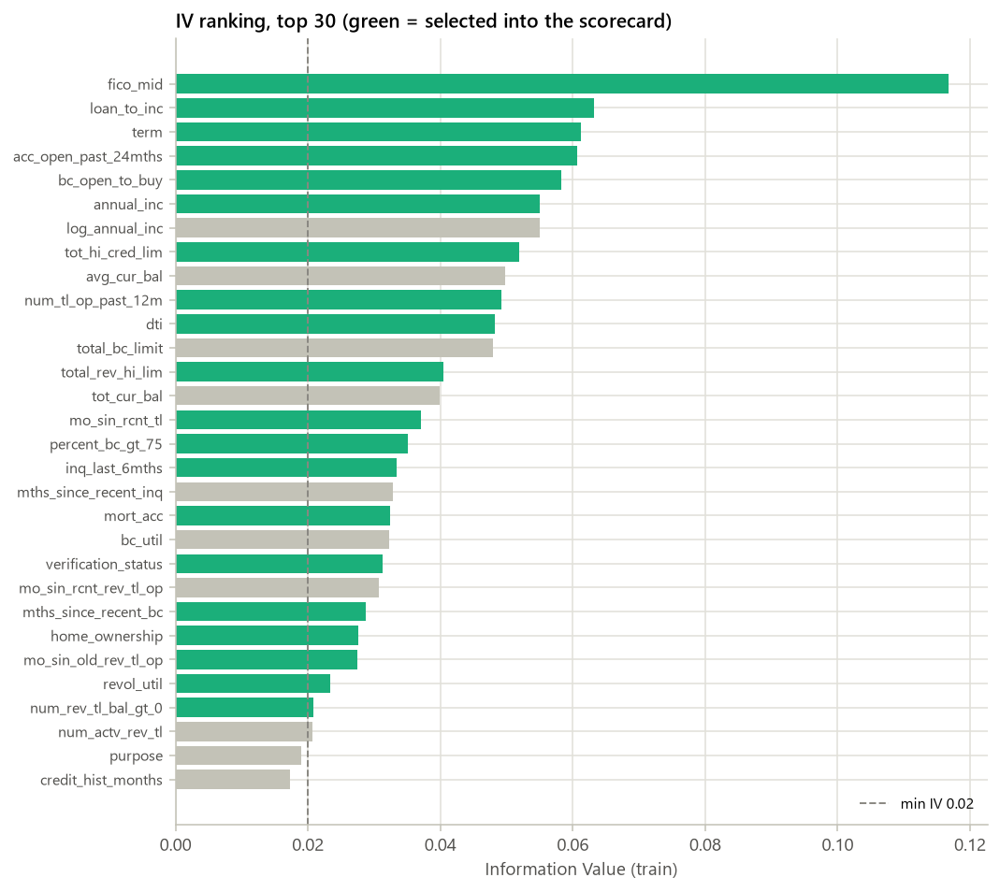

_图 2.1 IV 排名（前 30；绿色 = 入模）_

### 2.2 IV 排名表（全部候选特征，按 IV 降序）

| 特征 | 类型 | IV | 缺失率（train） | 箱数 | 入模 | 剔除步骤 | 原因 |
|---|---|---|---|---|---|---|---|
| fico_mid | numeric | 0.1168 | 0.00% | 6 | 是 |  | selected |
| loan_to_inc | numeric | 0.0632 | 0.00% | 4 | 是 |  | selected |
| term | numeric | 0.0612 | 0.00% | 2 | 是 |  | selected |
| acc_open_past_24mths | numeric | 0.0607 | 1.58% | 7 | 是 |  | selected |
| bc_open_to_buy | numeric | 0.0583 | 2.54% | 4 | 是 |  | selected |
| annual_inc | numeric | 0.0551 | 0.00% | 6 | 是 |  | selected |
| log_annual_inc | numeric | 0.0551 | 0.00% | 6 | 否 | 3_corr | \|corr\| = 1.00 with annual_inc (IV 0.055) |
| tot_hi_cred_lim | numeric | 0.0520 | 5.84% | 7 | 是 |  | selected |
| avg_cur_bal | numeric | 0.0498 | 5.84% | 7 | 否 | 3_corr | \|corr\| = 0.85 with tot_hi_cred_lim (IV 0.052) |
| num_tl_op_past_12m | numeric | 0.0493 | 5.84% | 6 | 是 |  | selected |
| dti | numeric | 0.0483 | 0.00% | 5 | 是 |  | selected |
| total_bc_limit | numeric | 0.0479 | 1.58% | 5 | 否 | 3_corr | \|corr\| = 0.71 with bc_open_to_buy (IV 0.058) |
| total_rev_hi_lim | numeric | 0.0405 | 5.84% | 7 | 是 |  | selected |
| tot_cur_bal | numeric | 0.0398 | 5.84% | 5 | 否 | 3_corr | \|corr\| = 0.93 with tot_hi_cred_lim (IV 0.052) |
| mo_sin_rcnt_tl | numeric | 0.0370 | 5.84% | 7 | 是 |  | selected |
| percent_bc_gt_75 | numeric | 0.0351 | 2.57% | 6 | 是 |  | selected |
| inq_last_6mths | numeric | 0.0335 | 0.00% | 4 | 是 |  | selected |
| mths_since_recent_inq | numeric | 0.0328 | 11.90% | 7 | 否 | 3_corr | \|corr\| = 0.73 with inq_last_6mths (IV 0.033) |
| mort_acc | numeric | 0.0325 | 1.58% | 6 | 是 |  | selected |
| bc_util | numeric | 0.0323 | 2.61% | 7 | 否 | 3_corr | \|corr\| = 0.79 with percent_bc_gt_75 (IV 0.035) |
| verification_status | categorical | 0.0313 | 0.00% | 3 | 是 |  | selected |
| mo_sin_rcnt_rev_tl_op | numeric | 0.0307 | 5.84% | 7 | 否 | 3_corr | \|corr\| = 0.74 with mo_sin_rcnt_tl (IV 0.037) |
| mths_since_recent_bc | numeric | 0.0288 | 2.45% | 7 | 是 |  | selected |
| home_ownership | categorical | 0.0276 | 0.00% | 3 | 是 |  | selected |
| mo_sin_old_rev_tl_op | numeric | 0.0274 | 5.84% | 6 | 是 |  | selected |
| revol_util | numeric | 0.0233 | 0.05% | 7 | 是 |  | selected |
| num_rev_tl_bal_gt_0 | numeric | 0.0208 | 5.84% | 7 | 是 |  | selected |
| num_actv_rev_tl | numeric | 0.0207 | 5.84% | 7 | 否 | 3_corr | \|corr\| = 0.99 with num_rev_tl_bal_gt_0 (IV 0.021) |
| purpose | categorical | 0.0190 | 0.00% | 3 | 否 | 2_iv | IV 0.0190 < 0.02 |
| credit_hist_months | numeric | 0.0173 | 0.00% | 5 | 否 | 2_iv | IV 0.0173 < 0.02 |
| mo_sin_old_il_acct | numeric | 0.0135 | 9.36% | 4 | 否 | 2_iv | IV 0.0135 < 0.02 |
| emp_length_years | numeric | 0.0116 | 5.33% | 4 | 否 | 2_iv | IV 0.0116 < 0.02 |
| revol_bal | numeric | 0.0100 | 0.00% | 4 | 否 | 2_iv | IV 0.0100 < 0.02 |
| addr_state | categorical | 0.0100 | 0.00% | 4 | 否 | 2_iv | IV 0.0100 < 0.02 |
| initial_list_status | categorical | 0.0081 | 0.00% | 2 | 否 | 2_iv | IV 0.0081 < 0.02 |
| num_op_rev_tl | numeric | 0.0056 | 5.84% | 7 | 否 | 2_iv | IV 0.0056 < 0.02 |
| num_actv_bc_tl | numeric | 0.0053 | 5.84% | 5 | 否 | 2_iv | IV 0.0053 < 0.02 |
| total_bal_ex_mort | numeric | 0.0041 | 1.58% | 5 | 否 | 2_iv | IV 0.0041 < 0.02 |
| total_acc | numeric | 0.0037 | 0.00% | 4 | 否 | 2_iv | IV 0.0037 < 0.02 |
| total_il_high_credit_limit | numeric | 0.0035 | 5.84% | 4 | 否 | 2_iv | IV 0.0035 < 0.02 |
| num_bc_tl | numeric | 0.0034 | 5.84% | 4 | 否 | 2_iv | IV 0.0034 < 0.02 |
| mths_since_last_record | numeric | 0.0030 | 84.98% | 3 | 否 | 1_missing | missing rate 85.0% > 50% |
| num_il_tl | numeric | 0.0026 | 5.84% | 5 | 否 | 2_iv | IV 0.0026 < 0.02 |
| num_accts_ever_120_pd | numeric | 0.0024 | 5.84% | 3 | 否 | 2_iv | IV 0.0024 < 0.02 |
| tot_coll_amt | numeric | 0.0023 | 5.84% | 3 | 否 | 2_iv | IV 0.0023 < 0.02 |
| pub_rec | numeric | 0.0021 | 0.00% | 2 | 否 | 2_iv | IV 0.0021 < 0.02 |
| mths_since_last_major_derog | numeric | 0.0019 | 75.37% | 3 | 否 | 1_missing | missing rate 75.4% > 50% |
| pub_rec_bankruptcies | numeric | 0.0018 | 0.00% | 2 | 否 | 2_iv | IV 0.0018 < 0.02 |
| num_sats | numeric | 0.0018 | 3.37% | 6 | 否 | 2_iv | IV 0.0018 < 0.02 |
| num_tl_120dpd_2m | numeric | 0.0018 | 8.17% | 2 | 否 | 2_iv | IV 0.0018 < 0.02 |
| num_rev_accts | numeric | 0.0016 | 5.84% | 3 | 否 | 2_iv | IV 0.0016 < 0.02 |
| pct_tl_nvr_dlq | numeric | 0.0015 | 5.87% | 3 | 否 | 2_iv | IV 0.0015 < 0.02 |
| num_tl_90g_dpd_24m | numeric | 0.0015 | 5.84% | 3 | 否 | 2_iv | IV 0.0015 < 0.02 |
| loan_amnt | numeric | 0.0011 | 0.00% | 4 | 否 | 2_iv | IV 0.0011 < 0.02 |
| funded_amnt | numeric | 0.0011 | 0.00% | 4 | 否 | 2_iv | IV 0.0011 < 0.02 |
| open_acc | numeric | 0.0011 | 0.00% | 3 | 否 | 2_iv | IV 0.0011 < 0.02 |
| num_tl_30dpd | numeric | 0.0011 | 5.84% | 2 | 否 | 2_iv | IV 0.0011 < 0.02 |
| delinq_2yrs | numeric | 0.0009 | 0.00% | 3 | 否 | 2_iv | IV 0.0009 < 0.02 |
| mths_since_last_delinq | numeric | 0.0006 | 52.06% | 3 | 否 | 1_missing | missing rate 52.1% > 50% |
| num_bc_sats | numeric | 0.0006 | 3.37% | 3 | 否 | 2_iv | IV 0.0006 < 0.02 |
| mths_since_recent_bc_dlq | numeric | 0.0002 | 76.20% | 3 | 否 | 1_missing | missing rate 76.2% > 50% |
| mths_since_recent_revol_delinq | numeric | 0.0002 | 66.50% | 3 | 否 | 1_missing | missing rate 66.5% > 50% |
| collections_12_mths_ex_med | numeric | 0.0000 | 0.00% | 1 | 否 | 2_iv | IV 0.0000 < 0.02 |
| application_type | categorical | 0.0000 | 0.00% | 1 | 否 | 2_iv | IV 0.0000 < 0.02 |
| verification_status_joint | categorical | 0.0000 | 100.00% | 1 | 否 | 1_missing | missing rate 100.0% > 50% |
| dti_joint | numeric | 0.0000 | 100.00% | 2 | 否 | 1_missing | missing rate 100.0% > 50% |
| annual_inc_joint | numeric | 0.0000 | 100.00% | 2 | 否 | 1_missing | missing rate 100.0% > 50% |
| il_util | numeric | 0.0000 | 100.00% | 2 | 否 | 1_missing | missing rate 100.0% > 50% |
| total_bal_il | numeric | 0.0000 | 100.00% | 2 | 否 | 1_missing | missing rate 100.0% > 50% |
| mths_since_rcnt_il | numeric | 0.0000 | 100.00% | 2 | 否 | 1_missing | missing rate 100.0% > 50% |
| open_il_24m | numeric | 0.0000 | 100.00% | 2 | 否 | 1_missing | missing rate 100.0% > 50% |
| open_il_12m | numeric | 0.0000 | 100.00% | 2 | 否 | 1_missing | missing rate 100.0% > 50% |
| open_act_il | numeric | 0.0000 | 100.00% | 2 | 否 | 1_missing | missing rate 100.0% > 50% |
| open_acc_6m | numeric | 0.0000 | 100.00% | 2 | 否 | 1_missing | missing rate 100.0% > 50% |
| acc_now_delinq | numeric | 0.0000 | 0.00% | 1 | 否 | 2_iv | IV 0.0000 < 0.02 |
| chargeoff_within_12_mths | numeric | 0.0000 | 0.00% | 1 | 否 | 2_iv | IV 0.0000 < 0.02 |
| total_cu_tl | numeric | 0.0000 | 100.00% | 2 | 否 | 1_missing | missing rate 100.0% > 50% |
| inq_fi | numeric | 0.0000 | 100.00% | 2 | 否 | 1_missing | missing rate 100.0% > 50% |
| all_util | numeric | 0.0000 | 100.00% | 2 | 否 | 1_missing | missing rate 100.0% > 50% |
| open_rv_24m | numeric | 0.0000 | 100.00% | 2 | 否 | 1_missing | missing rate 100.0% > 50% |
| max_bal_bc | numeric | 0.0000 | 100.00% | 2 | 否 | 1_missing | missing rate 100.0% > 50% |
| delinq_amnt | numeric | 0.0000 | 0.00% | 1 | 否 | 2_iv | IV 0.0000 < 0.02 |
| open_rv_12m | numeric | 0.0000 | 100.00% | 2 | 否 | 1_missing | missing rate 100.0% > 50% |
| inq_last_12m | numeric | 0.0000 | 100.00% | 2 | 否 | 1_missing | missing rate 100.0% > 50% |
| sec_app_fico_range_low | numeric | 0.0000 | 100.00% | 2 | 否 | 1_missing | missing rate 100.0% > 50% |
| revol_bal_joint | numeric | 0.0000 | 100.00% | 2 | 否 | 1_missing | missing rate 100.0% > 50% |
| tax_liens | numeric | 0.0000 | 0.00% | 1 | 否 | 2_iv | IV 0.0000 < 0.02 |
| sec_app_fico_range_high | numeric | 0.0000 | 100.00% | 2 | 否 | 1_missing | missing rate 100.0% > 50% |
| sec_app_inq_last_6mths | numeric | 0.0000 | 100.00% | 2 | 否 | 1_missing | missing rate 100.0% > 50% |
| sec_app_open_acc | numeric | 0.0000 | 100.00% | 2 | 否 | 1_missing | missing rate 100.0% > 50% |
| sec_app_mort_acc | numeric | 0.0000 | 100.00% | 2 | 否 | 1_missing | missing rate 100.0% > 50% |
| sec_app_collections_12_mths_ex_med | numeric | 0.0000 | 100.00% | 2 | 否 | 1_missing | missing rate 100.0% > 50% |
| sec_app_chargeoff_within_12_mths | numeric | 0.0000 | 100.00% | 2 | 否 | 1_missing | missing rate 100.0% > 50% |
| sec_app_num_rev_accts | numeric | 0.0000 | 100.00% | 2 | 否 | 1_missing | missing rate 100.0% > 50% |
| sec_app_open_act_il | numeric | 0.0000 | 100.00% | 2 | 否 | 1_missing | missing rate 100.0% > 50% |
| sec_app_revol_util | numeric | 0.0000 | 100.00% | 2 | 否 | 1_missing | missing rate 100.0% > 50% |
| disbursement_method | categorical | 0.0000 | 0.00% | 1 | 否 | 2_iv | IV 0.0000 < 0.02 |
| sec_app_mths_since_last_major_derog | numeric | 0.0000 | 100.00% | 2 | 否 | 1_missing | missing rate 100.0% > 50% |
| sec_app_credit_hist_months | numeric | 0.0000 | 100.00% | 2 | 否 | 1_missing | missing rate 100.0% > 50% |

### 2.3 特征筛选漏斗

| 步骤 | 剔除 | 剩余 |
|---|---|---|
| 候选特征 |  | 99 |
| 缺失率 > 50% | 35 | 64 |
| IV < 0.02 | 36 | 28 |
| \|corr\| > 0.7（保留 IV 高者） | 8 | 20 |
| LR 系数为正（WOE 方向反转） | 0 | 20 |

### 2.4 单调性检查（入模特征）

| 特征 | 类型 | 切点来源 | 初始箱数 | 初始单调 | 最终箱数（含缺失箱） | 最终单调 | 最大箱占比 |
|---|---|---|---|---|---|---|---|
| fico_mid | numeric | toad | 6 | 是 | 6 | 是 | 27.09% |
| loan_to_inc | numeric | toad | 4 | 是 | 4 | 是 | 35.56% |
| term | numeric | unique_values | 2 | 是 | 2 | 是 | 90.69% |
| acc_open_past_24mths | numeric | toad | 6 | 是 | 7 | 是 | 26.29% |
| bc_open_to_buy | numeric | toad | 3 | 是 | 4 | 是 | 38.93% |
| annual_inc | numeric | toad | 6 | 是 | 6 | 是 | 24.16% |
| tot_hi_cred_lim | numeric | toad | 6 | 是 | 7 | 是 | 30.03% |
| num_tl_op_past_12m | numeric | toad | 5 | 是 | 6 | 是 | 24.92% |
| dti | numeric | toad | 5 | 是 | 5 | 是 | 25.54% |
| total_rev_hi_lim | numeric | toad | 6 | 是 | 7 | 是 | 31.11% |
| mo_sin_rcnt_tl | numeric | toad | 6 | 是 | 7 | 是 | 29.01% |
| percent_bc_gt_75 | numeric | toad | 5 | 是 | 6 | 是 | 24.83% |
| inq_last_6mths | numeric | toad | 4 | 是 | 4 | 是 | 54.12% |
| mort_acc | numeric | toad | 5 | 是 | 6 | 是 | 41.51% |
| verification_status | categorical | unique_values | 3 | 是 | 3 | 是 | 34.00% |
| mths_since_recent_bc | numeric | toad | 6 | 是 | 7 | 是 | 37.45% |
| home_ownership | categorical | unique_values | 3 | 是 | 3 | 是 | 48.22% |
| mo_sin_old_rev_tl_op | numeric | toad | 5 | 是 | 6 | 是 | 29.66% |
| revol_util | numeric | toad | 6 | 是 | 7 | 是 | 36.94% |
| num_rev_tl_bal_gt_0 | numeric | toad | 6 | 是 | 7 | 是 | 29.22% |

_类别型特征按 train bad rate 排序后再分箱，因此天然单调。数值型不单调时合并相邻箱，直到 bad rate 单调或只剩 2 箱。切点来源 unique_values = 取值数不超过 max_bins、逐值成箱。_

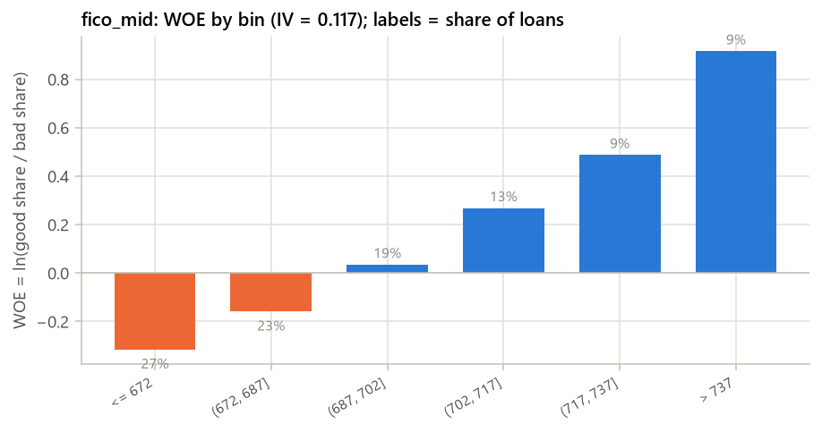

_图 2.2 fico_mid 的 WOE（IV 第 1 名）_

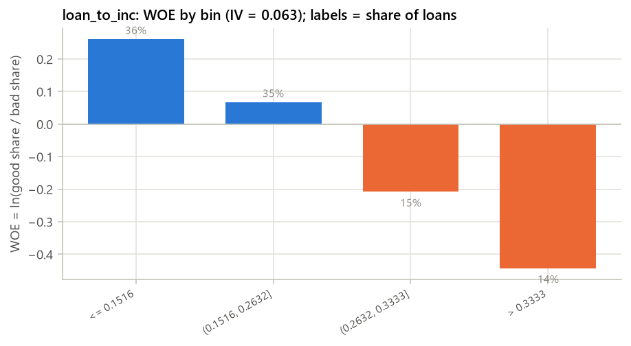

_图 2.3 loan_to_inc 的 WOE（IV 第 2 名）_

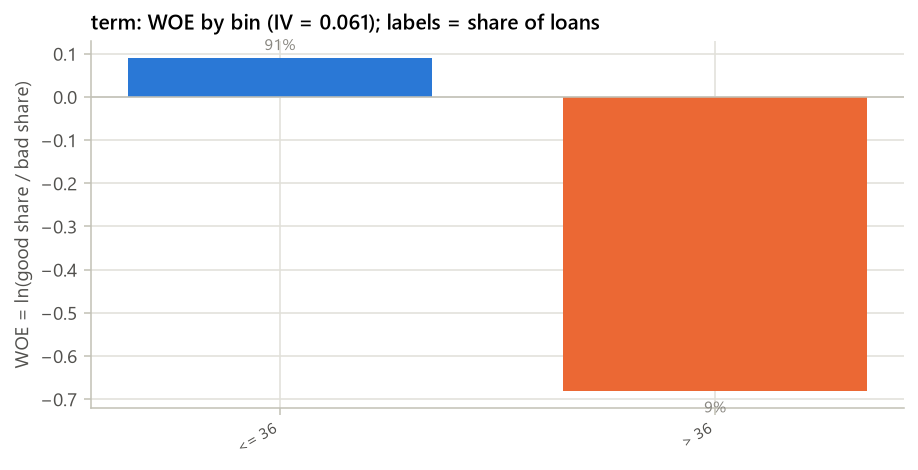

_图 2.4 term 的 WOE（IV 第 3 名）_

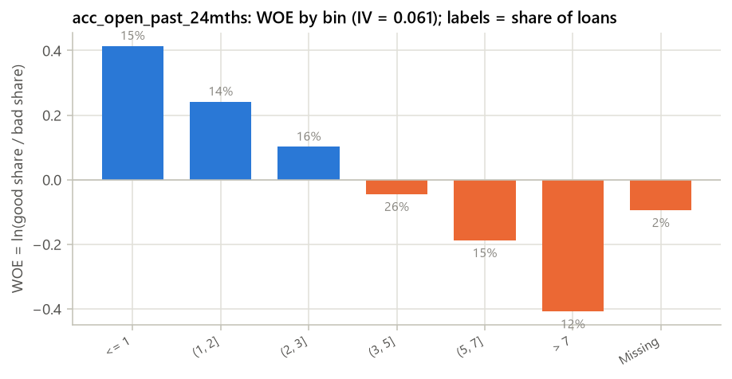

_图 2.5 acc_open_past_24mths 的 WOE（IV 第 4 名）_

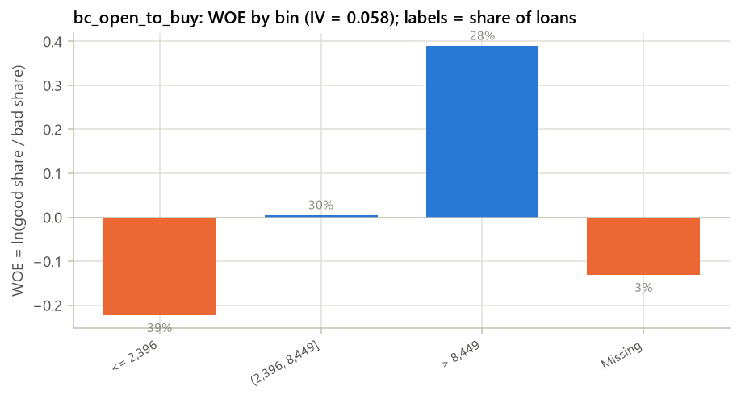

_图 2.6 bc_open_to_buy 的 WOE（IV 第 5 名）_

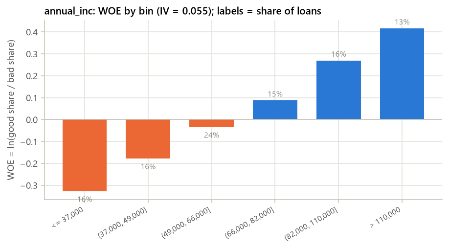

_图 2.7 annual_inc 的 WOE（IV 第 6 名）_

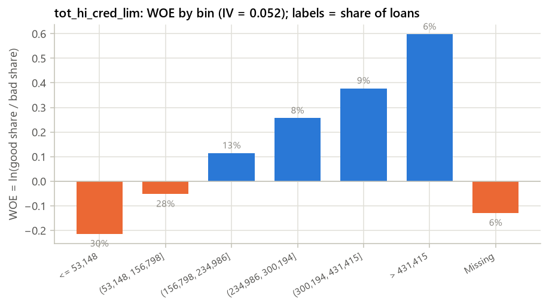

_图 2.8 tot_hi_cred_lim 的 WOE（IV 第 7 名）_

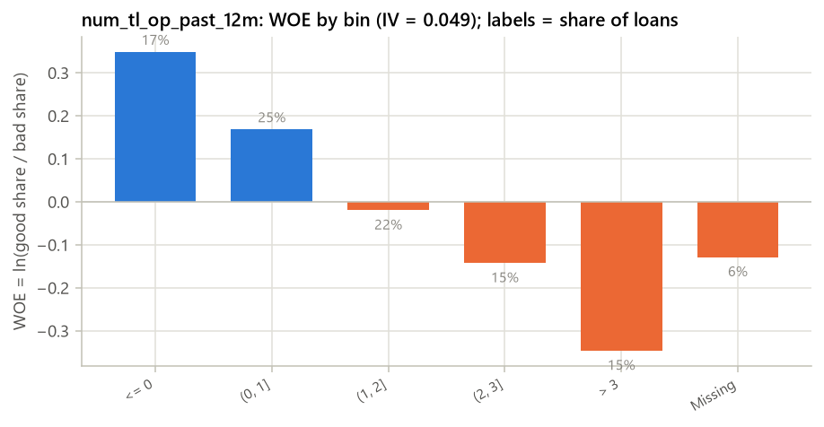

_图 2.9 num_tl_op_past_12m 的 WOE（IV 第 8 名）_

### 分箱表：fico_mid（IV = 0.1168）

| 分箱 | 人数 | 占比 | bad 数 | bad rate | WOE |
|---|---|---|---|---|---|
| <= 672 | 89,431 | 27.09% | 17,304 | 19.35% | -0.3151 |
| (672, 687] | 76,714 | 23.24% | 13,058 | 17.02% | -0.1585 |
| (687, 702] | 61,435 | 18.61% | 8,893 | 14.48% | 0.0338 |
| (702, 717] | 42,487 | 12.87% | 5,021 | 11.82% | 0.2672 |
| (717, 737] | 30,608 | 9.27% | 2,974 | 9.72% | 0.4866 |
| > 737 | 29,396 | 8.91% | 1,926 | 6.55% | 0.9151 |

### 分箱表：loan_to_inc（IV = 0.0632）

| 分箱 | 人数 | 占比 | bad 数 | bad rate | WOE |
|---|---|---|---|---|---|
| <= 0.1516 | 117,364 | 35.56% | 13,952 | 11.89% | 0.2605 |
| (0.1516, 0.2632] | 115,822 | 35.09% | 16,297 | 14.07% | 0.0669 |
| (0.2632, 0.3333] | 49,428 | 14.97% | 8,764 | 17.73% | -0.2079 |
| > 0.3333 | 47,457 | 14.38% | 10,163 | 21.42% | -0.4425 |

### 分箱表：term（IV = 0.0612）

| 分箱 | 人数 | 占比 | bad 数 | bad rate | WOE |
|---|---|---|---|---|---|
| <= 36 | 299,349 | 90.69% | 41,279 | 13.79% | 0.0903 |
| > 36 | 30,722 | 9.31% | 7,897 | 25.70% | -0.6812 |

### 分箱表：acc_open_past_24mths（IV = 0.0607）

| 分箱 | 人数 | 占比 | bad 数 | bad rate | WOE |
|---|---|---|---|---|---|
| <= 1 | 49,373 | 14.96% | 5,120 | 10.37% | 0.4142 |
| (1, 2] | 46,993 | 14.24% | 5,681 | 12.09% | 0.2415 |
| (2, 3] | 51,455 | 15.59% | 7,026 | 13.65% | 0.1017 |
| (3, 5] | 86,775 | 26.29% | 13,421 | 15.47% | -0.0441 |
| (5, 7] | 50,464 | 15.29% | 8,797 | 17.43% | -0.1873 |
| > 7 | 39,790 | 12.05% | 8,289 | 20.83% | -0.4075 |
| Missing | 5,221 | 1.58% | 842 | 16.13% | -0.0938 |

### 分箱表：bc_open_to_buy（IV = 0.0583）

| 分箱 | 人数 | 占比 | bad 数 | bad rate | WOE |
|---|---|---|---|---|---|
| <= 2,396 | 128,506 | 38.93% | 23,049 | 17.94% | -0.2219 |
| (2,396, 8,449] | 100,030 | 30.31% | 14,851 | 14.85% | 0.0041 |
| > 8,449 | 93,150 | 28.22% | 9,882 | 10.61% | 0.3888 |
| Missing | 8,385 | 2.54% | 1,394 | 16.62% | -0.1301 |

### 分箱表：annual_inc（IV = 0.0551）

| 分箱 | 人数 | 占比 | bad 数 | bad rate | WOE |
|---|---|---|---|---|---|
| <= 37,000 | 51,705 | 15.66% | 10,106 | 19.55% | -0.3276 |
| (37,000, 49,000] | 53,858 | 16.32% | 9,323 | 17.31% | -0.1788 |
| (49,000, 66,000] | 79,735 | 24.16% | 12,239 | 15.35% | -0.0351 |
| (66,000, 82,000] | 50,755 | 15.38% | 7,018 | 13.83% | 0.0871 |
| (82,000, 110,000] | 52,533 | 15.92% | 6,196 | 11.79% | 0.2695 |
| > 110,000 | 41,485 | 12.57% | 4,294 | 10.35% | 0.4163 |

### 分箱表：tot_hi_cred_lim（IV = 0.0520）

| 分箱 | 人数 | 占比 | bad 数 | bad rate | WOE |
|---|---|---|---|---|---|
| <= 53,148 | 99,117 | 30.03% | 17,658 | 17.82% | -0.2137 |
| (53,148, 156,798] | 93,447 | 28.31% | 14,554 | 15.57% | -0.0523 |
| (156,798, 234,986] | 41,750 | 12.65% | 5,640 | 13.51% | 0.1141 |
| (234,986, 300,194] | 26,500 | 8.03% | 3,162 | 11.93% | 0.2563 |
| (300,194, 431,415] | 29,502 | 8.94% | 3,161 | 10.71% | 0.3777 |
| > 431,415 | 20,483 | 6.21% | 1,800 | 8.79% | 0.5973 |
| Missing | 19,272 | 5.84% | 3,201 | 16.61% | -0.1290 |

### 分箱表：num_tl_op_past_12m（IV = 0.0493）

| 分箱 | 人数 | 占比 | bad 数 | bad rate | WOE |
|---|---|---|---|---|---|
| <= 0 | 56,712 | 17.18% | 6,236 | 11.00% | 0.3486 |
| (0, 1] | 82,243 | 24.92% | 10,599 | 12.89% | 0.1684 |
| (1, 2] | 73,053 | 22.13% | 11,071 | 15.15% | -0.0201 |
| (2, 3] | 50,501 | 15.30% | 8,486 | 16.80% | -0.1430 |
| > 3 | 48,290 | 14.63% | 9,583 | 19.84% | -0.3465 |
| Missing | 19,272 | 5.84% | 3,201 | 16.61% | -0.1290 |

### 分箱表：dti（IV = 0.0483）

| 分箱 | 人数 | 占比 | bad 数 | bad rate | WOE |
|---|---|---|---|---|---|
| <= 11.65 | 84,294 | 25.54% | 9,797 | 11.62% | 0.2861 |
| (11.65, 17.11] | 80,650 | 24.43% | 10,726 | 13.30% | 0.1322 |
| (17.11, 21.74] | 64,496 | 19.54% | 10,003 | 15.51% | -0.0474 |
| (21.74, 25.16] | 38,066 | 11.53% | 6,493 | 17.06% | -0.1610 |
| > 25.16 | 62,565 | 18.96% | 12,157 | 19.43% | -0.3203 |

### 分箱表：total_rev_hi_lim（IV = 0.0405）

| 分箱 | 人数 | 占比 | bad 数 | bad rate | WOE |
|---|---|---|---|---|---|
| <= 6,600 | 22,028 | 6.67% | 4,085 | 18.54% | -0.2627 |
| (6,600, 18,000] | 102,697 | 31.11% | 17,119 | 16.67% | -0.1333 |
| (18,000, 23,216] | 39,735 | 12.04% | 6,198 | 15.60% | -0.0542 |
| (23,216, 37,900] | 71,579 | 21.69% | 10,296 | 14.38% | 0.0412 |
| (37,900, 55,900] | 40,344 | 12.22% | 5,017 | 12.44% | 0.2092 |
| > 55,900 | 34,416 | 10.43% | 3,260 | 9.47% | 0.5147 |
| Missing | 19,272 | 5.84% | 3,201 | 16.61% | -0.1290 |

### 分箱表：mo_sin_rcnt_tl（IV = 0.0370）

| 分箱 | 人数 | 占比 | bad 数 | bad rate | WOE |
|---|---|---|---|---|---|
| <= 1 | 30,622 | 9.28% | 5,666 | 18.50% | -0.2599 |
| (1, 3] | 64,147 | 19.43% | 11,021 | 17.18% | -0.1697 |
| (3, 7] | 95,765 | 29.01% | 14,549 | 15.19% | -0.0230 |
| (7, 13] | 71,222 | 21.58% | 9,460 | 13.28% | 0.1336 |
| (13, 22] | 31,266 | 9.47% | 3,592 | 11.49% | 0.2992 |
| > 22 | 17,777 | 5.39% | 1,687 | 9.49% | 0.5127 |
| Missing | 19,272 | 5.84% | 3,201 | 16.61% | -0.1290 |

### 分箱表：percent_bc_gt_75（IV = 0.0351）

| 分箱 | 人数 | 占比 | bad 数 | bad rate | WOE |
|---|---|---|---|---|---|
| <= 0 | 58,860 | 17.83% | 6,624 | 11.25% | 0.3225 |
| (0, 26.7] | 39,576 | 11.99% | 5,021 | 12.69% | 0.1863 |
| (26.7, 50] | 81,970 | 24.83% | 11,861 | 14.47% | 0.0342 |
| (50, 83.3] | 71,318 | 21.61% | 11,833 | 16.59% | -0.1277 |
| > 83.3 | 69,851 | 21.16% | 12,430 | 17.80% | -0.2123 |
| Missing | 8,496 | 2.57% | 1,407 | 16.56% | -0.1255 |

### 分箱表：inq_last_6mths（IV = 0.0335）

| 分箱 | 人数 | 占比 | bad 数 | bad rate | WOE |
|---|---|---|---|---|---|
| <= 0 | 178,636 | 54.12% | 23,141 | 12.95% | 0.1624 |
| (0, 1] | 91,969 | 27.86% | 14,717 | 16.00% | -0.0845 |
| (1, 2] | 37,743 | 11.43% | 6,937 | 18.38% | -0.2517 |
| > 2 | 21,723 | 6.58% | 4,381 | 20.17% | -0.3667 |

### 分箱表：mort_acc（IV = 0.0325）

| 分箱 | 人数 | 占比 | bad 数 | bad rate | WOE |
|---|---|---|---|---|---|
| <= 0 | 137,007 | 41.51% | 23,685 | 17.29% | -0.1772 |
| (0, 1] | 52,801 | 16.00% | 7,826 | 14.82% | 0.0061 |
| (1, 2] | 42,862 | 12.99% | 5,759 | 13.44% | 0.1204 |
| (2, 4] | 56,673 | 17.17% | 7,053 | 12.45% | 0.2084 |
| > 4 | 35,507 | 10.76% | 4,011 | 11.30% | 0.3182 |
| Missing | 5,221 | 1.58% | 842 | 16.13% | -0.0938 |

### 分箱表：verification_status（IV = 0.0313）

| 分箱 | 人数 | 占比 | bad 数 | bad rate | WOE |
|---|---|---|---|---|---|
| {Not Verified} | 111,190 | 33.69% | 13,427 | 12.08% | 0.2427 |
| {Source Verified} | 106,649 | 32.31% | 16,159 | 15.15% | -0.0198 |
| {Verified} | 112,232 | 34.00% | 19,590 | 17.45% | -0.1889 |

### 分箱表：mths_since_recent_bc（IV = 0.0288）

| 分箱 | 人数 | 占比 | bad 数 | bad rate | WOE |
|---|---|---|---|---|---|
| <= 3 | 42,266 | 12.81% | 7,728 | 18.28% | -0.2454 |
| (3, 14] | 123,612 | 37.45% | 19,619 | 15.87% | -0.0748 |
| (14, 23] | 52,179 | 15.81% | 7,725 | 14.80% | 0.0074 |
| (23, 37] | 40,336 | 12.22% | 5,455 | 13.52% | 0.1128 |
| (37, 68] | 35,211 | 10.67% | 4,281 | 12.16% | 0.2350 |
| > 68 | 28,370 | 8.60% | 3,029 | 10.68% | 0.3816 |
| Missing | 8,097 | 2.45% | 1,339 | 16.54% | -0.1238 |

### 分箱表：home_ownership（IV = 0.0276）

| 分箱 | 人数 | 占比 | bad 数 | bad rate | WOE |
|---|---|---|---|---|---|
| {OTHER_RARE, MORTGAGE} | 159,173 | 48.22% | 20,345 | 12.78% | 0.1778 |
| {OWN} | 31,615 | 9.58% | 4,877 | 15.43% | -0.0410 |
| {RENT} | 139,283 | 42.20% | 23,954 | 17.20% | -0.1709 |

### 分箱表：mo_sin_old_rev_tl_op（IV = 0.0274）

| 分箱 | 人数 | 占比 | bad 数 | bad rate | WOE |
|---|---|---|---|---|---|
| <= 82 | 33,105 | 10.03% | 6,476 | 19.56% | -0.3287 |
| (82, 115] | 44,700 | 13.54% | 7,332 | 16.40% | -0.1140 |
| (115, 154] | 62,369 | 18.90% | 9,596 | 15.39% | -0.0379 |
| (154, 233] | 97,907 | 29.66% | 13,675 | 13.97% | 0.0754 |
| > 233 | 72,718 | 22.03% | 8,896 | 12.23% | 0.2279 |
| Missing | 19,272 | 5.84% | 3,201 | 16.61% | -0.1290 |

### 分箱表：revol_util（IV = 0.0233）

| 分箱 | 人数 | 占比 | bad 数 | bad rate | WOE |
|---|---|---|---|---|---|
| <= 18.1 | 21,601 | 6.54% | 2,229 | 10.32% | 0.4197 |
| (18.1, 25.5] | 16,619 | 5.03% | 1,987 | 11.96% | 0.2540 |
| (25.5, 44.8] | 70,600 | 21.39% | 9,587 | 13.58% | 0.1081 |
| (44.8, 58.8] | 67,701 | 20.51% | 10,032 | 14.82% | 0.0064 |
| (58.8, 86.9] | 121,944 | 36.94% | 19,757 | 16.20% | -0.0993 |
| > 86.9 | 31,430 | 9.52% | 5,555 | 17.67% | -0.2040 |
| Missing | 176 | 0.05% | 29 | 16.48% | -0.1194 |

### 分箱表：num_rev_tl_bal_gt_0（IV = 0.0208）

| 分箱 | 人数 | 占比 | bad 数 | bad rate | WOE |
|---|---|---|---|---|---|
| <= 2 | 34,285 | 10.39% | 4,076 | 11.89% | 0.2604 |
| (2, 3] | 42,309 | 12.82% | 5,500 | 13.00% | 0.1584 |
| (3, 5] | 96,433 | 29.22% | 13,661 | 14.17% | 0.0590 |
| (5, 7] | 68,586 | 20.78% | 10,609 | 15.47% | -0.0442 |
| (7, 8] | 21,549 | 6.53% | 3,569 | 16.56% | -0.1256 |
| > 8 | 47,637 | 14.43% | 8,560 | 17.97% | -0.2241 |
| Missing | 19,272 | 5.84% | 3,201 | 16.61% | -0.1290 |

## 3. 模型表现

_WOE 逻辑回归评分卡与 GBDT challenger 在 train / test / OOT 上的 AUC、KS、Gini，以及 train 内交叉验证（每折重做分箱与 WOE；入模变量清单固定自全 train）。_

### 3.1 LR 系数表（WOE 输入；WOE 越大越安全，系数应为负）

| 特征 | 系数 | IV | VIF |
|---|---|---|---|
| (intercept) | -1.7453 |  |  |
| fico_mid | -0.6103 | 0.1168 | 1.5947 |
| loan_to_inc | -0.6391 | 0.0632 | 1.4140 |
| term | -0.9009 | 0.0612 | 1.1583 |
| acc_open_past_24mths | -0.6347 | 0.0607 | 2.1604 |
| bc_open_to_buy | -0.3870 | 0.0583 | 2.4636 |
| annual_inc | -0.3421 | 0.0551 | 1.9384 |
| tot_hi_cred_lim | -0.2889 | 0.0520 | 2.4684 |
| num_tl_op_past_12m | -0.2714 | 0.0493 | 2.7492 |
| dti | -0.5140 | 0.0483 | 1.2970 |
| total_rev_hi_lim | -0.2358 | 0.0405 | 2.4729 |
| mo_sin_rcnt_tl | -0.0867 | 0.0370 | 2.1272 |
| percent_bc_gt_75 | -0.2651 | 0.0351 | 2.0241 |
| inq_last_6mths | -0.6494 | 0.0335 | 1.1389 |
| mort_acc | -0.2553 | 0.0325 | 2.0681 |
| verification_status | -0.4581 | 0.0313 | 1.1990 |
| mths_since_recent_bc | -0.3796 | 0.0288 | 1.4369 |
| home_ownership | -0.4242 | 0.0276 | 1.8161 |
| mo_sin_old_rev_tl_op | -0.3698 | 0.0274 | 1.2773 |
| revol_util | -0.0286 | 0.0233 | 2.1214 |
| num_rev_tl_bal_gt_0 | -0.2039 | 0.0208 | 1.3856 |

_LogisticRegression(penalty=l2, C=1.0)；VIF > 5.0 标警。_

### 3.2 train / test / OOT 表现

| 模型 | 样本 | 行数 | bad rate | AUC | KS | Gini |
|---|---|---|---|---|---|---|
| LR scorecard | train | 330,071 | 14.90% | 0.6733 | 0.2467 | 0.3466 |
| GBDT challenger | train | 330,071 | 14.90% | 0.7031 | 0.2943 | 0.4062 |
| LR scorecard | test | 141,460 | 14.90% | 0.6744 | 0.2513 | 0.3489 |
| GBDT challenger | test | 141,460 | 14.90% | 0.6941 | 0.2790 | 0.3882 |
| LR scorecard | OOT | 162,236 | 14.71% | 0.6750 | 0.2526 | 0.3499 |
| GBDT challenger | OOT | 162,236 | 14.71% | 0.6959 | 0.2838 | 0.3918 |

### 3.3 5 折 CV（train 内；每折重做分箱与 WOE）

| 模型 | AUC 均值 ± std | KS 均值 ± std | 折数 |
|---|---|---|---|
| LR scorecard | 0.6719 ± 0.0026 | 0.2471 ± 0.0047 | 5 |
| GBDT challenger | 0.6918 ± 0.0022 | 0.2796 ± 0.0032 | 5 |

### 3.4 LR vs GBDT challenger

| 指标 | LR scorecard | GBDT | GBDT − LR |
|---|---|---|---|
| test AUC | 0.6744 | 0.6941 | +0.0196 |
| test KS | 0.2513 | 0.2790 | +0.0277 |
| OOT AUC | 0.6750 | 0.6959 | +0.0209 |
| OOT KS | 0.2526 | 0.2838 | +0.0312 |

_challenger 直接使用未 WOE 的原始候选特征（含缺失），只作为性能上限参照，不上线。_

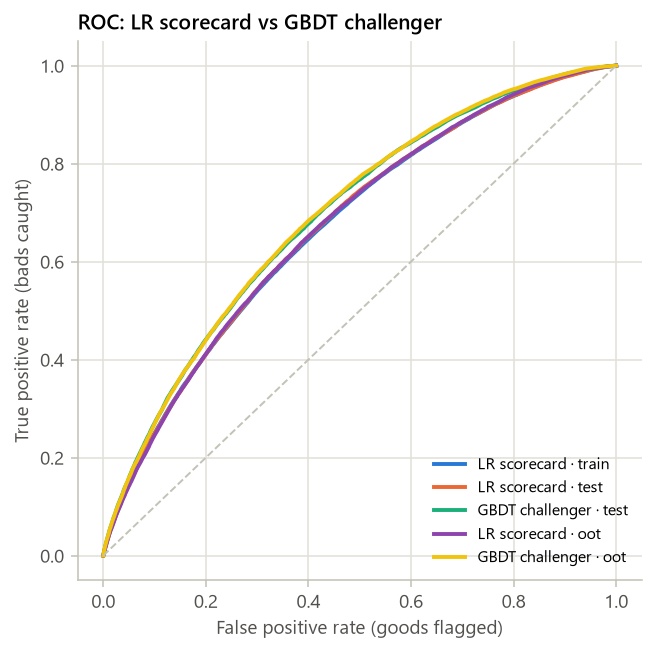

_图 3.1 ROC 曲线_

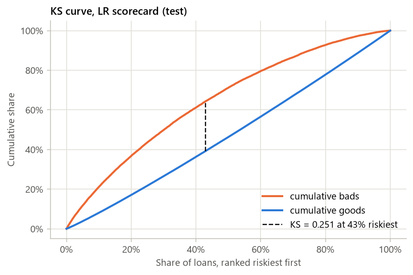

_图 3.2 KS 曲线（LR，test）_

### KS 分段表（test，按 LR 预测概率从高风险到低风险 10 等分）

| 分段 | 人数 | bad 数 | bad rate | 累计 bad 占比 | 累计 good 占比 | KS |
|---|---|---|---|---|---|---|
| 1 | 14,146 | 4,444 | 31.42% | 21.09% | 8.06% | 0.1303 |
| 2 | 14,146 | 3,300 | 23.33% | 36.74% | 17.07% | 0.1967 |
| 3 | 14,146 | 2,760 | 19.51% | 49.84% | 26.53% | 0.2331 |
| 4 | 14,146 | 2,379 | 16.82% | 61.13% | 36.30% | 0.2483 |
| 5 | 14,146 | 2,118 | 14.97% | 71.18% | 46.29% | 0.2488 |
| 6 | 14,146 | 1,768 | 12.50% | 79.56% | 56.57% | 0.2299 |
| 7 | 14,146 | 1,471 | 10.40% | 86.54% | 67.10% | 0.1944 |
| 8 | 14,146 | 1,302 | 9.20% | 92.72% | 77.77% | 0.1495 |
| 9 | 14,146 | 961 | 6.79% | 97.28% | 88.73% | 0.0856 |
| 10 | 14,146 | 573 | 4.05% | 100.00% | 100.00% | 0.0000 |

本次只跑“不含平台评级”一套模型；“含 / 不含平台评级”并排对比需要 features.use_platform_rating: [false, true]（Phase 2 默认）。

## 4. 评分卡

_把 WOE 逻辑回归换算为评分卡：PDO、base score、base odds，每个变量每个分箱的分数，以及分数分布。_

### 4.1 PDO 换算

- **PDO / base score / base odds**：20 / 600 / 20:1
- **Factor = PDO / ln2**：28.8539
- **Offset = base − Factor × ln(odds)**：600 − 28.8539 × ln(20) = 513.5614
- **LR 截距 b0**：-1.7453
- **基础分 = Offset − Factor × b0**：563.92 → 取整 564
- **分箱分数**：points = −Factor × 系数 × WOE，取整
- **可能的分数范围**：485 ~ 640
- **整数分数的 AUC（test / OOT）**：test 0.6740 / OOT 0.6745

### 4.2 评分卡表

| 变量 | 分箱 | train 人数 | 占比 | bad rate | WOE | 系数 | 分数 | 整数分 |
|---|---|---|---|---|---|---|---|---|
| BASE | (every applicant) |  |  |  |  |  | 563.92 | 564 |
| fico_mid | <= 672 | 89,431 | 27.09% | 19.35% | -0.3151 | -0.6103 | -5.55 | -6 |
| fico_mid | (672, 687] | 76,714 | 23.24% | 17.02% | -0.1585 | -0.6103 | -2.79 | -3 |
| fico_mid | (687, 702] | 61,435 | 18.61% | 14.48% | 0.0338 | -0.6103 | 0.59 | 1 |
| fico_mid | (702, 717] | 42,487 | 12.87% | 11.82% | 0.2672 | -0.6103 | 4.71 | 5 |
| fico_mid | (717, 737] | 30,608 | 9.27% | 9.72% | 0.4866 | -0.6103 | 8.57 | 9 |
| fico_mid | > 737 | 29,396 | 8.91% | 6.55% | 0.9151 | -0.6103 | 16.11 | 16 |
| loan_to_inc | <= 0.1516 | 117,364 | 35.56% | 11.89% | 0.2605 | -0.6391 | 4.80 | 5 |
| loan_to_inc | (0.1516, 0.2632] | 115,822 | 35.09% | 14.07% | 0.0669 | -0.6391 | 1.23 | 1 |
| loan_to_inc | (0.2632, 0.3333] | 49,428 | 14.97% | 17.73% | -0.2079 | -0.6391 | -3.83 | -4 |
| loan_to_inc | > 0.3333 | 47,457 | 14.38% | 21.42% | -0.4425 | -0.6391 | -8.16 | -8 |
| term | <= 36 | 299,349 | 90.69% | 13.79% | 0.0903 | -0.9009 | 2.35 | 2 |
| term | > 36 | 30,722 | 9.31% | 25.70% | -0.6812 | -0.9009 | -17.71 | -18 |
| acc_open_past_24mths | <= 1 | 49,373 | 14.96% | 10.37% | 0.4142 | -0.6347 | 7.59 | 8 |
| acc_open_past_24mths | (1, 2] | 46,993 | 14.24% | 12.09% | 0.2415 | -0.6347 | 4.42 | 4 |
| acc_open_past_24mths | (2, 3] | 51,455 | 15.59% | 13.65% | 0.1017 | -0.6347 | 1.86 | 2 |
| acc_open_past_24mths | (3, 5] | 86,775 | 26.29% | 15.47% | -0.0441 | -0.6347 | -0.81 | -1 |
| acc_open_past_24mths | (5, 7] | 50,464 | 15.29% | 17.43% | -0.1873 | -0.6347 | -3.43 | -3 |
| acc_open_past_24mths | > 7 | 39,790 | 12.05% | 20.83% | -0.4075 | -0.6347 | -7.46 | -7 |
| acc_open_past_24mths | Missing | 5,221 | 1.58% | 16.13% | -0.0938 | -0.6347 | -1.72 | -2 |
| bc_open_to_buy | <= 2,396 | 128,506 | 38.93% | 17.94% | -0.2219 | -0.3870 | -2.48 | -2 |
| bc_open_to_buy | (2,396, 8,449] | 100,030 | 30.31% | 14.85% | 0.0041 | -0.3870 | 0.05 | 0 |
| bc_open_to_buy | > 8,449 | 93,150 | 28.22% | 10.61% | 0.3888 | -0.3870 | 4.34 | 4 |
| bc_open_to_buy | Missing | 8,385 | 2.54% | 16.62% | -0.1301 | -0.3870 | -1.45 | -1 |
| annual_inc | <= 37,000 | 51,705 | 15.66% | 19.55% | -0.3276 | -0.3421 | -3.23 | -3 |
| annual_inc | (37,000, 49,000] | 53,858 | 16.32% | 17.31% | -0.1788 | -0.3421 | -1.76 | -2 |
| annual_inc | (49,000, 66,000] | 79,735 | 24.16% | 15.35% | -0.0351 | -0.3421 | -0.35 | 0 |
| annual_inc | (66,000, 82,000] | 50,755 | 15.38% | 13.83% | 0.0871 | -0.3421 | 0.86 | 1 |
| annual_inc | (82,000, 110,000] | 52,533 | 15.92% | 11.79% | 0.2695 | -0.3421 | 2.66 | 3 |
| annual_inc | > 110,000 | 41,485 | 12.57% | 10.35% | 0.4163 | -0.3421 | 4.11 | 4 |
| tot_hi_cred_lim | <= 53,148 | 99,117 | 30.03% | 17.82% | -0.2137 | -0.2889 | -1.78 | -2 |
| tot_hi_cred_lim | (53,148, 156,798] | 93,447 | 28.31% | 15.57% | -0.0523 | -0.2889 | -0.44 | 0 |
| tot_hi_cred_lim | (156,798, 234,986] | 41,750 | 12.65% | 13.51% | 0.1141 | -0.2889 | 0.95 | 1 |
| tot_hi_cred_lim | (234,986, 300,194] | 26,500 | 8.03% | 11.93% | 0.2563 | -0.2889 | 2.14 | 2 |
| tot_hi_cred_lim | (300,194, 431,415] | 29,502 | 8.94% | 10.71% | 0.3777 | -0.2889 | 3.15 | 3 |
| tot_hi_cred_lim | > 431,415 | 20,483 | 6.21% | 8.79% | 0.5973 | -0.2889 | 4.98 | 5 |
| tot_hi_cred_lim | Missing | 19,272 | 5.84% | 16.61% | -0.1290 | -0.2889 | -1.08 | -1 |
| num_tl_op_past_12m | <= 0 | 56,712 | 17.18% | 11.00% | 0.3486 | -0.2714 | 2.73 | 3 |
| num_tl_op_past_12m | (0, 1] | 82,243 | 24.92% | 12.89% | 0.1684 | -0.2714 | 1.32 | 1 |
| num_tl_op_past_12m | (1, 2] | 73,053 | 22.13% | 15.15% | -0.0201 | -0.2714 | -0.16 | 0 |
| num_tl_op_past_12m | (2, 3] | 50,501 | 15.30% | 16.80% | -0.1430 | -0.2714 | -1.12 | -1 |
| num_tl_op_past_12m | > 3 | 48,290 | 14.63% | 19.84% | -0.3465 | -0.2714 | -2.71 | -3 |
| num_tl_op_past_12m | Missing | 19,272 | 5.84% | 16.61% | -0.1290 | -0.2714 | -1.01 | -1 |
| dti | <= 11.65 | 84,294 | 25.54% | 11.62% | 0.2861 | -0.5140 | 4.24 | 4 |
| dti | (11.65, 17.11] | 80,650 | 24.43% | 13.30% | 0.1322 | -0.5140 | 1.96 | 2 |
| dti | (17.11, 21.74] | 64,496 | 19.54% | 15.51% | -0.0474 | -0.5140 | -0.70 | -1 |
| dti | (21.74, 25.16] | 38,066 | 11.53% | 17.06% | -0.1610 | -0.5140 | -2.39 | -2 |
| dti | > 25.16 | 62,565 | 18.96% | 19.43% | -0.3203 | -0.5140 | -4.75 | -5 |
| total_rev_hi_lim | <= 6,600 | 22,028 | 6.67% | 18.54% | -0.2627 | -0.2358 | -1.79 | -2 |
| total_rev_hi_lim | (6,600, 18,000] | 102,697 | 31.11% | 16.67% | -0.1333 | -0.2358 | -0.91 | -1 |
| total_rev_hi_lim | (18,000, 23,216] | 39,735 | 12.04% | 15.60% | -0.0542 | -0.2358 | -0.37 | 0 |
| total_rev_hi_lim | (23,216, 37,900] | 71,579 | 21.69% | 14.38% | 0.0412 | -0.2358 | 0.28 | 0 |
| total_rev_hi_lim | (37,900, 55,900] | 40,344 | 12.22% | 12.44% | 0.2092 | -0.2358 | 1.42 | 1 |
| total_rev_hi_lim | > 55,900 | 34,416 | 10.43% | 9.47% | 0.5147 | -0.2358 | 3.50 | 4 |
| total_rev_hi_lim | Missing | 19,272 | 5.84% | 16.61% | -0.1290 | -0.2358 | -0.88 | -1 |
| mo_sin_rcnt_tl | <= 1 | 30,622 | 9.28% | 18.50% | -0.2599 | -0.0867 | -0.65 | -1 |
| mo_sin_rcnt_tl | (1, 3] | 64,147 | 19.43% | 17.18% | -0.1697 | -0.0867 | -0.42 | 0 |
| mo_sin_rcnt_tl | (3, 7] | 95,765 | 29.01% | 15.19% | -0.0230 | -0.0867 | -0.06 | 0 |
| mo_sin_rcnt_tl | (7, 13] | 71,222 | 21.58% | 13.28% | 0.1336 | -0.0867 | 0.33 | 0 |
| mo_sin_rcnt_tl | (13, 22] | 31,266 | 9.47% | 11.49% | 0.2992 | -0.0867 | 0.75 | 1 |
| mo_sin_rcnt_tl | > 22 | 17,777 | 5.39% | 9.49% | 0.5127 | -0.0867 | 1.28 | 1 |
| mo_sin_rcnt_tl | Missing | 19,272 | 5.84% | 16.61% | -0.1290 | -0.0867 | -0.32 | 0 |
| percent_bc_gt_75 | <= 0 | 58,860 | 17.83% | 11.25% | 0.3225 | -0.2651 | 2.47 | 2 |
| percent_bc_gt_75 | (0, 26.7] | 39,576 | 11.99% | 12.69% | 0.1863 | -0.2651 | 1.43 | 1 |
| percent_bc_gt_75 | (26.7, 50] | 81,970 | 24.83% | 14.47% | 0.0342 | -0.2651 | 0.26 | 0 |
| percent_bc_gt_75 | (50, 83.3] | 71,318 | 21.61% | 16.59% | -0.1277 | -0.2651 | -0.98 | -1 |
| percent_bc_gt_75 | > 83.3 | 69,851 | 21.16% | 17.80% | -0.2123 | -0.2651 | -1.62 | -2 |
| percent_bc_gt_75 | Missing | 8,496 | 2.57% | 16.56% | -0.1255 | -0.2651 | -0.96 | -1 |
| inq_last_6mths | <= 0 | 178,636 | 54.12% | 12.95% | 0.1624 | -0.6494 | 3.04 | 3 |
| inq_last_6mths | (0, 1] | 91,969 | 27.86% | 16.00% | -0.0845 | -0.6494 | -1.58 | -2 |
| inq_last_6mths | (1, 2] | 37,743 | 11.43% | 18.38% | -0.2517 | -0.6494 | -4.72 | -5 |
| inq_last_6mths | > 2 | 21,723 | 6.58% | 20.17% | -0.3667 | -0.6494 | -6.87 | -7 |
| mort_acc | <= 0 | 137,007 | 41.51% | 17.29% | -0.1772 | -0.2553 | -1.31 | -1 |
| mort_acc | (0, 1] | 52,801 | 16.00% | 14.82% | 0.0061 | -0.2553 | 0.04 | 0 |
| mort_acc | (1, 2] | 42,862 | 12.99% | 13.44% | 0.1204 | -0.2553 | 0.89 | 1 |
| mort_acc | (2, 4] | 56,673 | 17.17% | 12.45% | 0.2084 | -0.2553 | 1.54 | 2 |
| mort_acc | > 4 | 35,507 | 10.76% | 11.30% | 0.3182 | -0.2553 | 2.34 | 2 |
| mort_acc | Missing | 5,221 | 1.58% | 16.13% | -0.0938 | -0.2553 | -0.69 | -1 |
| verification_status | {Not Verified} | 111,190 | 33.69% | 12.08% | 0.2427 | -0.4581 | 3.21 | 3 |
| verification_status | {Source Verified} | 106,649 | 32.31% | 15.15% | -0.0198 | -0.4581 | -0.26 | 0 |
| verification_status | {Verified} | 112,232 | 34.00% | 17.45% | -0.1889 | -0.4581 | -2.50 | -2 |
| mths_since_recent_bc | <= 3 | 42,266 | 12.81% | 18.28% | -0.2454 | -0.3796 | -2.69 | -3 |
| mths_since_recent_bc | (3, 14] | 123,612 | 37.45% | 15.87% | -0.0748 | -0.3796 | -0.82 | -1 |
| mths_since_recent_bc | (14, 23] | 52,179 | 15.81% | 14.80% | 0.0074 | -0.3796 | 0.08 | 0 |
| mths_since_recent_bc | (23, 37] | 40,336 | 12.22% | 13.52% | 0.1128 | -0.3796 | 1.24 | 1 |
| mths_since_recent_bc | (37, 68] | 35,211 | 10.67% | 12.16% | 0.2350 | -0.3796 | 2.57 | 3 |
| mths_since_recent_bc | > 68 | 28,370 | 8.60% | 10.68% | 0.3816 | -0.3796 | 4.18 | 4 |
| mths_since_recent_bc | Missing | 8,097 | 2.45% | 16.54% | -0.1238 | -0.3796 | -1.36 | -1 |
| home_ownership | {OTHER_RARE, MORTGAGE} | 159,173 | 48.22% | 12.78% | 0.1778 | -0.4242 | 2.18 | 2 |
| home_ownership | {OWN} | 31,615 | 9.58% | 15.43% | -0.0410 | -0.4242 | -0.50 | -1 |
| home_ownership | {RENT} | 139,283 | 42.20% | 17.20% | -0.1709 | -0.4242 | -2.09 | -2 |
| mo_sin_old_rev_tl_op | <= 82 | 33,105 | 10.03% | 19.56% | -0.3287 | -0.3698 | -3.51 | -4 |
| mo_sin_old_rev_tl_op | (82, 115] | 44,700 | 13.54% | 16.40% | -0.1140 | -0.3698 | -1.22 | -1 |
| mo_sin_old_rev_tl_op | (115, 154] | 62,369 | 18.90% | 15.39% | -0.0379 | -0.3698 | -0.40 | 0 |
| mo_sin_old_rev_tl_op | (154, 233] | 97,907 | 29.66% | 13.97% | 0.0754 | -0.3698 | 0.80 | 1 |
| mo_sin_old_rev_tl_op | > 233 | 72,718 | 22.03% | 12.23% | 0.2279 | -0.3698 | 2.43 | 2 |
| mo_sin_old_rev_tl_op | Missing | 19,272 | 5.84% | 16.61% | -0.1290 | -0.3698 | -1.38 | -1 |
| revol_util | <= 18.1 | 21,601 | 6.54% | 10.32% | 0.4197 | -0.0286 | 0.35 | 0 |
| revol_util | (18.1, 25.5] | 16,619 | 5.03% | 11.96% | 0.2540 | -0.0286 | 0.21 | 0 |
| revol_util | (25.5, 44.8] | 70,600 | 21.39% | 13.58% | 0.1081 | -0.0286 | 0.09 | 0 |
| revol_util | (44.8, 58.8] | 67,701 | 20.51% | 14.82% | 0.0064 | -0.0286 | 0.01 | 0 |
| revol_util | (58.8, 86.9] | 121,944 | 36.94% | 16.20% | -0.0993 | -0.0286 | -0.08 | 0 |
| revol_util | > 86.9 | 31,430 | 9.52% | 17.67% | -0.2040 | -0.0286 | -0.17 | 0 |
| revol_util | Missing | 176 | 0.05% | 16.48% | -0.1194 | -0.0286 | -0.10 | 0 |
| num_rev_tl_bal_gt_0 | <= 2 | 34,285 | 10.39% | 11.89% | 0.2604 | -0.2039 | 1.53 | 2 |
| num_rev_tl_bal_gt_0 | (2, 3] | 42,309 | 12.82% | 13.00% | 0.1584 | -0.2039 | 0.93 | 1 |
| num_rev_tl_bal_gt_0 | (3, 5] | 96,433 | 29.22% | 14.17% | 0.0590 | -0.2039 | 0.35 | 0 |
| num_rev_tl_bal_gt_0 | (5, 7] | 68,586 | 20.78% | 15.47% | -0.0442 | -0.2039 | -0.26 | 0 |
| num_rev_tl_bal_gt_0 | (7, 8] | 21,549 | 6.53% | 16.56% | -0.1256 | -0.2039 | -0.74 | -1 |
| num_rev_tl_bal_gt_0 | > 8 | 47,637 | 14.43% | 17.97% | -0.2241 | -0.2039 | -1.32 | -1 |
| num_rev_tl_bal_gt_0 | Missing | 19,272 | 5.84% | 16.61% | -0.1290 | -0.2039 | -0.76 | -1 |

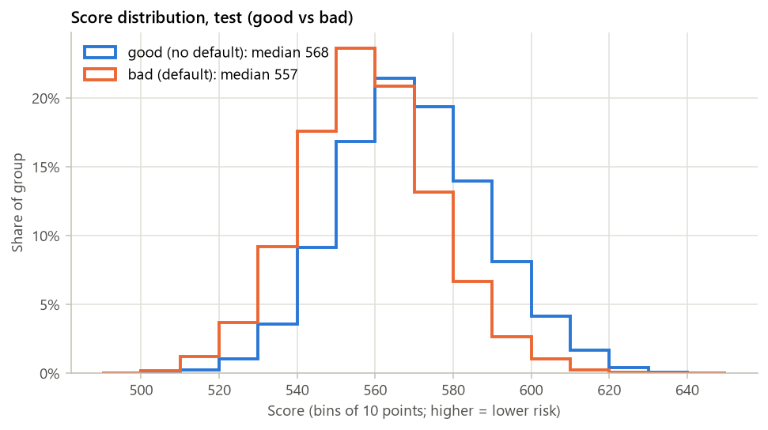

_图 4.1 分数分布（test，good / bad 分开）_

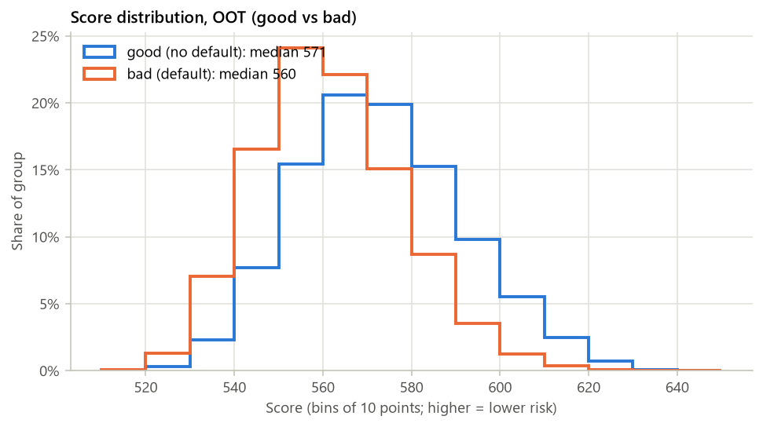

_图 4.2 分数分布（OOT，good / bad 分开）_

## 5. 策略分析

_分数段表、通过率–坏账率曲线、候选 cut-off、利润曲线与 swap set。_

**（本阶段未实现）**

本节计划内容：
- 等频 10 段分数段表
- 通过率 50/60/70/80/90% 的 cut-off 与 bad rate
- 利润曲线与利润最大化 cut-off（基于 net_cash）
- 与平台评级基准的 swap set 2×2 表

## 6. 稳定性

_score PSI、入模特征 CSI、vintage 曲线。_

**（本阶段未实现）**

本节计划内容：
- score PSI：train → test、train → OOT（10 等频段）
- 每个入模特征的 CSI（train → OOT）
- PSI 0.10 / 0.25 阈值标色
- vintage 曲线（按 issue 季度）

## 7. 自动检查与风险提示

_对 leakage、单箱占比、KS 差、PSI、高缺失率入模等做自动检查。_

**（本阶段未实现）**

本节计划内容：
- IV > 0.5 的特征（疑似 leakage）
- 单一分箱占比 > 90% 的特征
- train–test KS 差 > 0.05
- PSI > 0.25
- 缺失率 > 50% 仍入模
- adapter 报告的警告

## 附录：运行元数据

### 运行元数据

- **config**：configs\lendingclub.yaml（hash ca81f62454d0）
- **数据文件**：data/raw/accepted_2007_to_2018Q4.csv.gz；原始 2,260,701 行 → 样本 633,767 行
- **git commit**：24db62f
- **运行时间**：2026-10-19 00:42:15
- **总耗时**：78.2 s
- **版本**：python 3.13.2, credit-scorecard-pipeline 0.1.0, pandas 3.0.6, numpy 2.5.4, sklearn 1.9.1, toad 0.1.7, matplotlib 3.11.2
- **缓存**：data\cache\lendingclub_2767e594d504e290.pkl

### 各步骤耗时

| 步骤 | 秒 |
|---|---|
| load | 12.0 |
| split | 0.2 |
| profile | 2.4 |
| variants | 63.6 |
| strategy | 0.0 |
| monitor | 0.0 |
| checks | 0.0 |
| artifacts | 0.0 |
| variant.no_platform_rating.binning | 5.3 |
| variant.no_platform_rating.select_and_lr | 2.4 |
| variant.no_platform_rating.gbdt | 6.5 |
| variant.no_platform_rating.scoring | 8.2 |
| variant.no_platform_rating.cv_lr | 11.8 |
| variant.no_platform_rating.cv_gbdt | 29.4 |

<details><summary>完整 config</summary>

```yaml
dataset:
  adapter: lendingclub
  path: data/raw/accepted_2007_to_2018Q4.csv.gz
  nrows: null
  cache: true
  cache_dir: data/cache
  options:
    date_format: '%b-%Y'
    sample_frac: null
    sample_random_state: 42
    data_cutoff_month: 2018-12
    terms_allowed: null
    net_cash_subtract_collection_fee: true
    rare_category_min_share: 0.01
    rare_category_cols:
    - purpose
    - home_ownership
    - addr_state
    rare_category_label: OTHER_RARE
    field_groups:
      A:
      - loan_status
      B:
      - total_pymnt
      - total_pymnt_inv
      - total_rec_prncp
      - total_rec_int
      - total_rec_late_fee
      - recoveries
      - collection_recovery_fee
      - out_prncp
      - out_prncp_inv
      - last_pymnt_d
      - last_pymnt_amnt
      - next_pymnt_d
      - last_credit_pull_d
      C:
      - last_fico_range_high
      - last_fico_range_low
      D:
      - hardship_*
      - settlement_*
      - debt_settlement_flag*
      - deferral_term
      - payment_plan_start_date
      - orig_projected_additional_accrued_interest
      - pymnt_plan
      E:
      - id
      - member_id
      - url
      - desc
      - title
      - policy_code
      - emp_title
      - zip_code
      F:
      - funded_amnt_inv
      G:
      - grade
      - sub_grade
      - int_rate
      - installment
      H:
      - annual_inc_joint
      - dti_joint
      - verification_status_joint
      - revol_bal_joint
      - sec_app_*
sample:
  min_issue_date: 2012-01
  max_issue_date: null
split:
  oot_months: 6
  oot_fraction: 0.15
  train_ratio: 0.7
  random_state: 42
features:
  use_platform_rating: false
  exclude: []
binning:
  backend: auto
  method: chi
  min_samples: 0.05
  max_bins: 6
  monotonic: true
  sample_size: 200000
  prebins: 200
select:
  max_missing: 0.5
  min_iv: 0.02
  leakage_iv: 0.5
  max_corr: 0.7
  max_vif: 5.0
  drop_positive_coef: true
  max_features: null
model:
  lr_C: 1.0
  lr_max_iter: 1000
  cv_folds: 5
  cv_challenger: true
  gbdt:
    learning_rate: 0.05
    max_iter: 300
    max_leaf_nodes: 8
    min_samples_leaf: 200
    l2_regularization: 1.0
    early_stopping: false
scorecard:
  pdo: 20
  base_score: 600
  base_odds: 20
strategy:
  approval_rates:
  - 0.5
  - 0.6
  - 0.7
  - 0.8
  - 0.9
  score_bands: 10
monitor:
  psi_bins: 10
  psi_warn: 0.1
  psi_alert: 0.25
checks:
  leakage_iv: 0.5
  single_bin_share: 0.9
  ks_gap: 0.05
  psi_alert: 0.25
  missing_in_model: 0.5
report:
  title: Lending Club 信用评分卡与策略分析报告
  top_missing: 20
  top_woe_plots: 8
  embed_figures: true
output:
  dir: outputs/lendingclub
```

</details>

