# Synthetic 评分卡报告（演示）

- **数据**：synthetic（20,000 行）
- **config hash**：f72ef3f50f97
- **git commit**：24db62f
- **生成时间**：2026-10-19 00:42:15

- **样本**：20,000 笔，bad rate 27.42%
- **入模特征**：6 / 14
- **train AUC / KS**：0.7690 / 0.4025
- **test AUC / KS**：0.7732 / 0.4247
- **OOT AUC / KS**：0.7672 / 0.4049

> **运行警告**
> - fico_mid: IV = 0.805 > 0.5，疑似 leakage，已保留但需人工确认

## 1. 样本与数据概况

_数据来源、样本定义的每条规则及其影响、字段审计（哪些字段因为是贷后信息而剔除）、缺失率与 bad rate 随时间的变化。_

### 1.1 数据来源与规模

- **数据来源**：synthetic
- **adapter**：synthetic
- **原始行 × 列**：20,000 × 20
- **样本定义后行数**：20,000
- **候选特征数**：14（其中类别型 2）
- **bad rate**：27.42%（bad = 5,484）
- **issue_date 范围**：2015-01 ~ 2017-12

### 1.2 样本定义影响表

| 步骤 | 规则 | 说明 | 剔除行数 | 剩余行数 | 剩余 bad rate |
|---|---|---|---|---|---|
| 1 | drop_missing_target | 剔除 target 缺失的行 | 0 | 20,000 | 27.42% |
| 2 | final_sample | 最终样本量与 bad rate | 0 | 20,000 | 27.42% |

### 1.4 字段审计：按分组汇总

| 分组 | 字段数 | 处理 |
|---|---|---|
| A 目标 / 保留列 | 5 | 保留列（非特征） 5 |
| G 平台评级（use_platform_rating 开关） | 1 | 平台评级（开关） 1 |
| I 候选特征 | 14 | 入模候选 14 |

### 字段审计清单（全部原始字段 + 派生变量）

| 字段 | 分组 | 处理 | 原因 |
|---|---|---|---|
| target | A 目标 / 保留列 | 保留列（非特征） | 保留列（target / 日期 / 金额） |
| issue_date | A 目标 / 保留列 | 保留列（非特征） | 保留列（target / 日期 / 金额） |
| event_date | A 目标 / 保留列 | 保留列（非特征） | 保留列（target / 日期 / 金额） |
| loan_amount | A 目标 / 保留列 | 保留列（非特征） | 保留列（target / 日期 / 金额） |
| net_cash | A 目标 / 保留列 | 保留列（非特征） | 保留列（target / 日期 / 金额） |
| grade | G 平台评级（use_platform_rating 开关） | 平台评级（开关） | 平台评级 |
| fico_mid | I 候选特征 | 入模候选 | 合成特征 |
| dti | I 候选特征 | 入模候选 | 合成特征 |
| annual_inc | I 候选特征 | 入模候选 | 合成特征 |
| revol_util | I 候选特征 | 入模候选 | 合成特征 |
| inq_last_6mths | I 候选特征 | 入模候选 | 合成特征 |
| delinq_2yrs | I 候选特征 | 入模候选 | 合成特征 |
| credit_hist_months | I 候选特征 | 入模候选 | 合成特征 |
| term | I 候选特征 | 入模候选 | 合成特征 |
| noise_feature | I 候选特征 | 入模候选 | 纯噪声特征（应被 IV 筛掉） |
| purpose | I 候选特征 | 入模候选 | 合成特征 |
| home_ownership | I 候选特征 | 入模候选 | 合成特征 |
| loan_amnt | I 候选特征 | 入模候选 | 合成特征 |
| mths_since_last_delinq | I 候选特征 | 入模候选 | 合成特征 |
| mostly_missing | I 候选特征 | 入模候选 | 合成特征 |

### 1.5 缺失率 Top 20（候选特征，全样本）

| 特征 | 类型 | 缺失率 | 取值数 |
|---|---|---|---|
| mostly_missing | numeric | 94.93% | 1,014 |
| mths_since_last_delinq | numeric | 73.83% | 79 |
| revol_util | numeric | 7.87% | 978 |
| annual_inc | numeric | 0.00% | 1,829 |
| dti | numeric | 0.00% | 4,161 |
| fico_mid | numeric | 0.00% | 216 |
| delinq_2yrs | numeric | 0.00% | 5 |
| inq_last_6mths | numeric | 0.00% | 7 |
| credit_hist_months | numeric | 0.00% | 470 |
| term | numeric | 0.00% | 2 |
| purpose | categorical | 0.00% | 6 |
| noise_feature | numeric | 0.00% | 4,463 |
| loan_amnt | numeric | 0.00% | 8 |
| home_ownership | categorical | 0.00% | 3 |

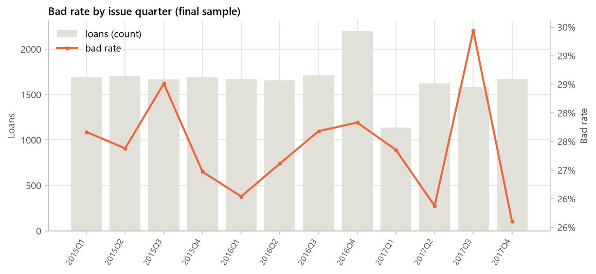

_图 1.2 bad rate 按 issue 季度（最终样本）_

### 1.6 bad rate 按 issue 季度

| 季度 | 贷款数 | bad 数 | bad rate |
|---|---|---|---|
| 2015Q1 | 1,688 | 467 | 27.67% |
| 2015Q2 | 1,702 | 466 | 27.38% |
| 2015Q3 | 1,666 | 475 | 28.51% |
| 2015Q4 | 1,687 | 455 | 26.97% |
| 2016Q1 | 1,673 | 444 | 26.54% |
| 2016Q2 | 1,656 | 449 | 27.11% |
| 2016Q3 | 1,716 | 475 | 27.68% |
| 2016Q4 | 2,199 | 612 | 27.83% |
| 2017Q1 | 1,137 | 311 | 27.35% |
| 2017Q2 | 1,619 | 427 | 26.37% |
| 2017Q3 | 1,583 | 466 | 29.44% |
| 2017Q4 | 1,674 | 437 | 26.11% |

### 1.7 缺失率按 issue 年（总缺失率 > 5% 的特征）

| 特征 | 总缺失率 | 2015 | 2016 | 2017 |
|---|---|---|---|---|
| mostly_missing | 94.9% | 95.0% | 95.0% | 94.7% |
| mths_since_last_delinq | 73.8% | 73.1% | 74.2% | 74.2% |
| revol_util | 7.9% | 8.3% | 7.6% | 7.7% |

### 1.8 样本切分

| 样本 | 行数 | 占比 | bad rate | issue 起 | issue 止 |
|---|---|---|---|---|---|
| train | 11,720 | 58.60% | 27.36% | 2015-01 | 2017-06 |
| test | 5,023 | 25.11% | 27.35% | 2015-01 | 2017-06 |
| oot | 3,257 | 16.29% | 27.72% | 2017-07 | 2017-12 |

_按 issue_date 切 OOT（最后 6 个月：2017-07 ~ 2017-12），其余按 target 分层随机切 train / test；train_ratio = 0.7，random_state = 42。分箱、WOE、特征选择与模型只在 train 上拟合。_

## 2. 分箱与 IV

_在 train 上做单调 WOE 分箱并计算 IV；按缺失率、IV、相关性和系数符号筛选入模特征。_

### 2.1 分箱设置

- **分箱后端**：toad（1 个特征库未给出切点，退到 tree：noise_feature）
- **method / min_samples / max_bins**：chi / 0.05 / 6
- **单调性约束**：是（不单调则合并相邻箱直至单调或退到 2 箱）
- **切点搜索样本量**：11,720（WOE / IV 在全部 train 上计算；筛选阈值也在 train 上评估）
- **WOE 定义**：WOE = ln(good 占比 / bad 占比)，越大越安全；缺失单独一箱
- **候选特征 → 入模特征**：14 → 6

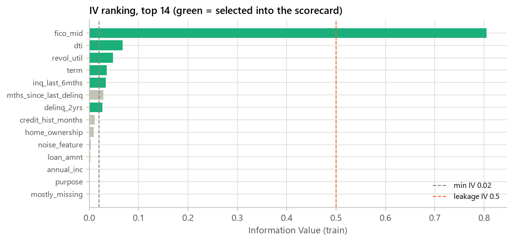

_图 2.1 IV 排名（前 30；绿色 = 入模）_

### 2.2 IV 排名表（全部候选特征，按 IV 降序）

| 特征 | 类型 | IV | 缺失率（train） | 箱数 | 入模 | 剔除步骤 | 原因 |
|---|---|---|---|---|---|---|---|
| fico_mid | numeric | 0.8052 | 0.00% | 6 | 是 |  | selected |
| dti | numeric | 0.0677 | 0.00% | 6 | 是 |  | selected |
| revol_util | numeric | 0.0478 | 8.11% | 5 | 是 |  | selected |
| term | numeric | 0.0356 | 0.00% | 2 | 是 |  | selected |
| inq_last_6mths | numeric | 0.0336 | 0.00% | 3 | 是 |  | selected |
| mths_since_last_delinq | numeric | 0.0284 | 74.00% | 3 | 否 | 1_missing | missing rate 74.0% > 50% |
| delinq_2yrs | numeric | 0.0265 | 0.00% | 2 | 是 |  | selected |
| credit_hist_months | numeric | 0.0115 | 0.00% | 4 | 否 | 2_iv | IV 0.0115 < 0.02 |
| home_ownership | categorical | 0.0096 | 0.00% | 3 | 否 | 2_iv | IV 0.0096 < 0.02 |
| noise_feature | numeric | 0.0035 | 0.00% | 4 | 否 | 2_iv | IV 0.0035 < 0.02 |
| loan_amnt | numeric | 0.0024 | 0.00% | 3 | 否 | 2_iv | IV 0.0024 < 0.02 |
| annual_inc | numeric | 0.0016 | 0.00% | 3 | 否 | 2_iv | IV 0.0016 < 0.02 |
| purpose | categorical | 0.0007 | 0.00% | 5 | 否 | 2_iv | IV 0.0007 < 0.02 |
| mostly_missing | numeric | 0.0000 | 95.07% | 2 | 否 | 1_missing | missing rate 95.1% > 50% |

### 2.3 特征筛选漏斗

| 步骤 | 剔除 | 剩余 |
|---|---|---|
| 候选特征 |  | 14 |
| 缺失率 > 50% | 2 | 12 |
| IV < 0.02 | 6 | 6 |
| \|corr\| > 0.7（保留 IV 高者） | 0 | 6 |
| LR 系数为正（WOE 方向反转） | 0 | 6 |

> **提示**
> - IV > 0.5 的特征（疑似 leakage，已保留，需人工确认）：fico_mid

### 2.4 单调性检查（入模特征）

| 特征 | 类型 | 切点来源 | 初始箱数 | 初始单调 | 最终箱数（含缺失箱） | 最终单调 | 最大箱占比 |
|---|---|---|---|---|---|---|---|
| fico_mid | numeric | toad | 6 | 是 | 6 | 是 | 24.56% |
| dti | numeric | toad | 6 | 是 | 6 | 是 | 23.02% |
| revol_util | numeric | toad | 4 | 是 | 5 | 是 | 29.03% |
| term | numeric | unique_values | 2 | 是 | 2 | 是 | 74.71% |
| inq_last_6mths | numeric | toad | 3 | 是 | 3 | 是 | 45.26% |
| delinq_2yrs | numeric | unique_values | 2 | 是 | 2 | 是 | 74.00% |

_类别型特征按 train bad rate 排序后再分箱，因此天然单调。数值型不单调时合并相邻箱，直到 bad rate 单调或只剩 2 箱。切点来源 unique_values = 取值数不超过 max_bins、逐值成箱。_

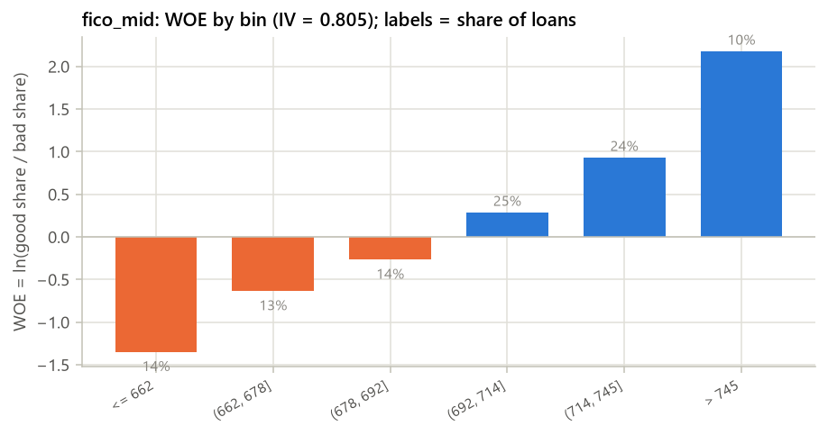

_图 2.2 fico_mid 的 WOE（IV 第 1 名）_

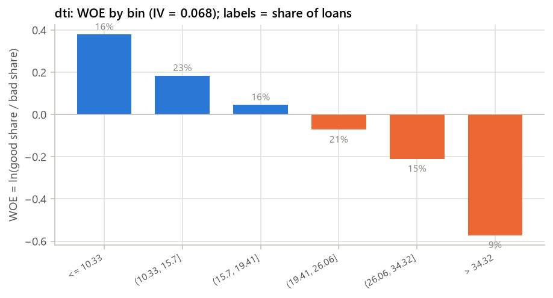

_图 2.3 dti 的 WOE（IV 第 2 名）_

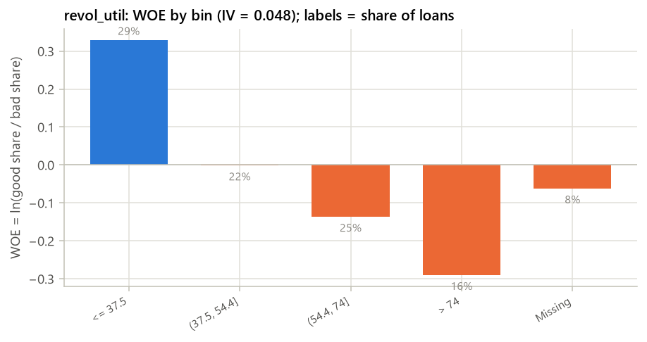

_图 2.4 revol_util 的 WOE（IV 第 3 名）_

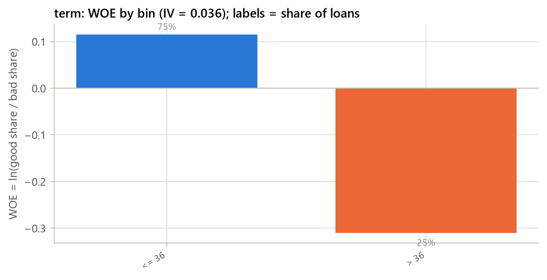

_图 2.5 term 的 WOE（IV 第 4 名）_

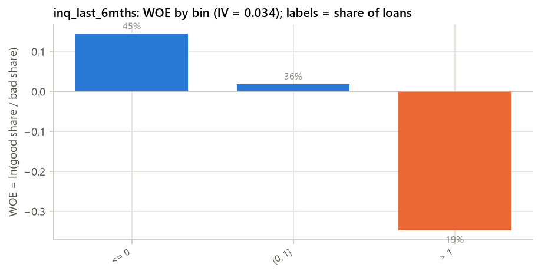

_图 2.6 inq_last_6mths 的 WOE（IV 第 5 名）_

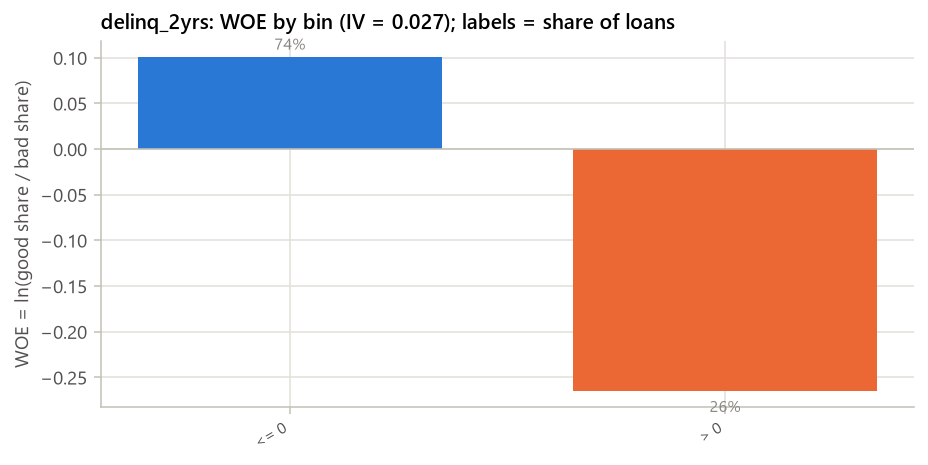

_图 2.7 delinq_2yrs 的 WOE（IV 第 6 名）_

### 分箱表：fico_mid（IV = 0.8052）

| 分箱 | 人数 | 占比 | bad 数 | bad rate | WOE |
|---|---|---|---|---|---|
| <= 662 | 1,643 | 14.02% | 973 | 59.22% | -1.3494 |
| (662, 678] | 1,499 | 12.79% | 623 | 41.56% | -0.6354 |
| (678, 692] | 1,680 | 14.33% | 554 | 32.98% | -0.2670 |
| (692, 714] | 2,879 | 24.56% | 638 | 22.16% | 0.2801 |
| (714, 745] | 2,854 | 24.35% | 371 | 13.00% | 0.9248 |
| > 745 | 1,165 | 9.94% | 48 | 4.12% | 2.1709 |

### 分箱表：dti（IV = 0.0677）

| 分箱 | 人数 | 占比 | bad 数 | bad rate | WOE |
|---|---|---|---|---|---|
| <= 10.33 | 1,877 | 16.02% | 385 | 20.51% | 0.3784 |
| (10.33, 15.7] | 2,698 | 23.02% | 644 | 23.87% | 0.1836 |
| (15.7, 19.41] | 1,874 | 15.99% | 496 | 26.47% | 0.0456 |
| (19.41, 26.06] | 2,519 | 21.49% | 726 | 28.82% | -0.0722 |
| (26.06, 34.32] | 1,755 | 14.97% | 557 | 31.74% | -0.2104 |
| > 34.32 | 997 | 8.51% | 399 | 40.02% | -0.5716 |

### 分箱表：revol_util（IV = 0.0478）

| 分箱 | 人数 | 占比 | bad 数 | bad rate | WOE |
|---|---|---|---|---|---|
| <= 37.5 | 3,402 | 29.03% | 726 | 21.34% | 0.3283 |
| (37.5, 54.4] | 2,633 | 22.47% | 721 | 27.38% | -0.0010 |
| (54.4, 74] | 2,912 | 24.85% | 878 | 30.15% | -0.1361 |
| > 74 | 1,822 | 15.55% | 610 | 33.48% | -0.2897 |
| Missing | 951 | 8.11% | 272 | 28.60% | -0.0614 |

### 分箱表：term（IV = 0.0356）

| 分箱 | 人数 | 占比 | bad 数 | bad rate | WOE |
|---|---|---|---|---|---|
| <= 36 | 8,756 | 74.71% | 2,201 | 25.14% | 0.1151 |
| > 36 | 2,964 | 25.29% | 1,006 | 33.94% | -0.3103 |

### 分箱表：inq_last_6mths（IV = 0.0336）

| 分箱 | 人数 | 占比 | bad 数 | bad rate | WOE |
|---|---|---|---|---|---|
| <= 0 | 5,304 | 45.26% | 1,304 | 24.59% | 0.1446 |
| (0, 1] | 4,216 | 35.97% | 1,138 | 26.99% | 0.0187 |
| > 1 | 2,200 | 18.77% | 765 | 34.77% | -0.3472 |

### 分箱表：delinq_2yrs（IV = 0.0265）

| 分箱 | 人数 | 占比 | bad 数 | bad rate | WOE |
|---|---|---|---|---|---|
| <= 0 | 8,673 | 74.00% | 2,204 | 25.41% | 0.1005 |
| > 0 | 3,047 | 26.00% | 1,003 | 32.92% | -0.2643 |

## 3. 模型表现

_WOE 逻辑回归评分卡与 GBDT challenger 在 train / test / OOT 上的 AUC、KS、Gini，以及 train 内交叉验证（每折重做分箱与 WOE；入模变量清单固定自全 train）。_

### 3.1 LR 系数表（WOE 输入；WOE 越大越安全，系数应为负）

| 特征 | 系数 | IV | VIF |
|---|---|---|---|
| (intercept) | -0.9777 |  |  |
| fico_mid | -1.0377 | 0.8052 | 1.0012 |
| dti | -1.1332 | 0.0677 | 1.0004 |
| revol_util | -1.1094 | 0.0478 | 1.0007 |
| term | -1.2428 | 0.0356 | 1.0003 |
| inq_last_6mths | -1.0971 | 0.0336 | 1.0006 |
| delinq_2yrs | -1.0796 | 0.0265 | 1.0005 |

_LogisticRegression(penalty=l2, C=1.0)；VIF > 5.0 标警。_

### 3.2 train / test / OOT 表现

| 模型 | 样本 | 行数 | bad rate | AUC | KS | Gini |
|---|---|---|---|---|---|---|
| LR scorecard | train | 11,720 | 27.36% | 0.7690 | 0.4025 | 0.5380 |
| GBDT challenger | train | 11,720 | 27.36% | 0.8110 | 0.4644 | 0.6220 |
| LR scorecard | test | 5,023 | 27.35% | 0.7732 | 0.4247 | 0.5464 |
| GBDT challenger | test | 5,023 | 27.35% | 0.7770 | 0.4313 | 0.5540 |
| LR scorecard | OOT | 3,257 | 27.72% | 0.7672 | 0.4049 | 0.5344 |
| GBDT challenger | OOT | 3,257 | 27.72% | 0.7733 | 0.4088 | 0.5466 |

### 3.3 5 折 CV（train 内；每折重做分箱与 WOE）

| 模型 | AUC 均值 ± std | KS 均值 ± std | 折数 |
|---|---|---|---|
| LR scorecard | 0.7635 ± 0.0149 | 0.4001 ± 0.0294 | 5 |
| GBDT challenger | 0.7647 ± 0.0178 | 0.4039 ± 0.0289 | 5 |

### 3.4 LR vs GBDT challenger

| 指标 | LR scorecard | GBDT | GBDT − LR |
|---|---|---|---|
| test AUC | 0.7732 | 0.7770 | +0.0038 |
| test KS | 0.4247 | 0.4313 | +0.0066 |
| OOT AUC | 0.7672 | 0.7733 | +0.0061 |
| OOT KS | 0.4049 | 0.4088 | +0.0039 |

_challenger 直接使用未 WOE 的原始候选特征（含缺失），只作为性能上限参照，不上线。_

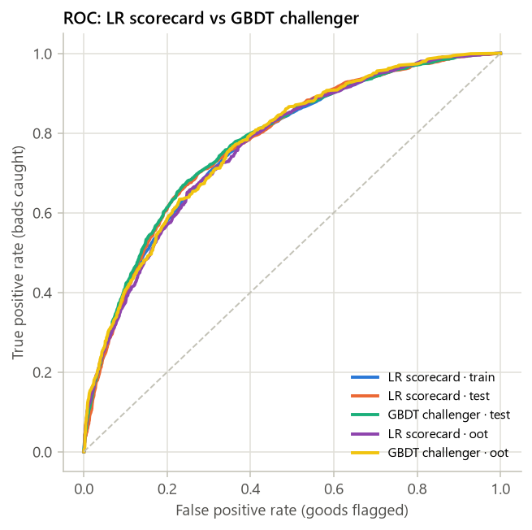

_图 3.1 ROC 曲线_

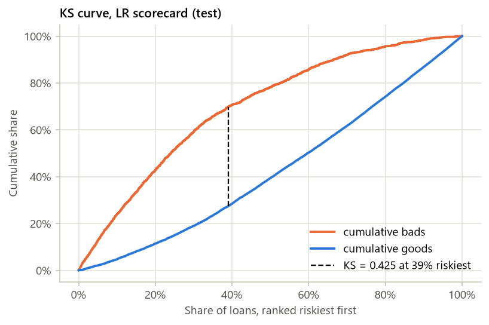

_图 3.2 KS 曲线（LR，test）_

### KS 分段表（test，按 LR 预测概率从高风险到低风险 10 等分）

| 分段 | 人数 | bad 数 | bad rate | 累计 bad 占比 | 累计 good 占比 | KS |
|---|---|---|---|---|---|---|
| 1 | 503 | 329 | 65.41% | 23.94% | 4.77% | 0.1918 |
| 2 | 502 | 260 | 51.79% | 42.87% | 11.40% | 0.3147 |
| 3 | 502 | 224 | 44.62% | 59.17% | 19.02% | 0.4015 |
| 4 | 502 | 158 | 31.47% | 70.67% | 28.45% | 0.4222 |
| 5 | 503 | 104 | 20.68% | 78.24% | 39.38% | 0.3886 |
| 6 | 502 | 103 | 20.52% | 85.74% | 50.32% | 0.3542 |
| 7 | 502 | 86 | 17.13% | 91.99% | 61.72% | 0.3028 |
| 8 | 502 | 50 | 9.96% | 95.63% | 74.10% | 0.2153 |
| 9 | 502 | 39 | 7.77% | 98.47% | 86.79% | 0.1168 |
| 10 | 503 | 21 | 4.17% | 100.00% | 100.00% | 0.0000 |

本次只跑“不含平台评级”一套模型；“含 / 不含平台评级”并排对比需要 features.use_platform_rating: [false, true]（Phase 2 默认）。

## 4. 评分卡

_把 WOE 逻辑回归换算为评分卡：PDO、base score、base odds，每个变量每个分箱的分数，以及分数分布。_

### 4.1 PDO 换算

- **PDO / base score / base odds**：20 / 600 / 20:1
- **Factor = PDO / ln2**：28.8539
- **Offset = base − Factor × ln(odds)**：600 − 28.8539 × ln(20) = 513.5614
- **LR 截距 b0**：-0.9777
- **基础分 = Offset − Factor × b0**：541.77 → 取整 542
- **分箱分数**：points = −Factor × 系数 × WOE，取整
- **可能的分数范围**：444 ~ 642
- **整数分数的 AUC（test / OOT）**：test 0.7734 / OOT 0.7672

### 4.2 评分卡表

| 变量 | 分箱 | train 人数 | 占比 | bad rate | WOE | 系数 | 分数 | 整数分 |
|---|---|---|---|---|---|---|---|---|
| BASE | (every applicant) |  |  |  |  |  | 541.77 | 542 |
| fico_mid | <= 662 | 1,643 | 14.02% | 59.22% | -1.3494 | -1.0377 | -40.40 | -40 |
| fico_mid | (662, 678] | 1,499 | 12.79% | 41.56% | -0.6354 | -1.0377 | -19.03 | -19 |
| fico_mid | (678, 692] | 1,680 | 14.33% | 32.98% | -0.2670 | -1.0377 | -7.99 | -8 |
| fico_mid | (692, 714] | 2,879 | 24.56% | 22.16% | 0.2801 | -1.0377 | 8.39 | 8 |
| fico_mid | (714, 745] | 2,854 | 24.35% | 13.00% | 0.9248 | -1.0377 | 27.69 | 28 |
| fico_mid | > 745 | 1,165 | 9.94% | 4.12% | 2.1709 | -1.0377 | 65.00 | 65 |
| dti | <= 10.33 | 1,877 | 16.02% | 20.51% | 0.3784 | -1.1332 | 12.37 | 12 |
| dti | (10.33, 15.7] | 2,698 | 23.02% | 23.87% | 0.1836 | -1.1332 | 6.00 | 6 |
| dti | (15.7, 19.41] | 1,874 | 15.99% | 26.47% | 0.0456 | -1.1332 | 1.49 | 1 |
| dti | (19.41, 26.06] | 2,519 | 21.49% | 28.82% | -0.0722 | -1.1332 | -2.36 | -2 |
| dti | (26.06, 34.32] | 1,755 | 14.97% | 31.74% | -0.2104 | -1.1332 | -6.88 | -7 |
| dti | > 34.32 | 997 | 8.51% | 40.02% | -0.5716 | -1.1332 | -18.69 | -19 |
| revol_util | <= 37.5 | 3,402 | 29.03% | 21.34% | 0.3283 | -1.1094 | 10.51 | 11 |
| revol_util | (37.5, 54.4] | 2,633 | 22.47% | 27.38% | -0.0010 | -1.1094 | -0.03 | 0 |
| revol_util | (54.4, 74] | 2,912 | 24.85% | 30.15% | -0.1361 | -1.1094 | -4.36 | -4 |
| revol_util | > 74 | 1,822 | 15.55% | 33.48% | -0.2897 | -1.1094 | -9.27 | -9 |
| revol_util | Missing | 951 | 8.11% | 28.60% | -0.0614 | -1.1094 | -1.97 | -2 |
| term | <= 36 | 8,756 | 74.71% | 25.14% | 0.1151 | -1.2428 | 4.13 | 4 |
| term | > 36 | 2,964 | 25.29% | 33.94% | -0.3103 | -1.2428 | -11.13 | -11 |
| inq_last_6mths | <= 0 | 5,304 | 45.26% | 24.59% | 0.1446 | -1.0971 | 4.58 | 5 |
| inq_last_6mths | (0, 1] | 4,216 | 35.97% | 26.99% | 0.0187 | -1.0971 | 0.59 | 1 |
| inq_last_6mths | > 1 | 2,200 | 18.77% | 34.77% | -0.3472 | -1.0971 | -10.99 | -11 |
| delinq_2yrs | <= 0 | 8,673 | 74.00% | 25.41% | 0.1005 | -1.0796 | 3.13 | 3 |
| delinq_2yrs | > 0 | 3,047 | 26.00% | 32.92% | -0.2643 | -1.0796 | -8.23 | -8 |

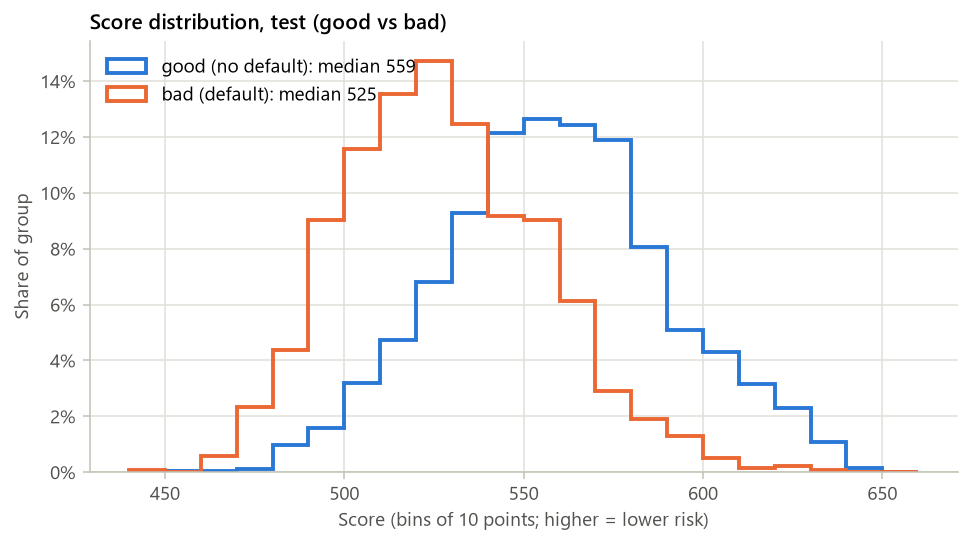

_图 4.1 分数分布（test，good / bad 分开）_

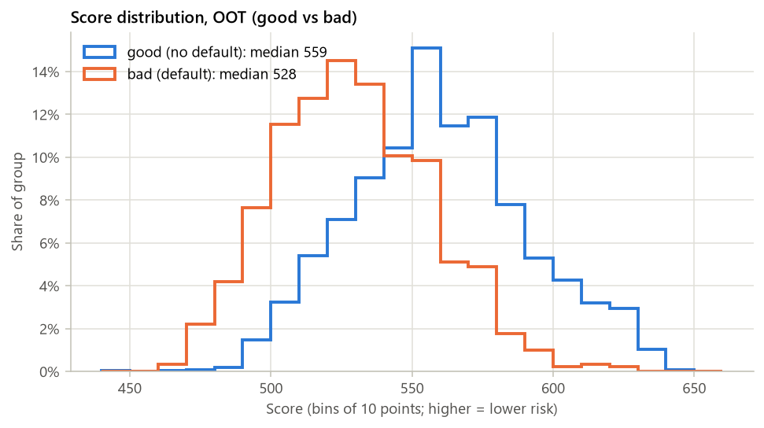

_图 4.2 分数分布（OOT，good / bad 分开）_

## 5. 策略分析

_分数段表、通过率–坏账率曲线、候选 cut-off、利润曲线与 swap set。_

**（本阶段未实现）**

本节计划内容：
- 等频 10 段分数段表
- 通过率 50/60/70/80/90% 的 cut-off 与 bad rate
- 利润曲线与利润最大化 cut-off（基于 net_cash）
- 与平台评级基准的 swap set 2×2 表

## 6. 稳定性

_score PSI、入模特征 CSI、vintage 曲线。_

**（本阶段未实现）**

本节计划内容：
- score PSI：train → test、train → OOT（10 等频段）
- 每个入模特征的 CSI（train → OOT）
- PSI 0.10 / 0.25 阈值标色
- vintage 曲线（按 issue 季度）

## 7. 自动检查与风险提示

_对 leakage、单箱占比、KS 差、PSI、高缺失率入模等做自动检查。_

**（本阶段未实现）**

本节计划内容：
- IV > 0.5 的特征（疑似 leakage）
- 单一分箱占比 > 90% 的特征
- train–test KS 差 > 0.05
- PSI > 0.25
- 缺失率 > 50% 仍入模
- adapter 报告的警告

## 附录：运行元数据

### 运行元数据

- **config**：configs\synthetic.yaml（hash f72ef3f50f97）
- **数据文件**：synthetic；原始 20,000 行 → 样本 20,000 行
- **git commit**：24db62f
- **运行时间**：2026-10-19 00:42:15
- **总耗时**：2.8 s
- **版本**：python 3.13.2, credit-scorecard-pipeline 0.1.0, pandas 3.0.6, numpy 2.5.4, sklearn 1.9.1, toad 0.1.7, matplotlib 3.11.2
- **缓存**：未命中 / 未启用

### 各步骤耗时

| 步骤 | 秒 |
|---|---|
| load | 0.1 |
| split | 0.0 |
| profile | 0.0 |
| variants | 2.6 |
| strategy | 0.0 |
| monitor | 0.0 |
| checks | 0.0 |
| artifacts | 0.0 |
| variant.no_platform_rating.binning | 0.1 |
| variant.no_platform_rating.select_and_lr | 0.0 |
| variant.no_platform_rating.gbdt | 0.3 |
| variant.no_platform_rating.scoring | 0.2 |
| variant.no_platform_rating.cv_lr | 0.2 |
| variant.no_platform_rating.cv_gbdt | 1.7 |

<details><summary>完整 config</summary>

```yaml
dataset:
  adapter: synthetic
  path: null
  nrows: null
  cache: true
  cache_dir: data/cache
  options:
    n_rows: 20000
    n_months: 36
    base_bad_rate: 0.15
sample:
  min_issue_date: null
  max_issue_date: null
split:
  oot_months: 6
  oot_fraction: 0.15
  train_ratio: 0.7
  random_state: 42
features:
  use_platform_rating: false
  exclude: []
binning:
  backend: auto
  method: chi
  min_samples: 0.05
  max_bins: 6
  monotonic: true
  sample_size: 20000
  prebins: 200
select:
  max_missing: 0.5
  min_iv: 0.02
  leakage_iv: 0.5
  max_corr: 0.7
  max_vif: 5.0
  drop_positive_coef: true
  max_features: null
model:
  lr_C: 1.0
  lr_max_iter: 1000
  cv_folds: 5
  cv_challenger: true
  gbdt:
    learning_rate: 0.05
    max_iter: 300
    max_leaf_nodes: 8
    min_samples_leaf: 200
    l2_regularization: 1.0
    early_stopping: false
scorecard:
  pdo: 20
  base_score: 600
  base_odds: 20
strategy:
  approval_rates:
  - 0.5
  - 0.6
  - 0.7
  - 0.8
  - 0.9
  score_bands: 10
monitor:
  psi_bins: 10
  psi_warn: 0.1
  psi_alert: 0.25
checks:
  leakage_iv: 0.5
  single_bin_share: 0.9
  ks_gap: 0.05
  psi_alert: 0.25
  missing_in_model: 0.5
report:
  title: Synthetic 评分卡报告（演示）
  top_missing: 20
  top_woe_plots: 8
  embed_figures: true
output:
  dir: outputs/synthetic
```

</details>

