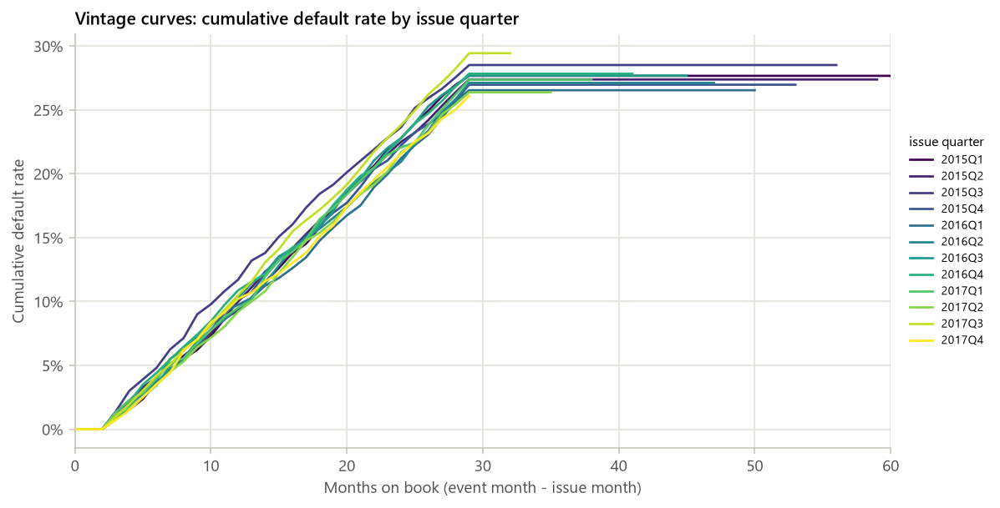

# Synthetic 评分卡报告（演示）

- **数据**：synthetic（20,000 行）
- **config hash**：37cc2e51350d
- **git commit**：ca6f10e
- **生成时间**：2026-10-19 01:16:58

- **样本**：20,000 笔，bad rate 27.42%
- **入模特征**：6 / 14
- **train AUC / KS**：0.7690 / 0.4025
- **test AUC / KS**：0.7732 / 0.4247
- **OOT AUC / KS**：0.7672 / 0.4049

> **运行警告**
> - fico_mid: IV = 0.805 > 0.5，疑似 leakage，已保留但需人工确认
> - fico_mid: IV = 0.805 > 0.5，疑似 leakage，已保留但需人工确认
> - grade: IV = 0.699 > 0.5，疑似 leakage，已保留但需人工确认

## 1. 样本与数据概况

_数据来源、样本定义的每条规则及其影响、字段审计（哪些字段因为是贷后信息而剔除）、缺失率与 bad rate 随时间的变化。_

### 1.1 数据来源与规模

- **数据来源**：synthetic
- **adapter**：synthetic
- **原始行 × 列**：20,000 × 20
- **样本定义后行数**：20,000
- **候选特征数**：14（其中类别型 2）
- **bad rate**：27.42%（bad = 5,484）
- **issue_date 范围**：2015-01 ~ 2017-12

### 1.2 样本定义影响表

| 步骤 | 规则 | 说明 | 剔除行数 | 剩余行数 | 剩余 bad rate |
|---|---|---|---|---|---|
| 1 | drop_missing_target | 剔除 target 缺失的行 | 0 | 20,000 | 27.42% |
| 2 | final_sample | 最终样本量与 bad rate | 0 | 20,000 | 27.42% |

### 1.4 字段审计：按分组汇总

| 分组 | 字段数 | 处理 |
|---|---|---|
| A 目标 / 保留列 | 5 | 保留列（非特征） 5 |
| G 平台评级（use_platform_rating 开关） | 1 | 平台评级（开关） 1 |
| I 候选特征 | 14 | 入模候选 14 |

### 字段审计清单（全部原始字段 + 派生变量）

| 字段 | 分组 | 处理 | 原因 |
|---|---|---|---|
| target | A 目标 / 保留列 | 保留列（非特征） | 保留列（target / 日期 / 金额） |
| issue_date | A 目标 / 保留列 | 保留列（非特征） | 保留列（target / 日期 / 金额） |
| event_date | A 目标 / 保留列 | 保留列（非特征） | 保留列（target / 日期 / 金额） |
| loan_amount | A 目标 / 保留列 | 保留列（非特征） | 保留列（target / 日期 / 金额） |
| net_cash | A 目标 / 保留列 | 保留列（非特征） | 保留列（target / 日期 / 金额） |
| grade | G 平台评级（use_platform_rating 开关） | 平台评级（开关） | 平台评级 |
| fico_mid | I 候选特征 | 入模候选 | 合成特征 |
| dti | I 候选特征 | 入模候选 | 合成特征 |
| annual_inc | I 候选特征 | 入模候选 | 合成特征 |
| revol_util | I 候选特征 | 入模候选 | 合成特征 |
| inq_last_6mths | I 候选特征 | 入模候选 | 合成特征 |
| delinq_2yrs | I 候选特征 | 入模候选 | 合成特征 |
| credit_hist_months | I 候选特征 | 入模候选 | 合成特征 |
| term | I 候选特征 | 入模候选 | 合成特征 |
| noise_feature | I 候选特征 | 入模候选 | 纯噪声特征（应被 IV 筛掉） |
| purpose | I 候选特征 | 入模候选 | 合成特征 |
| home_ownership | I 候选特征 | 入模候选 | 合成特征 |
| loan_amnt | I 候选特征 | 入模候选 | 合成特征 |
| mths_since_last_delinq | I 候选特征 | 入模候选 | 合成特征 |
| mostly_missing | I 候选特征 | 入模候选 | 合成特征 |

### 1.5 缺失率 Top 20（候选特征，全样本）

| 特征 | 类型 | 缺失率 | 取值数 |
|---|---|---|---|
| mostly_missing | numeric | 94.93% | 1,014 |
| mths_since_last_delinq | numeric | 73.83% | 79 |
| revol_util | numeric | 7.87% | 978 |
| annual_inc | numeric | 0.00% | 1,829 |
| dti | numeric | 0.00% | 4,161 |
| fico_mid | numeric | 0.00% | 216 |
| delinq_2yrs | numeric | 0.00% | 5 |
| inq_last_6mths | numeric | 0.00% | 7 |
| credit_hist_months | numeric | 0.00% | 470 |
| term | numeric | 0.00% | 2 |
| purpose | categorical | 0.00% | 6 |
| noise_feature | numeric | 0.00% | 4,463 |
| loan_amnt | numeric | 0.00% | 8 |
| home_ownership | categorical | 0.00% | 3 |


_图 1.2 bad rate 按 issue 季度（最终样本）_

### 1.6 bad rate 按 issue 季度

| 季度 | 贷款数 | bad 数 | bad rate |
|---|---|---|---|
| 2015Q1 | 1,688 | 467 | 27.67% |
| 2015Q2 | 1,702 | 466 | 27.38% |
| 2015Q3 | 1,666 | 475 | 28.51% |
| 2015Q4 | 1,687 | 455 | 26.97% |
| 2016Q1 | 1,673 | 444 | 26.54% |
| 2016Q2 | 1,656 | 449 | 27.11% |
| 2016Q3 | 1,716 | 475 | 27.68% |
| 2016Q4 | 2,199 | 612 | 27.83% |
| 2017Q1 | 1,137 | 311 | 27.35% |
| 2017Q2 | 1,619 | 427 | 26.37% |
| 2017Q3 | 1,583 | 466 | 29.44% |
| 2017Q4 | 1,674 | 437 | 26.11% |

### 1.7 缺失率按 issue 年（总缺失率 > 5% 的特征）

| 特征 | 总缺失率 | 2015 | 2016 | 2017 |
|---|---|---|---|---|
| mostly_missing | 94.9% | 95.0% | 95.0% | 94.7% |
| mths_since_last_delinq | 73.8% | 73.1% | 74.2% | 74.2% |
| revol_util | 7.9% | 8.3% | 7.6% | 7.7% |

### 1.8 样本切分

| 样本 | 行数 | 占比 | bad rate | issue 起 | issue 止 |
|---|---|---|---|---|---|
| train | 11,720 | 58.60% | 27.36% | 2015-01 | 2017-06 |
| test | 5,023 | 25.11% | 27.35% | 2015-01 | 2017-06 |
| oot | 3,257 | 16.29% | 27.72% | 2017-07 | 2017-12 |

_按 issue_date 切 OOT（最后 6 个月：2017-07 ~ 2017-12），其余按 target 分层随机切 train / test；train_ratio = 0.7，random_state = 42。分箱、WOE、特征选择与模型只在 train 上拟合。_

## 2. 分箱与 IV

_在 train 上做单调 WOE 分箱并计算 IV；按缺失率、IV、相关性和系数符号筛选入模特征。_

### [不含平台评级] 2.1 分箱设置

- **分箱后端**：toad（1 个特征库未给出切点，退到 tree：noise_feature）
- **method / min_samples / max_bins**：chi / 0.05 / 6
- **单调性约束**：是（不单调则合并相邻箱直至单调或退到 2 箱）
- **切点搜索样本量**：11,720（WOE / IV 在全部 train 上计算；筛选阈值也在 train 上评估）
- **WOE 定义**：WOE = ln(good 占比 / bad 占比)，越大越安全；缺失单独一箱
- **候选特征 → 入模特征**：14 → 6

![[不含平台评级] 图 2.1 IV 排名（前 30；绿色 = 入模）](figures/03_iv_ranking_no_platform_rating.png)

_[不含平台评级] 图 2.1 IV 排名（前 30；绿色 = 入模）_

### [不含平台评级] 2.2 IV 排名表（全部候选特征，按 IV 降序）

| 特征 | 类型 | IV | 缺失率（train） | 箱数 | 入模 | 剔除步骤 | 原因 |
|---|---|---|---|---|---|---|---|
| fico_mid | numeric | 0.8052 | 0.00% | 6 | 是 |  | selected |
| dti | numeric | 0.0677 | 0.00% | 6 | 是 |  | selected |
| revol_util | numeric | 0.0478 | 8.11% | 5 | 是 |  | selected |
| term | numeric | 0.0356 | 0.00% | 2 | 是 |  | selected |
| inq_last_6mths | numeric | 0.0336 | 0.00% | 3 | 是 |  | selected |
| mths_since_last_delinq | numeric | 0.0284 | 74.00% | 3 | 否 | 1_missing | missing rate 74.0% > 50% |
| delinq_2yrs | numeric | 0.0265 | 0.00% | 2 | 是 |  | selected |
| credit_hist_months | numeric | 0.0115 | 0.00% | 4 | 否 | 2_iv | IV 0.0115 < 0.02 |
| home_ownership | categorical | 0.0096 | 0.00% | 3 | 否 | 2_iv | IV 0.0096 < 0.02 |
| noise_feature | numeric | 0.0035 | 0.00% | 4 | 否 | 2_iv | IV 0.0035 < 0.02 |
| loan_amnt | numeric | 0.0024 | 0.00% | 3 | 否 | 2_iv | IV 0.0024 < 0.02 |
| annual_inc | numeric | 0.0016 | 0.00% | 3 | 否 | 2_iv | IV 0.0016 < 0.02 |
| purpose | categorical | 0.0007 | 0.00% | 5 | 否 | 2_iv | IV 0.0007 < 0.02 |
| mostly_missing | numeric | 0.0000 | 95.07% | 2 | 否 | 1_missing | missing rate 95.1% > 50% |

### [不含平台评级] 2.3 特征筛选漏斗

| 步骤 | 剔除 | 剩余 |
|---|---|---|
| 候选特征 |  | 14 |
| 缺失率 > 50% | 2 | 12 |
| IV < 0.02 | 6 | 6 |
| \|corr\| > 0.7（保留 IV 高者） | 0 | 6 |
| LR 系数为正（WOE 方向反转） | 0 | 6 |

> **提示**
> - IV > 0.5 的特征（疑似 leakage，已保留，需人工确认）：fico_mid

### [不含平台评级] 2.4 单调性检查（入模特征）

| 特征 | 类型 | 切点来源 | 初始箱数 | 初始单调 | 最终箱数（含缺失箱） | 最终单调 | 最大箱占比 |
|---|---|---|---|---|---|---|---|
| fico_mid | numeric | toad | 6 | 是 | 6 | 是 | 24.56% |
| dti | numeric | toad | 6 | 是 | 6 | 是 | 23.02% |
| revol_util | numeric | toad | 4 | 是 | 5 | 是 | 29.03% |
| term | numeric | unique_values | 2 | 是 | 2 | 是 | 74.71% |
| inq_last_6mths | numeric | toad | 3 | 是 | 3 | 是 | 45.26% |
| delinq_2yrs | numeric | unique_values | 2 | 是 | 2 | 是 | 74.00% |

_类别型特征按 train bad rate 排序后再分箱，因此天然单调。数值型不单调时合并相邻箱，直到 bad rate 单调或只剩 2 箱。切点来源 unique_values = 取值数不超过 max_bins、逐值成箱。_

![[不含平台评级] 图 2.2 fico_mid 的 WOE（IV 第 1 名）](figures/04_woe_no_platform_rating_01_fico_mid.png)

_[不含平台评级] 图 2.2 fico_mid 的 WOE（IV 第 1 名）_

![[不含平台评级] 图 2.3 dti 的 WOE（IV 第 2 名）](figures/04_woe_no_platform_rating_02_dti.png)

_[不含平台评级] 图 2.3 dti 的 WOE（IV 第 2 名）_

![[不含平台评级] 图 2.4 revol_util 的 WOE（IV 第 3 名）](figures/04_woe_no_platform_rating_03_revol_util.png)

_[不含平台评级] 图 2.4 revol_util 的 WOE（IV 第 3 名）_

![[不含平台评级] 图 2.5 term 的 WOE（IV 第 4 名）](figures/04_woe_no_platform_rating_04_term.png)

_[不含平台评级] 图 2.5 term 的 WOE（IV 第 4 名）_

![[不含平台评级] 图 2.6 inq_last_6mths 的 WOE（IV 第 5 名）](figures/04_woe_no_platform_rating_05_inq_last_6mths.png)

_[不含平台评级] 图 2.6 inq_last_6mths 的 WOE（IV 第 5 名）_

![[不含平台评级] 图 2.7 delinq_2yrs 的 WOE（IV 第 6 名）](figures/04_woe_no_platform_rating_06_delinq_2yrs.png)

_[不含平台评级] 图 2.7 delinq_2yrs 的 WOE（IV 第 6 名）_

### [不含平台评级] 分箱表：fico_mid（IV = 0.8052）

| 分箱 | 人数 | 占比 | bad 数 | bad rate | WOE |
|---|---|---|---|---|---|
| <= 662 | 1,643 | 14.02% | 973 | 59.22% | -1.3494 |
| (662, 678] | 1,499 | 12.79% | 623 | 41.56% | -0.6354 |
| (678, 692] | 1,680 | 14.33% | 554 | 32.98% | -0.2670 |
| (692, 714] | 2,879 | 24.56% | 638 | 22.16% | 0.2801 |
| (714, 745] | 2,854 | 24.35% | 371 | 13.00% | 0.9248 |
| > 745 | 1,165 | 9.94% | 48 | 4.12% | 2.1709 |

### [不含平台评级] 分箱表：dti（IV = 0.0677）

| 分箱 | 人数 | 占比 | bad 数 | bad rate | WOE |
|---|---|---|---|---|---|
| <= 10.33 | 1,877 | 16.02% | 385 | 20.51% | 0.3784 |
| (10.33, 15.7] | 2,698 | 23.02% | 644 | 23.87% | 0.1836 |
| (15.7, 19.41] | 1,874 | 15.99% | 496 | 26.47% | 0.0456 |
| (19.41, 26.06] | 2,519 | 21.49% | 726 | 28.82% | -0.0722 |
| (26.06, 34.32] | 1,755 | 14.97% | 557 | 31.74% | -0.2104 |
| > 34.32 | 997 | 8.51% | 399 | 40.02% | -0.5716 |

### [不含平台评级] 分箱表：revol_util（IV = 0.0478）

| 分箱 | 人数 | 占比 | bad 数 | bad rate | WOE |
|---|---|---|---|---|---|
| <= 37.5 | 3,402 | 29.03% | 726 | 21.34% | 0.3283 |
| (37.5, 54.4] | 2,633 | 22.47% | 721 | 27.38% | -0.0010 |
| (54.4, 74] | 2,912 | 24.85% | 878 | 30.15% | -0.1361 |
| > 74 | 1,822 | 15.55% | 610 | 33.48% | -0.2897 |
| Missing | 951 | 8.11% | 272 | 28.60% | -0.0614 |

### [不含平台评级] 分箱表：term（IV = 0.0356）

| 分箱 | 人数 | 占比 | bad 数 | bad rate | WOE |
|---|---|---|---|---|---|
| <= 36 | 8,756 | 74.71% | 2,201 | 25.14% | 0.1151 |
| > 36 | 2,964 | 25.29% | 1,006 | 33.94% | -0.3103 |

### [不含平台评级] 分箱表：inq_last_6mths（IV = 0.0336）

| 分箱 | 人数 | 占比 | bad 数 | bad rate | WOE |
|---|---|---|---|---|---|
| <= 0 | 5,304 | 45.26% | 1,304 | 24.59% | 0.1446 |
| (0, 1] | 4,216 | 35.97% | 1,138 | 26.99% | 0.0187 |
| > 1 | 2,200 | 18.77% | 765 | 34.77% | -0.3472 |

### [不含平台评级] 分箱表：delinq_2yrs（IV = 0.0265）

| 分箱 | 人数 | 占比 | bad 数 | bad rate | WOE |
|---|---|---|---|---|---|
| <= 0 | 8,673 | 74.00% | 2,204 | 25.41% | 0.1005 |
| > 0 | 3,047 | 26.00% | 1,003 | 32.92% | -0.2643 |

### [含平台评级] 2.1 分箱设置

- **分箱后端**：toad（1 个特征库未给出切点，退到 tree：noise_feature）
- **method / min_samples / max_bins**：chi / 0.05 / 6
- **单调性约束**：是（不单调则合并相邻箱直至单调或退到 2 箱）
- **切点搜索样本量**：11,720（WOE / IV 在全部 train 上计算；筛选阈值也在 train 上评估）
- **WOE 定义**：WOE = ln(good 占比 / bad 占比)，越大越安全；缺失单独一箱
- **候选特征 → 入模特征**：15 → 7

![[含平台评级] 图 2.1 IV 排名（前 30；绿色 = 入模）](figures/03_iv_ranking_with_platform_rating.png)

_[含平台评级] 图 2.1 IV 排名（前 30；绿色 = 入模）_

### [含平台评级] 2.2 IV 排名表（全部候选特征，按 IV 降序）

| 特征 | 类型 | IV | 缺失率（train） | 箱数 | 入模 | 剔除步骤 | 原因 |
|---|---|---|---|---|---|---|---|
| fico_mid | numeric | 0.8052 | 0.00% | 6 | 是 |  | selected |
| grade | categorical | 0.6994 | 0.00% | 6 | 是 |  | selected |
| dti | numeric | 0.0677 | 0.00% | 6 | 是 |  | selected |
| revol_util | numeric | 0.0478 | 8.11% | 5 | 是 |  | selected |
| term | numeric | 0.0356 | 0.00% | 2 | 是 |  | selected |
| inq_last_6mths | numeric | 0.0336 | 0.00% | 3 | 是 |  | selected |
| mths_since_last_delinq | numeric | 0.0284 | 74.00% | 3 | 否 | 1_missing | missing rate 74.0% > 50% |
| delinq_2yrs | numeric | 0.0265 | 0.00% | 2 | 是 |  | selected |
| credit_hist_months | numeric | 0.0115 | 0.00% | 4 | 否 | 2_iv | IV 0.0115 < 0.02 |
| home_ownership | categorical | 0.0096 | 0.00% | 3 | 否 | 2_iv | IV 0.0096 < 0.02 |
| noise_feature | numeric | 0.0035 | 0.00% | 4 | 否 | 2_iv | IV 0.0035 < 0.02 |
| loan_amnt | numeric | 0.0024 | 0.00% | 3 | 否 | 2_iv | IV 0.0024 < 0.02 |
| annual_inc | numeric | 0.0016 | 0.00% | 3 | 否 | 2_iv | IV 0.0016 < 0.02 |
| purpose | categorical | 0.0007 | 0.00% | 5 | 否 | 2_iv | IV 0.0007 < 0.02 |
| mostly_missing | numeric | 0.0000 | 95.07% | 2 | 否 | 1_missing | missing rate 95.1% > 50% |

### [含平台评级] 2.3 特征筛选漏斗

| 步骤 | 剔除 | 剩余 |
|---|---|---|
| 候选特征 |  | 15 |
| 缺失率 > 50% | 2 | 13 |
| IV < 0.02 | 6 | 7 |
| \|corr\| > 0.7（保留 IV 高者） | 0 | 7 |
| LR 系数为正（WOE 方向反转） | 0 | 7 |

> **提示**
> - IV > 0.5 的特征（疑似 leakage，已保留，需人工确认）：fico_mid, grade

### [含平台评级] 2.4 单调性检查（入模特征）

| 特征 | 类型 | 切点来源 | 初始箱数 | 初始单调 | 最终箱数（含缺失箱） | 最终单调 | 最大箱占比 |
|---|---|---|---|---|---|---|---|
| fico_mid | numeric | toad | 6 | 是 | 6 | 是 | 24.56% |
| grade | categorical | toad | 6 | 是 | 6 | 是 | 28.28% |
| dti | numeric | toad | 6 | 是 | 6 | 是 | 23.02% |
| revol_util | numeric | toad | 4 | 是 | 5 | 是 | 29.03% |
| term | numeric | unique_values | 2 | 是 | 2 | 是 | 74.71% |
| inq_last_6mths | numeric | toad | 3 | 是 | 3 | 是 | 45.26% |
| delinq_2yrs | numeric | unique_values | 2 | 是 | 2 | 是 | 74.00% |

_类别型特征按 train bad rate 排序后再分箱，因此天然单调。数值型不单调时合并相邻箱，直到 bad rate 单调或只剩 2 箱。切点来源 unique_values = 取值数不超过 max_bins、逐值成箱。_

![[含平台评级] 图 2.2 fico_mid 的 WOE（IV 第 1 名）](figures/04_woe_with_platform_rating_01_fico_mid.png)

_[含平台评级] 图 2.2 fico_mid 的 WOE（IV 第 1 名）_

![[含平台评级] 图 2.3 grade 的 WOE（IV 第 2 名）](figures/04_woe_with_platform_rating_02_grade.png)

_[含平台评级] 图 2.3 grade 的 WOE（IV 第 2 名）_

![[含平台评级] 图 2.4 dti 的 WOE（IV 第 3 名）](figures/04_woe_with_platform_rating_03_dti.png)

_[含平台评级] 图 2.4 dti 的 WOE（IV 第 3 名）_

![[含平台评级] 图 2.5 revol_util 的 WOE（IV 第 4 名）](figures/04_woe_with_platform_rating_04_revol_util.png)

_[含平台评级] 图 2.5 revol_util 的 WOE（IV 第 4 名）_

![[含平台评级] 图 2.6 term 的 WOE（IV 第 5 名）](figures/04_woe_with_platform_rating_05_term.png)

_[含平台评级] 图 2.6 term 的 WOE（IV 第 5 名）_

![[含平台评级] 图 2.7 inq_last_6mths 的 WOE（IV 第 6 名）](figures/04_woe_with_platform_rating_06_inq_last_6mths.png)

_[含平台评级] 图 2.7 inq_last_6mths 的 WOE（IV 第 6 名）_

![[含平台评级] 图 2.8 delinq_2yrs 的 WOE（IV 第 7 名）](figures/04_woe_with_platform_rating_07_delinq_2yrs.png)

_[含平台评级] 图 2.8 delinq_2yrs 的 WOE（IV 第 7 名）_

### [含平台评级] 分箱表：fico_mid（IV = 0.8052）

| 分箱 | 人数 | 占比 | bad 数 | bad rate | WOE |
|---|---|---|---|---|---|
| <= 662 | 1,643 | 14.02% | 973 | 59.22% | -1.3494 |
| (662, 678] | 1,499 | 12.79% | 623 | 41.56% | -0.6354 |
| (678, 692] | 1,680 | 14.33% | 554 | 32.98% | -0.2670 |
| (692, 714] | 2,879 | 24.56% | 638 | 22.16% | 0.2801 |
| (714, 745] | 2,854 | 24.35% | 371 | 13.00% | 0.9248 |
| > 745 | 1,165 | 9.94% | 48 | 4.12% | 2.1709 |

### [含平台评级] 分箱表：grade（IV = 0.6994）

| 分箱 | 人数 | 占比 | bad 数 | bad rate | WOE |
|---|---|---|---|---|---|
| {A} | 1,667 | 14.22% | 116 | 6.96% | 1.6168 |
| {B} | 1,669 | 14.24% | 214 | 12.82% | 0.9405 |
| {C, D} | 3,314 | 28.28% | 697 | 21.03% | 0.3467 |
| {E} | 1,714 | 14.62% | 546 | 31.86% | -0.2158 |
| {F} | 1,709 | 14.58% | 687 | 40.20% | -0.5791 |
| {G} | 1,647 | 14.05% | 947 | 57.50% | -1.2785 |

### [含平台评级] 分箱表：dti（IV = 0.0677）

| 分箱 | 人数 | 占比 | bad 数 | bad rate | WOE |
|---|---|---|---|---|---|
| <= 10.33 | 1,877 | 16.02% | 385 | 20.51% | 0.3784 |
| (10.33, 15.7] | 2,698 | 23.02% | 644 | 23.87% | 0.1836 |
| (15.7, 19.41] | 1,874 | 15.99% | 496 | 26.47% | 0.0456 |
| (19.41, 26.06] | 2,519 | 21.49% | 726 | 28.82% | -0.0722 |
| (26.06, 34.32] | 1,755 | 14.97% | 557 | 31.74% | -0.2104 |
| > 34.32 | 997 | 8.51% | 399 | 40.02% | -0.5716 |

### [含平台评级] 分箱表：revol_util（IV = 0.0478）

| 分箱 | 人数 | 占比 | bad 数 | bad rate | WOE |
|---|---|---|---|---|---|
| <= 37.5 | 3,402 | 29.03% | 726 | 21.34% | 0.3283 |
| (37.5, 54.4] | 2,633 | 22.47% | 721 | 27.38% | -0.0010 |
| (54.4, 74] | 2,912 | 24.85% | 878 | 30.15% | -0.1361 |
| > 74 | 1,822 | 15.55% | 610 | 33.48% | -0.2897 |
| Missing | 951 | 8.11% | 272 | 28.60% | -0.0614 |

### [含平台评级] 分箱表：term（IV = 0.0356）

| 分箱 | 人数 | 占比 | bad 数 | bad rate | WOE |
|---|---|---|---|---|---|
| <= 36 | 8,756 | 74.71% | 2,201 | 25.14% | 0.1151 |
| > 36 | 2,964 | 25.29% | 1,006 | 33.94% | -0.3103 |

### [含平台评级] 分箱表：inq_last_6mths（IV = 0.0336）

| 分箱 | 人数 | 占比 | bad 数 | bad rate | WOE |
|---|---|---|---|---|---|
| <= 0 | 5,304 | 45.26% | 1,304 | 24.59% | 0.1446 |
| (0, 1] | 4,216 | 35.97% | 1,138 | 26.99% | 0.0187 |
| > 1 | 2,200 | 18.77% | 765 | 34.77% | -0.3472 |

### [含平台评级] 分箱表：delinq_2yrs（IV = 0.0265）

| 分箱 | 人数 | 占比 | bad 数 | bad rate | WOE |
|---|---|---|---|---|---|
| <= 0 | 8,673 | 74.00% | 2,204 | 25.41% | 0.1005 |
| > 0 | 3,047 | 26.00% | 1,003 | 32.92% | -0.2643 |

## 3. 模型表现

_WOE 逻辑回归评分卡与 GBDT challenger 在 train / test / OOT 上的 AUC、KS、Gini，以及 train 内交叉验证（每折重做分箱与 WOE；入模变量清单固定自全 train）。_

### [不含平台评级] 3.1 LR 系数表（WOE 输入；WOE 越大越安全，系数应为负）

| 特征 | 系数 | IV | VIF |
|---|---|---|---|
| (intercept) | -0.9777 |  |  |
| fico_mid | -1.0377 | 0.8052 | 1.0012 |
| dti | -1.1332 | 0.0677 | 1.0004 |
| revol_util | -1.1094 | 0.0478 | 1.0007 |
| term | -1.2428 | 0.0356 | 1.0003 |
| inq_last_6mths | -1.0971 | 0.0336 | 1.0006 |
| delinq_2yrs | -1.0796 | 0.0265 | 1.0005 |

_LogisticRegression(penalty=l2, C=1.0)；VIF > 5.0 标警。_

### [不含平台评级] 3.2 train / test / OOT 表现

| 模型 | 样本 | 行数 | bad rate | AUC | KS | Gini |
|---|---|---|---|---|---|---|
| LR scorecard | train | 11,720 | 27.36% | 0.7690 | 0.4025 | 0.5380 |
| GBDT challenger | train | 11,720 | 27.36% | 0.8110 | 0.4644 | 0.6220 |
| LR scorecard | test | 5,023 | 27.35% | 0.7732 | 0.4247 | 0.5464 |
| GBDT challenger | test | 5,023 | 27.35% | 0.7770 | 0.4313 | 0.5540 |
| LR scorecard | OOT | 3,257 | 27.72% | 0.7672 | 0.4049 | 0.5344 |
| GBDT challenger | OOT | 3,257 | 27.72% | 0.7733 | 0.4088 | 0.5466 |

### [不含平台评级] 3.3 5 折 CV（train 内；每折重做分箱与 WOE）

| 模型 | AUC 均值 ± std | KS 均值 ± std | 折数 |
|---|---|---|---|
| LR scorecard | 0.7635 ± 0.0149 | 0.4001 ± 0.0294 | 5 |
| GBDT challenger | 0.7647 ± 0.0178 | 0.4039 ± 0.0289 | 5 |

### [不含平台评级] 3.4 LR vs GBDT challenger

| 指标 | LR scorecard | GBDT | GBDT − LR |
|---|---|---|---|
| test AUC | 0.7732 | 0.7770 | +0.0038 |
| test KS | 0.4247 | 0.4313 | +0.0066 |
| OOT AUC | 0.7672 | 0.7733 | +0.0061 |
| OOT KS | 0.4049 | 0.4088 | +0.0039 |

_challenger 直接使用未 WOE 的原始候选特征（含缺失），只作为性能上限参照，不上线。_

![[不含平台评级] 图 3.1 ROC 曲线](figures/05_roc_no_platform_rating.png)

_[不含平台评级] 图 3.1 ROC 曲线_

![[不含平台评级] 图 3.2 KS 曲线（LR，test）](figures/06_ks_no_platform_rating.png)

_[不含平台评级] 图 3.2 KS 曲线（LR，test）_

### [不含平台评级] KS 分段表（test，按 LR 预测概率从高风险到低风险 10 等分）

| 分段 | 人数 | bad 数 | bad rate | 累计 bad 占比 | 累计 good 占比 | KS |
|---|---|---|---|---|---|---|
| 1 | 503 | 329 | 65.41% | 23.94% | 4.77% | 0.1918 |
| 2 | 502 | 260 | 51.79% | 42.87% | 11.40% | 0.3147 |
| 3 | 502 | 224 | 44.62% | 59.17% | 19.02% | 0.4015 |
| 4 | 502 | 158 | 31.47% | 70.67% | 28.45% | 0.4222 |
| 5 | 503 | 104 | 20.68% | 78.24% | 39.38% | 0.3886 |
| 6 | 502 | 103 | 20.52% | 85.74% | 50.32% | 0.3542 |
| 7 | 502 | 86 | 17.13% | 91.99% | 61.72% | 0.3028 |
| 8 | 502 | 50 | 9.96% | 95.63% | 74.10% | 0.2153 |
| 9 | 502 | 39 | 7.77% | 98.47% | 86.79% | 0.1168 |
| 10 | 503 | 21 | 4.17% | 100.00% | 100.00% | 0.0000 |

### [含平台评级] 3.1 LR 系数表（WOE 输入；WOE 越大越安全，系数应为负）

| 特征 | 系数 | IV | VIF |
|---|---|---|---|
| (intercept) | -0.9788 |  |  |
| fico_mid | -0.9012 | 0.8052 | 2.1221 |
| grade | -0.2157 | 0.6994 | 2.4361 |
| dti | -0.9998 | 0.0677 | 1.0829 |
| revol_util | -0.9737 | 0.0478 | 1.0588 |
| term | -1.0906 | 0.0356 | 1.0546 |
| inq_last_6mths | -0.9500 | 0.0336 | 1.0502 |
| delinq_2yrs | -0.9350 | 0.0265 | 1.0360 |

_LogisticRegression(penalty=l2, C=1.0)；VIF > 5.0 标警。_

### [含平台评级] 3.2 train / test / OOT 表现

| 模型 | 样本 | 行数 | bad rate | AUC | KS | Gini |
|---|---|---|---|---|---|---|
| LR scorecard | train | 11,720 | 27.36% | 0.7705 | 0.4071 | 0.5409 |
| GBDT challenger | train | 11,720 | 27.36% | 0.8128 | 0.4696 | 0.6255 |
| LR scorecard | test | 5,023 | 27.35% | 0.7755 | 0.4305 | 0.5511 |
| GBDT challenger | test | 5,023 | 27.35% | 0.7764 | 0.4262 | 0.5528 |
| LR scorecard | OOT | 3,257 | 27.72% | 0.7717 | 0.4125 | 0.5434 |
| GBDT challenger | OOT | 3,257 | 27.72% | 0.7748 | 0.4156 | 0.5496 |

### [含平台评级] 3.3 5 折 CV（train 内；每折重做分箱与 WOE）

| 模型 | AUC 均值 ± std | KS 均值 ± std | 折数 |
|---|---|---|---|
| LR scorecard | 0.7656 ± 0.0151 | 0.4039 ± 0.0274 | 5 |
| GBDT challenger | 0.7626 ± 0.0178 | 0.3951 ± 0.0307 | 5 |

### [含平台评级] 3.4 LR vs GBDT challenger

| 指标 | LR scorecard | GBDT | GBDT − LR |
|---|---|---|---|
| test AUC | 0.7755 | 0.7764 | +0.0009 |
| test KS | 0.4305 | 0.4262 | -0.0043 |
| OOT AUC | 0.7717 | 0.7748 | +0.0031 |
| OOT KS | 0.4125 | 0.4156 | +0.0031 |

_challenger 直接使用未 WOE 的原始候选特征（含缺失），只作为性能上限参照，不上线。_

![[含平台评级] 图 3.1 ROC 曲线](figures/05_roc_with_platform_rating.png)

_[含平台评级] 图 3.1 ROC 曲线_

![[含平台评级] 图 3.2 KS 曲线（LR，test）](figures/06_ks_with_platform_rating.png)

_[含平台评级] 图 3.2 KS 曲线（LR，test）_

### [含平台评级] KS 分段表（test，按 LR 预测概率从高风险到低风险 10 等分）

| 分段 | 人数 | bad 数 | bad rate | 累计 bad 占比 | 累计 good 占比 | KS |
|---|---|---|---|---|---|---|
| 1 | 503 | 329 | 65.41% | 23.94% | 4.77% | 0.1918 |
| 2 | 502 | 268 | 53.39% | 43.45% | 11.18% | 0.3227 |
| 3 | 502 | 220 | 43.82% | 59.46% | 18.91% | 0.4055 |
| 4 | 502 | 157 | 31.27% | 70.89% | 28.36% | 0.4252 |
| 5 | 503 | 105 | 20.87% | 78.53% | 39.27% | 0.3926 |
| 6 | 502 | 101 | 20.12% | 85.88% | 50.26% | 0.3562 |
| 7 | 502 | 78 | 15.54% | 91.56% | 61.88% | 0.2968 |
| 8 | 502 | 54 | 10.76% | 95.49% | 74.16% | 0.2133 |
| 9 | 502 | 40 | 7.97% | 98.40% | 86.82% | 0.1158 |
| 10 | 503 | 22 | 4.37% | 100.00% | 100.00% | 0.0000 |

## 4. 评分卡

_把 WOE 逻辑回归换算为评分卡：PDO、base score、base odds，每个变量每个分箱的分数，以及分数分布。_

### [不含平台评级] 4.1 PDO 换算

- **PDO / base score / base odds**：20 / 600 / 20:1
- **Factor = PDO / ln2**：28.8539
- **Offset = base − Factor × ln(odds)**：600 − 28.8539 × ln(20) = 513.5614
- **LR 截距 b0**：-0.9777
- **基础分 = Offset − Factor × b0**：541.77 → 取整 542
- **分箱分数**：points = −Factor × 系数 × WOE，取整
- **可能的分数范围**：444 ~ 642
- **整数分数的 AUC（test / OOT）**：test 0.7734 / OOT 0.7672

### [不含平台评级] 4.2 评分卡表

| 变量 | 分箱 | train 人数 | 占比 | bad rate | WOE | 系数 | 分数 | 整数分 |
|---|---|---|---|---|---|---|---|---|
| BASE | (every applicant) |  |  |  |  |  | 541.77 | 542 |
| fico_mid | <= 662 | 1,643 | 14.02% | 59.22% | -1.3494 | -1.0377 | -40.40 | -40 |
| fico_mid | (662, 678] | 1,499 | 12.79% | 41.56% | -0.6354 | -1.0377 | -19.03 | -19 |
| fico_mid | (678, 692] | 1,680 | 14.33% | 32.98% | -0.2670 | -1.0377 | -7.99 | -8 |
| fico_mid | (692, 714] | 2,879 | 24.56% | 22.16% | 0.2801 | -1.0377 | 8.39 | 8 |
| fico_mid | (714, 745] | 2,854 | 24.35% | 13.00% | 0.9248 | -1.0377 | 27.69 | 28 |
| fico_mid | > 745 | 1,165 | 9.94% | 4.12% | 2.1709 | -1.0377 | 65.00 | 65 |
| dti | <= 10.33 | 1,877 | 16.02% | 20.51% | 0.3784 | -1.1332 | 12.37 | 12 |
| dti | (10.33, 15.7] | 2,698 | 23.02% | 23.87% | 0.1836 | -1.1332 | 6.00 | 6 |
| dti | (15.7, 19.41] | 1,874 | 15.99% | 26.47% | 0.0456 | -1.1332 | 1.49 | 1 |
| dti | (19.41, 26.06] | 2,519 | 21.49% | 28.82% | -0.0722 | -1.1332 | -2.36 | -2 |
| dti | (26.06, 34.32] | 1,755 | 14.97% | 31.74% | -0.2104 | -1.1332 | -6.88 | -7 |
| dti | > 34.32 | 997 | 8.51% | 40.02% | -0.5716 | -1.1332 | -18.69 | -19 |
| revol_util | <= 37.5 | 3,402 | 29.03% | 21.34% | 0.3283 | -1.1094 | 10.51 | 11 |
| revol_util | (37.5, 54.4] | 2,633 | 22.47% | 27.38% | -0.0010 | -1.1094 | -0.03 | 0 |
| revol_util | (54.4, 74] | 2,912 | 24.85% | 30.15% | -0.1361 | -1.1094 | -4.36 | -4 |
| revol_util | > 74 | 1,822 | 15.55% | 33.48% | -0.2897 | -1.1094 | -9.27 | -9 |
| revol_util | Missing | 951 | 8.11% | 28.60% | -0.0614 | -1.1094 | -1.97 | -2 |
| term | <= 36 | 8,756 | 74.71% | 25.14% | 0.1151 | -1.2428 | 4.13 | 4 |
| term | > 36 | 2,964 | 25.29% | 33.94% | -0.3103 | -1.2428 | -11.13 | -11 |
| inq_last_6mths | <= 0 | 5,304 | 45.26% | 24.59% | 0.1446 | -1.0971 | 4.58 | 5 |
| inq_last_6mths | (0, 1] | 4,216 | 35.97% | 26.99% | 0.0187 | -1.0971 | 0.59 | 1 |
| inq_last_6mths | > 1 | 2,200 | 18.77% | 34.77% | -0.3472 | -1.0971 | -10.99 | -11 |
| delinq_2yrs | <= 0 | 8,673 | 74.00% | 25.41% | 0.1005 | -1.0796 | 3.13 | 3 |
| delinq_2yrs | > 0 | 3,047 | 26.00% | 32.92% | -0.2643 | -1.0796 | -8.23 | -8 |

![[不含平台评级] 图 4.1 分数分布（test，good / bad 分开）](figures/07_score_dist_no_platform_rating_test.png)

_[不含平台评级] 图 4.1 分数分布（test，good / bad 分开）_

![[不含平台评级] 图 4.2 分数分布（OOT，good / bad 分开）](figures/07_score_dist_no_platform_rating_oot.png)

_[不含平台评级] 图 4.2 分数分布（OOT，good / bad 分开）_

### [含平台评级] 4.1 PDO 换算

- **PDO / base score / base odds**：20 / 600 / 20:1
- **Factor = PDO / ln2**：28.8539
- **Offset = base − Factor × ln(odds)**：600 − 28.8539 × ln(20) = 513.5614
- **LR 截距 b0**：-0.9788
- **基础分 = Offset − Factor × b0**：541.80 → 取整 542
- **分箱分数**：points = −Factor × 系数 × WOE，取整
- **可能的分数范围**：448 ~ 639
- **整数分数的 AUC（test / OOT）**：test 0.7754 / OOT 0.7717

### [含平台评级] 4.2 评分卡表

| 变量 | 分箱 | train 人数 | 占比 | bad rate | WOE | 系数 | 分数 | 整数分 |
|---|---|---|---|---|---|---|---|---|
| BASE | (every applicant) |  |  |  |  |  | 541.80 | 542 |
| fico_mid | <= 662 | 1,643 | 14.02% | 59.22% | -1.3494 | -0.9012 | -35.09 | -35 |
| fico_mid | (662, 678] | 1,499 | 12.79% | 41.56% | -0.6354 | -0.9012 | -16.52 | -17 |
| fico_mid | (678, 692] | 1,680 | 14.33% | 32.98% | -0.2670 | -0.9012 | -6.94 | -7 |
| fico_mid | (692, 714] | 2,879 | 24.56% | 22.16% | 0.2801 | -0.9012 | 7.28 | 7 |
| fico_mid | (714, 745] | 2,854 | 24.35% | 13.00% | 0.9248 | -0.9012 | 24.05 | 24 |
| fico_mid | > 745 | 1,165 | 9.94% | 4.12% | 2.1709 | -0.9012 | 56.45 | 56 |
| grade | {A} | 1,667 | 14.22% | 6.96% | 1.6168 | -0.2157 | 10.06 | 10 |
| grade | {B} | 1,669 | 14.24% | 12.82% | 0.9405 | -0.2157 | 5.85 | 6 |
| grade | {C, D} | 3,314 | 28.28% | 21.03% | 0.3467 | -0.2157 | 2.16 | 2 |
| grade | {E} | 1,714 | 14.62% | 31.86% | -0.2158 | -0.2157 | -1.34 | -1 |
| grade | {F} | 1,709 | 14.58% | 40.20% | -0.5791 | -0.2157 | -3.60 | -4 |
| grade | {G} | 1,647 | 14.05% | 57.50% | -1.2785 | -0.2157 | -7.96 | -8 |
| dti | <= 10.33 | 1,877 | 16.02% | 20.51% | 0.3784 | -0.9998 | 10.91 | 11 |
| dti | (10.33, 15.7] | 2,698 | 23.02% | 23.87% | 0.1836 | -0.9998 | 5.30 | 5 |
| dti | (15.7, 19.41] | 1,874 | 15.99% | 26.47% | 0.0456 | -0.9998 | 1.31 | 1 |
| dti | (19.41, 26.06] | 2,519 | 21.49% | 28.82% | -0.0722 | -0.9998 | -2.08 | -2 |
| dti | (26.06, 34.32] | 1,755 | 14.97% | 31.74% | -0.2104 | -0.9998 | -6.07 | -6 |
| dti | > 34.32 | 997 | 8.51% | 40.02% | -0.5716 | -0.9998 | -16.49 | -16 |
| revol_util | <= 37.5 | 3,402 | 29.03% | 21.34% | 0.3283 | -0.9737 | 9.22 | 9 |
| revol_util | (37.5, 54.4] | 2,633 | 22.47% | 27.38% | -0.0010 | -0.9737 | -0.03 | 0 |
| revol_util | (54.4, 74] | 2,912 | 24.85% | 30.15% | -0.1361 | -0.9737 | -3.83 | -4 |
| revol_util | > 74 | 1,822 | 15.55% | 33.48% | -0.2897 | -0.9737 | -8.14 | -8 |
| revol_util | Missing | 951 | 8.11% | 28.60% | -0.0614 | -0.9737 | -1.73 | -2 |
| term | <= 36 | 8,756 | 74.71% | 25.14% | 0.1151 | -1.0906 | 3.62 | 4 |
| term | > 36 | 2,964 | 25.29% | 33.94% | -0.3103 | -1.0906 | -9.76 | -10 |
| inq_last_6mths | <= 0 | 5,304 | 45.26% | 24.59% | 0.1446 | -0.9500 | 3.96 | 4 |
| inq_last_6mths | (0, 1] | 4,216 | 35.97% | 26.99% | 0.0187 | -0.9500 | 0.51 | 1 |
| inq_last_6mths | > 1 | 2,200 | 18.77% | 34.77% | -0.3472 | -0.9500 | -9.52 | -10 |
| delinq_2yrs | <= 0 | 8,673 | 74.00% | 25.41% | 0.1005 | -0.9350 | 2.71 | 3 |
| delinq_2yrs | > 0 | 3,047 | 26.00% | 32.92% | -0.2643 | -0.9350 | -7.13 | -7 |

![[含平台评级] 图 4.1 分数分布（test，good / bad 分开）](figures/07_score_dist_with_platform_rating_test.png)

_[含平台评级] 图 4.1 分数分布（test，good / bad 分开）_

![[含平台评级] 图 4.2 分数分布（OOT，good / bad 分开）](figures/07_score_dist_with_platform_rating_oot.png)

_[含平台评级] 图 4.2 分数分布（OOT，good / bad 分开）_

## 5. 策略分析

_在 test 与 OOT 上评估评分卡的业务用法：分数段表、通过率–坏账率曲线、候选 cut-off、用实际回款算的利润曲线，以及与平台基准的 swap set。_

### 5.0 口径

- **评分方向与通过规则**：分数越高越安全；cut-off 规则为 score ≥ cut-off 通过。分数为整数，所以每个候选通过率取实际通过率最接近的 cut-off，并同时报告实际通过率
- **评估样本**：test / OOT（train 不参与策略评估）
- **候选通过率**：50% / 60% / 70% / 80% / 90%
- **利润口径**：net_cash 由 adapter 提供（实际回款减放款本金）。这是用贷后实际结果做的策略评估，不是预测；净现金为名义金额，未折现、未扣资金成本与运营成本
- **swap set 基准**：平台评级 grade 从最好一档往下批，批到与模型 cut-off 相同的通过人数（边际一档内按固定种子随机排序）
- **swap set 展示的 cut-off**：候选通过率中最接近 70% 的一档（其余通过率见汇总表）

### [不含平台评级] 5.1 分数段表（test，等频 10 段，分数从高到低）

| 分段 | 分数区间 | 人数 | 占比 | bad 数 | bad rate | 累计通过率 | 累计 bad rate | 净现金/笔 |
|---|---|---|---|---|---|---|---|---|
| 1 | 595–642 | 491 | 9.78% | 21 | 4.28% | 9.78% | 4.28% | 2,130 |
| 2 | 580–594 | 446 | 8.88% | 36 | 8.07% | 18.65% | 6.08% | 1,832 |
| 3 | 568–579 | 566 | 11.27% | 50 | 8.83% | 29.92% | 7.12% | 2,072 |
| 4 | 560–567 | 446 | 8.88% | 74 | 16.59% | 38.80% | 9.29% | 1,927 |
| 5 | 551–559 | 525 | 10.45% | 109 | 20.76% | 49.25% | 11.72% | 1,031 |
| 6 | 542–550 | 520 | 10.35% | 109 | 20.96% | 59.61% | 13.33% | 1,476 |
| 7 | 533–541 | 492 | 9.79% | 151 | 30.69% | 69.40% | 15.78% | 802 |
| 8 | 521–532 | 520 | 10.35% | 230 | 44.23% | 79.75% | 19.47% | -1,056 |
| 9 | 508–520 | 488 | 9.72% | 254 | 52.05% | 89.47% | 23.01% | -1,652 |
| 10 | 449–507 | 529 | 10.53% | 340 | 64.27% | 100.00% | 27.35% | -3,228 |

_累计通过率 / 累计 bad rate = 以该段下边界为 cut-off 时的通过率与通过客群 bad rate。按分数分位数切段，整数分数有并列，各段人数近似相等。_

### [不含平台评级] 5.1 分数段表（OOT，等频 10 段，分数从高到低）

| 分段 | 分数区间 | 人数 | 占比 | bad 数 | bad rate | 累计通过率 | 累计 bad rate | 净现金/笔 |
|---|---|---|---|---|---|---|---|---|
| 1 | 596–642 | 316 | 9.70% | 8 | 2.53% | 9.70% | 2.53% | 2,290 |
| 2 | 580–595 | 294 | 9.03% | 24 | 8.16% | 18.73% | 5.25% | 1,813 |
| 3 | 569–579 | 352 | 10.81% | 48 | 13.64% | 29.54% | 8.32% | 1,539 |
| 4 | 560–568 | 287 | 8.81% | 42 | 14.63% | 38.35% | 9.77% | 1,803 |
| 5 | 552–559 | 365 | 11.21% | 70 | 19.18% | 49.55% | 11.90% | 1,309 |
| 6 | 544–551 | 274 | 8.41% | 73 | 26.64% | 57.97% | 14.04% | 1,217 |
| 7 | 533–543 | 385 | 11.82% | 123 | 31.95% | 69.79% | 17.07% | 242 |
| 8 | 523–532 | 326 | 10.01% | 138 | 42.33% | 79.80% | 20.24% | -486 |
| 9 | 509–522 | 319 | 9.79% | 150 | 47.02% | 89.59% | 23.17% | -971 |
| 10 | 449–508 | 339 | 10.41% | 227 | 66.96% | 100.00% | 27.72% | -3,784 |

![[不含平台评级] 图 5.1 通过率–坏账率曲线（点 = 候选 cut-off）](figures/08_approval_curve_no_platform_rating.png)

_[不含平台评级] 图 5.1 通过率–坏账率曲线（点 = 候选 cut-off）_

### [不含平台评级] 5.2 候选 cut-off（test；样本 bad rate 27.35%）

| 目标通过率 | cut-off | 实际通过率 | 通过人数 | 通过客群 bad rate | 拒绝客群 bad rate | 边际新增人数 | 边际 bad rate | 总净现金 | 净现金/笔 | 边际净现金/笔 |
|---|---|---|---|---|---|---|---|---|---|---|
| 50.00% | 550 | 50.45% | 2,534 | 12.04% | 42.95% | 2,534 | 12.04% | 4,508,695 | 1,779 | 1,779 |
| 60.00% | 541 | 60.34% | 3,031 | 13.49% | 48.44% | 497 | 20.93% | 5,213,271 | 1,720 | 1,418 |
| 70.00% | 533 | 69.40% | 3,486 | 15.78% | 53.61% | 455 | 30.99% | 5,598,062 | 1,606 | 846 |
| 80.00% | 521 | 79.75% | 4,006 | 19.47% | 58.41% | 520 | 44.23% | 5,049,080 | 1,260 | -1,056 |
| 90.00% | 507 | 90.26% | 4,534 | 23.20% | 65.85% | 528 | 51.52% | 4,173,931 | 921 | -1,657 |

_边际 = 比上一档宽松的 cut-off 多放进来的那一批客户；边际 bad rate 和边际净现金/笔决定了再放松一档是否划算。_

### [不含平台评级] 5.2 候选 cut-off（OOT；样本 bad rate 27.72%）

| 目标通过率 | cut-off | 实际通过率 | 通过人数 | 通过客群 bad rate | 拒绝客群 bad rate | 边际新增人数 | 边际 bad rate | 总净现金 | 净现金/笔 | 边际净现金/笔 |
|---|---|---|---|---|---|---|---|---|---|---|
| 50.00% | 552 | 49.55% | 1,614 | 11.90% | 43.27% | 1,614 | 11.90% | 2,793,348 | 1,731 | 1,731 |
| 60.00% | 543 | 60.09% | 1,957 | 14.46% | 47.69% | 343 | 26.53% | 3,151,697 | 1,610 | 1,045 |
| 70.00% | 533 | 69.79% | 2,273 | 17.07% | 52.34% | 316 | 33.23% | 3,219,944 | 1,417 | 216 |
| 80.00% | 523 | 79.80% | 2,599 | 20.24% | 57.29% | 326 | 42.33% | 3,061,554 | 1,178 | -486 |
| 90.00% | 509 | 89.59% | 2,918 | 23.17% | 66.96% | 319 | 47.02% | 2,751,713 | 943 | -971 |

![[不含平台评级] 图 5.2 利润曲线（左：总净现金；右：每笔净现金）](figures/09_profit_curve_no_platform_rating.png)

_[不含平台评级] 图 5.2 利润曲线（左：总净现金；右：每笔净现金）_

### [不含平台评级] 5.3 利润最大化 cut-off（总净现金 vs 每笔净现金，并列报告）

| 样本 | 准则 | cut-off | 实际通过率 | 通过人数 | 通过客群 bad rate | 总净现金 | 净现金/笔 |
|---|---|---|---|---|---|---|---|
| test | 总净现金最大 | 535 | 67.57% | 3,394 | 15.06% | 5,664,746 | 1,669 |
| test | 每笔净现金最大 | 591 | 11.37% | 571 | 4.55% | 1,245,539 | 2,181 |
| test | 全部通过（参照） | 449 | 100.00% | 5,023 | 27.35% | 2,535,125 | 505 |
| OOT | 总净现金最大 | 539 | 63.86% | 2,080 | 15.05% | 3,293,291 | 1,583 |
| OOT | 每笔净现金最大 | 595 | 10.10% | 329 | 2.43% | 758,556 | 2,306 |
| OOT | 全部通过（参照） | 449 | 100.00% | 3,257 | 27.72% | 1,468,853 | 451 |

_净现金来自实际回款（见 5.0 口径）。每笔净现金最大的 cut-off 只在通过率 ≥ 10% 的范围内搜索，避免只剩几十个高分客户时的噪声。总净现金最大的 cut-off 通常比坏账率最低的 cut-off 宽松得多：多放进来的一档客户只要利息收入高于损失，总额就继续上升（风险定价越充分，越接近全部通过）。_

### [不含平台评级] 5.4 swap set（test；cut-off 533，通过率 69.4%，目标 70%）

| 模型 \ 基准 | 基准批 | 基准拒 | 合计 |
|---|---|---|---|
| 模型批（score ≥ cut-off） | 3,042 笔 · bad rate 14.00% · 净现金/笔 1,608 | 444 笔 · bad rate 27.93% · 净现金/笔 1,589  ← swap-in | 3,486 笔 · bad rate 15.78% · 净现金/笔 1,606 |
| 模型拒 | 444 笔 · bad rate 45.05% · 净现金/笔 -1,102  ← swap-out | 1,093 笔 · bad rate 57.09% · 净现金/笔 -2,355 | 1,537 笔 · bad rate 53.61% · 净现金/笔 -1,993 |
| 合计 | 3,486 笔 · bad rate 17.96% · 净现金/笔 1,263 | 1,537 笔 · bad rate 48.67% · 净现金/笔 -1,215 | 5,023 笔 · bad rate 27.35% · 净现金/笔 505 |

_swap-in（模型批、基准拒）444 笔，bad rate 27.93%；swap-out（模型拒、基准批）444 笔，bad rate 45.05%。两格人数相同，模型换进了更好的客户；同通过率下模型通过客群 bad rate 15.78%，基准（平台评级） 17.96%（-2.18 pp）。 通过客群净现金：模型 5,598,062，基准 4,403,314。_

### [不含平台评级] 5.4 swap set（OOT；cut-off 533，通过率 69.8%，目标 70%）

| 模型 \ 基准 | 基准批 | 基准拒 | 合计 |
|---|---|---|---|
| 模型批（score ≥ cut-off） | 1,987 笔 · bad rate 14.95% · 净现金/笔 1,511 | 286 笔 · bad rate 31.82% · 净现金/笔 763  ← swap-in | 2,273 笔 · bad rate 17.07% · 净现金/笔 1,417 |
| 模型拒 | 286 笔 · bad rate 40.91% · 净现金/笔 -620  ← swap-out | 698 笔 · bad rate 57.02% · 净现金/笔 -2,255 | 984 笔 · bad rate 52.34% · 净现金/笔 -1,780 |
| 合计 | 2,273 笔 · bad rate 18.21% · 净现金/笔 1,243 | 984 笔 · bad rate 49.70% · 净现金/笔 -1,378 | 3,257 笔 · bad rate 27.72% · 净现金/笔 451 |

_swap-in（模型批、基准拒）286 笔，bad rate 31.82%；swap-out（模型拒、基准批）286 笔，bad rate 40.91%。两格人数相同，模型换进了更好的客户；同通过率下模型通过客群 bad rate 17.07%，基准（平台评级） 18.21%（-1.14 pp）。 通过客群净现金：模型 3,219,944，基准 2,824,316。_

### [不含平台评级] 各候选通过率下的 swap set 汇总

| 样本 | 目标通过率 | cut-off | 实际通过率 | 模型通过客群 bad rate | 基准通过客群 bad rate | swap-in 人数 | swap-in bad rate | swap-out 人数 | swap-out bad rate | 模型通过客群净现金 | 基准通过客群净现金 |
|---|---|---|---|---|---|---|---|---|---|---|---|
| test | 50.00% | 550 | 50.45% | 12.04% | 14.05% | 529 | 15.88% | 529 | 25.52% | 4,508,695 | 3,660,415 |
| test | 60.00% | 541 | 60.34% | 13.49% | 15.80% | 492 | 20.12% | 492 | 34.35% | 5,213,271 | 4,222,999 |
| test | 70.00% | 533 | 69.40% | 15.78% | 17.96% | 444 | 27.93% | 444 | 45.05% | 5,598,062 | 4,403,314 |
| test | 80.00% | 521 | 79.75% | 19.47% | 20.52% | 372 | 39.78% | 372 | 51.08% | 5,049,080 | 4,438,027 |
| test | 90.00% | 507 | 90.26% | 23.20% | 23.84% | 275 | 52.00% | 275 | 62.55% | 4,173,931 | 3,809,638 |
| OOT | 50.00% | 552 | 49.55% | 11.90% | 13.51% | 345 | 20.87% | 345 | 28.41% | 2,793,348 | 2,308,510 |
| OOT | 60.00% | 543 | 60.09% | 14.46% | 15.69% | 303 | 27.06% | 303 | 34.98% | 3,151,697 | 2,703,671 |
| OOT | 70.00% | 533 | 69.79% | 17.07% | 18.21% | 286 | 31.82% | 286 | 40.91% | 3,219,944 | 2,824,316 |
| OOT | 80.00% | 523 | 79.80% | 20.24% | 20.85% | 261 | 39.85% | 261 | 45.98% | 3,061,554 | 2,747,681 |
| OOT | 90.00% | 509 | 89.59% | 23.17% | 23.68% | 182 | 50.00% | 182 | 58.24% | 2,751,713 | 2,481,924 |

### [含平台评级] 5.1 分数段表（test，等频 10 段，分数从高到低）

| 分段 | 分数区间 | 人数 | 占比 | bad 数 | bad rate | 累计通过率 | 累计 bad rate | 净现金/笔 |
|---|---|---|---|---|---|---|---|---|
| 1 | 595–639 | 486 | 9.68% | 21 | 4.32% | 9.68% | 4.32% | 2,014 |
| 2 | 580–594 | 507 | 10.09% | 37 | 7.30% | 19.77% | 5.84% | 1,900 |
| 3 | 569–579 | 509 | 10.13% | 58 | 11.39% | 29.90% | 7.72% | 1,755 |
| 4 | 560–568 | 456 | 9.08% | 70 | 15.35% | 38.98% | 9.50% | 1,684 |
| 5 | 551–559 | 546 | 10.87% | 108 | 19.78% | 49.85% | 11.74% | 1,392 |
| 6 | 542–550 | 504 | 10.03% | 106 | 21.03% | 59.88% | 13.30% | 1,669 |
| 7 | 533–541 | 432 | 8.60% | 124 | 28.70% | 68.48% | 15.23% | 1,011 |
| 8 | 520–532 | 573 | 11.41% | 251 | 43.80% | 79.89% | 19.31% | -1,014 |
| 9 | 506–519 | 487 | 9.70% | 261 | 53.59% | 89.59% | 23.02% | -1,666 |
| 10 | 452–505 | 523 | 10.41% | 338 | 64.63% | 100.00% | 27.35% | -3,278 |

_累计通过率 / 累计 bad rate = 以该段下边界为 cut-off 时的通过率与通过客群 bad rate。按分数分位数切段，整数分数有并列，各段人数近似相等。_

### [含平台评级] 5.1 分数段表（OOT，等频 10 段，分数从高到低）

| 分段 | 分数区间 | 人数 | 占比 | bad 数 | bad rate | 累计通过率 | 累计 bad rate | 净现金/笔 |
|---|---|---|---|---|---|---|---|---|
| 1 | 596–639 | 316 | 9.70% | 10 | 3.16% | 9.70% | 3.16% | 2,164 |
| 2 | 580–595 | 326 | 10.01% | 27 | 8.28% | 19.71% | 5.76% | 1,583 |
| 3 | 569–579 | 330 | 10.13% | 40 | 12.12% | 29.84% | 7.92% | 1,661 |
| 4 | 560–568 | 294 | 9.03% | 45 | 15.31% | 38.87% | 9.64% | 1,749 |
| 5 | 552–559 | 356 | 10.93% | 66 | 18.54% | 49.80% | 11.59% | 1,617 |
| 6 | 543–551 | 305 | 9.36% | 86 | 28.20% | 59.16% | 14.22% | 664 |
| 7 | 533–542 | 310 | 9.52% | 106 | 34.19% | 68.68% | 16.99% | 149 |
| 8 | 522–532 | 344 | 10.56% | 127 | 36.92% | 79.24% | 19.64% | 253 |
| 9 | 508–521 | 348 | 10.68% | 171 | 49.14% | 89.93% | 23.15% | -1,117 |
| 10 | 452–507 | 328 | 10.07% | 225 | 68.60% | 100.00% | 27.72% | -4,013 |

![[含平台评级] 图 5.1 通过率–坏账率曲线（点 = 候选 cut-off）](figures/08_approval_curve_with_platform_rating.png)

_[含平台评级] 图 5.1 通过率–坏账率曲线（点 = 候选 cut-off）_

### [含平台评级] 5.2 候选 cut-off（test；样本 bad rate 27.35%）

| 目标通过率 | cut-off | 实际通过率 | 通过人数 | 通过客群 bad rate | 拒绝客群 bad rate | 边际新增人数 | 边际 bad rate | 总净现金 | 净现金/笔 | 边际净现金/笔 |
|---|---|---|---|---|---|---|---|---|---|---|
| 50.00% | 551 | 49.85% | 2,504 | 11.74% | 42.87% | 2,504 | 11.74% | 4,363,283 | 1,743 | 1,743 |
| 60.00% | 542 | 59.88% | 3,008 | 13.30% | 48.34% | 504 | 21.03% | 5,204,669 | 1,730 | 1,669 |
| 70.00% | 532 | 70.14% | 3,523 | 15.92% | 54.20% | 515 | 31.26% | 5,627,384 | 1,597 | 821 |
| 80.00% | 520 | 79.89% | 4,013 | 19.31% | 59.31% | 490 | 43.67% | 5,060,485 | 1,261 | -1,157 |
| 90.00% | 505 | 90.24% | 4,533 | 23.21% | 65.71% | 520 | 53.27% | 4,164,012 | 919 | -1,724 |

_边际 = 比上一档宽松的 cut-off 多放进来的那一批客户；边际 bad rate 和边际净现金/笔决定了再放松一档是否划算。_

### [含平台评级] 5.2 候选 cut-off（OOT；样本 bad rate 27.72%）

| 目标通过率 | cut-off | 实际通过率 | 通过人数 | 通过客群 bad rate | 拒绝客群 bad rate | 边际新增人数 | 边际 bad rate | 总净现金 | 净现金/笔 | 边际净现金/笔 |
|---|---|---|---|---|---|---|---|---|---|---|
| 50.00% | 552 | 49.80% | 1,622 | 11.59% | 43.73% | 1,622 | 11.59% | 2,838,171 | 1,750 | 1,750 |
| 60.00% | 543 | 59.16% | 1,927 | 14.22% | 47.29% | 305 | 28.20% | 3,040,749 | 1,578 | 664 |
| 70.00% | 532 | 70.28% | 2,289 | 17.21% | 52.58% | 362 | 33.15% | 3,175,585 | 1,387 | 372 |
| 80.00% | 521 | 80.23% | 2,613 | 20.02% | 59.01% | 324 | 39.81% | 3,105,028 | 1,188 | -218 |
| 90.00% | 508 | 89.93% | 2,929 | 23.15% | 68.60% | 316 | 49.05% | 2,785,204 | 951 | -1,012 |

![[含平台评级] 图 5.2 利润曲线（左：总净现金；右：每笔净现金）](figures/09_profit_curve_with_platform_rating.png)

_[含平台评级] 图 5.2 利润曲线（左：总净现金；右：每笔净现金）_

### [含平台评级] 5.3 利润最大化 cut-off（总净现金 vs 每笔净现金，并列报告）

| 样本 | 准则 | cut-off | 实际通过率 | 通过人数 | 通过客群 bad rate | 总净现金 | 净现金/笔 |
|---|---|---|---|---|---|---|---|
| test | 总净现金最大 | 534 | 67.99% | 3,415 | 14.99% | 5,656,299 | 1,656 |
| test | 每笔净现金最大 | 590 | 12.62% | 634 | 4.42% | 1,329,773 | 2,097 |
| test | 全部通过（参照） | 452 | 100.00% | 5,023 | 27.35% | 2,535,125 | 505 |
| OOT | 总净现金最大 | 538 | 64.45% | 2,099 | 15.25% | 3,236,676 | 1,542 |
| OOT | 每笔净现金最大 | 589 | 13.29% | 433 | 3.46% | 961,872 | 2,221 |
| OOT | 全部通过（参照） | 452 | 100.00% | 3,257 | 27.72% | 1,468,853 | 451 |

_净现金来自实际回款（见 5.0 口径）。每笔净现金最大的 cut-off 只在通过率 ≥ 10% 的范围内搜索，避免只剩几十个高分客户时的噪声。总净现金最大的 cut-off 通常比坏账率最低的 cut-off 宽松得多：多放进来的一档客户只要利息收入高于损失，总额就继续上升（风险定价越充分，越接近全部通过）。_

### [含平台评级] 5.4 swap set（test；cut-off 532，通过率 70.1%，目标 70%）

| 模型 \ 基准 | 基准批 | 基准拒 | 合计 |
|---|---|---|---|
| 模型批（score ≥ cut-off） | 3,160 笔 · bad rate 14.72% · 净现金/笔 1,572 | 363 笔 · bad rate 26.45% · 净现金/笔 1,822  ← swap-in | 3,523 笔 · bad rate 15.92% · 净现金/笔 1,597 |
| 模型拒 | 363 笔 · bad rate 47.66% · 净现金/笔 -1,491  ← swap-out | 1,137 笔 · bad rate 56.29% · 净现金/笔 -2,244 | 1,500 笔 · bad rate 54.20% · 净现金/笔 -2,062 |
| 合计 | 3,523 笔 · bad rate 18.11% · 净现金/笔 1,256 | 1,500 笔 · bad rate 49.07% · 净现金/笔 -1,260 | 5,023 笔 · bad rate 27.35% · 净现金/笔 505 |

_swap-in（模型批、基准拒）363 笔，bad rate 26.45%；swap-out（模型拒、基准批）363 笔，bad rate 47.66%。两格人数相同，模型换进了更好的客户；同通过率下模型通过客群 bad rate 15.92%，基准（平台评级） 18.11%（-2.19 pp）。 通过客群净现金：模型 5,627,384，基准 4,425,064。_

### [含平台评级] 5.4 swap set（OOT；cut-off 532，通过率 70.3%，目标 70%）

| 模型 \ 基准 | 基准批 | 基准拒 | 合计 |
|---|---|---|---|
| 模型批（score ≥ cut-off） | 2,057 笔 · bad rate 15.65% · 净现金/笔 1,448 | 232 笔 · bad rate 31.03% · 净现金/笔 845  ← swap-in | 2,289 笔 · bad rate 17.21% · 净现金/笔 1,387 |
| 模型拒 | 232 笔 · bad rate 42.67% · 净现金/笔 -806  ← swap-out | 736 笔 · bad rate 55.71% · 净现金/笔 -2,065 | 968 笔 · bad rate 52.58% · 净现金/笔 -1,763 |
| 合计 | 2,289 笔 · bad rate 18.39% · 净现金/笔 1,220 | 968 笔 · bad rate 49.79% · 净现金/笔 -1,367 | 3,257 笔 · bad rate 27.72% · 净现金/笔 451 |

_swap-in（模型批、基准拒）232 笔，bad rate 31.03%；swap-out（模型拒、基准批）232 笔，bad rate 42.67%。两格人数相同，模型换进了更好的客户；同通过率下模型通过客群 bad rate 17.21%，基准（平台评级） 18.39%（-1.18 pp）。 通过客群净现金：模型 3,175,585，基准 2,792,504。_

### [含平台评级] 各候选通过率下的 swap set 汇总

| 样本 | 目标通过率 | cut-off | 实际通过率 | 模型通过客群 bad rate | 基准通过客群 bad rate | swap-in 人数 | swap-in bad rate | swap-out 人数 | swap-out bad rate | 模型通过客群净现金 | 基准通过客群净现金 |
|---|---|---|---|---|---|---|---|---|---|---|---|
| test | 50.00% | 551 | 49.85% | 11.74% | 13.74% | 461 | 14.97% | 461 | 25.81% | 4,363,283 | 3,675,682 |
| test | 60.00% | 542 | 59.88% | 13.30% | 15.72% | 420 | 18.33% | 420 | 35.71% | 5,204,669 | 4,210,944 |
| test | 70.00% | 532 | 70.14% | 15.92% | 18.11% | 363 | 26.45% | 363 | 47.66% | 5,627,384 | 4,425,064 |
| test | 80.00% | 520 | 79.89% | 19.31% | 20.53% | 312 | 36.54% | 312 | 52.24% | 5,060,485 | 4,449,153 |
| test | 90.00% | 505 | 90.24% | 23.21% | 23.83% | 246 | 52.03% | 246 | 63.41% | 4,164,012 | 3,811,400 |
| OOT | 50.00% | 552 | 49.80% | 11.59% | 13.50% | 297 | 20.20% | 297 | 30.64% | 2,838,171 | 2,342,140 |
| OOT | 60.00% | 543 | 59.16% | 14.22% | 15.46% | 249 | 26.91% | 249 | 36.55% | 3,040,749 | 2,667,681 |
| OOT | 70.00% | 532 | 70.28% | 17.21% | 18.39% | 232 | 31.03% | 232 | 42.67% | 3,175,585 | 2,792,504 |
| OOT | 80.00% | 521 | 80.23% | 20.02% | 20.93% | 219 | 36.99% | 219 | 47.95% | 3,105,028 | 2,777,160 |
| OOT | 90.00% | 508 | 89.93% | 23.15% | 23.76% | 149 | 49.66% | 149 | 61.74% | 2,785,204 | 2,498,032 |

### 5.5 两套模型对比：同通过率下的通过客群 bad rate（不含平台评级 vs 含平台评级）

| 样本 | 目标通过率 | cut-off（不含平台评级） | bad rate（不含平台评级） | cut-off（含平台评级） | bad rate（含平台评级） | 差（pp） |
|---|---|---|---|---|---|---|
| test | 50.00% | 550 | 12.04% | 551 | 11.74% | -0.30 |
| test | 60.00% | 541 | 13.49% | 542 | 13.30% | -0.20 |
| test | 70.00% | 533 | 15.78% | 532 | 15.92% | +0.15 |
| test | 80.00% | 521 | 19.47% | 520 | 19.31% | -0.16 |
| test | 90.00% | 507 | 23.20% | 505 | 23.21% | +0.01 |
| OOT | 50.00% | 552 | 11.90% | 552 | 11.59% | -0.31 |
| OOT | 60.00% | 543 | 14.46% | 543 | 14.22% | -0.24 |
| OOT | 70.00% | 533 | 17.07% | 532 | 17.21% | +0.14 |
| OOT | 80.00% | 523 | 20.24% | 521 | 20.02% | -0.22 |
| OOT | 90.00% | 509 | 23.17% | 508 | 23.15% | -0.02 |

_两套模型的 cut-off 不可比（分数刻度相同但变量不同），应比较同通过率下的 bad rate。_

## 6. 稳定性

_分数与入模特征在 train → test / OOT 上的分布稳定性（PSI / CSI），以及按 issue 季度的 vintage 曲线。_

### 6.0 口径

- **PSI 公式**：PSI = Σ (actual% − expected%) × ln(actual% / expected%)，expected = train；占比为 0 的段按 0.01% 处理
- **score PSI 分段**：train 分数的 10 等频段（右闭区间），同一套边界套到 test / OOT
- **CSI**：每个入模特征按评分卡的分箱（含缺失箱）算分布的 PSI，train → test 与 train → OOT
- **阈值**：🟢 稳定 < 0.10 ≤ 🟡 关注 < 0.25 ≤ 🔴 警戒（行业惯例：< 0.10 不动，0.10–0.25 观察，> 0.25 需处理）

### [不含平台评级] 6.1 score PSI

| 对比 | train 行数 | 对比样本行数 | PSI | 判定 |
|---|---|---|---|---|
| train → test | 11,720 | 5,023 | 0.0032 | 🟢 稳定 |
| train → OOT | 11,720 | 3,257 | 0.0033 | 🟢 稳定 |

![[不含平台评级] 图 6.1 分数分布按 train 等频段（train vs test vs OOT）](figures/10_score_psi_no_platform_rating.png)

_[不含平台评级] 图 6.1 分数分布按 train 等频段（train vs test vs OOT）_

### [不含平台评级] score PSI 分段明细

| 段 | 分数区间 | train 占比 | test 占比 | OOT 占比 | PSI 贡献（test） | PSI 贡献（OOT） |
|---|---|---|---|---|---|---|
| 1 | <= 507 | 10.35% | 10.53% | 9.27% | 0.0000 | 0.0012 |
| 2 | (507, 521] | 10.20% | 10.23% | 10.22% | 0.0000 | 0.0000 |
| 3 | (521, 532] | 10.43% | 9.83% | 10.72% | 0.0003 | 0.0001 |
| 4 | (532, 540] | 9.22% | 9.06% | 8.57% | 0.0000 | 0.0005 |
| 5 | (540, 550] | 10.70% | 11.09% | 10.50% | 0.0001 | 0.0000 |
| 6 | (550, 558] | 9.55% | 8.32% | 10.29% | 0.0017 | 0.0005 |
| 7 | (558, 567] | 10.32% | 11.01% | 10.13% | 0.0005 | 0.0000 |
| 8 | (567, 577] | 9.33% | 9.24% | 9.09% | 0.0000 | 0.0001 |
| 9 | (577, 594] | 10.20% | 10.91% | 11.11% | 0.0005 | 0.0008 |
| 10 | > 594 | 9.72% | 9.78% | 10.10% | 0.0000 | 0.0001 |

### [不含平台评级] 6.2 入模特征 CSI（判定按 train → OOT）

| 特征 | CSI train→test | CSI train→OOT | 判定 | 偏移最大的箱 | train 占比 | OOT 占比 |
|---|---|---|---|---|---|---|
| revol_util | 0.0010 | 0.0056 | 🟢 稳定 | (54.4, 74] | 24.85% | 22.72% |
| dti | 0.0020 | 0.0023 | 🟢 稳定 | > 34.32 | 8.51% | 9.46% |
| fico_mid | 0.0009 | 0.0013 | 🟢 稳定 | <= 662 | 14.02% | 13.14% |
| inq_last_6mths | 0.0001 | 0.0013 | 🟢 稳定 | <= 0 | 45.26% | 47.01% |
| delinq_2yrs | 0.0001 | 0.0001 | 🟢 稳定 | <= 0 | 74.00% | 73.60% |
| term | 0.0004 | 0.0001 | 🟢 稳定 | > 36 | 25.29% | 24.90% |

_CSI 高说明该特征的客群分布变了，不一定意味着模型失效：先看 score PSI 是否稳定，再看该特征的分箱是否仍合理、含义是否变化（例如某个征信字段从某年开始才有值）。_

![[不含平台评级] 图 6.2 入模特征 CSI（虚线 = 0.10 / 0.25）](figures/11_csi_no_platform_rating.png)

_[不含平台评级] 图 6.2 入模特征 CSI（虚线 = 0.10 / 0.25）_

### [不含平台评级] CSI 分箱明细（train → OOT）

| 特征 | 分箱 | train 占比 | 对比样本占比 | PSI 贡献 |
|---|---|---|---|---|
| fico_mid | <= 662 | 14.02% | 13.14% | 0.0006 |
| fico_mid | (662, 678] | 12.79% | 12.25% | 0.0002 |
| fico_mid | (678, 692] | 14.33% | 15.08% | 0.0004 |
| fico_mid | (692, 714] | 24.56% | 24.59% | 0.0000 |
| fico_mid | (714, 745] | 24.35% | 24.72% | 0.0001 |
| fico_mid | > 745 | 9.94% | 10.22% | 0.0001 |
| dti | <= 10.33 | 16.02% | 15.29% | 0.0003 |
| dti | (10.33, 15.7] | 23.02% | 23.52% | 0.0001 |
| dti | (15.7, 19.41] | 15.99% | 16.64% | 0.0003 |
| dti | (19.41, 26.06] | 21.49% | 20.85% | 0.0002 |
| dti | (26.06, 34.32] | 14.97% | 14.25% | 0.0004 |
| dti | > 34.32 | 8.51% | 9.46% | 0.0010 |
| revol_util | <= 37.5 | 29.03% | 31.04% | 0.0014 |
| revol_util | (37.5, 54.4] | 22.47% | 24.13% | 0.0012 |
| revol_util | (54.4, 74] | 24.85% | 22.72% | 0.0019 |
| revol_util | > 74 | 15.55% | 14.74% | 0.0004 |
| revol_util | Missing | 8.11% | 7.37% | 0.0007 |
| term | <= 36 | 74.71% | 75.10% | 0.0000 |
| term | > 36 | 25.29% | 24.90% | 0.0001 |
| inq_last_6mths | <= 0 | 45.26% | 47.01% | 0.0007 |
| inq_last_6mths | (0, 1] | 35.97% | 35.03% | 0.0002 |
| inq_last_6mths | > 1 | 18.77% | 17.96% | 0.0004 |
| delinq_2yrs | <= 0 | 74.00% | 73.60% | 0.0000 |
| delinq_2yrs | > 0 | 26.00% | 26.40% | 0.0001 |

### [含平台评级] 6.1 score PSI

| 对比 | train 行数 | 对比样本行数 | PSI | 判定 |
|---|---|---|---|---|
| train → test | 11,720 | 5,023 | 0.0018 | 🟢 稳定 |
| train → OOT | 11,720 | 3,257 | 0.0026 | 🟢 稳定 |

![[含平台评级] 图 6.1 分数分布按 train 等频段（train vs test vs OOT）](figures/10_score_psi_with_platform_rating.png)

_[含平台评级] 图 6.1 分数分布按 train 等频段（train vs test vs OOT）_

### [含平台评级] score PSI 分段明细

| 段 | 分数区间 | train 占比 | test 占比 | OOT 占比 | PSI 贡献（test） | PSI 贡献（OOT） |
|---|---|---|---|---|---|---|
| 1 | <= 506 | 10.24% | 10.65% | 9.43% | 0.0002 | 0.0007 |
| 2 | (506, 520] | 9.98% | 9.78% | 10.35% | 0.0000 | 0.0001 |
| 3 | (520, 531] | 10.09% | 9.44% | 9.95% | 0.0004 | 0.0000 |
| 4 | (531, 541] | 10.35% | 10.25% | 9.36% | 0.0000 | 0.0010 |
| 5 | (541, 549] | 9.52% | 9.28% | 9.46% | 0.0001 | 0.0000 |
| 6 | (549, 558] | 9.90% | 9.56% | 10.38% | 0.0001 | 0.0002 |
| 7 | (558, 567] | 10.46% | 10.61% | 10.38% | 0.0000 | 0.0000 |
| 8 | (567, 577] | 9.62% | 9.70% | 9.95% | 0.0000 | 0.0001 |
| 9 | (577, 594] | 10.10% | 11.07% | 10.53% | 0.0009 | 0.0002 |
| 10 | > 594 | 9.74% | 9.68% | 10.22% | 0.0000 | 0.0002 |

### [含平台评级] 6.2 入模特征 CSI（判定按 train → OOT）

| 特征 | CSI train→test | CSI train→OOT | 判定 | 偏移最大的箱 | train 占比 | OOT 占比 |
|---|---|---|---|---|---|---|
| revol_util | 0.0010 | 0.0056 | 🟢 稳定 | (54.4, 74] | 24.85% | 22.72% |
| grade | 0.0012 | 0.0026 | 🟢 稳定 | {E} | 14.62% | 13.08% |
| dti | 0.0020 | 0.0023 | 🟢 稳定 | > 34.32 | 8.51% | 9.46% |
| fico_mid | 0.0009 | 0.0013 | 🟢 稳定 | <= 662 | 14.02% | 13.14% |
| inq_last_6mths | 0.0001 | 0.0013 | 🟢 稳定 | <= 0 | 45.26% | 47.01% |
| delinq_2yrs | 0.0001 | 0.0001 | 🟢 稳定 | <= 0 | 74.00% | 73.60% |
| term | 0.0004 | 0.0001 | 🟢 稳定 | > 36 | 25.29% | 24.90% |

_CSI 高说明该特征的客群分布变了，不一定意味着模型失效：先看 score PSI 是否稳定，再看该特征的分箱是否仍合理、含义是否变化（例如某个征信字段从某年开始才有值）。_

![[含平台评级] 图 6.2 入模特征 CSI（虚线 = 0.10 / 0.25）](figures/11_csi_with_platform_rating.png)

_[含平台评级] 图 6.2 入模特征 CSI（虚线 = 0.10 / 0.25）_

### [含平台评级] CSI 分箱明细（train → OOT）

| 特征 | 分箱 | train 占比 | 对比样本占比 | PSI 贡献 |
|---|---|---|---|---|
| fico_mid | <= 662 | 14.02% | 13.14% | 0.0006 |
| fico_mid | (662, 678] | 12.79% | 12.25% | 0.0002 |
| fico_mid | (678, 692] | 14.33% | 15.08% | 0.0004 |
| fico_mid | (692, 714] | 24.56% | 24.59% | 0.0000 |
| fico_mid | (714, 745] | 24.35% | 24.72% | 0.0001 |
| fico_mid | > 745 | 9.94% | 10.22% | 0.0001 |
| grade | {A} | 14.22% | 14.31% | 0.0000 |
| grade | {B} | 14.24% | 15.04% | 0.0004 |
| grade | {C, D} | 28.28% | 28.83% | 0.0001 |
| grade | {E} | 14.62% | 13.08% | 0.0017 |
| grade | {F} | 14.58% | 14.12% | 0.0001 |
| grade | {G} | 14.05% | 14.61% | 0.0002 |
| dti | <= 10.33 | 16.02% | 15.29% | 0.0003 |
| dti | (10.33, 15.7] | 23.02% | 23.52% | 0.0001 |
| dti | (15.7, 19.41] | 15.99% | 16.64% | 0.0003 |
| dti | (19.41, 26.06] | 21.49% | 20.85% | 0.0002 |
| dti | (26.06, 34.32] | 14.97% | 14.25% | 0.0004 |
| dti | > 34.32 | 8.51% | 9.46% | 0.0010 |
| revol_util | <= 37.5 | 29.03% | 31.04% | 0.0014 |
| revol_util | (37.5, 54.4] | 22.47% | 24.13% | 0.0012 |
| revol_util | (54.4, 74] | 24.85% | 22.72% | 0.0019 |
| revol_util | > 74 | 15.55% | 14.74% | 0.0004 |
| revol_util | Missing | 8.11% | 7.37% | 0.0007 |
| term | <= 36 | 74.71% | 75.10% | 0.0000 |
| term | > 36 | 25.29% | 24.90% | 0.0001 |
| inq_last_6mths | <= 0 | 45.26% | 47.01% | 0.0007 |
| inq_last_6mths | (0, 1] | 35.97% | 35.03% | 0.0002 |
| inq_last_6mths | > 1 | 18.77% | 17.96% | 0.0004 |
| delinq_2yrs | <= 0 | 74.00% | 73.60% | 0.0000 |
| delinq_2yrs | > 0 | 26.00% | 26.40% | 0.0001 |



_图 6.3 vintage 曲线（按 issue 季度的累计违约率 vs 账龄）_

### 6.3 vintage 表：累计违约率按 issue 季度 × 账龄（月）

| issue 季度 | 贷款数 | MOB 3 | MOB 6 | MOB 9 | MOB 12 | MOB 18 | MOB 24 | MOB 30 | MOB 36 | MOB 48 | MOB 60 |
|---|---|---|---|---|---|---|---|---|---|---|---|
| 2015Q1 | 1,688 | 0.77% | 3.67% | 6.22% | 9.30% | 15.82% | 22.81% | 27.67% | 27.67% | 27.67% | 27.67% |
| 2015Q2 | 1,702 | 1.29% | 4.05% | 6.52% | 9.99% | 16.33% | 22.50% | 27.38% | 27.38% | 27.38% |  |
| 2015Q3 | 1,666 | 1.38% | 4.80% | 9.00% | 11.70% | 18.43% | 23.65% | 28.51% | 28.51% | 28.51% |  |
| 2015Q4 | 1,687 | 1.13% | 3.68% | 6.88% | 10.14% | 15.95% | 22.23% | 26.97% | 26.97% | 26.97% |  |
| 2016Q1 | 1,673 | 1.02% | 3.89% | 7.11% | 9.74% | 14.76% | 21.22% | 26.54% | 26.54% | 26.54% |  |
| 2016Q2 | 1,656 | 0.91% | 3.62% | 6.46% | 9.48% | 15.70% | 20.95% | 27.11% | 27.11% |  |  |
| 2016Q3 | 1,716 | 0.87% | 3.44% | 7.28% | 10.26% | 15.91% | 22.79% | 27.68% | 27.68% |  |  |
| 2016Q4 | 2,199 | 0.86% | 4.41% | 7.41% | 10.87% | 16.19% | 22.78% | 27.83% | 27.83% |  |  |
| 2017Q1 | 1,137 | 1.32% | 3.96% | 6.77% | 9.50% | 16.45% | 22.08% | 27.35% | 27.35% |  |  |
| 2017Q2 | 1,619 | 1.17% | 3.46% | 6.42% | 9.20% | 15.38% | 21.68% | 26.37% |  |  |  |
| 2017Q3 | 1,583 | 0.95% | 4.17% | 7.01% | 10.49% | 17.18% | 23.82% | 29.44% |  |  |  |
| 2017Q4 | 1,674 | 0.72% | 3.52% | 7.05% | 10.22% | 15.11% | 21.57% |  |  |  |  |

_空白 = 该季度到数据截止时账龄还没到。_

### vintage 口径

- 账龄 = event_date − issue_date（月），event_date 为 adapter 提供的违约时点近似。
- 数据截止月 2020-05；账龄超过 60 个月的违约（0 笔）计入最后一个月。

## 7. 自动检查与风险提示

_对 leakage、单箱占比、train–test KS 差、PSI / CSI、高缺失率入模、系数符号与 VIF 的自动检查，并汇总 adapter 与建模警告。_

### 7.0 汇总

- **通过 / 警告 / 不通过 / 提示**：23 / 0 / 2 / 3
- **结论**：存在不通过项，报告中的模型不应直接上线，先处理第 7 节列出的问题

### 7.1 检查清单

| 检查项 | 范围 | 阈值 | 结果 | 判定 | 说明 |
|---|---|---|---|---|---|
| 样本 bad rate 在合理区间 | 数据 | 1%–40% | 27.42% | 🟢 通过 |  |
| IV 过高（疑似 leakage） | 不含平台评级 | IV > 0.5 | 1 个特征 | 🔴 不通过 | 已入模：fico_mid。清单：fico_mid 0.805。请核对这些字段是否为贷后信息 |
| 入模特征单一分箱占比过高 | 不含平台评级 | 最大箱占比 > 90% | 最大 74.7%（term） | 🟢 通过 |  |
| train–test KS 差（LR scorecard） | 不含平台评级 | KS(train) − KS(test) > 0.05 | 0.4025 − 0.4247 = -0.0221 | 🟢 通过 |  |
| train–test KS 差（GBDT challenger） | 不含平台评级 | KS(train) − KS(test) > 0.05 | 0.4644 − 0.4313 = +0.0332 | 🟢 通过 |  |
| test KS 高得不合理 | 不含平台评级 | KS > 0.9 | 0.4247 | 🟢 通过 |  |
| score PSI train → test | 不含平台评级 | PSI > 0.25 | 0.0032 | 🟢 通过 |  |
| score PSI train → OOT | 不含平台评级 | PSI > 0.25 | 0.0033 | 🟢 通过 |  |
| 入模特征 CSI（train → OOT） | 不含平台评级 | CSI > 0.25 | 0 / 6 个特征 | 🟢 通过 |  |
| 入模特征缺失率过高 | 不含平台评级 | train 缺失率 > 50% | 最高 8.1%（revol_util） | 🟢 通过 |  |
| LR 系数符号（WOE 越大越安全，系数应为负） | 不含平台评级 | 系数 > 0 | 0 / 6 个为正 | 🟢 通过 |  |
| 入模特征 VIF | 不含平台评级 | VIF > 5.0 | 最高 1.00（fico_mid） | 🟢 通过 |  |
| swap set：swap-in bad rate 低于 swap-out（OOT，基准 = 平台评级） | 不含平台评级 | swap-in > swap-out | 31.82% vs 40.91% | 🟢 通过 |  |
| IV 过高（疑似 leakage） | 含平台评级 | IV > 0.5 | 2 个特征 | 🔴 不通过 | 已入模：fico_mid, grade。清单：fico_mid 0.805, grade 0.699。请核对这些字段是否为贷后信息 |
| 入模特征单一分箱占比过高 | 含平台评级 | 最大箱占比 > 90% | 最大 74.7%（term） | 🟢 通过 |  |
| train–test KS 差（LR scorecard） | 含平台评级 | KS(train) − KS(test) > 0.05 | 0.4071 − 0.4305 = -0.0234 | 🟢 通过 |  |
| train–test KS 差（GBDT challenger） | 含平台评级 | KS(train) − KS(test) > 0.05 | 0.4696 − 0.4262 = +0.0434 | 🟢 通过 |  |
| test KS 高得不合理 | 含平台评级 | KS > 0.9 | 0.4305 | 🟢 通过 |  |
| score PSI train → test | 含平台评级 | PSI > 0.25 | 0.0018 | 🟢 通过 |  |
| score PSI train → OOT | 含平台评级 | PSI > 0.25 | 0.0026 | 🟢 通过 |  |
| 入模特征 CSI（train → OOT） | 含平台评级 | CSI > 0.25 | 0 / 7 个特征 | 🟢 通过 |  |
| 入模特征缺失率过高 | 含平台评级 | train 缺失率 > 50% | 最高 8.1%（revol_util） | 🟢 通过 |  |
| LR 系数符号（WOE 越大越安全，系数应为负） | 含平台评级 | 系数 > 0 | 0 / 7 个为正 | 🟢 通过 |  |
| 入模特征 VIF | 含平台评级 | VIF > 5.0 | 最高 2.44（grade） | 🟢 通过 |  |
| swap set：swap-in bad rate 低于 swap-out（OOT，基准 = 平台评级） | 含平台评级 | swap-in > swap-out | 31.03% vs 42.67% | 🟢 通过 |  |
| 建模警告 | 不含平台评级 | — | — | ℹ️ 提示 | fico_mid: IV = 0.805 > 0.5，疑似 leakage，已保留但需人工确认 |
| 建模警告 | 含平台评级 | — | — | ℹ️ 提示 | fico_mid: IV = 0.805 > 0.5，疑似 leakage，已保留但需人工确认 |
| 建模警告 | 含平台评级 | — | — | ℹ️ 提示 | grade: IV = 0.699 > 0.5，疑似 leakage，已保留但需人工确认 |

阈值来自 config `checks`；IV / 单箱占比 / 缺失率在 train 上计算，PSI / CSI 见第 6 节，KS 见第 3 节，swap set 见第 5 节。这些检查只提示风险，不会自动改模型。

## 附录：运行元数据

### 运行元数据

- **config**：configs\synthetic.yaml（hash 37cc2e51350d）
- **数据文件**：synthetic；原始 20,000 行 → 样本 20,000 行
- **git commit**：ca6f10e
- **运行时间**：2026-10-19 01:16:58
- **总耗时**：4.8 s
- **版本**：python 3.13.2, credit-scorecard-pipeline 0.1.0, pandas 3.0.6, numpy 2.5.4, sklearn 1.9.1, toad 0.1.7, matplotlib 3.11.2
- **缓存**：未命中 / 未启用

### 各步骤耗时

| 步骤 | 秒 |
|---|---|
| load | 0.1 |
| split | 0.0 |
| profile | 0.0 |
| variants | 4.4 |
| strategy | 0.1 |
| monitor | 0.1 |
| checks | 0.0 |
| artifacts | 0.1 |
| variant.no_platform_rating.binning | 0.1 |
| variant.no_platform_rating.select_and_lr | 0.0 |
| variant.no_platform_rating.gbdt | 0.3 |
| variant.no_platform_rating.scoring | 0.1 |
| variant.no_platform_rating.cv_lr | 0.2 |
| variant.no_platform_rating.cv_gbdt | 1.4 |
| variant.with_platform_rating.binning | 0.1 |
| variant.with_platform_rating.select_and_lr | 0.1 |
| variant.with_platform_rating.gbdt | 0.3 |
| variant.with_platform_rating.scoring | 0.1 |
| variant.with_platform_rating.cv_lr | 0.2 |
| variant.with_platform_rating.cv_gbdt | 1.4 |

<details><summary>完整 config</summary>

```yaml
dataset:
  adapter: synthetic
  path: null
  nrows: null
  cache: true
  cache_dir: data/cache
  options:
    n_rows: 20000
    n_months: 36
    base_bad_rate: 0.15
sample:
  min_issue_date: null
  max_issue_date: null
split:
  oot_months: 6
  oot_fraction: 0.15
  train_ratio: 0.7
  random_state: 42
features:
  use_platform_rating:
  - false
  - true
  exclude: []
binning:
  backend: auto
  method: chi
  min_samples: 0.05
  max_bins: 6
  monotonic: true
  sample_size: 20000
  prebins: 200
select:
  max_missing: 0.5
  min_iv: 0.02
  leakage_iv: 0.5
  max_corr: 0.7
  max_vif: 5.0
  drop_positive_coef: true
  max_features: null
model:
  lr_C: 1.0
  lr_max_iter: 1000
  cv_folds: 5
  cv_challenger: true
  gbdt:
    learning_rate: 0.05
    max_iter: 300
    max_leaf_nodes: 8
    min_samples_leaf: 200
    l2_regularization: 1.0
    early_stopping: false
scorecard:
  pdo: 20
  base_score: 600
  base_odds: 20
strategy:
  approval_rates:
  - 0.5
  - 0.6
  - 0.7
  - 0.8
  - 0.9
  score_bands: 10
  swap_set_approval_rate: 0.7
  profit_min_approval_rate: 0.1
monitor:
  psi_bins: 10
  psi_warn: 0.1
  psi_alert: 0.25
  vintage_max_mob: 60
checks:
  leakage_iv: 0.5
  single_bin_share: 0.9
  ks_gap: 0.05
  psi_alert: 0.25
  missing_in_model: 0.5
report:
  title: Synthetic 评分卡报告（演示）
  top_missing: 20
  top_woe_plots: 8
  embed_figures: true
output:
  dir: outputs/synthetic
```

</details>

