# UCI 信用卡违约评分卡报告

- **数据**：data/raw/uci_default_of_credit_card_clients.csv（30,000 行）
- **config hash**：f0649da10817
- **git commit**：ab257db
- **生成时间**：2026-10-19 02:51:23

- **样本**：30,000 笔，bad rate 22.12%
- **入模特征**：17 / 32
- **train AUC / KS**：0.7755 / 0.4176
- **test AUC / KS**：0.7667 / 0.4212
- **OOT AUC / KS**：0.7641 / 0.4020
- **cut-off（OOT，bad rate ≤ 10%）**：score ≥ 569：通过率 49.0%，bad rate 9.85%

> **运行警告**
> - PAY_0: IV = 0.849 > 0.5，疑似 leakage，已保留但需人工确认
> - DELQ_MONTHS_6M: IV = 0.843 > 0.5，疑似 leakage，已保留但需人工确认
> - MAX_DELQ_6M: IV = 0.743 > 0.5，疑似 leakage，已保留但需人工确认
> - PAY_2: IV = 0.535 > 0.5，疑似 leakage，已保留但需人工确认

## 1. 样本与数据概况

_数据来源、样本定义的每条规则及其影响、字段审计（哪些字段因为是贷后信息而剔除）、缺失率与 bad rate 随时间的变化。_

### 1.1 数据来源与规模

- **数据来源**：data/raw/uci_default_of_credit_card_clients.csv
- **adapter**：uci
- **原始行 × 列**：30,000 × 25
- **样本定义后行数**：30,000
- **候选特征数**：32（其中类别型 1）
- **bad rate**：22.12%（bad = 6,636）
- **issue_date 范围**：— ~ —

### 1.2 样本定义影响表

| 步骤 | 规则 | 说明 | 剔除行数 | 剩余行数 | 剩余 bad rate |
|---|---|---|---|---|---|
| 1 | drop_missing_target | 剔除 label 缺失的行 | 0 | 30,000 | 22.12% |
| 2 | final_sample | 最终样本量与 bad rate（UCI 数据无日期、无回款，样本不再筛选） | 0 | 30,000 | 22.12% |

_UCI 数据是 2005 年 4–9 月的 30,000 名信用卡客户快照，标签是 10 月是否违约；没有放款日期（OOT 用分层 hold-out 代替）、没有回款（跳过利润曲线）、没有平台评级（swap set 用随机基准）。_

### 1.4 字段审计：按分组汇总

| 分组 | 字段数 | 处理 |
|---|---|---|
| A 目标 / 保留列 | 1 | 保留列（非特征） 1 |
| E 标识 / 未用（剔除） | 1 | 剔除 1 |
| F 受保护属性（公平性，剔除） | 2 | 剔除 2 |
| I 候选特征 | 21 | 入模候选 21 |
| X adapter 派生变量（行为特征） | 11 | 入模候选 11 |

### 字段审计清单（全部原始字段 + 派生变量）

| 字段 | 分组 | 处理 | 原因 |
|---|---|---|---|
| ID | E 标识 / 未用（剔除） | 剔除 | 客户编号，无信息 |
| LIMIT_BAL | I 候选特征 | 入模候选 | 授信额度（含附属卡，NT$） |
| SEX | F 受保护属性（公平性，剔除） | 剔除 | 受保护属性（公平性），两套模型都不入模；保留在数据表里供公平性检查 |
| EDUCATION | I 候选特征 | 入模候选 | 教育程度（1 研究生 2 大学 3 高中 4 其他；0/5/6 并入 4） |
| MARRIAGE | F 受保护属性（公平性，剔除） | 剔除 | 受保护属性（公平性），两套模型都不入模；保留在数据表里供公平性检查 |
| AGE | I 候选特征 | 入模候选 | 年龄 |
| PAY_0 | I 候选特征 | 入模候选 | 还款状态码（9 月）：-2/-1/0 未逾期，1..8 逾期月数 |
| PAY_2 | I 候选特征 | 入模候选 | 还款状态码（8 月）：-2/-1/0 未逾期，1..8 逾期月数 |
| PAY_3 | I 候选特征 | 入模候选 | 还款状态码（7 月）：-2/-1/0 未逾期，1..8 逾期月数 |
| PAY_4 | I 候选特征 | 入模候选 | 还款状态码（6 月）：-2/-1/0 未逾期，1..8 逾期月数 |
| PAY_5 | I 候选特征 | 入模候选 | 还款状态码（5 月）：-2/-1/0 未逾期，1..8 逾期月数 |
| PAY_6 | I 候选特征 | 入模候选 | 还款状态码（4 月）：-2/-1/0 未逾期，1..8 逾期月数 |
| BILL_AMT1 | I 候选特征 | 入模候选 | 账单金额（9 月，NT$；负数 = 贷方余额） |
| BILL_AMT2 | I 候选特征 | 入模候选 | 账单金额（8 月，NT$；负数 = 贷方余额） |
| BILL_AMT3 | I 候选特征 | 入模候选 | 账单金额（7 月，NT$；负数 = 贷方余额） |
| BILL_AMT4 | I 候选特征 | 入模候选 | 账单金额（6 月，NT$；负数 = 贷方余额） |
| BILL_AMT5 | I 候选特征 | 入模候选 | 账单金额（5 月，NT$；负数 = 贷方余额） |
| BILL_AMT6 | I 候选特征 | 入模候选 | 账单金额（4 月，NT$；负数 = 贷方余额） |
| PAY_AMT1 | I 候选特征 | 入模候选 | 还款金额（9 月，NT$） |
| PAY_AMT2 | I 候选特征 | 入模候选 | 还款金额（8 月，NT$） |
| PAY_AMT3 | I 候选特征 | 入模候选 | 还款金额（7 月，NT$） |
| PAY_AMT4 | I 候选特征 | 入模候选 | 还款金额（6 月，NT$） |
| PAY_AMT5 | I 候选特征 | 入模候选 | 还款金额（5 月，NT$） |
| PAY_AMT6 | I 候选特征 | 入模候选 | 还款金额（4 月，NT$） |
| Y | A 目标 / 保留列 | 保留列（非特征） | 目标：下月是否违约（1 = 违约） |
| UTIL_1 | X adapter 派生变量（行为特征） | 入模候选 | max(BILL_AMT1, 0) / LIMIT_BAL：最近一个月的额度使用率 |
| UTIL_MEAN_6M | X adapter 派生变量（行为特征） | 入模候选 | 6 个月 max(BILL_AMTk, 0) / LIMIT_BAL 的均值：持续的额度使用水平 |
| UTIL_MAX_6M | X adapter 派生变量（行为特征） | 入模候选 | 6 个月额度使用率的最大值（> 1 = 超限） |
| BILL_TREND_3M | X adapter 派生变量（行为特征） | 入模候选 | 近 3 个月使用率均值 − 前 3 个月使用率均值：余额在涨还是在降 |
| PAY_RATIO_1 | X adapter 派生变量（行为特征） | 入模候选 | PAY_AMT1 / BILL_AMT2（上期账单的还款覆盖率，封顶 1；上期账单 <= 0 时缺失） |
| PAY_RATIO_MEAN_5M | X adapter 派生变量（行为特征） | 入模候选 | 5 个月还款覆盖率的均值：全额还款型 vs 最低还款型 |
| PAY_RATIO_MIN_5M | X adapter 派生变量（行为特征） | 入模候选 | 5 个月还款覆盖率的最小值：最差的一个月 |
| DELQ_MONTHS_6M | X adapter 派生变量（行为特征） | 入模候选 | 6 个月中逾期（PAY >= 1）的月数 |
| MAX_DELQ_6M | X adapter 派生变量（行为特征） | 入模候选 | 6 个月中最严重的逾期月数 max(PAY, 0) |
| DELQ_TREND_3M | X adapter 派生变量（行为特征） | 入模候选 | 近 3 个月逾期月数 − 前 3 个月逾期月数：在恶化还是在恢复 |
| NO_BILL_MONTHS_6M | X adapter 派生变量（行为特征） | 入模候选 | 6 个月中账单 <= 0 的月数：账户不活跃 |

### 1.5 缺失率 Top 20（候选特征，全样本）

| 特征 | 类型 | 缺失率 | 取值数 |
|---|---|---|---|
| PAY_RATIO_1 | numeric | 10.58% | 17,597 |
| PAY_RATIO_MEAN_5M | numeric | 4.69% | 21,647 |
| PAY_RATIO_MIN_5M | numeric | 4.69% | 14,948 |
| LIMIT_BAL | numeric | 0.00% | 81 |
| PAY_2 | numeric | 0.00% | 11 |
| EDUCATION | categorical | 0.00% | 4 |
| AGE | numeric | 0.00% | 56 |
| PAY_0 | numeric | 0.00% | 11 |
| PAY_6 | numeric | 0.00% | 10 |
| BILL_AMT1 | numeric | 0.00% | 22,723 |
| BILL_AMT2 | numeric | 0.00% | 22,346 |
| BILL_AMT3 | numeric | 0.00% | 22,026 |
| BILL_AMT4 | numeric | 0.00% | 21,548 |
| PAY_3 | numeric | 0.00% | 11 |
| PAY_4 | numeric | 0.00% | 11 |
| PAY_5 | numeric | 0.00% | 10 |
| PAY_AMT1 | numeric | 0.00% | 7,943 |
| BILL_AMT6 | numeric | 0.00% | 20,604 |
| BILL_AMT5 | numeric | 0.00% | 21,010 |
| PAY_AMT2 | numeric | 0.00% | 7,899 |

### 1.8 样本切分

| 样本 | 行数 | 占比 | bad rate |
|---|---|---|---|
| train | 17,850 | 59.50% | 22.12% |
| test | 7,650 | 25.50% | 22.12% |
| oot | 4,500 | 15.00% | 22.11% |

_无 issue_date：OOT 用分层 hold-out 代替，其余分层随机切 train / test；train_ratio = 0.7，random_state = 42。分箱、WOE、特征选择与模型只在 train 上拟合。_

## 2. 分箱与 IV

_在 train 上做单调 WOE 分箱并计算 IV；按缺失率、IV、相关性和系数符号筛选入模特征。_

### 2.1 分箱设置

- **分箱后端**：tree
- **method / min_samples / max_bins**：chi / 0.05 / 5
- **单调性约束**：是（不单调则合并相邻箱直至单调或退到 2 箱）
- **切点搜索样本量**：17,850（WOE / IV 在全部 train 上计算；筛选阈值也在 train 上评估）
- **WOE 定义**：WOE = ln(good 占比 / bad 占比)，越大越安全；缺失单独一箱
- **候选特征 → 入模特征**：32 → 17

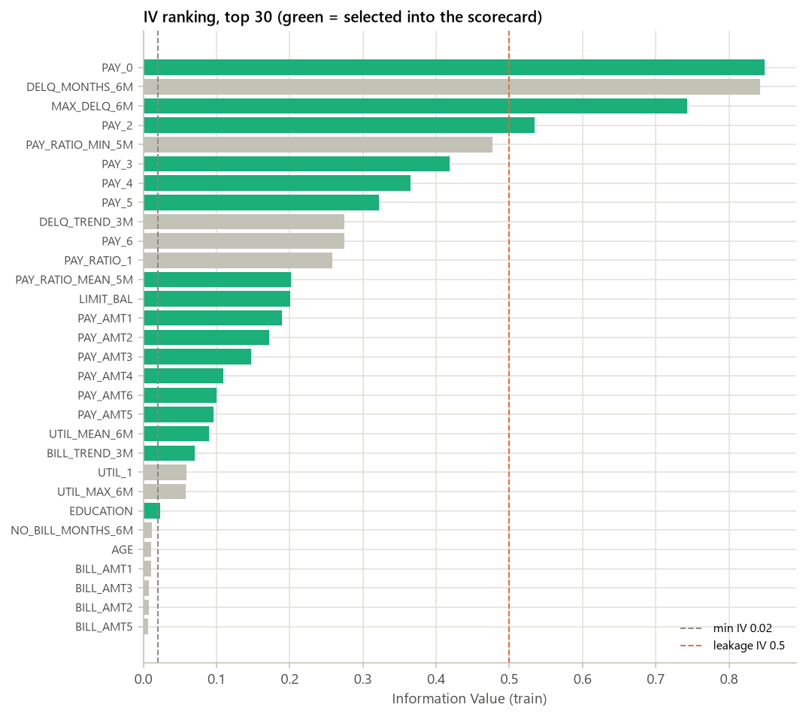

_图 2.1 IV 排名（前 30；绿色 = 入模）_

### 2.2 IV 排名表（全部候选特征，按 IV 降序）

| 特征 | 类型 | IV | 缺失率（train） | 箱数 | 入模 | 剔除步骤 | 原因 |
|---|---|---|---|---|---|---|---|
| PAY_0 | numeric | 0.8490 | 0.00% | 4 | 是 |  | selected |
| DELQ_MONTHS_6M | numeric | 0.8430 | 0.00% | 4 | 否 | 3_corr | \|corr\| = 0.76 with PAY_0 (IV 0.849) |
| MAX_DELQ_6M | numeric | 0.7432 | 0.00% | 3 | 是 |  | selected |
| PAY_2 | numeric | 0.5350 | 0.00% | 2 | 是 |  | selected |
| PAY_RATIO_MIN_5M | numeric | 0.4767 | 4.75% | 5 | 否 | 3_corr | \|corr\| = 0.71 with MAX_DELQ_6M (IV 0.743) |
| PAY_3 | numeric | 0.4181 | 0.00% | 3 | 是 |  | selected |
| PAY_4 | numeric | 0.3655 | 0.00% | 3 | 是 |  | selected |
| PAY_5 | numeric | 0.3222 | 0.00% | 3 | 是 |  | selected |
| DELQ_TREND_3M | numeric | 0.2745 | 0.00% | 3 | 否 | 5_sign | coefficient +0.4576 is not negative |
| PAY_6 | numeric | 0.2744 | 0.00% | 3 | 否 | 5_sign | coefficient +0.1010 is not negative |
| PAY_RATIO_1 | numeric | 0.2586 | 10.50% | 4 | 否 | 5_sign | coefficient +0.0040 is not negative |
| PAY_RATIO_MEAN_5M | numeric | 0.2014 | 4.75% | 5 | 是 |  | selected |
| LIMIT_BAL | numeric | 0.2006 | 0.00% | 5 | 是 |  | selected |
| PAY_AMT1 | numeric | 0.1896 | 0.00% | 5 | 是 |  | selected |
| PAY_AMT2 | numeric | 0.1722 | 0.00% | 5 | 是 |  | selected |
| PAY_AMT3 | numeric | 0.1475 | 0.00% | 4 | 是 |  | selected |
| PAY_AMT4 | numeric | 0.1095 | 0.00% | 4 | 是 |  | selected |
| PAY_AMT6 | numeric | 0.1002 | 0.00% | 5 | 是 |  | selected |
| PAY_AMT5 | numeric | 0.0955 | 0.00% | 5 | 是 |  | selected |
| UTIL_MEAN_6M | numeric | 0.0901 | 0.00% | 3 | 是 |  | selected |
| BILL_TREND_3M | numeric | 0.0706 | 0.00% | 3 | 是 |  | selected |
| UTIL_1 | numeric | 0.0592 | 0.00% | 4 | 否 | 3_corr | \|corr\| = 0.76 with UTIL_MEAN_6M (IV 0.090) |
| UTIL_MAX_6M | numeric | 0.0578 | 0.00% | 3 | 否 | 3_corr | \|corr\| = 0.80 with UTIL_MEAN_6M (IV 0.090) |
| EDUCATION | categorical | 0.0227 | 0.00% | 3 | 是 |  | selected |
| NO_BILL_MONTHS_6M | numeric | 0.0122 | 0.00% | 2 | 否 | 2_iv | IV 0.0122 < 0.02 |
| AGE | numeric | 0.0107 | 0.00% | 2 | 否 | 2_iv | IV 0.0107 < 0.02 |
| BILL_AMT1 | numeric | 0.0102 | 0.00% | 4 | 否 | 2_iv | IV 0.0102 < 0.02 |
| BILL_AMT3 | numeric | 0.0075 | 0.00% | 3 | 否 | 2_iv | IV 0.0075 < 0.02 |
| BILL_AMT2 | numeric | 0.0074 | 0.00% | 4 | 否 | 2_iv | IV 0.0074 < 0.02 |
| BILL_AMT5 | numeric | 0.0066 | 0.00% | 3 | 否 | 2_iv | IV 0.0066 < 0.02 |
| BILL_AMT4 | numeric | 0.0061 | 0.00% | 4 | 否 | 2_iv | IV 0.0061 < 0.02 |
| BILL_AMT6 | numeric | 0.0033 | 0.00% | 3 | 否 | 2_iv | IV 0.0033 < 0.02 |

### 2.3 特征筛选漏斗

| 步骤 | 剔除 | 剩余 |
|---|---|---|
| 候选特征 |  | 32 |
| 缺失率 > 50% | 0 | 32 |
| IV < 0.02 | 8 | 24 |
| 时间稳定性（无 issue_date，跳过） | 0 | 24 |
| \|corr\| > 0.7（保留 IV 高者） | 4 | 20 |
| LR 系数为正（WOE 方向反转） | 3 | 17 |

> **提示**
> - IV > 0.5 的特征（疑似 leakage，已保留，需人工确认）：PAY_0, DELQ_MONTHS_6M, MAX_DELQ_6M, PAY_2

### 2.4 单调性检查（入模特征）

| 特征 | 类型 | 切点来源 | 初始箱数 | 初始单调 | 最终箱数（含缺失箱） | 最终单调 | 最大箱占比 |
|---|---|---|---|---|---|---|---|
| PAY_0 | numeric | tree | 5 | 否 | 4 | 是 | 67.89% |
| MAX_DELQ_6M | numeric | tree | 3 | 是 | 3 | 是 | 65.87% |
| PAY_2 | numeric | tree | 4 | 否 | 2 | 是 | 85.06% |
| PAY_3 | numeric | tree | 4 | 否 | 3 | 是 | 52.59% |
| PAY_4 | numeric | tree | 4 | 否 | 3 | 是 | 54.66% |
| PAY_5 | numeric | tree | 4 | 否 | 3 | 是 | 56.56% |
| PAY_RATIO_MEAN_5M | numeric | tree | 5 | 否 | 5 | 是 | 45.68% |
| LIMIT_BAL | numeric | tree | 5 | 是 | 5 | 是 | 40.58% |
| PAY_AMT1 | numeric | tree | 5 | 是 | 5 | 是 | 48.42% |
| PAY_AMT2 | numeric | tree | 5 | 是 | 5 | 是 | 32.76% |
| PAY_AMT3 | numeric | tree | 4 | 是 | 4 | 是 | 42.43% |
| PAY_AMT4 | numeric | tree | 5 | 否 | 4 | 是 | 37.51% |
| PAY_AMT6 | numeric | tree | 5 | 是 | 5 | 是 | 41.08% |
| PAY_AMT5 | numeric | tree | 5 | 是 | 5 | 是 | 31.28% |
| UTIL_MEAN_6M | numeric | tree | 5 | 否 | 3 | 是 | 63.22% |
| BILL_TREND_3M | numeric | tree | 5 | 否 | 3 | 是 | 56.52% |
| EDUCATION | categorical | unique_values | 3 | 是 | 3 | 是 | 46.68% |

_类别型特征按 train bad rate 排序后再分箱，因此天然单调。数值型不单调时合并相邻箱，直到 bad rate 单调或只剩 2 箱。切点来源 unique_values = 取值数不超过 max_bins、逐值成箱。_

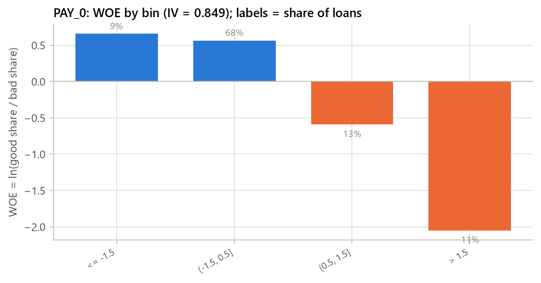

_图 2.2 PAY_0 的 WOE（IV 第 1 名）_

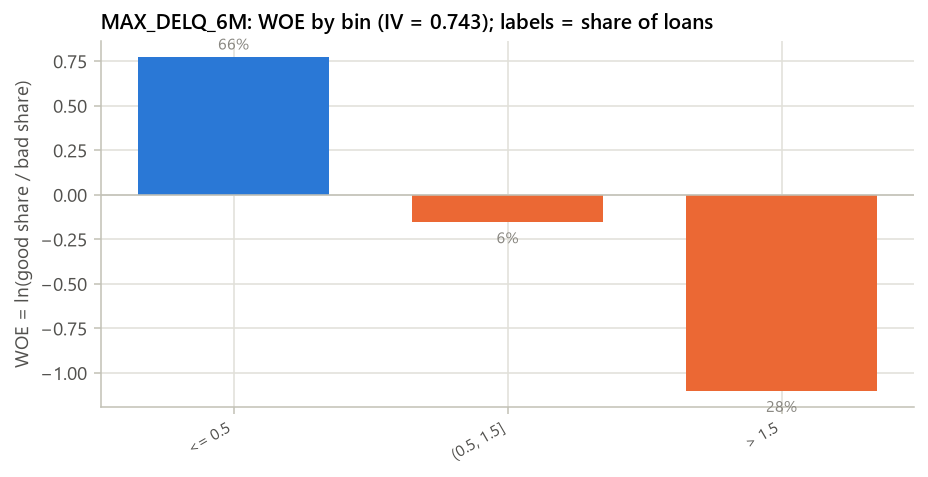

_图 2.3 MAX_DELQ_6M 的 WOE（IV 第 2 名）_

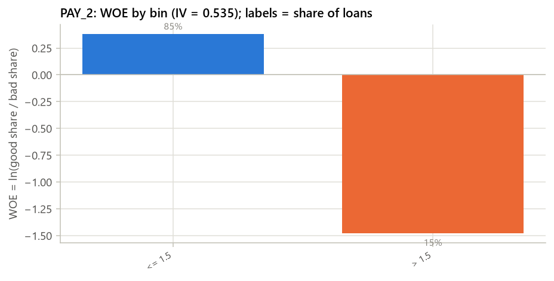

_图 2.4 PAY_2 的 WOE（IV 第 3 名）_

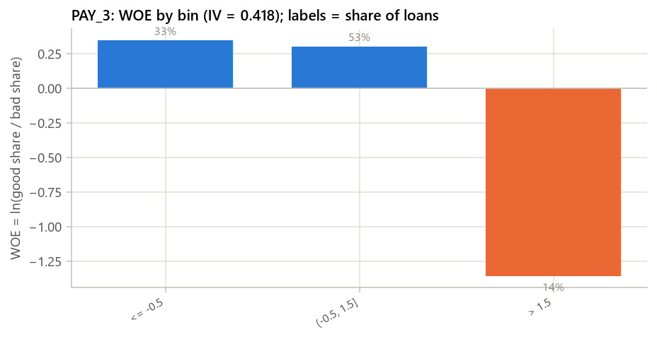

_图 2.5 PAY_3 的 WOE（IV 第 4 名）_

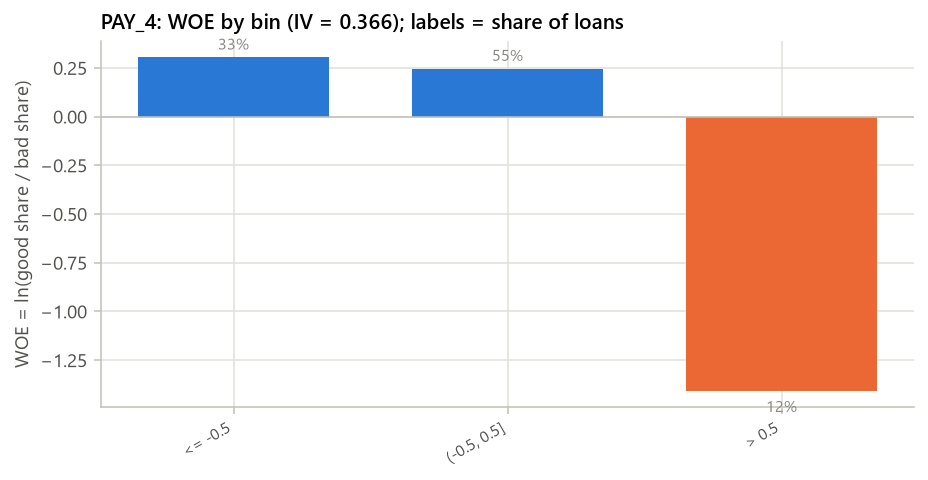

_图 2.6 PAY_4 的 WOE（IV 第 5 名）_

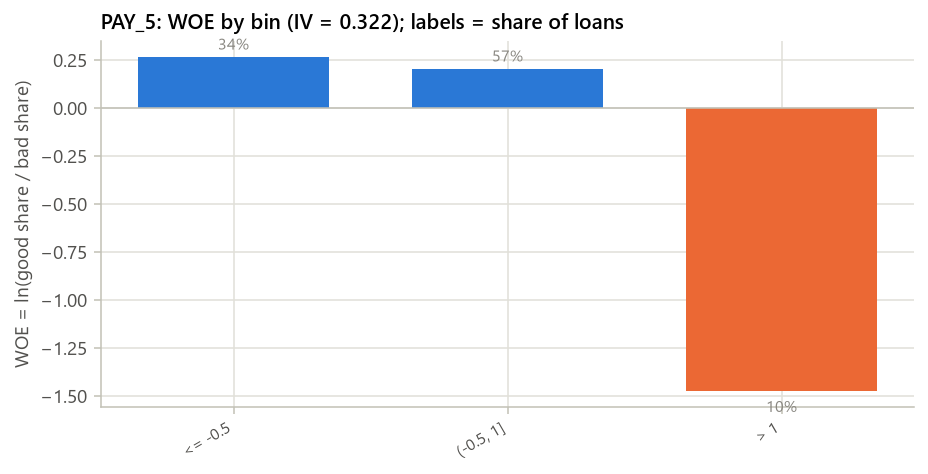

_图 2.7 PAY_5 的 WOE（IV 第 6 名）_

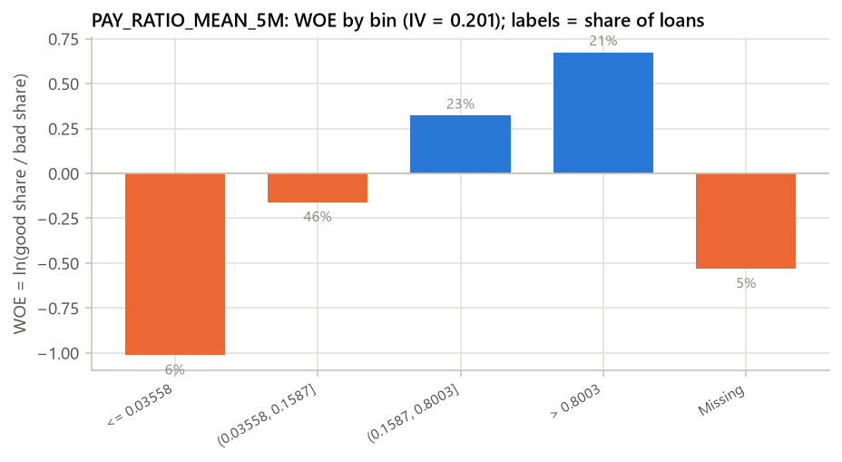

_图 2.8 PAY_RATIO_MEAN_5M 的 WOE（IV 第 7 名）_

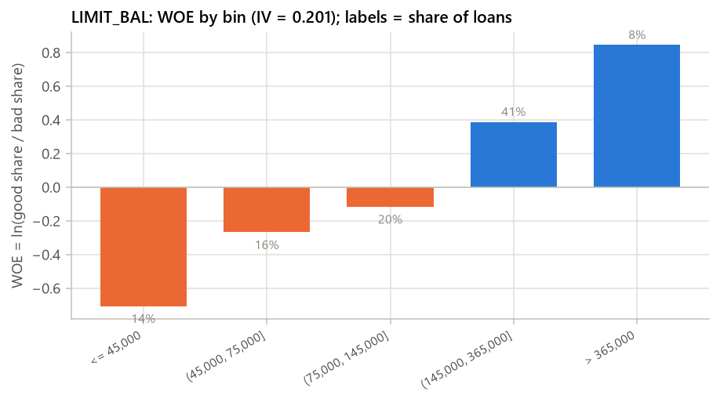

_图 2.9 LIMIT_BAL 的 WOE（IV 第 8 名）_

### 分箱表：PAY_0（IV = 0.8490）

| 分箱 | 人数 | 占比 | bad 数 | bad rate | WOE |
|---|---|---|---|---|---|
| <= -1.5 | 1,587 | 8.89% | 204 | 12.85% | 0.6554 |
| (-1.5, 0.5] | 12,119 | 67.89% | 1,685 | 13.90% | 0.5648 |
| (0.5, 1.5] | 2,267 | 12.70% | 769 | 33.92% | -0.5917 |
| > 1.5 | 1,877 | 10.52% | 1,291 | 68.78% | -2.0484 |

### 分箱表：MAX_DELQ_6M（IV = 0.7432）

| 分箱 | 人数 | 占比 | bad 数 | bad rate | WOE |
|---|---|---|---|---|---|
| <= 0.5 | 11,758 | 65.87% | 1,365 | 11.61% | 0.7715 |
| (0.5, 1.5] | 1,038 | 5.82% | 258 | 24.86% | -0.1522 |
| > 1.5 | 5,054 | 28.31% | 2,326 | 46.02% | -1.0991 |

### 分箱表：PAY_2（IV = 0.5350）

| 分箱 | 人数 | 占比 | bad 数 | bad rate | WOE |
|---|---|---|---|---|---|
| <= 1.5 | 15,184 | 85.06% | 2,472 | 16.28% | 0.3790 |
| > 1.5 | 2,666 | 14.94% | 1,477 | 55.40% | -1.4754 |

### 分箱表：PAY_3（IV = 0.4181）

| 分箱 | 人数 | 占比 | bad 数 | bad rate | WOE |
|---|---|---|---|---|---|
| <= -0.5 | 5,932 | 33.23% | 993 | 16.74% | 0.3457 |
| (-0.5, 1.5] | 9,387 | 52.59% | 1,629 | 17.35% | 0.3023 |
| > 1.5 | 2,531 | 14.18% | 1,327 | 52.43% | -1.3558 |

### 分箱表：PAY_4（IV = 0.3655）

| 分箱 | 人数 | 占比 | bad 数 | bad rate | WOE |
|---|---|---|---|---|---|
| <= -0.5 | 5,970 | 33.45% | 1,035 | 17.34% | 0.3035 |
| (-0.5, 0.5] | 9,757 | 54.66% | 1,774 | 18.18% | 0.2456 |
| > 0.5 | 2,123 | 11.89% | 1,140 | 53.70% | -1.4067 |

### 分箱表：PAY_5（IV = 0.3222）

| 分箱 | 人数 | 占比 | bad 数 | bad rate | WOE |
|---|---|---|---|---|---|
| <= -0.5 | 5,999 | 33.61% | 1,075 | 17.92% | 0.2633 |
| (-0.5, 1] | 10,096 | 56.56% | 1,903 | 18.85% | 0.2014 |
| > 1 | 1,755 | 9.83% | 971 | 55.33% | -1.4724 |

### 分箱表：PAY_RATIO_MEAN_5M（IV = 0.2014）

| 分箱 | 人数 | 占比 | bad 数 | bad rate | WOE |
|---|---|---|---|---|---|
| <= 0.03558 | 1,067 | 5.98% | 468 | 43.86% | -1.0117 |
| (0.03558, 0.1587] | 8,153 | 45.68% | 2,038 | 25.00% | -0.1597 |
| (0.1587, 0.8003] | 4,109 | 23.02% | 702 | 17.08% | 0.3212 |
| > 0.8003 | 3,673 | 20.58% | 465 | 12.66% | 0.6729 |
| Missing | 848 | 4.75% | 276 | 32.55% | -0.5298 |

### 分箱表：LIMIT_BAL（IV = 0.2006）

| 分箱 | 人数 | 占比 | bad 数 | bad rate | WOE |
|---|---|---|---|---|---|
| <= 45,000 | 2,582 | 14.46% | 944 | 36.56% | -0.7074 |
| (45,000, 75,000] | 2,933 | 16.43% | 795 | 27.11% | -0.2692 |
| (75,000, 145,000] | 3,631 | 20.34% | 879 | 24.21% | -0.1172 |
| (145,000, 365,000] | 7,243 | 40.58% | 1,172 | 16.18% | 0.3863 |
| > 365,000 | 1,461 | 8.18% | 159 | 10.88% | 0.8443 |

### 分箱表：PAY_AMT1（IV = 0.1896）

| 分箱 | 人数 | 占比 | bad 数 | bad rate | WOE |
|---|---|---|---|---|---|
| <= 155.1 | 3,337 | 18.69% | 1,192 | 35.72% | -0.6710 |
| (155.1, 3,959] | 8,643 | 48.42% | 1,924 | 22.26% | -0.0080 |
| (3,959, 4,964] | 971 | 5.44% | 170 | 17.51% | 0.2916 |
| (4,964, 9,565] | 2,727 | 15.28% | 409 | 15.00% | 0.4762 |
| > 9,565 | 2,172 | 12.17% | 254 | 11.69% | 0.7632 |

### 分箱表：PAY_AMT2（IV = 0.1722）

| 分箱 | 人数 | 占比 | bad 数 | bad rate | WOE |
|---|---|---|---|---|---|
| <= 143 | 3,429 | 19.21% | 1,137 | 33.16% | -0.5575 |
| (143, 1,613] | 3,863 | 21.64% | 944 | 24.44% | -0.1296 |
| (1,613, 4,953] | 5,848 | 32.76% | 1,238 | 21.17% | 0.0562 |
| (4,953, 15,242] | 3,618 | 20.27% | 542 | 14.98% | 0.4776 |
| > 15,242 | 1,092 | 6.12% | 88 | 8.06% | 1.1759 |

### 分箱表：PAY_AMT3（IV = 0.1475）

| 分箱 | 人数 | 占比 | bad 数 | bad rate | WOE |
|---|---|---|---|---|---|
| <= 32.15 | 3,720 | 20.84% | 1,218 | 32.74% | -0.5386 |
| (32.15, 2,949] | 7,573 | 42.43% | 1,721 | 22.73% | -0.0346 |
| (2,949, 4,574] | 2,136 | 11.97% | 414 | 19.38% | 0.1669 |
| > 4,574 | 4,421 | 24.77% | 596 | 13.48% | 0.6006 |

### 分箱表：PAY_AMT4（IV = 0.1095）

| 分箱 | 人数 | 占比 | bad 数 | bad rate | WOE |
|---|---|---|---|---|---|
| <= 5 | 3,901 | 21.85% | 1,209 | 30.99% | -0.4580 |
| (5, 2,014] | 6,696 | 37.51% | 1,536 | 22.94% | -0.0467 |
| (2,014, 4,050] | 2,851 | 15.97% | 558 | 19.57% | 0.1548 |
| > 4,050 | 4,402 | 24.66% | 646 | 14.68% | 0.5018 |

### 分箱表：PAY_AMT6（IV = 0.1002）

| 分箱 | 人数 | 占比 | bad 数 | bad rate | WOE |
|---|---|---|---|---|---|
| <= 3 | 4,361 | 24.43% | 1,268 | 29.08% | -0.3668 |
| (3, 2,996] | 7,333 | 41.08% | 1,698 | 23.16% | -0.0590 |
| (2,996, 4,002] | 1,683 | 9.43% | 328 | 19.49% | 0.1600 |
| (4,002, 9,851] | 2,702 | 15.14% | 438 | 16.21% | 0.3842 |
| > 9,851 | 1,771 | 9.92% | 217 | 12.25% | 0.7102 |

### 分箱表：PAY_AMT5（IV = 0.0955）

| 分箱 | 人数 | 占比 | bad 数 | bad rate | WOE |
|---|---|---|---|---|---|
| <= 5.5 | 4,086 | 22.89% | 1,204 | 29.47% | -0.3857 |
| (5.5, 1,970] | 5,583 | 31.28% | 1,322 | 23.68% | -0.0881 |
| (1,970, 4,050] | 3,772 | 21.13% | 763 | 20.23% | 0.1136 |
| (4,050, 13,108] | 3,304 | 18.51% | 525 | 15.89% | 0.4079 |
| > 13,108 | 1,105 | 6.19% | 135 | 12.22% | 0.7135 |

### 分箱表：UTIL_MEAN_6M（IV = 0.0901）

| 分箱 | 人数 | 占比 | bad 数 | bad rate | WOE |
|---|---|---|---|---|---|
| <= 0.5052 | 11,285 | 63.22% | 2,072 | 18.36% | 0.2336 |
| (0.5052, 0.7975] | 3,488 | 19.54% | 890 | 25.52% | -0.1872 |
| > 0.7975 | 3,077 | 17.24% | 987 | 32.08% | -0.5082 |

### 分箱表：BILL_TREND_3M（IV = 0.0706）

| 分箱 | 人数 | 占比 | bad 数 | bad rate | WOE |
|---|---|---|---|---|---|
| <= -0.02627 | 3,883 | 21.75% | 1,160 | 29.87% | -0.4052 |
| (-0.02627, ~0] | 3,878 | 21.73% | 933 | 24.06% | -0.1090 |
| > ~0 | 10,089 | 56.52% | 1,856 | 18.40% | 0.2312 |

### 分箱表：EDUCATION（IV = 0.0227）

| 分箱 | 人数 | 占比 | bad 数 | bad rate | WOE |
|---|---|---|---|---|---|
| {4, 1} | 6,608 | 37.02% | 1,242 | 18.80% | 0.2049 |
| {2} | 8,333 | 46.68% | 1,991 | 23.89% | -0.0999 |
| {3} | 2,909 | 16.30% | 716 | 24.61% | -0.1392 |

## 3. 模型表现

_WOE 逻辑回归评分卡与 GBDT challenger 在 train / test / OOT 上的 AUC、KS、Gini，以及 train 内交叉验证（每折重做分箱与 WOE；入模变量清单固定自全 train）。_

### 3.1 LR 系数表（WOE 输入；WOE 越大越安全，系数应为负）

| 特征 | 系数 | IV | VIF |
|---|---|---|---|
| (intercept) | -1.2574 |  |  |
| PAY_0 | -0.6097 | 0.8490 | 2.2552 |
| MAX_DELQ_6M | -0.2674 | 0.7432 | 2.7585 |
| PAY_2 | -0.0140 | 0.5350 | 2.8606 |
| PAY_3 | -0.1114 | 0.4181 | 2.8271 |
| PAY_4 | -0.0735 | 0.3655 | 2.8361 |
| PAY_5 | -0.1537 | 0.3222 | 2.2017 |
| PAY_RATIO_MEAN_5M | -0.0949 | 0.2014 | 1.4724 |
| LIMIT_BAL | -0.1483 | 0.2006 | 1.6489 |
| PAY_AMT1 | -0.1586 | 0.1896 | 2.0618 |
| PAY_AMT2 | -0.2638 | 0.1722 | 1.8980 |
| PAY_AMT3 | -0.3404 | 0.1475 | 2.0796 |
| PAY_AMT4 | -0.1936 | 0.1095 | 1.9074 |
| PAY_AMT6 | -0.1017 | 0.1002 | 1.7130 |
| PAY_AMT5 | -0.1867 | 0.0955 | 1.7772 |
| UTIL_MEAN_6M | -0.4657 | 0.0901 | 1.7731 |
| BILL_TREND_3M | -0.3399 | 0.0706 | 1.2052 |
| EDUCATION | -0.0850 | 0.0227 | 1.0909 |

_LogisticRegression(penalty=l2, C=1.0)；VIF > 5.0 标警。_

### 3.2 train / test / OOT 表现

| 模型 | 样本 | 行数 | bad rate | AUC | KS | Gini |
|---|---|---|---|---|---|---|
| LR scorecard | train | 17,850 | 22.12% | 0.7755 | 0.4176 | 0.5509 |
| GBDT challenger | train | 17,850 | 22.12% | 0.8061 | 0.4582 | 0.6122 |
| LR scorecard | test | 7,650 | 22.12% | 0.7667 | 0.4212 | 0.5333 |
| GBDT challenger | test | 7,650 | 22.12% | 0.7825 | 0.4293 | 0.5651 |
| LR scorecard | OOT | 4,500 | 22.11% | 0.7641 | 0.4020 | 0.5281 |
| GBDT challenger | OOT | 4,500 | 22.11% | 0.7877 | 0.4367 | 0.5754 |

### 3.3 5 折 CV（train 内；每折重做分箱与 WOE）

| 模型 | AUC 均值 ± std | KS 均值 ± std | 折数 |
|---|---|---|---|
| LR scorecard | 0.7718 ± 0.0070 | 0.4229 ± 0.0095 | 5 |
| GBDT challenger | 0.7882 ± 0.0088 | 0.4439 ± 0.0177 | 5 |

### 3.4 LR vs GBDT challenger

| 指标 | LR scorecard | GBDT | GBDT − LR |
|---|---|---|---|
| test AUC | 0.7667 | 0.7825 | +0.0159 |
| test KS | 0.4212 | 0.4293 | +0.0081 |
| OOT AUC | 0.7641 | 0.7877 | +0.0237 |
| OOT KS | 0.4020 | 0.4367 | +0.0347 |

_challenger 直接使用未 WOE 的原始候选特征（含缺失），只作为性能上限参照，不上线。_

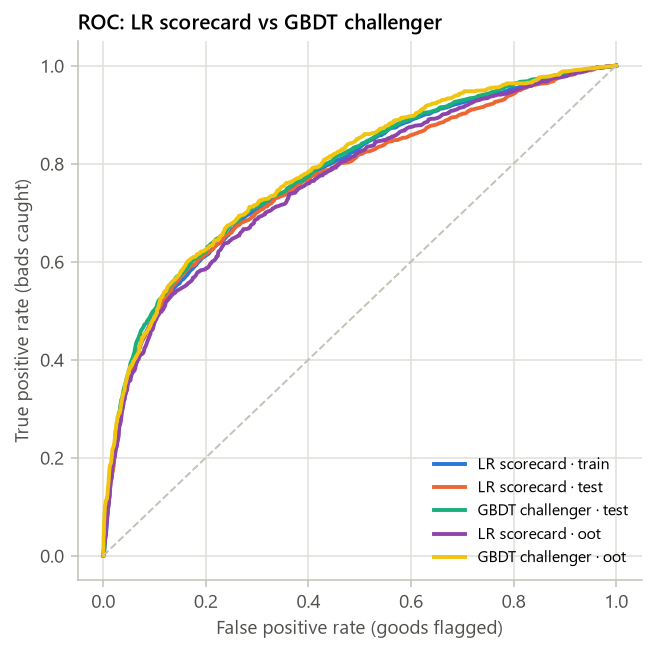

_图 3.1 ROC 曲线_

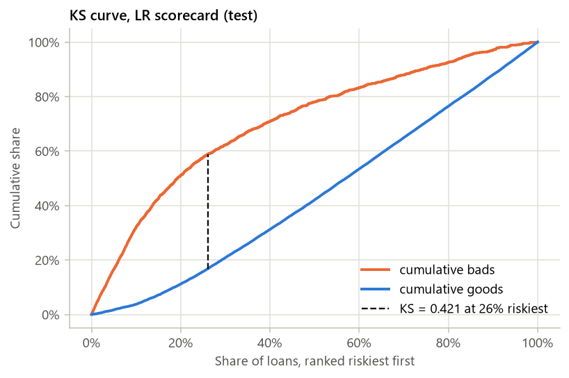

_图 3.2 KS 曲线（LR，test）_

### KS 分段表（test，按 LR 预测概率从高风险到低风险 10 等分）

| 分段 | 人数 | bad 数 | bad rate | 累计 bad 占比 | 累计 good 占比 | KS |
|---|---|---|---|---|---|---|
| 1 | 765 | 542 | 70.85% | 32.03% | 3.74% | 0.2829 |
| 2 | 765 | 322 | 42.09% | 51.06% | 11.18% | 0.3989 |
| 3 | 765 | 189 | 24.71% | 62.23% | 20.85% | 0.4139 |
| 4 | 765 | 146 | 19.08% | 70.86% | 31.24% | 0.3963 |
| 5 | 765 | 121 | 15.82% | 78.01% | 42.04% | 0.3597 |
| 6 | 765 | 88 | 11.50% | 83.22% | 53.41% | 0.2981 |
| 7 | 765 | 80 | 10.46% | 87.94% | 64.90% | 0.2304 |
| 8 | 765 | 79 | 10.33% | 92.61% | 76.42% | 0.1619 |
| 9 | 765 | 75 | 9.80% | 97.04% | 88.00% | 0.0905 |
| 10 | 765 | 50 | 6.54% | 100.00% | 100.00% | 0.0000 |

本次只跑“不含平台评级”一套模型；“含 / 不含平台评级”并排对比需要 features.use_platform_rating: [false, true]（configs/lendingclub.yaml 的默认）。

## 4. 评分卡

_把 WOE 逻辑回归换算为评分卡：PDO、base score、base odds，每个变量每个分箱的分数，以及分数分布。_

### 4.1 PDO 换算

- **PDO / base score / base odds**：20 / 600 / 20:1
- **Factor = PDO / ln2**：28.8539
- **Offset = base − Factor × ln(odds)**：600 − 28.8539 × ln(20) = 513.5614
- **LR 截距 b0**：-1.2574
- **基础分 = Offset − Factor × b0**：549.84 → 取整 550
- **分箱分数**：points = −Factor × 系数 × WOE，取整
- **可能的分数范围**：456 ~ 610
- **整数分数的 AUC（test / OOT）**：test 0.7670 / OOT 0.7644

### 4.2 评分卡表

| 变量 | 分箱 | train 人数 | 占比 | bad rate | WOE | 系数 | 分数 | 整数分 |
|---|---|---|---|---|---|---|---|---|
| BASE | (every applicant) |  |  |  |  |  | 549.84 | 550 |
| PAY_0 | <= -1.5 | 1,587 | 8.89% | 12.85% | 0.6554 | -0.6097 | 11.53 | 12 |
| PAY_0 | (-1.5, 0.5] | 12,119 | 67.89% | 13.90% | 0.5648 | -0.6097 | 9.94 | 10 |
| PAY_0 | (0.5, 1.5] | 2,267 | 12.70% | 33.92% | -0.5917 | -0.6097 | -10.41 | -10 |
| PAY_0 | > 1.5 | 1,877 | 10.52% | 68.78% | -2.0484 | -0.6097 | -36.03 | -36 |
| MAX_DELQ_6M | <= 0.5 | 11,758 | 65.87% | 11.61% | 0.7715 | -0.2674 | 5.95 | 6 |
| MAX_DELQ_6M | (0.5, 1.5] | 1,038 | 5.82% | 24.86% | -0.1522 | -0.2674 | -1.17 | -1 |
| MAX_DELQ_6M | > 1.5 | 5,054 | 28.31% | 46.02% | -1.0991 | -0.2674 | -8.48 | -8 |
| PAY_2 | <= 1.5 | 15,184 | 85.06% | 16.28% | 0.3790 | -0.0140 | 0.15 | 0 |
| PAY_2 | > 1.5 | 2,666 | 14.94% | 55.40% | -1.4754 | -0.0140 | -0.59 | -1 |
| PAY_3 | <= -0.5 | 5,932 | 33.23% | 16.74% | 0.3457 | -0.1114 | 1.11 | 1 |
| PAY_3 | (-0.5, 1.5] | 9,387 | 52.59% | 17.35% | 0.3023 | -0.1114 | 0.97 | 1 |
| PAY_3 | > 1.5 | 2,531 | 14.18% | 52.43% | -1.3558 | -0.1114 | -4.36 | -4 |
| PAY_4 | <= -0.5 | 5,970 | 33.45% | 17.34% | 0.3035 | -0.0735 | 0.64 | 1 |
| PAY_4 | (-0.5, 0.5] | 9,757 | 54.66% | 18.18% | 0.2456 | -0.0735 | 0.52 | 1 |
| PAY_4 | > 0.5 | 2,123 | 11.89% | 53.70% | -1.4067 | -0.0735 | -2.98 | -3 |
| PAY_5 | <= -0.5 | 5,999 | 33.61% | 17.92% | 0.2633 | -0.1537 | 1.17 | 1 |
| PAY_5 | (-0.5, 1] | 10,096 | 56.56% | 18.85% | 0.2014 | -0.1537 | 0.89 | 1 |
| PAY_5 | > 1 | 1,755 | 9.83% | 55.33% | -1.4724 | -0.1537 | -6.53 | -7 |
| PAY_RATIO_MEAN_5M | <= 0.03558 | 1,067 | 5.98% | 43.86% | -1.0117 | -0.0949 | -2.77 | -3 |
| PAY_RATIO_MEAN_5M | (0.03558, 0.1587] | 8,153 | 45.68% | 25.00% | -0.1597 | -0.0949 | -0.44 | 0 |
| PAY_RATIO_MEAN_5M | (0.1587, 0.8003] | 4,109 | 23.02% | 17.08% | 0.3212 | -0.0949 | 0.88 | 1 |
| PAY_RATIO_MEAN_5M | > 0.8003 | 3,673 | 20.58% | 12.66% | 0.6729 | -0.0949 | 1.84 | 2 |
| PAY_RATIO_MEAN_5M | Missing | 848 | 4.75% | 32.55% | -0.5298 | -0.0949 | -1.45 | -1 |
| LIMIT_BAL | <= 45,000 | 2,582 | 14.46% | 36.56% | -0.7074 | -0.1483 | -3.03 | -3 |
| LIMIT_BAL | (45,000, 75,000] | 2,933 | 16.43% | 27.11% | -0.2692 | -0.1483 | -1.15 | -1 |
| LIMIT_BAL | (75,000, 145,000] | 3,631 | 20.34% | 24.21% | -0.1172 | -0.1483 | -0.50 | -1 |
| LIMIT_BAL | (145,000, 365,000] | 7,243 | 40.58% | 16.18% | 0.3863 | -0.1483 | 1.65 | 2 |
| LIMIT_BAL | > 365,000 | 1,461 | 8.18% | 10.88% | 0.8443 | -0.1483 | 3.61 | 4 |
| PAY_AMT1 | <= 155.1 | 3,337 | 18.69% | 35.72% | -0.6710 | -0.1586 | -3.07 | -3 |
| PAY_AMT1 | (155.1, 3,959] | 8,643 | 48.42% | 22.26% | -0.0080 | -0.1586 | -0.04 | 0 |
| PAY_AMT1 | (3,959, 4,964] | 971 | 5.44% | 17.51% | 0.2916 | -0.1586 | 1.33 | 1 |
| PAY_AMT1 | (4,964, 9,565] | 2,727 | 15.28% | 15.00% | 0.4762 | -0.1586 | 2.18 | 2 |
| PAY_AMT1 | > 9,565 | 2,172 | 12.17% | 11.69% | 0.7632 | -0.1586 | 3.49 | 3 |
| PAY_AMT2 | <= 143 | 3,429 | 19.21% | 33.16% | -0.5575 | -0.2638 | -4.24 | -4 |
| PAY_AMT2 | (143, 1,613] | 3,863 | 21.64% | 24.44% | -0.1296 | -0.2638 | -0.99 | -1 |
| PAY_AMT2 | (1,613, 4,953] | 5,848 | 32.76% | 21.17% | 0.0562 | -0.2638 | 0.43 | 0 |
| PAY_AMT2 | (4,953, 15,242] | 3,618 | 20.27% | 14.98% | 0.4776 | -0.2638 | 3.64 | 4 |
| PAY_AMT2 | > 15,242 | 1,092 | 6.12% | 8.06% | 1.1759 | -0.2638 | 8.95 | 9 |
| PAY_AMT3 | <= 32.15 | 3,720 | 20.84% | 32.74% | -0.5386 | -0.3404 | -5.29 | -5 |
| PAY_AMT3 | (32.15, 2,949] | 7,573 | 42.43% | 22.73% | -0.0346 | -0.3404 | -0.34 | 0 |
| PAY_AMT3 | (2,949, 4,574] | 2,136 | 11.97% | 19.38% | 0.1669 | -0.3404 | 1.64 | 2 |
| PAY_AMT3 | > 4,574 | 4,421 | 24.77% | 13.48% | 0.6006 | -0.3404 | 5.90 | 6 |
| PAY_AMT4 | <= 5 | 3,901 | 21.85% | 30.99% | -0.4580 | -0.1936 | -2.56 | -3 |
| PAY_AMT4 | (5, 2,014] | 6,696 | 37.51% | 22.94% | -0.0467 | -0.1936 | -0.26 | 0 |
| PAY_AMT4 | (2,014, 4,050] | 2,851 | 15.97% | 19.57% | 0.1548 | -0.1936 | 0.86 | 1 |
| PAY_AMT4 | > 4,050 | 4,402 | 24.66% | 14.68% | 0.5018 | -0.1936 | 2.80 | 3 |
| PAY_AMT6 | <= 3 | 4,361 | 24.43% | 29.08% | -0.3668 | -0.1017 | -1.08 | -1 |
| PAY_AMT6 | (3, 2,996] | 7,333 | 41.08% | 23.16% | -0.0590 | -0.1017 | -0.17 | 0 |
| PAY_AMT6 | (2,996, 4,002] | 1,683 | 9.43% | 19.49% | 0.1600 | -0.1017 | 0.47 | 0 |
| PAY_AMT6 | (4,002, 9,851] | 2,702 | 15.14% | 16.21% | 0.3842 | -0.1017 | 1.13 | 1 |
| PAY_AMT6 | > 9,851 | 1,771 | 9.92% | 12.25% | 0.7102 | -0.1017 | 2.09 | 2 |
| PAY_AMT5 | <= 5.5 | 4,086 | 22.89% | 29.47% | -0.3857 | -0.1867 | -2.08 | -2 |
| PAY_AMT5 | (5.5, 1,970] | 5,583 | 31.28% | 23.68% | -0.0881 | -0.1867 | -0.47 | 0 |
| PAY_AMT5 | (1,970, 4,050] | 3,772 | 21.13% | 20.23% | 0.1136 | -0.1867 | 0.61 | 1 |
| PAY_AMT5 | (4,050, 13,108] | 3,304 | 18.51% | 15.89% | 0.4079 | -0.1867 | 2.20 | 2 |
| PAY_AMT5 | > 13,108 | 1,105 | 6.19% | 12.22% | 0.7135 | -0.1867 | 3.84 | 4 |
| UTIL_MEAN_6M | <= 0.5052 | 11,285 | 63.22% | 18.36% | 0.2336 | -0.4657 | 3.14 | 3 |
| UTIL_MEAN_6M | (0.5052, 0.7975] | 3,488 | 19.54% | 25.52% | -0.1872 | -0.4657 | -2.52 | -3 |
| UTIL_MEAN_6M | > 0.7975 | 3,077 | 17.24% | 32.08% | -0.5082 | -0.4657 | -6.83 | -7 |
| BILL_TREND_3M | <= -0.02627 | 3,883 | 21.75% | 29.87% | -0.4052 | -0.3399 | -3.97 | -4 |
| BILL_TREND_3M | (-0.02627, ~0] | 3,878 | 21.73% | 24.06% | -0.1090 | -0.3399 | -1.07 | -1 |
| BILL_TREND_3M | > ~0 | 10,089 | 56.52% | 18.40% | 0.2312 | -0.3399 | 2.27 | 2 |
| EDUCATION | {4, 1} | 6,608 | 37.02% | 18.80% | 0.2049 | -0.0850 | 0.50 | 1 |
| EDUCATION | {2} | 8,333 | 46.68% | 23.89% | -0.0999 | -0.0850 | -0.25 | 0 |
| EDUCATION | {3} | 2,909 | 16.30% | 24.61% | -0.1392 | -0.0850 | -0.34 | 0 |

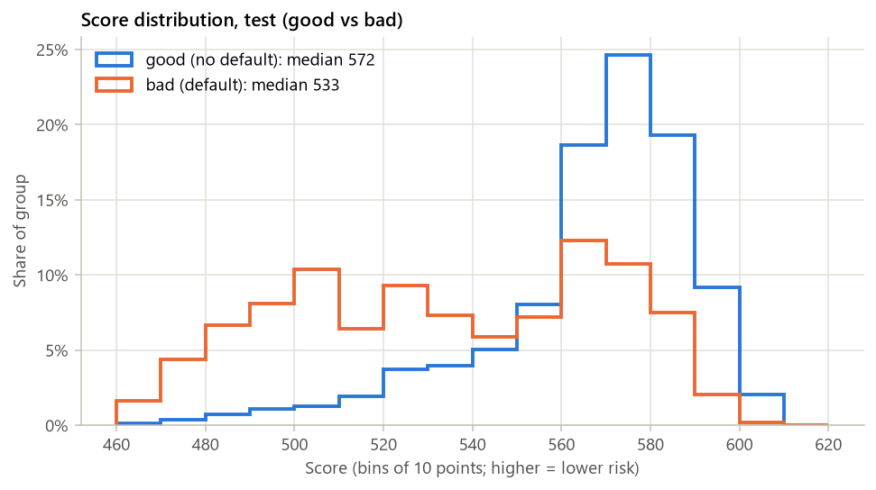

_图 4.1 分数分布（test，good / bad 分开）_

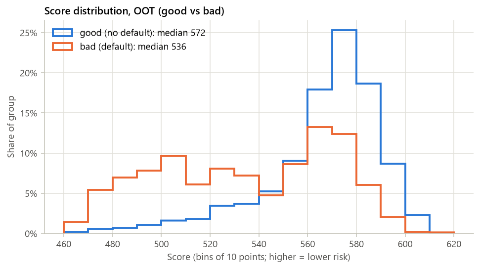

_图 4.2 分数分布（OOT，good / bad 分开）_

## 5. 策略分析

_在 test 与 OOT 上评估评分卡的业务用法：分数段表、通过率–坏账率曲线、候选 cut-off、用实际回款算的利润曲线，以及与平台基准的 swap set。_

### 5.0 口径

- **评分方向与通过规则**：分数越高越安全；cut-off 规则为 score ≥ cut-off 通过。分数为整数，所以每个候选通过率取实际通过率最接近的 cut-off，并同时报告实际通过率
- **评估样本**：test / OOT（train 不参与策略评估）
- **候选通过率**：50% / 60% / 70% / 80% / 90%
- **利润口径**：数据不含回款信息，跳过
- **swap set 基准**：数据没有平台评级：用随机策略（同通过率，固定种子）做基准
- **约束条件**：坏账率上限 10%（5.3 的主要结论）；目标通过率 70%（5.3 的第二行，swap set 也按这一档展示）

### 5.1 分数段表（test，等频 10 段，分数从高到低）

| 分段 | 分数区间 | 人数 | 占比 | bad 数 | bad rate | 累计通过率 | 累计 bad rate |
|---|---|---|---|---|---|---|---|
| 1 | 590–610 | 704 | 9.20% | 38 | 5.40% | 9.20% | 5.40% |
| 2 | 584–589 | 717 | 9.37% | 73 | 10.18% | 18.58% | 7.81% |
| 3 | 578–583 | 851 | 11.12% | 88 | 10.34% | 29.70% | 8.76% |
| 4 | 574–577 | 671 | 8.77% | 70 | 10.43% | 38.47% | 9.14% |
| 5 | 569–573 | 858 | 11.22% | 101 | 11.77% | 49.69% | 9.73% |
| 6 | 565–568 | 678 | 8.86% | 106 | 15.63% | 58.55% | 10.63% |
| 7 | 555–564 | 833 | 10.89% | 157 | 18.85% | 69.44% | 11.92% |
| 8 | 536–554 | 789 | 10.31% | 189 | 23.95% | 79.75% | 13.47% |
| 9 | 512–535 | 763 | 9.97% | 319 | 41.81% | 89.73% | 16.62% |
| 10 | 463–511 | 786 | 10.27% | 551 | 70.10% | 100.00% | 22.12% |

_累计通过率 / 累计 bad rate = 以该段下边界为 cut-off 时的通过率与通过客群 bad rate。按分数分位数切段，整数分数有并列，各段人数近似相等。_

### 5.1 分数段表（OOT，等频 10 段，分数从高到低）

| 分段 | 分数区间 | 人数 | 占比 | bad 数 | bad rate | 累计通过率 | 累计 bad rate |
|---|---|---|---|---|---|---|---|
| 1 | 590–610 | 409 | 9.09% | 23 | 5.62% | 9.09% | 5.62% |
| 2 | 583–589 | 455 | 10.11% | 36 | 7.91% | 19.20% | 6.83% |
| 3 | 578–582 | 434 | 9.64% | 47 | 10.83% | 28.84% | 8.17% |
| 4 | 574–577 | 412 | 9.16% | 40 | 9.71% | 38.00% | 8.54% |
| 5 | 569–573 | 494 | 10.98% | 71 | 14.37% | 48.98% | 9.85% |
| 6 | 564–568 | 476 | 10.58% | 80 | 16.81% | 59.56% | 11.08% |
| 7 | 555–563 | 461 | 10.24% | 100 | 21.69% | 69.80% | 12.64% |
| 8 | 537–554 | 451 | 10.02% | 95 | 21.06% | 79.82% | 13.70% |
| 9 | 510–536 | 457 | 10.16% | 192 | 42.01% | 89.98% | 16.89% |
| 10 | 462–509 | 451 | 10.02% | 311 | 68.96% | 100.00% | 22.11% |

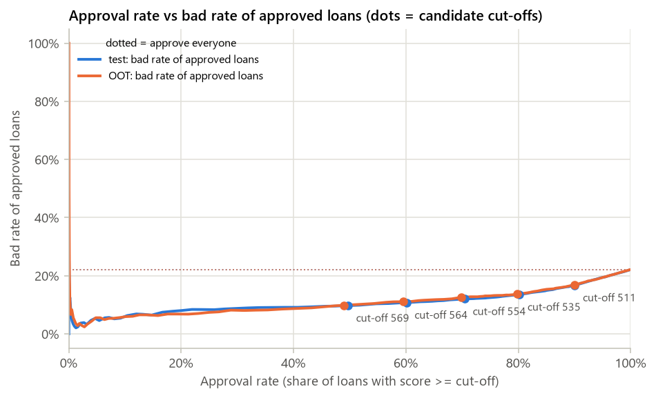

_图 5.1 通过率–坏账率曲线（点 = 候选 cut-off）_

### 5.2 候选 cut-off（test；样本 bad rate 22.12%）

| 目标通过率 | cut-off | 实际通过率 | 通过人数 | 通过客群 bad rate | 拒绝客群 bad rate | 边际新增人数 | 边际 bad rate |
|---|---|---|---|---|---|---|---|
| 50.00% | 569 | 49.69% | 3,801 | 9.73% | 34.35% | 3,801 | 9.73% |
| 60.00% | 564 | 60.09% | 4,597 | 10.77% | 39.21% | 796 | 15.70% |
| 70.00% | 554 | 70.44% | 5,389 | 12.02% | 46.17% | 792 | 19.32% |
| 80.00% | 535 | 80.20% | 6,135 | 13.53% | 56.90% | 746 | 24.40% |
| 90.00% | 511 | 90.04% | 6,888 | 16.74% | 70.73% | 753 | 42.90% |

_边际 = 比上一档宽松的 cut-off 多放进来的那一批客户；边际 bad rate 和边际净现金/笔决定了再放松一档是否划算。_

### 5.2 候选 cut-off（OOT；样本 bad rate 22.11%）

| 目标通过率 | cut-off | 实际通过率 | 通过人数 | 通过客群 bad rate | 拒绝客群 bad rate | 边际新增人数 | 边际 bad rate |
|---|---|---|---|---|---|---|---|
| 50.00% | 569 | 48.98% | 2,204 | 9.85% | 33.89% | 2,204 | 9.85% |
| 60.00% | 564 | 59.56% | 2,680 | 11.08% | 38.35% | 476 | 16.81% |
| 70.00% | 555 | 69.80% | 3,141 | 12.64% | 44.00% | 461 | 21.69% |
| 80.00% | 537 | 79.82% | 3,592 | 13.70% | 55.40% | 451 | 21.06% |
| 90.00% | 510 | 89.98% | 4,049 | 16.89% | 68.96% | 457 | 42.01% |

### 5.3 约束下的最优 cut-off（主要结论）

| 样本 | 准则 | cut-off | 实际通过率 | 通过人数 | 通过客群 bad rate |
|---|---|---|---|---|---|
| test | 坏账率上限 10% 下通过率最高 | 568 | 51.75% | 3,959 | 9.88% |
| test | 目标通过率 70% 下的坏账率与净现金 | 554 | 70.44% | 5,389 | 12.02% |
| OOT | 坏账率上限 10% 下通过率最高 | 569 | 48.98% | 2,204 | 9.85% |
| OOT | 目标通过率 70% 下的坏账率与净现金 | 555 | 69.80% | 3,141 | 12.64% |

_第一行：通过客群 bad rate ≤ 10% 的前提下通过率最高的 cut-off（空白 = 没有任何 cut-off 能满足）；第二行：通过率 70% 时的坏账率与净现金。_

### 5.4 利润曲线

- **利润曲线**：数据不含回款信息，跳过

### 5.5 swap set（test；cut-off 554，通过率 70.4%，目标 70%）

| 模型 \ 基准 | 基准批 | 基准拒 | 合计 |
|---|---|---|---|
| 模型批（score ≥ cut-off） | 3,771 笔 · bad rate 11.77% | 1,618 笔 · bad rate 12.61%  ← swap-in | 5,389 笔 · bad rate 12.02% |
| 模型拒 | 1,618 笔 · bad rate 46.60%  ← swap-out | 643 笔 · bad rate 45.10% | 2,261 笔 · bad rate 46.17% |
| 合计 | 5,389 笔 · bad rate 22.23% | 2,261 笔 · bad rate 21.85% | 7,650 笔 · bad rate 22.12% |

_swap-in（模型批、基准拒）1,618 笔，bad rate 12.61%；swap-out（模型拒、基准批）1,618 笔，bad rate 46.60%。两格人数相同，模型换进了更好的客户；同通过率下模型通过客群 bad rate 12.02%，基准（随机） 22.23%（-10.21 pp）。_

### 5.5 swap set（OOT；cut-off 555，通过率 69.8%，目标 70%）

| 模型 \ 基准 | 基准批 | 基准拒 | 合计 |
|---|---|---|---|
| 模型批（score ≥ cut-off） | 2,191 笔 · bad rate 12.73% | 950 笔 · bad rate 12.42%  ← swap-in | 3,141 笔 · bad rate 12.64% |
| 模型拒 | 950 笔 · bad rate 45.89%  ← swap-out | 409 笔 · bad rate 39.61% | 1,359 笔 · bad rate 44.00% |
| 合计 | 3,141 笔 · bad rate 22.76% | 1,359 笔 · bad rate 20.60% | 4,500 笔 · bad rate 22.11% |

_swap-in（模型批、基准拒）950 笔，bad rate 12.42%；swap-out（模型拒、基准批）950 笔，bad rate 45.89%。两格人数相同，模型换进了更好的客户；同通过率下模型通过客群 bad rate 12.64%，基准（随机） 22.76%（-10.12 pp）。_

### 各候选通过率下的 swap set 汇总

| 样本 | 目标通过率 | cut-off | 实际通过率 | 模型通过客群 bad rate | 基准通过客群 bad rate | swap-in 人数 | swap-in bad rate | swap-out 人数 | swap-out bad rate |
|---|---|---|---|---|---|---|---|---|---|
| test | 50.00% | 569 | 49.69% | 9.73% | 22.34% | 1,925 | 9.77% | 1,925 | 34.65% |
| test | 60.00% | 564 | 60.09% | 10.77% | 22.60% | 1,869 | 10.59% | 1,869 | 39.70% |
| test | 70.00% | 554 | 70.44% | 12.02% | 22.23% | 1,618 | 12.61% | 1,618 | 46.60% |
| test | 80.00% | 535 | 80.20% | 13.53% | 22.23% | 1,216 | 13.98% | 1,216 | 57.89% |
| test | 90.00% | 511 | 90.04% | 16.74% | 22.17% | 691 | 16.79% | 691 | 70.91% |
| OOT | 50.00% | 569 | 48.98% | 9.85% | 23.87% | 1,130 | 9.38% | 1,130 | 36.73% |
| OOT | 60.00% | 564 | 59.56% | 11.08% | 23.28% | 1,103 | 10.79% | 1,103 | 40.44% |
| OOT | 70.00% | 555 | 69.80% | 12.64% | 22.76% | 950 | 12.42% | 950 | 45.89% |
| OOT | 80.00% | 537 | 79.82% | 13.70% | 22.63% | 732 | 12.84% | 732 | 56.69% |
| OOT | 90.00% | 510 | 89.98% | 16.89% | 22.08% | 404 | 16.58% | 404 | 68.56% |

## 6. 稳定性

_分数与入模特征在 train → test / OOT 上的分布稳定性（PSI / CSI），以及按 issue 季度的 vintage 曲线。_

### 6.0 口径

- **PSI 公式**：PSI = Σ (actual% − expected%) × ln(actual% / expected%)，expected = train；占比为 0 的段按 0.01% 处理
- **score PSI 分段**：train 分数的 10 等频段（右闭区间），同一套边界套到 test / OOT
- **CSI**：每个入模特征按评分卡的分箱（含缺失箱）算分布的 PSI，train → test 与 train → OOT
- **阈值**：🟢 稳定 < 0.10 ≤ 🟡 关注 < 0.25 ≤ 🔴 警戒（行业惯例：< 0.10 不动，0.10–0.25 观察，> 0.25 需处理）

### 6.1 score PSI

| 对比 | train 行数 | 对比样本行数 | PSI | 判定 |
|---|---|---|---|---|
| train → test | 17,850 | 7,650 | 0.0028 | 🟢 稳定 |
| train → OOT | 17,850 | 4,500 | 0.0031 | 🟢 稳定 |

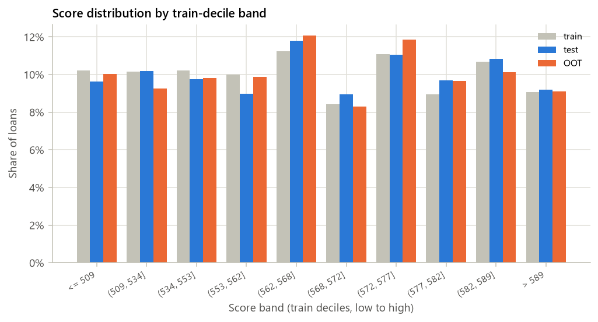

_图 6.1 分数分布按 train 等频段（train vs test vs OOT）_

### score PSI 分段明细

| 段 | 分数区间 | train 占比 | test 占比 | OOT 占比 | PSI 贡献（test） | PSI 贡献（OOT） |
|---|---|---|---|---|---|---|
| 1 | <= 509 | 10.22% | 9.63% | 10.02% | 0.0004 | 0.0000 |
| 2 | (509, 534] | 10.15% | 10.17% | 9.24% | 0.0000 | 0.0008 |
| 3 | (534, 553] | 10.22% | 9.75% | 9.82% | 0.0002 | 0.0002 |
| 4 | (553, 562] | 9.98% | 8.98% | 9.87% | 0.0011 | 0.0000 |
| 5 | (562, 568] | 11.22% | 11.78% | 12.07% | 0.0003 | 0.0006 |
| 6 | (568, 572] | 8.43% | 8.94% | 8.29% | 0.0003 | 0.0000 |
| 7 | (572, 577] | 11.07% | 11.05% | 11.84% | 0.0000 | 0.0005 |
| 8 | (577, 582] | 8.94% | 9.67% | 9.64% | 0.0006 | 0.0005 |
| 9 | (582, 589] | 10.69% | 10.82% | 10.11% | 0.0000 | 0.0003 |
| 10 | > 589 | 9.08% | 9.20% | 9.09% | 0.0000 | 0.0000 |

### 6.2 入模特征 CSI（判定按 train → OOT）

| 特征 | CSI train→test | CSI train→OOT | 判定 | 偏移最大的箱 | train 占比 | OOT 占比 |
|---|---|---|---|---|---|---|
| PAY_0 | 0.0014 | 0.0031 | 🟢 稳定 | (0.5, 1.5] | 12.70% | 10.93% |
| MAX_DELQ_6M | 0.0004 | 0.0024 | 🟢 稳定 | <= 0.5 | 65.87% | 68.04% |
| PAY_AMT6 | 0.0009 | 0.0014 | 🟢 稳定 | <= 3 | 24.43% | 23.04% |
| PAY_AMT5 | 0.0008 | 0.0008 | 🟢 稳定 | (5.5, 1,970] | 31.28% | 32.38% |
| LIMIT_BAL | 0.0009 | 0.0007 | 🟢 稳定 | (145,000, 365,000] | 40.58% | 39.49% |
| PAY_AMT3 | 0.0003 | 0.0007 | 🟢 稳定 | (32.15, 2,949] | 42.43% | 43.53% |
| PAY_AMT1 | 0.0005 | 0.0006 | 🟢 稳定 | (4,964, 9,565] | 15.28% | 14.58% |
| PAY_AMT2 | 0.0011 | 0.0006 | 🟢 稳定 | (4,953, 15,242] | 20.27% | 19.42% |
| PAY_AMT4 | 0.0004 | 0.0005 | 🟢 稳定 | (5, 2,014] | 37.51% | 38.44% |
| PAY_2 | 0.0002 | 0.0003 | 🟢 稳定 | <= 1.5 | 85.06% | 85.71% |
| PAY_4 | 0.0003 | 0.0002 | 🟢 稳定 | > 0.5 | 11.89% | 11.44% |
| PAY_RATIO_MEAN_5M | 0.0013 | 0.0002 | 🟢 稳定 | (0.1587, 0.8003] | 23.02% | 22.71% |
| UTIL_MEAN_6M | 0.0006 | 0.0002 | 🟢 稳定 | > 0.7975 | 17.24% | 17.73% |
| EDUCATION | 0.0002 | 0.0001 | 🟢 稳定 | {2} | 46.68% | 46.24% |
| PAY_3 | 0.0005 | 0.0001 | 🟢 稳定 | (-0.5, 1.5] | 52.59% | 52.20% |
| BILL_TREND_3M | 0.0001 | 0.0000 | 🟢 稳定 | <= -0.02627 | 21.75% | 21.56% |
| PAY_5 | 0.0001 | 0.0000 | 🟢 稳定 | <= -0.5 | 33.61% | 33.51% |

_CSI 高说明该特征的客群分布变了，不一定意味着模型失效：先看 score PSI 是否稳定，再看该特征的分箱是否仍合理、含义是否变化（例如某个征信字段从某年开始才有值）。_

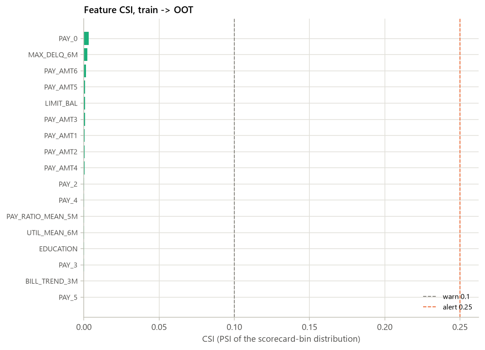

_图 6.2 入模特征 CSI（虚线 = 0.10 / 0.25）_

### CSI 分箱明细（train → OOT）

| 特征 | 分箱 | train 占比 | 对比样本占比 | PSI 贡献 |
|---|---|---|---|---|
| PAY_0 | <= -1.5 | 8.89% | 9.27% | 0.0002 |
| PAY_0 | (-1.5, 0.5] | 67.89% | 69.31% | 0.0003 |
| PAY_0 | (0.5, 1.5] | 12.70% | 10.93% | 0.0026 |
| PAY_0 | > 1.5 | 10.52% | 10.49% | 0.0000 |
| MAX_DELQ_6M | <= 0.5 | 65.87% | 68.04% | 0.0007 |
| MAX_DELQ_6M | (0.5, 1.5] | 5.82% | 5.11% | 0.0009 |
| MAX_DELQ_6M | > 1.5 | 28.31% | 26.84% | 0.0008 |
| PAY_2 | <= 1.5 | 85.06% | 85.71% | 0.0000 |
| PAY_2 | > 1.5 | 14.94% | 14.29% | 0.0003 |
| PAY_3 | <= -0.5 | 33.23% | 33.40% | 0.0000 |
| PAY_3 | (-0.5, 1.5] | 52.59% | 52.20% | 0.0000 |
| PAY_3 | > 1.5 | 14.18% | 14.40% | 0.0000 |
| PAY_4 | <= -0.5 | 33.45% | 33.69% | 0.0000 |
| PAY_4 | (-0.5, 0.5] | 54.66% | 54.87% | 0.0000 |
| PAY_4 | > 0.5 | 11.89% | 11.44% | 0.0002 |
| PAY_5 | <= -0.5 | 33.61% | 33.51% | 0.0000 |
| PAY_5 | (-0.5, 1] | 56.56% | 56.64% | 0.0000 |
| PAY_5 | > 1 | 9.83% | 9.84% | 0.0000 |
| PAY_RATIO_MEAN_5M | <= 0.03558 | 5.98% | 6.24% | 0.0001 |
| PAY_RATIO_MEAN_5M | (0.03558, 0.1587] | 45.68% | 45.58% | 0.0000 |
| PAY_RATIO_MEAN_5M | (0.1587, 0.8003] | 23.02% | 22.71% | 0.0000 |
| PAY_RATIO_MEAN_5M | > 0.8003 | 20.58% | 20.60% | 0.0000 |
| PAY_RATIO_MEAN_5M | Missing | 4.75% | 4.87% | 0.0000 |
| LIMIT_BAL | <= 45,000 | 14.46% | 14.73% | 0.0000 |
| LIMIT_BAL | (45,000, 75,000] | 16.43% | 16.71% | 0.0000 |
| LIMIT_BAL | (75,000, 145,000] | 20.34% | 20.36% | 0.0000 |
| LIMIT_BAL | (145,000, 365,000] | 40.58% | 39.49% | 0.0003 |
| LIMIT_BAL | > 365,000 | 8.18% | 8.71% | 0.0003 |
| PAY_AMT1 | <= 155.1 | 18.69% | 18.49% | 0.0000 |
| PAY_AMT1 | (155.1, 3,959] | 48.42% | 48.69% | 0.0000 |
| PAY_AMT1 | (3,959, 4,964] | 5.44% | 5.51% | 0.0000 |
| PAY_AMT1 | (4,964, 9,565] | 15.28% | 14.58% | 0.0003 |
| PAY_AMT1 | > 9,565 | 12.17% | 12.73% | 0.0003 |
| PAY_AMT2 | <= 143 | 19.21% | 19.51% | 0.0000 |
| PAY_AMT2 | (143, 1,613] | 21.64% | 21.76% | 0.0000 |
| PAY_AMT2 | (1,613, 4,953] | 32.76% | 32.87% | 0.0000 |
| PAY_AMT2 | (4,953, 15,242] | 20.27% | 19.42% | 0.0004 |
| PAY_AMT2 | > 15,242 | 6.12% | 6.44% | 0.0002 |
| PAY_AMT3 | <= 32.15 | 20.84% | 20.20% | 0.0002 |
| PAY_AMT3 | (32.15, 2,949] | 42.43% | 43.53% | 0.0003 |
| PAY_AMT3 | (2,949, 4,574] | 11.97% | 12.11% | 0.0000 |
| PAY_AMT3 | > 4,574 | 24.77% | 24.16% | 0.0002 |
| PAY_AMT4 | <= 5 | 21.85% | 21.11% | 0.0003 |
| PAY_AMT4 | (5, 2,014] | 37.51% | 38.44% | 0.0002 |
| PAY_AMT4 | (2,014, 4,050] | 15.97% | 15.69% | 0.0001 |
| PAY_AMT4 | > 4,050 | 24.66% | 24.76% | 0.0000 |
| PAY_AMT6 | <= 3 | 24.43% | 23.04% | 0.0008 |
| PAY_AMT6 | (3, 2,996] | 41.08% | 42.40% | 0.0004 |
| PAY_AMT6 | (2,996, 4,002] | 9.43% | 9.27% | 0.0000 |
| PAY_AMT6 | (4,002, 9,851] | 15.14% | 15.56% | 0.0001 |
| PAY_AMT6 | > 9,851 | 9.92% | 9.73% | 0.0000 |
| PAY_AMT5 | <= 5.5 | 22.89% | 22.04% | 0.0003 |
| PAY_AMT5 | (5.5, 1,970] | 31.28% | 32.38% | 0.0004 |
| PAY_AMT5 | (1,970, 4,050] | 21.13% | 20.64% | 0.0001 |
| PAY_AMT5 | (4,050, 13,108] | 18.51% | 18.76% | 0.0000 |
| PAY_AMT5 | > 13,108 | 6.19% | 6.18% | 0.0000 |
| UTIL_MEAN_6M | <= 0.5052 | 63.22% | 62.84% | 0.0000 |
| UTIL_MEAN_6M | (0.5052, 0.7975] | 19.54% | 19.42% | 0.0000 |
| UTIL_MEAN_6M | > 0.7975 | 17.24% | 17.73% | 0.0001 |
| BILL_TREND_3M | <= -0.02627 | 21.75% | 21.56% | 0.0000 |
| BILL_TREND_3M | (-0.02627, ~0] | 21.73% | 21.82% | 0.0000 |
| BILL_TREND_3M | > ~0 | 56.52% | 56.62% | 0.0000 |
| EDUCATION | {4, 1} | 37.02% | 37.13% | 0.0000 |
| EDUCATION | {2} | 46.68% | 46.24% | 0.0000 |
| EDUCATION | {3} | 16.30% | 16.62% | 0.0001 |

### 6.3 vintage

- **vintage 曲线**：数据不含 issue_date / event_date，无法绘制 vintage 曲线

## 7. 自动检查与风险提示

_对 leakage、单箱占比、train–test KS 差、PSI / CSI、高缺失率入模、系数符号与 VIF 的自动检查，并汇总 adapter 与建模警告。_

### 7.0 汇总

- **通过 / 警告 / 不通过 / 提示**：12 / 1 / 0 / 4
- **结论**：有警告项，需要人工判断

### 7.1 检查清单

| 检查项 | 范围 | 阈值 | 结果 | 判定 | 说明 |
|---|---|---|---|---|---|
| 样本 bad rate 在合理区间 | 数据 | 1%–40% | 22.12% | 🟢 通过 |  |
| IV 过高（疑似 leakage） | 模型 | IV > 0.5 | 4 个特征 | 🟡 警告 | 已入模：PAY_0, MAX_DELQ_6M, PAY_2。清单：PAY_0 0.849, DELQ_MONTHS_6M 0.843, MAX_DELQ_6M 0.743, PAY_2 0.535。adapter 说明：PAY_0 / PAY_2 及由还款状态派生的 DELQ_MONTHS_6M、MAX_DELQ_6M 的 IV 超过 0.5：它们是 2005 年 4–9 月的还款状态，标签是 10 月是否违约，时间上在前，不是贷后信息；IV 高是因为已经逾期的人更可能继续违约（已人工核对，保留）。 |
| 入模特征单一分箱占比过高 | 模型 | 最大箱占比 > 90% | 最大 85.1%（PAY_2） | 🟢 通过 |  |
| train–test KS 差（LR scorecard） | 模型 | KS(train) − KS(test) > 0.05 | 0.4176 − 0.4212 = -0.0036 | 🟢 通过 |  |
| train–test KS 差（GBDT challenger） | 模型 | KS(train) − KS(test) > 0.05 | 0.4582 − 0.4293 = +0.0289 | 🟢 通过 |  |
| test KS 高得不合理 | 模型 | KS > 0.9 | 0.4212 | 🟢 通过 |  |
| score PSI train → test | 模型 | PSI > 0.25 | 0.0028 | 🟢 通过 |  |
| score PSI train → OOT | 模型 | PSI > 0.25 | 0.0031 | 🟢 通过 |  |
| 入模特征 CSI（train → OOT） | 模型 | CSI > 0.25 | 0 / 17 个特征 | 🟢 通过 |  |
| 入模特征缺失率过高 | 模型 | train 缺失率 > 50% | 最高 4.8%（PAY_RATIO_MEAN_5M） | 🟢 通过 |  |
| LR 系数符号（WOE 越大越安全，系数应为负） | 模型 | 系数 > 0 | 0 / 17 个为正 | 🟢 通过 |  |
| 入模特征 VIF | 模型 | VIF > 5.0 | 最高 2.86（PAY_2） | 🟢 通过 |  |
| swap set：swap-in bad rate 低于 swap-out（OOT，基准 = 随机） | 模型 | swap-in > swap-out | 12.42% vs 45.89% | 🟢 通过 |  |
| 建模警告 | 模型 | — | — | ℹ️ 提示 | PAY_0: IV = 0.849 > 0.5，疑似 leakage，已保留但需人工确认 |
| 建模警告 | 模型 | — | — | ℹ️ 提示 | DELQ_MONTHS_6M: IV = 0.843 > 0.5，疑似 leakage，已保留但需人工确认 |
| 建模警告 | 模型 | — | — | ℹ️ 提示 | MAX_DELQ_6M: IV = 0.743 > 0.5，疑似 leakage，已保留但需人工确认 |
| 建模警告 | 模型 | — | — | ℹ️ 提示 | PAY_2: IV = 0.535 > 0.5，疑似 leakage，已保留但需人工确认 |

阈值来自 config `checks`；IV / 单箱占比 / 缺失率在 train 上计算，PSI / CSI 见第 6 节，KS 见第 3 节，swap set 见第 5 节。这些检查只提示风险，不会自动改模型。

## 附录：运行元数据

### 运行元数据

- **config**：configs\uci.yaml（hash f0649da10817）
- **数据文件**：data/raw/uci_default_of_credit_card_clients.csv；原始 30,000 行 → 样本 30,000 行
- **git commit**：ab257db
- **运行时间**：2026-10-19 02:51:23
- **总耗时**：2.9 s
- **版本**：python 3.13.2, credit-scorecard-pipeline 0.1.0, pandas 3.0.6, numpy 2.5.4, sklearn 1.9.1, toad 0.1.7, matplotlib 3.11.2
- **缓存**：未命中 / 未启用

### 各步骤耗时

| 步骤 | 秒 |
|---|---|
| load | 0.2 |
| split | 0.0 |
| profile | 0.1 |
| variants | 2.4 |
| strategy | 0.1 |
| monitor | 0.1 |
| checks | 0.0 |
| artifacts | 0.0 |
| variant.no_platform_rating.binning | 0.2 |
| variant.no_platform_rating.select_and_lr | 0.2 |
| variant.no_platform_rating.gbdt | 0.2 |
| variant.no_platform_rating.scoring | 0.2 |
| variant.no_platform_rating.cv_lr | 0.6 |
| variant.no_platform_rating.cv_gbdt | 1.0 |

<details><summary>完整 config</summary>

```yaml
dataset:
  adapter: uci
  path: data/raw/uci_default_of_credit_card_clients.csv
  nrows: null
  cache: true
  cache_dir: data/cache
  options:
    uci_id: 350
    exclude_protected:
    - SEX
    - MARRIAGE
    engineer_features: true
sample:
  min_issue_date: null
  max_issue_date: null
split:
  oot_months: 6
  oot_fraction: 0.15
  train_ratio: 0.7
  random_state: 42
features:
  use_platform_rating: false
  exclude: []
binning:
  backend: tree
  method: chi
  min_samples: 0.05
  max_bins: 5
  monotonic: true
  sample_size: 30000
  prebins: 200
select:
  max_missing: 0.5
  min_iv: 0.02
  leakage_iv: 0.5
  max_corr: 0.7
  max_vif: 5.0
  drop_positive_coef: true
  max_features: null
  max_time_csi: 0.25
model:
  lr_C: 1.0
  lr_max_iter: 1000
  cv_folds: 5
  cv_challenger: true
  gbdt:
    learning_rate: 0.05
    max_iter: 150
    max_leaf_nodes: 6
    min_samples_leaf: 200
    l2_regularization: 1.0
    early_stopping: false
scorecard:
  pdo: 20
  base_score: 600
  base_odds: 20
strategy:
  approval_rates:
  - 0.5
  - 0.6
  - 0.7
  - 0.8
  - 0.9
  score_bands: 10
  target_approval_rate: 0.7
  max_bad_rate: 0.1
  profit_min_approval_rate: 0.1
monitor:
  psi_bins: 10
  psi_warn: 0.1
  psi_alert: 0.25
  vintage_max_mob: 60
checks:
  leakage_iv: 0.5
  single_bin_share: 0.9
  ks_gap: 0.05
  psi_alert: 0.25
  missing_in_model: 0.5
report:
  title: UCI 信用卡违约评分卡报告
  top_missing: 20
  top_woe_plots: 8
  embed_figures: true
output:
  dir: outputs/uci
```

</details>

